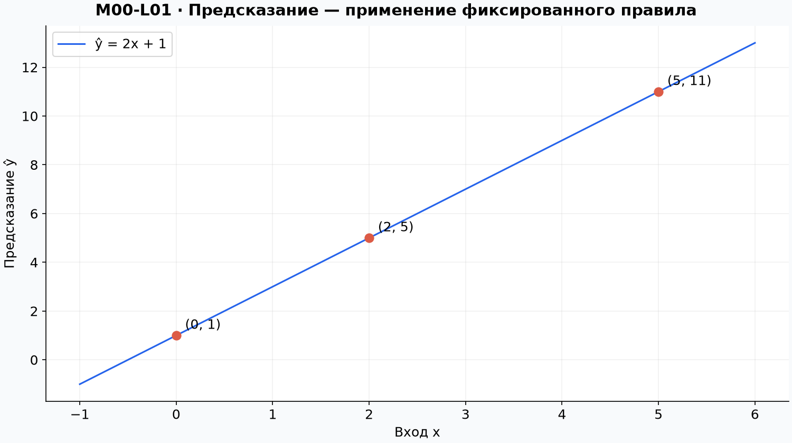

# M00-L01. От входа к предсказанию

**Результат:** Вычислить предсказание и отделить вход модели от результата.

**Перед началом:** Подстановка числа в формулу, сложение и умножение; опыт Python.

## Результат и входные знания

В backend-разработке ты привык связывать запрос с ответом функции. Модель начинается с того же понятного действия. Прежде чем обсуждать большие языковые модели, полезно увидеть маленькое вычисление целиком: какие сведения пришли, какое правило применилось и какое число получилось. Это позволяет потом находить ошибки без рассуждений о «магическом интеллекте».

## Проверь себя сначала

**Короткий путь для знакомой темы, 2–5 минут.** Модель ŷ = −2x + 5. Вычисли ŷ для x = 3 и x = −1. Что здесь входы, какие числа задают правило и что является результатом?

Запиши ответ и объяснение, затем сверь с [ключом M00-L01-D](../../solutions/modules/M00.md#m00-l01-d). Всё верно и объяснение совпадает по смыслу — переходи сразу к самостоятельной задаче этого урока, затем к варианту B/C. Ошибка, сомнение или ответ без объяснения — проходи урок полностью с начала. [Как работает адаптивный маршрут](../self-study.md#адаптивный-маршрут).

## Объяснение

Модель — правило преобразования входа в выход. В учебном примере вход x — одно число, а выход ŷ — другое. Значок над y удобно читать как «предсказанное значение». Правильный ответ, если он уже известен, будем обозначать y без значка. Эти две величины могут совпадать, но имеют разные роли: одну мы вычислили, другую получили из данных задачи.

Возьмём правило ŷ = 2x + 1. Сначала вход умножается на два, затем прибавляется единица. Для x = 3 это 2 × 3 + 1 = 7. Для x = 0 получится 1, а для x = −2 получится −3. Минус не создаёт особой трудности: действует та же последовательность. Функция не знает, как назвать вход «часами подготовки» или «числом запросов». Этот смысл задаёт инженер и обязан сохранять его при использовании.

Значение x меняется от объекта к объекту. Числа 2 и 1 пока фиксированы. Далее мы назовём их параметрами и научимся выбирать по примерам. Сейчас важно, что повторный вызов с другим x не изменяет само правило. Применение уже выбранной модели называется инференсом. Модель может быть простой формулой, деревом решений или сложной нейросетью; общая идея вычисления по входу остаётся.

Предсказание полезно только относительно конкретной задачи. Если выход означает балл собеседования, нужно знать допустимый диапазон, единицы и то, как получены настоящие баллы. Наша формула может выдать отрицательное число или значение выше максимума. Это не ошибка умножения: это ограничение выбранной модели. Искусственная линейная задача нужна, чтобы понять механизм, и не является готовой моделью оценки людей.



Точки на линии показывают отдельные вызовы одной функции. Переход от точки к точке меняет вход, но не наклон и не положение всей линии. Попробуй предсказать высоту точки до чтения её координат.

## Аналогия: чистая функция в backend

Как похоже: модель ведёт себя как чистая функция расчёта в сервисе, например `price(quantity) = 2 * quantity + 1`. Каждый вызов получает аргумент и возвращает результат, а код функции от вызова не меняется. Смысл аргумента — штуки или граммы — задаёт контракт API, а не сама формула.

| В уроке | В аналогии |
| --- | --- |
| Модель ŷ = 2x + 1 | Чистая функция без побочных эффектов |
| Вход x | Аргумент запроса |
| Предсказание ŷ | Ответ функции |
| Числа 2 и 1 | Константы в коде функции |
| Инференс | Вызов функции; код при этом не меняется |
| Смысл и единицы x | Контракт API: что именно передаёт клиент |

**Где аналогия ломается:** формулу цены программист пишет руками, и она верна по определению. Параметры модели позже подбираются по данным, а её ответ — оценка, которая может расходиться с настоящим y.

## Разобранный пример

Для входов 0, 2 и 5 выполняем три независимых подстановки: 1, 5 и 11. Если сохранять результаты в список, список становится состоянием приложения. Формула от этого не меняется. Код ниже специально не использует библиотеку машинного обучения: все операции видны.

```python
def predict(x):
    return 2 * x + 1

values = [predict(x) for x in [0, 2, 5]]
print(values)
assert values == [1, 5, 11]
```

**Ожидаемый результат:** Список [1, 5, 11]; проверка assert проходит.

## Как проверить рассуждение

Проверь размер результата: три входа должны дать три предсказания. Затем выбери один вход и посчитай ответ независимо от программы. Это две разные проверки. Верное количество результатов ещё не означает верную арифметику, а одно удачное число не проверяет обработку всего списка.

Отдельно спроси, что известно в момент вызова. Если желаемый балл уже передан как вход, задача предсказания может оказаться бессмысленной. На будущих данных правильный y обычно неизвестен; модель как раз пытается его оценить. Нельзя незаметно подставить ответ в признаки и затем объявить высокую точность.

## Практика с поддержкой

**Предскажи до запуска.** Прежде чем запускать код или пересчитывать пример, запиши ожидаемый вывод: числа, формы массивов, порядок или текст. После запуска сравни с фактическим и объясни каждое расхождение.

Измени список входов на [−1, 1, 4]. Сначала составь таблицу вход → умножение → прибавление → результат на бумаге. Затем сравни с Python. Убедись, что функция не читает результаты предыдущего вызова.

## Самостоятельная задача A — M00-L01-A01

Используй новую модель ŷ = 3x − 2. Вычисли ответы для x = −1, 0, 4. Напиши функцию и объясни, какие три значения являются входами, какие числа определяют правило и почему получение трёх ответов само по себе не является обучением.


## Подсказки по очереди

Начни с x = 0: умножение обнуляется, остаётся смещение. Для отрицательного x отдельно запиши произведение. В последнем вопросе проверь, менялись ли числа 3 и −2 по результатам сравнения с примерами.

## Критерии и типичные ошибки

Верно подставлен новый вход и названы параметры. Полный ответ сохранён до открытия ключа. Если потребовался разбор, проверь самостоятельность на варианте B. Все условия обязательны; оформление не компенсирует неверный механизм.

## Новая и отложенная проверка

**Вариант B:** Вычисли f(−1), если f(x)=−2x+4.

**Вариант C через 3–7 дней:** Вычисли f(6) для f(x)=0.5x−3.

[Отдельные ключи B/C](../../solutions/modules/M00.md). Сохрани попытку, ошибку и требуемую помощь в журнале.

## Карточка урока

| Поле | Содержание |
| --- | --- |
| Правило | ŷ = f(x); для линейной модели ŷ = w·x + b. Инференс — применение готового правила к новому входу, правило при этом не меняется |
| Смысл величин | x — вход, его смысл и единицы задаёт инженер; ŷ — предсказание; y — известный правильный ответ; w и b — числа, задающие правило |
| Когда применять | Всякий раз, когда нужно отделить вычисление ответа от подбора правила. Пример: ŷ = 2x + 1 при x = 3 даёт 7, повторный вызов с другим x правило не меняет |
| Главная ошибка | Считать вызов модели обучением или путать предсказание ŷ с правильным ответом y |

## Источники и углубление

[Ключи M00](../../solutions/modules/M00.md) · [Лабораторная модуля](../../labs/M00/README.md) · [Оглавление модуля](../modules/M00.md)

Основной дополнительный источник: [Google: введение в машинное обучение](https://developers.google.com/machine-learning/intro-to-ml). Собственных объяснений, данных и кода в уроке достаточно для обязательного задания; внешняя ссылка нужна для уточнений и углубления.

Второй источник на русском: [учебник по машинному обучению ШАД, глава «Машинное обучение»](https://education.yandex.ru/handbook/ml/article/mashinnoye-obucheniye) — вводная глава о задаче обучения по примерам.
