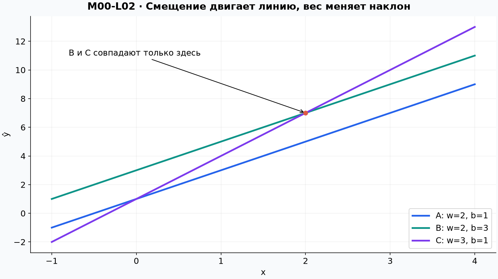

# M00-L02. Параметры и устройство модели

**Результат:** Отделить архитектуру, параметры и состояние приложения и сохранить параметры явно.

**Перед началом:** [M00-L01](M00-L01.md)

## Результат и входные знания

В реальном сервисе код, веса и история запросов меняются независимо. Если смешать эти сущности, легко объяснить новое поведение не той причиной или откатить только часть системы. На маленькой модели можно потренироваться различать их до появления файлов весом в гигабайты.

## Проверь себя сначала

**Короткий путь для знакомой темы, 2–5 минут.** Модель ŷ = w·x + b, w = 3, b = −2. Что здесь архитектура, а что параметры? Если изменить только b на 0, каким станет ответ при x = 2 (сравни с исходным)? Какие поля нужны в сохранённом файле параметров, чтобы его безопасно загрузить?

Запиши ответ и объяснение, затем сверь с [ключом M00-L02-D](../../solutions/modules/M00.md#m00-l02-d). Всё верно и объяснение совпадает по смыслу — переходи сразу к самостоятельной задаче этого урока, затем к варианту B/C. Ошибка, сомнение или ответ без объяснения — проходи урок полностью с начала. [Как работает адаптивный маршрут](../self-study.md#адаптивный-маршрут).

## Объяснение

Запишем линейную модель в общем виде: ŷ = wx + b. Буква w обозначает вес, то есть коэффициент при входе; b — смещение. Устройство вычисления «умножить и прибавить» — архитектура этой модели. Конкретные числа, подставленные вместо w и b, — её параметры. Параметры могут быть выбраны вручную или получены обучением; само число не содержит сведения о своём происхождении.

Изменение b на два сдвигает все предсказания вверх на два. Изменение w действует иначе: разница равна изменению веса, умноженному на x. Поэтому при положительном x ответ может увеличиться, при отрицательном уменьшиться, а при нуле не измениться. График помогает увидеть, что вес задаёт наклон, а смещение — значение при нулевом входе.

Архитектура тоже может измениться: например, вместо wx+b мы введём wx²+b. Даже при тех же числах w и b это уже другое правило. При чтении файла параметров нужно знать, какое вычисление ожидает эти значения. Поэтому релиз модели — не просто несколько чисел без названий. Он включает согласованное устройство, порядок признаков, преобразования и версию.

История запросов относится к состоянию приложения. Можно сохранить x и полученный ответ в базу, увеличить счётчик или записать время; параметры от этого не обязаны изменяться. Позже история может стать обучающими данными, но для обучения потребуется отдельная процедура. Путаница особенно заметна у чат-ботов: запоминание сообщений в приложении и изменение весов языковой модели — разные действия.



Сравни сначала параллельные линии: у них одинаковый вес. Затем найди линию с другим наклоном. Расстояние между параллельными линиями по вертикали постоянно, а эффект изменения веса зависит от входа.

## Аналогия: код, конфиг и база данных

Как похоже: архитектура модели — это код обработчика, параметры — значения в конфиге, а история запросов — строки в базе данных. Поменять значение в конфиге не то же самое, что переписать код, и ни то ни другое не происходит, когда сервис записывает запрос в базу.

| В уроке | В аналогии |
| --- | --- |
| Архитектура «умножить и прибавить» | Код обработчика |
| Параметры w и b | Значения в конфиге, которые читает код |
| Изменение b сдвигает все ответы | Новое значение в конфиге при том же коде |
| Замена wx + b на wx² + b | Новая версия кода, даже со старым конфигом |
| История запросов | Строки в базе данных приложения |
| Релиз модели | Версия кода, конфиг, схема входа и порядок полей вместе |

**Где аналогия ломается:** поле конфига человек задаёт и понимает по отдельности. У большой модели миллионы параметров, найденных оптимизацией, и смысл имеет только весь набор вместе с архитектурой — прочитать одно число как настройку нельзя.

## Разобранный пример

Для модели A параметры (w, b)=(2, 1), для B — (2, 3), для C — (3, 1). При x=2 получаем 5, 7, 7. Равенство двух отдельных ответов не означает равенства моделей: при x=0 B выдаст 3, а C — 1. Сохраним явные имена полей вместо безымянного списка.

```python
import json

artifact = {"architecture": "linear_v1", "w": 2.0, "b": 1.0, "version": "v1"}
restored = json.loads(json.dumps(artifact))
prediction = restored["w"] * 4 + restored["b"]
print(prediction, restored["version"])
assert prediction == 9.0
```

**Ожидаемый результат:** 9.0 v1; параметры восстановлены из JSON без изменения смысла.

## Как проверить рассуждение

При сравнении двух артефактов сначала спроси, одинаково ли понимаются их поля. Значение w=2 для признака в секундах не имеет того же смысла, что w=2 для признака в миллисекундах. Простое совпадение числа недостаточно. В будущих моделях к этой проблеме добавится порядок сотен признаков.

Сериализация сохраняет представление состояния; она не доказывает, что состояние правильно. Полезная минимальная проверка загрузки — воспроизвести заранее известный вход и ответ, а также проверить версию архитектуры. Если неизвестное поле тихо игнорируется, ошибочный релиз может выглядеть технически успешным.

## Практика с поддержкой

**Предскажи до запуска.** Прежде чем запускать код или пересчитывать пример, запиши ожидаемый вывод: числа, формы массивов, порядок или текст. После запуска сравни с фактическим и объясни каждое расхождение.

Для A, B и C вычисли ответы при x=−2, 0, 2. Запиши, где изменение смещения даёт одинаковую прибавку и где изменение веса меняет знак эффекта. Затем сохрани каждый словарь через json.dumps и восстанови.

## Самостоятельная задача A — M00-L02-A01

У модели w=−2, b=4. Сначала измени только b на 1, затем отдельно верни b=4 и измени только w на −1. Вычисли три версии при x=−2 и x=3. Предложи минимальный JSON-артефакт и назови информацию, без которой его использование опасно.


## Подсказки по очереди

Выпиши три пары параметров до вычислений, чтобы случайно не изменить оба числа сразу. Для артефакта проверь название архитектуры, версию, единицы входа и порядок признаков, даже если признак пока один.

## Критерии и типичные ошибки

Различены архитектура, параметры и вход вызова. Полный ответ сохранён до открытия ключа. Если потребовался разбор, проверь самостоятельность на варианте B. Все условия обязательны; оформление не компенсирует неверный механизм.

## Новая и отложенная проверка

**Вариант B:** При x=2 сравни w=2,b=1 и w=3,b=1. Что изменилось?

**Вариант C через 3–7 дней:** Добавлен документ в контекст, веса прежние. Это обучение?

[Отдельные ключи B/C](../../solutions/modules/M00.md). Сохрани попытку, ошибку и требуемую помощь в журнале.

## Карточка урока

| Поле | Содержание |
| --- | --- |
| Правило | Архитектура — вид вычисления (w·x + b), параметры — конкретные числа w и b, состояние приложения — данные вне модели, например история запросов |
| Смысл величин | w — наклон: при росте x на 1 ответ меняется на w; b — ответ при x = 0, его изменение сдвигает все ответы одинаково |
| Когда применять | При сохранении, загрузке и выпуске модели: релиз = архитектура + параметры + порядок признаков + подготовка входа + версия. Пример: b с 1 на 3 сдвигает все ответы на +2 |
| Главная ошибка | Сохранять параметры без архитектуры и версии или считать запись истории запросов изменением параметров |

## Источники и углубление

[Ключи M00](../../solutions/modules/M00.md) · [Лабораторная модуля](../../labs/M00/README.md) · [Оглавление модуля](../modules/M00.md)

Основной дополнительный источник: [Google: линейная регрессия](https://developers.google.com/machine-learning/crash-course/linear-regression). Собственных объяснений, данных и кода в уроке достаточно для обязательного задания; внешняя ссылка нужна для уточнений и углубления.
