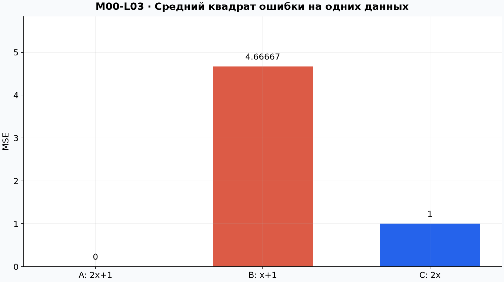

# M00-L03. Ошибка и подбор параметров

**Результат:** Вычислить среднюю квадратичную ошибку и выбрать настройку по одинаковым примерам.

**Перед началом:** [M00-L02](M00-L02.md)

## Результат и входные знания

Фраза «модель отвечает лучше» требует правила сравнения. Численная ошибка позволяет увидеть, как выбранные параметры связаны с результатом. Одновременно важно понимать, что любое число измеряет только определённую сторону качества и само по себе не гарантирует полезность продукта.

## Проверь себя сначала

**Короткий путь для знакомой темы, 2–5 минут.** x = [0, 1, 3], y = [1, 3, 6]. Сравни по MSE варианты A: ŷ = 2x + 1 и B: ŷ = x + 2 и выбери один.

Запиши ответ и объяснение, затем сверь с [ключом M00-L03-D](../../solutions/modules/M00.md#m00-l03-d). Всё верно и объяснение совпадает по смыслу — переходи сразу к самостоятельной задаче этого урока, затем к варианту B/C. Ошибка, сомнение или ответ без объяснения — проходи урок полностью с начала. [Как работает адаптивный маршрут](../self-study.md#адаптивный-маршрут).

## Объяснение

Для каждого учебного объекта известны вход x и целевой ответ y. Модель выдаёт ŷ. Остаток e = ŷ−y показывает отклонение: положительный остаток означает завышение, отрицательный — занижение. Если просто усреднить остатки, ошибки разных знаков могут погасить друг друга. Например, −2 и 2 имеют среднее ноль, хотя оба предсказания ошибочны.

Средняя квадратичная ошибка, MSE, вычисляется как сумма квадратов остатков, делённая на число объектов: MSE = (e₁²+…+eₙ²)/n. Квадраты неотрицательны и сильнее увеличивают вклад больших отклонений. При n=0 среднее не определено; пустой набор нельзя трактовать как идеальное качество. Размерность MSE равна квадрату единиц целевого значения: если цель измеряется в секундах, ошибка выражена в секундах в квадрате.

Чтобы сравнение было честным, кандидаты должны оцениваться на одних и тех же объектах по одному правилу. Затем можно выбрать параметры с меньшей ошибкой на обучающих примерах. Такой конечный перебор — уже простой алгоритм обучения. Никакой нейросети для этого не требуется. Архитектура остаётся прежней, а конкретные числа выбираются по данным.

Однако выбор по тем же примерам, на которых показывается результат, ещё не проверяет обобщение. Можно подобрать правило, которое хорошо воспроизводит известные ответы и плохо работает на новых. Позже мы отделим обучение, выбор настроек и окончательную проверку. Уже сейчас полезно формулировать вывод точно: «у A меньше MSE на этой таблице», а не «A всегда надёжнее».



Высота столбца — средняя ошибка, а не отдельный ответ. Нулевой столбец означает совпадение с этой искусственной таблицей. Он не показывает, что случится с другой зависимостью или шумом.

## Аналогия: оценка времени задачи по журналу очереди

Как похоже: сервис очереди оценивает, сколько будет выполняться задача (ETA), и две формулы оценки сравнивают на одном журнале прошлых задач. Для каждой задачи считают промах «оценка минус факт»; большие промахи болезненнее, поэтому их возводят в квадрат и усредняют.

| В уроке | В аналогии |
| --- | --- |
| Объект с известным y | Задача из журнала с фактической длительностью |
| Вход x | Размер задачи |
| Предсказание ŷ | Оценка длительности (ETA) |
| Остаток e = ŷ − y | Промах оценки: плюс — завышение, минус — занижение |
| MSE | Средний квадрат промаха по журналу |
| Сравнение кандидатов на одних объектах | Обе формулы проверяются на одном и том же журнале |

**Где аналогия ломается:** в нагрузочном тесте ту же нагрузку можно воспроизвести снова. Модель встретит новые данные с другим распределением, и малая MSE на той же таблице, где подбирали параметры, ничего не гарантирует для них. К тому же «секунды в квадрате» не так наглядны, как p95 задержки.

## Разобранный пример

Даны x=[1, 2, 3], y=[3, 5, 7]. Для A=(2, 1) предсказания точны. Для B=(1, 1) остатки равны [−1, −2, −3], квадраты [1, 4, 9], MSE=14/3. Для C=(2, 0) каждый остаток равен −1, поэтому MSE=1.

```python
def mse(y, pred):
    if len(y) == 0 or len(y) != len(pred):
        raise ValueError("Nonempty equally sized lists required")
    return sum((p-t)**2 for t,p in zip(y,pred)) / len(y)

x, y = [1,2,3], [3,5,7]
scores = {str((w,b)): mse(y,[w*v+b for v in x]) for w,b in [(2,1),(1,1),(2,0)]}
print(scores)
assert scores['(2, 1)'] == 0 and scores['(2, 0)'] == 1
```

**Ожидаемый результат:** Ошибки 0, примерно 4.6667 и 1; лучший кандидат на этой таблице — (2, 1).

## Как проверить рассуждение

Проверь порядок операций: сначала разность, затем квадрат каждой разности, потом среднее. Квадрат уже усреднённой ошибки — другая величина. На примере остатков [−2, 2] она даст ноль, тогда как MSE равна 4. Такой контрольный случай полезнее проверки только на идеальных предсказаниях.

Подумай также о цели продукта. За одинаковую MSE могут отвечать разные распределения ошибок: много небольших отклонений или один очень крупный промах. Для тренажёра собеседований нужны отдельные рубрики содержания, а не механический перенос MSE на произвольный текст. Метрику выбирают из задачи, а не из привычки к библиотечной функции.

## Практика с поддержкой

**Предскажи до запуска.** Прежде чем запускать код или пересчитывать пример, запиши ожидаемый вывод: числа, формы массивов, порядок или текст. После запуска сравни с фактическим и объясни каждое расхождение.

Добавь кандидат (w, b)=(3, 0). Посчитай по строкам и выведи таблицу остатков. Затем проверь функцию на одинаковых ответах, на одном объекте и на противоположных по знаку ошибках.

## Самостоятельная задача A — M00-L03-A01

Для x=[0, 1, 2], y=[2, 4, 6] сравни A=(2, 1) и B=(1, 2). Найди MSE обоих, выбери вариант по этой таблице и напиши одно допустимое и одно недопустимое заключение о качестве.


## Подсказки по очереди

Сначала выпиши два списка предсказаний. Число объектов равно трём, даже если один остаток нулевой. Для вывода отдели наблюдавшуюся таблицу от неизвестных будущих данных.

## Критерии и типичные ошибки

Посчитаны отдельные квадраты ошибок до среднего. Полный ответ сохранён до открытия ключа. Если потребовался разбор, проверь самостоятельность на варианте B. Все условия обязательны; оформление не компенсирует неверный механизм.

## Новая и отложенная проверка

**Вариант B:** Для y=[0,2], p=[1,1] сравни MSE и квадрат среднего остатка.

**Вариант C через 3–7 дней:** Для y=[1,4], p=[1,1] вычисли MSE.

[Отдельные ключи B/C](../../solutions/modules/M00.md). Сохрани попытку, ошибку и требуемую помощь в журнале.

## Карточка урока

| Поле | Содержание |
| --- | --- |
| Правило | MSE = (e₁² + … + eₙ²)/n, где eᵢ = ŷᵢ − yᵢ; кандидатов сравнивают на одних и тех же объектах по одному правилу |
| Смысл величин | eᵢ — остаток (плюс — завышение, минус — занижение); квадрат усиливает большие промахи; n — число объектов, при n = 0 ошибка не определена; единицы MSE — квадрат единиц y |
| Когда применять | При выборе параметров по таблице с известными ответами. Пример: остатки [1, −1, 2] дают MSE = (1 + 1 + 4)/3 = 2 |
| Главная ошибка | Усреднять остатки без квадрата, так что ошибки разных знаков гасят друг друга, или выдавать меньшую MSE на обучающей таблице за качество на новых данных |

## Источники и углубление

[Ключи M00](../../solutions/modules/M00.md) · [Лабораторная модуля](../../labs/M00/README.md) · [Оглавление модуля](../modules/M00.md)

Основной дополнительный источник: [Google: функция потерь линейной регрессии](https://developers.google.com/machine-learning/crash-course/linear-regression/loss). Собственных объяснений, данных и кода в уроке достаточно для обязательного задания; внешняя ссылка нужна для уточнений и углубления.

Второй источник: [scikit-learn: mean_squared_error](https://scikit-learn.org/stable/modules/generated/sklearn.metrics.mean_squared_error.html) — библиотечная функция MSE; сверь её результат со своим расчётом по строкам.
