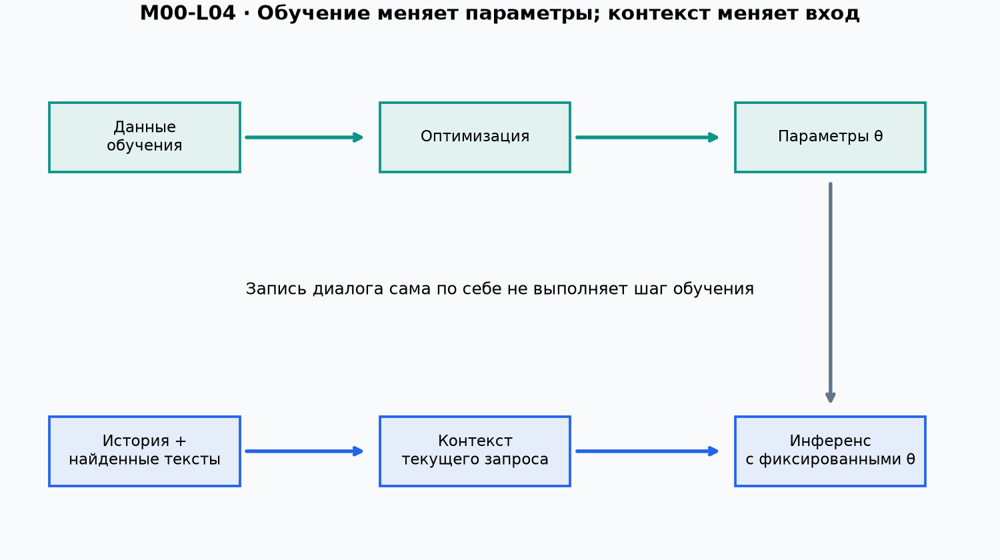

# M00-L04. Обучение и применение

**Результат:** Классифицировать изменения весов, контекста и состояния приложения.

**Перед началом:** [M00-L03](M00-L03.md)

## Результат и входные знания

В проекте AI-интервьюера будут одновременно меняться сообщения, документы, сохранённая история и параметры моделей. Понимание этих разных изменений позволяет выбирать правильное исправление: добавить нужный контекст, обновить поиск, изменить сценарий или действительно обучить модель.

## Проверь себя сначала

**Короткий путь для знакомой темы, 2–5 минут.** Для каждого изменения назови, что изменилось — веса, контекст запроса, состояние приложения или индекс, — и как это проверить. (1) Пользователь включил «короткие ответы», и приложение добавляет это требование в инструкцию каждого запроса. (2) Базу вопросов переиндексировали. (3) Модель дообучили на 500 примерах.

Запиши ответ и объяснение, затем сверь с [ключом M00-L04-D](../../solutions/modules/M00.md#m00-l04-d). Всё верно и объяснение совпадает по смыслу — переходи сразу к самостоятельной задаче этого урока, затем к варианту B/C. Ошибка, сомнение или ответ без объяснения — проходи урок полностью с начала. [Как работает адаптивный маршрут](../self-study.md#адаптивный-маршрут).

## Объяснение

Обучение — процедура выбора параметров или обучаемой структуры по данным относительно выбранной цели. Инференс — применение выбранной модели к входу. Эти действия можно выполнять в одном приложении, но их роли различаются. Наличие слова «AI» в интерфейсе не определяет, какой процесс сейчас происходит.

В чат-системе входом языковой модели служит последовательность токенов: единиц текста, определяемых токенизатором. Контекстом называют содержимое конкретного вызова — инструкции, переданные сообщения, найденные фрагменты и другие допустимые данные. История, сохранённая в базе приложения, не становится контекстом автоматически. Приложение должно выбрать и передать нужные части, причём существует ограничение длины.

RAG соединяет поиск информации с генерацией ответа. Система ищет фрагменты во внешнем корпусе, включает их в контекст и вызывает модель. Добавление новой методички в корпус обычно меняет документы или поисковый индекс; оно не меняет веса генератора. Если документ не найден или не передан, его наличие на диске не гарантирует использования в ответе.

Дообучение изменяет обучаемые параметры. Иногда изменяются все веса, иногда только дополнительные адаптеры при замороженной базовой модели. Поэтому неверно говорить, что обучение обязательно должно менять каждое число. Верный вопрос — выполнялась ли процедура оптимизации обучаемых параметров по примерам и цели.

Эти понятия не являются взаимоисключающими названиями всего продукта. Один тренажёр может хранить историю, применять RAG, запускать инференс и периодически дообучаться отдельным процессом. Для диагностики нужно прослеживать конкретное действие и конкретный артефакт, который оно изменяет.



На схеме история и документы входят в подготовку запроса, а обучение имеет отдельный путь к параметрам. Проверь, через какую стрелку новый документ сможет повлиять на ответ; простое сохранение файла ещё не завершает путь.

## Аналогия: собранный сервис, тело запроса и поисковый индекс

Как похоже: веса модели похожи на собранный бинарник сервиса — они меняются только новой сборкой, то есть обучением. Контекст — это тело конкретного запроса. История чата в базе и документы в поисковом индексе попадают в ответ, только если обработчик сам выберет их и положит в запрос.

| В уроке | В аналогии |
| --- | --- |
| Веса модели | Собранный бинарник сервиса |
| Обучение или дообучение | Новая сборка; адаптер — подключаемый модуль без пересборки ядра |
| Контекст вызова | Тело конкретного запроса |
| История в базе приложения | Строки в базе: в запрос попадают, только если их выбрали |
| RAG-индекс | Поисковый индекс: новый документ нужно проиндексировать и найти |
| Ограничение длины контекста | Лимит размера тела запроса |

**Где аналогия ломается:** бинарник собран из читаемого кода и ведёт себя детерминированно. Веса найдены оптимизацией, их нельзя прочитать как исходник, а модель может проигнорировать часть переданного контекста — сервис так с полями запроса не поступает.

## Разобранный пример

Возьмём искусственный генератор, который просто возвращает входную строку. Это не LLM, а прозрачная модель границы приложения. Добавление фрагмента меняет вход, хотя словарь параметров остаётся прежним. Такой пример позволяет проверить архитектурное утверждение без скачивания весов.

```python
weights = {"version": "fixed-v1"}
history = ["Объясни индекс SQL"]
document = "Индекс ускоряет некоторые чтения и требует обновления при записи."
context = "\n".join(history + [document])
before = weights.copy()
print(context)
assert weights == before and document in context
```

**Ожидаемый результат:** В контексте две строки; сохранённый словарь параметров не изменён. Код не имитирует качество языковой модели.

## Как проверить рассуждение

Разбирая ошибку «бот забыл ответ», начни с наблюдаемых данных. Была ли нужная реплика сохранена? Выбрана ли при подготовке вызова? Поместилась ли в ограничение? Передана ли модели? Только после этих проверок имеет смысл обсуждать способность модели использовать информацию. Иначе дообучение пытается исправить отсутствие входа.

Если технический ответ устарел, аналогично проверь версию документа, индекс и найденный фрагмент. Результат поиска и результат генерации оцениваются отдельно. Верный документ в корпусе не доказывает верный поиск, а верный поиск не гарантирует корректный пересказ.

## Практика с поддержкой

**Предскажи до запуска.** Прежде чем запускать код или пересчитывать пример, запиши ожидаемый вывод: числа, формы массивов, порядок или текст. После запуска сравни с фактическим и объясни каждое расхождение.

Нарисуй три карточки: параметры, состояние сессии, документы. Разложи действия «новое сообщение», «сохранить переписку», «обновить индекс», «выполнить шаг оптимизации». Отдельно пометь, какие действия изменят следующий вход.

## Самостоятельная задача A — M00-L04-A01

Опиши четыре случая: добавили резюме истории в запрос; записали новую методичку, но индекс не обновили; обучили только адаптер; изменили системную инструкцию. Для каждого назови изменённый объект и проверку, которая подтвердит твоё объяснение.


## Подсказки по очереди

Сравни до и после содержимое запроса, версии индекса и контрольную сумму параметров. Не подменяй наблюдение словами «бот теперь знает». Для адаптера назови отдельно базовые веса и дополнительные обучаемые числа.

## Критерии и типичные ошибки

Назван конкретный изменённый объект и эффект на вызов. Полный ответ сохранён до открытия ключа. Если потребовался разбор, проверь самостоятельность на варианте B. Все условия обязательны; оформление не компенсирует неверный механизм.

## Новая и отложенная проверка

**Вариант B:** Сервис передал прежней модели предыдущие сообщения. Какой объект изменён?

**Вариант C через 3–7 дней:** Файл добавлен в папку, но retrieval и prompt прежние. Обязательно ли изменится ответ?

[Отдельные ключи B/C](../../solutions/modules/M00.md). Сохрани попытку, ошибку и требуемую помощь в журнале.

## Карточка урока

| Поле | Содержание |
| --- | --- |
| Правило | Обучение меняет обучаемые параметры по данным и цели; инференс применяет модель; контекст — содержимое одного вызова; история и индекс — данные приложения |
| Смысл величин | Веса — обучаемые параметры (все или только адаптер); контекст — токены конкретного запроса; RAG-индекс — корпус, из которого ищут фрагменты для контекста |
| Когда применять | При разборе вопроса «почему ответ изменился или не изменился»: проследи, какой артефакт поменяло действие — веса, контекст, историю или индекс |
| Главная ошибка | Считать, что сохранённая история или новый документ в корпусе меняют веса модели или сами попадают в контекст |

## Источники и углубление

[Ключи M00](../../solutions/modules/M00.md) · [Лабораторная модуля](../../labs/M00/README.md) · [Оглавление модуля](../modules/M00.md)

Основной дополнительный источник: [Google: введение в большие языковые модели](https://developers.google.com/machine-learning/crash-course/llm). Собственных объяснений, данных и кода в уроке достаточно для обязательного задания; внешняя ссылка нужна для уточнений и углубления.
