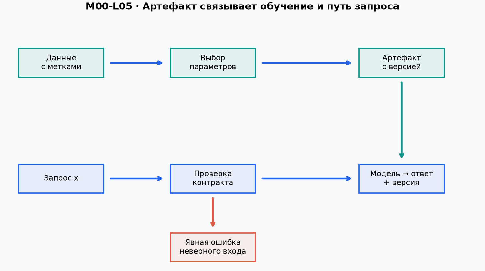

# M00-L05. Первая схема ML-сервиса

**Результат:** Спроектировать минимальный путь запроса к модели и показать один отказ и откат.

**Перед началом:** [M00-L03](M00-L03.md)

## Зачем это инженеру

Системный дизайн начинается раньше сложной инфраструктуры. Даже функция с двумя параметрами требует входного контракта, загрузки согласованной версии и обработки ошибок. Эти решения позже сохранятся в LLM-системе, где к ним добавятся поиск, голос и ограничения вычислений.

## Объяснение

Разделим систему на контур подготовки модели и контур запроса. В первом примеры проверяются, параметры выбираются, результат оценивается и сохраняется как артефакт. Во втором приложение получает новый вход, проверяет контракт, загружает подходящую версию, вычисляет ответ и возвращает его. Запрос не должен случайно запускать повторное обучение.

Контракт описывает не только название поля. Нужно определить тип, допустимые значения, единицы измерения и смысл результата. Для нашего примера поле x — конечное числовое значение. Строка «4» не принимается автоматически: неявное преобразование иногда скрывает ошибку отправителя. В Python bool является подклассом int, поэтому его нужно исключить явно, если логическое значение не считается числовым признаком задачи.

Артефакт модели включает параметры и версию. Если перед моделью применяется преобразование, например центрирование, оно тоже входит в согласованный набор. Откат означает вернуть эту совместимую комбинацию, а не только один файл. Сервис может продолжать отвечать без исключений и при этом выдавать неверные числа из-за несовпадения преобразования и весов.

Наблюдаемость означает возможность увидеть важные события и отличить типы отказов. Для первого сервиса достаточно счётчика неверных запросов, времени обработки и версии модели в ответе. Для качества нужно получать настоящие целевые значения или ручную проверку; низкая задержка не доказывает правильность предсказаний.

Не добавляй очередь, кластер или распределённое хранилище без требования, которое они решают. Сначала нарисуй простую последовательность и проверь её на конкретных случаях. Если один пользователь получает один численный ответ, локальная функция с явным контрактом лучше объясняет архитектуру, чем схема из десяти необоснованных сервисов.



У каждой стрелки должно быть название передаваемых данных. Обрати внимание: журнал запроса находится рядом с инференсом, но не возвращает параметры обратно в обучение при каждом вызове.

## Разобранный пример

Версия v1 использует w=2, b=1 и отвечает 9 на x=4. Версия v2 использует w=3, b=2 и отвечает 14. Если версия v2 вызывает ухудшение на проверочных данных, откат возвращает v1 целиком. Проверка входа происходит до умножения.

```python
import math

def handle(payload, model):
    x = payload.get("x")
    if type(x) not in (int, float) or not math.isfinite(x):
        raise ValueError("x must be a finite number")
    return {"prediction": model["w"]*x+model["b"], "model_version": model["version"]}

v1 = {"w":2, "b":1, "version":"v1"}
assert handle({"x":4},v1) == {"prediction":9,"model_version":"v1"}
print(handle({"x":4},v1))
```

**Ожидаемый результат:** Словарь prediction=9, model_version=v1; некорректный вход должен отклоняться до вычисления.

## Как проверить рассуждение

Пройди схему глазами пользователя: какое действие он совершает и какой результат видит? Затем пройди её глазами оператора: какой сигнал отличит ошибку входа от отсутствующего артефакта? Эти два просмотра выявляют разные пробелы. Название блока «мониторинг» без сигнала и реакции ещё ничего не объясняет.

Минимальная проверка релиза содержит известный корректный запрос, неверный запрос, подтверждение версии и сценарий возврата. Для будущего интервьюера появятся проверки завершения сессии и качества обратной связи, но принцип останется: каждому требованию нужен наблюдаемый пример поведения.

## Практика с поддержкой

Вызови обработчик со строкой, отсутствующим x, NaN и bool. Для каждого случая запиши ожидаемое исключение. Затем замени версию артефакта и проверь, что ответ сообщает актуальную версию.

## Самостоятельная задача M00-L05-A01

Спроектируй v3 с формулой ŷ=4(x−2)+1, где центрирование x−2 сохранено отдельно от веса. Вычисли ответ для x=5. Опиши, какой результат даст ошибочная загрузка веса v3 вместе с отсутствующим центрированием. Покажи полный состав отката.

Сначала сохрани собственные расчёты и объяснение в submissions. Не открывай ключ до первой попытки. Важно показать промежуточные значения: по ним можно понять, где именно расходятся смысл и реализация. Разрешено пользоваться калькулятором и документацией синтаксиса; полученную содержательную подсказку отметь отдельно. После просмотра готового решения самостоятельность проверяется новым примером, а не повторным переписыванием тех же строк.

## Подсказки

Сначала вычисли преобразованный вход z. Затем подставь z в модель. Для ошибочного случая подставь исходный x. В артефакте должны быть обе согласованные части, а не только вес.

## Ошибки и критерии самопроверки

Разделены подготовка, запрос и артефакт; обработка неверных входов явная. Критическая ошибка — считать отсутствие исключения подтверждением корректности релиза или откатывать несогласованную часть.

При несовпадении ответа с эталоном сначала классифицируй ошибку: неверно понято условие, перепутаны величины, допущена арифметическая ошибка или нарушено правило эксперимента. Проверка кода не заменяет объяснение. Если вывод сильнее имеющихся данных, перепиши именно вывод, а затем реши, какие дополнительные наблюдения нужны. Хорошее оформление не компенсирует критическую ошибку.

## Повторная и отложенная проверка

Добавь новое требование: модель временно недоступна. Опиши допустимый ответ пользователю, измеримый сигнал и способ восстановления. В M06 вернись к этому решению с ограничением задержки и нагрузкой.

Через несколько других занятий вернись к этому действию без открытого конспекта. Сохрани новый ответ и сравни способ рассуждения, а не только последнее число. В [журнале](../../progress/progress.md) отделяй самостоятельную попытку, результат с подсказкой и внешнюю проверку, если она действительно была.

## Решение и дополнительные материалы

[Ключи M00](../../solutions/modules/M00.md) · [Лабораторная модуля](../../labs/M00/README.md) · [Оглавление модуля](../modules/M00.md)

Основной дополнительный источник: [Google: системы машинного обучения в продукте](https://developers.google.com/machine-learning/crash-course/production-ml-systems). Собственных объяснений, данных и кода в уроке достаточно для обязательного задания; внешняя ссылка нужна для уточнений и углубления.
