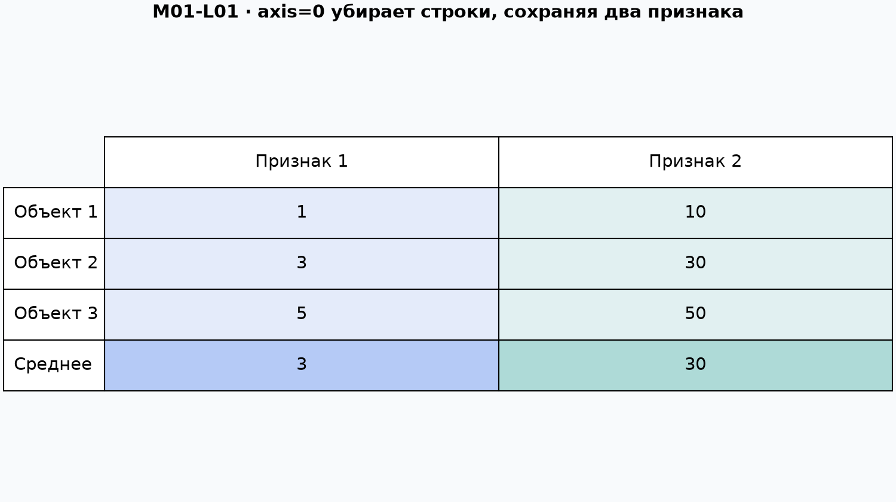

# M01-L01. Массивы и формы

**Результат:** Выбрать форму массива по смыслу данных и вычислить среднее по нужной оси.

**Перед началом:** [M00-L01](M00-L01.md)

## Зачем это инженеру

В таблице интервью строки могут обозначать сессии, а столбцы — длительность, число вопросов и длину ответа. Модель получает числа, но библиотека не знает, какой смысл ты назначил каждой оси. Ошибка формы иногда вызывает исключение, а иногда незаметно превращает нужную операцию в совсем другую. Поэтому форма является частью контракта данных.

## Объяснение

Массив NumPy — однородная структура: элементы имеют общий dtype, а положение элемента задаётся индексами. У массива shape=(3, 2) три строки и два столбца. В принятом здесь соглашении строка соответствует объекту, столбец — признаку. Это соглашение, а не закон NumPy. В другом приложении оси могут означать время, канал или координату изображения.

Массив формы (3, ) имеет одну ось. Формы (3, 1) и (1, 3) имеют две оси и означают столбец и строку. Значения похожи, но правила совместных вычислений различаются. Индекс X[:, 0] выбирает первый признак всех объектов и обычно возвращает одномерный массив. Срез X[:, 0:1] сохраняет вторую ось. Перед операцией полезно выписать ожидаемую форму результата словами.

Сокращение по axis=0 убирает ось строк: mean(axis=0) возвращает среднее каждого признака по объектам. Сокращение по axis=1 убирает столбцы и усредняет признаки внутри объекта. Если признаки имеют разные единицы, последнее среднее может быть математически вычислимым, но бессмысленным. Нельзя интерпретировать среднее между секундами и количеством вопросов как физическую величину.

Broadcasting позволяет согласовать размеры при поэлементных операциях: размеры сравниваются справа налево, каждая пара должна совпадать или содержать единицу. При вычитании вектора формы (2, ) из матрицы (3, 2) вектор используется для каждой строки. При сложении форм (3, 1) и (3, ) получится матрица (3, 3). Это особенно опасно при вычислении ошибки модели: вместо трёх остатков можно получить девять попарных разностей.

Тип также влияет на результат. Целочисленный массив не может хранить дробные значения без преобразования типа. Для учебных вычислений используй dtype=float, а входные идентификаторы не превращай в вещественные признаки только потому, что они записаны цифрами. Изменение формы через reshape не узнаёт семантику и не заменяет правильную группировку данных.



На рисунке цвет связывает каждый столбец со своим средним. Читай сначала подписи осей, затем направление агрегации. Массив средних содержит два числа, потому что сохраняются два признака.

## Разобранный пример

Для X=[[1, 10], [3, 30], [5, 50]] средние столбцов равны [3, 30]. Центрирование вычитает эти числа из каждой строки: [[−2, −20], [0, 0], [2, 20]]. Новые средние столбцов равны нулю. При этом строки по-прежнему обозначают те же три объекта.

```python
import numpy as np
X = np.array([[1, 10], [3, 30], [5, 50]], dtype=float)
means = X.mean(axis=0)
centered = X - means
print(X.shape, means.tolist(), centered.tolist())
assert centered.shape == (3, 2)
assert np.allclose(centered.mean(axis=0), 0)
```

**Ожидаемый результат:** (3, 2), [3.0, 30.0] и строки центрированной матрицы из примера.

## Как проверить рассуждение

Проверь центрирование двумя способами: выпиши второй столбец вручную и затем вычисли среднее результата. Нулевое среднее само по себе не доказывает правильность порядка столбцов: можно перепутать признаки и всё равно получить нули. Поэтому дополнительно зафиксируй названия и единицы. Проверка формы перед вычислением MSE должна требовать одинаковые формы y и prediction, а не полагаться на broadcasting. Для маленького примера сравни каждую строку с ручной арифметикой.

## Практика с поддержкой

Добавь четвёртую строку [7, 70], заранее предскажи новые средние. Затем сравни X[:, 0].shape и X[:, 0:1].shape. Объясни, почему значения совпадают, но результат вычитания массива другой формы может отличаться.

## Самостоятельная задача M01-L01-A01

Дана матрица [[2, 20], [4, 40], [6, 60], [8, 80]]. Найди средние столбцов и центрированную матрицу. Для y формы (4, ) и prediction формы (4, 1) укажи форму прямого вычитания и предложи явное исправление. Не вычисляй ошибку на ошибочной форме.

Сначала сохрани собственные расчёты и объяснение в submissions. Не открывай ключ до первой попытки. Важно показать промежуточные значения: по ним можно понять, где именно расходятся смысл и реализация. Разрешено пользоваться калькулятором и документацией синтаксиса; полученную содержательную подсказку отметь отдельно. После просмотра готового решения самостоятельность проверяется новым примером, а не повторным переписыванием тех же строк.

## Подсказки

1. Сложи отдельно первый и второй столбец и раздели на четыре.
2. Для broadcasting мысленно допиши слева единицу к форме (4, ).
3. Если целевой контракт одномерный, используй prediction.reshape(-1) и проверь равенство shapes.

## Ошибки и критерии самопроверки

Средние [5, 50], сохранены четыре строки и два столбца; объяснена разница формы и значений. Критическая ошибка — принять матрицу из шестнадцати разностей за четыре ошибки предсказаний. Исправление не должно случайно менять порядок объектов.

При несовпадении ответа с эталоном сначала классифицируй ошибку: неверно понято условие, перепутаны величины, допущена арифметическая ошибка или нарушено правило эксперимента. Проверка кода не заменяет объяснение. Если вывод сильнее имеющихся данных, перепиши именно вывод, а затем реши, какие дополнительные наблюдения нужны. Хорошее оформление не компенсирует критическую ошибку.

## Повторная и отложенная проверка

На следующем занятии повтори для матрицы [[1, 2, 3], [3, 4, 5]], назови формы средних по обеим осям. Позже без кода объясни, почему массив формы (n, ) не всегда взаимозаменяем со столбцом (n, 1).

Через несколько других занятий вернись к этому действию без открытого конспекта. Сохрани новый ответ и сравни способ рассуждения, а не только последнее число. В [журнале](../../progress/progress.md) отделяй самостоятельную попытку, результат с подсказкой и внешнюю проверку, если она действительно была.

## Решение и дополнительные материалы

[Ключи M01](../../solutions/modules/M01.md) · [Лабораторная модуля](../../labs/M01/README.md) · [Оглавление модуля](../modules/M01.md)

Основной дополнительный источник: [NumPy: основы массивов](https://numpy.org/doc/stable/user/absolute_beginners.html). Собственных объяснений, данных и кода в уроке достаточно для обязательного задания; внешняя ссылка нужна для уточнений и углубления.
