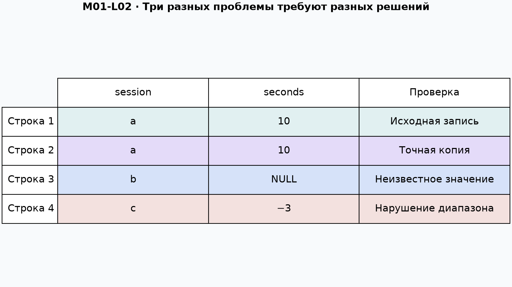

# M01-L02. Качество таблицы

**Результат:** Найти пропуски, дубликаты и несоответствие единицы наблюдения до обучения.

**Перед началом:** [M00-L01](M00-L01.md)

## Зачем это инженеру

Модель может успешно обучиться на испорченной таблице. Например, повторная загрузка логов удвоит вес одной сессии, а пропущенная длительность превратится в ноль и станет ложным сигналом. Проверка данных начинается с вопроса, что именно означает одна строка, а не с вызова fit.

## Объяснение

Единица наблюдения — сущность, которую представляет строка: пользователь, сессия, вопрос или отдельное сообщение. Таблица уровня сообщений не превращается в таблицу уровня пользователей после переименования столбца. Если задача предсказывает результат сессии, сначала нужно определить, какие сообщения относятся к ней и какие из них доступны в момент предсказания.

Первичный ключ — набор полей, который должен уникально идентифицировать наблюдение. Для таблицы ответов это может быть пара session_id и question_id. Проверка уникальности пары сильнее, чем удаление полностью одинаковых строк. Две строки с одним ключом и разными ответами — конфликт, который нельзя безопасно разрешить произвольным keep=first.

Пропуск означает отсутствие значения. Он не равен нулю: нулевая длительность наблюдалась как ноль, а неизвестная длительность не наблюдалась. Причина пропуска тоже важна. Если микрофон не работал только на старых устройствах, пропуски связаны с условиями эксплуатации. Заполнение средним не устраняет эту разницу и может скрыть сбой сбора данных.

Проверяй допустимый диапазон, тип, единицы и связь полей. Отрицательная длительность подозрительна; строка «120» может быть преобразована в число; значение 120000 требует выяснить, это миллисекунды или секунды. Правило качества должно объяснять, что делать с нарушением: отклонить запись, исправить подтверждённую единицу или оставить пропуск с отдельным признаком.

Очистка должна быть наблюдаемой. Сохрани число строк до и после каждой операции, перечень отклонённых ключей и причину. Иначе улучшенная метрика может оказаться следствием удаления трудных объектов. Статистики заполнения, которые узнаются из данных, позднее вычисляются только на обучающей части. Проверка схемы может применяться ко всем частям по заранее установленному контракту.

Для тренажёра начни с синтетических записей. Они позволяют открыто проверять ошибки без публикации чужих разговоров. Поля person_id и session_id остаются идентификаторами, а не автоматически полезными признаками модели. Происхождение каждой строки позволяет восстановить, когда и каким способом она была получена.



Цвет отмечает разные виды проблем, но решение нельзя принять только по цвету. Повтор требует сравнения содержимого, пропуск — выяснения причины, невозможное значение — проверки контракта.

## Разобранный пример

В таблице session=[a, a, b, c], seconds=[10, 10, None, −3] первая пара строк полностью совпадает. После удаления подтверждённой копии остаются три сессии. Среди них один пропуск и одно нарушение диапазона. Замена обоих нулём сделала бы таблицу численно удобной, но смешала бы два разных события.

```python
import pandas as pd
df=pd.DataFrame({"session":["a","a","b","c"],"seconds":[10,10,None,-3]})
clean=df.drop_duplicates().copy()
missing=clean["seconds"].isna().sum()
invalid=clean["seconds"].lt(0).sum()
print(len(df),len(clean),int(missing),int(invalid))
assert (len(clean),missing,invalid)==(3,1,1)
assert clean["session"].is_unique
```

**Ожидаемый результат:** 4 3 1 1: четыре исходные строки, три после удаления точной копии, один пропуск и одно отрицательное значение.

## Как проверить рассуждение

Проверка уникальности после очистки здесь проходит только потому, что повтор был точной копией. Если для сессии a сохранить одновременно 10 и 12 секунд, drop_duplicates не разрешит конфликт. Это полезное поведение: библиотека не должна угадывать, какое измерение верно. В отчёте отделяй долю пропусков до фильтрации и после неё, иначе знаменатель изменится незаметно. Пропуск результата нельзя заполнить предсказанием и затем использовать как настоящую метку в оценивании.

## Практика с поддержкой

Измени вторую длительность с 10 на 12. Проверь duplicated("session", keep=False). Напиши, почему простой drop_duplicates("session") теряет свидетельство конфликта. Затем добавь явное поле source для двух источников.

## Самостоятельная задача M01-L02-A01

Разбери пять записей: (a, 20), (a, 20), (b, None), (c, −5), (d, 0). Укажи исходную единицу наблюдения, число уникальных записей после удаления точной копии, долю пропусков и долю нарушений среди оставшихся строк. Объясни, почему ноль не следует удалять без дополнительного правила.


## Подсказки

1. После удаления одной точной копии знаменатель равен четырём.
2. isna и условие <0 выявляют разные множества.
3. У нулевой длительности может быть допустимая причина: отмена до первого ответа.

## Критерии самостоятельной проверки

Различены точная копия и конфликт ключа. Полный ответ сохранён до открытия ключа. Если потребовался разбор, проверь самостоятельность на варианте B. Все условия обязательны; оформление не компенсирует неверный механизм.

## Повторная и отложенная проверка

**Вариант B:** У двух строк одинаковый session_id, но value 2 и 3. Можно удалить вторую как копию?

**Вариант C через 3–7 дней:** A имеет значения [1,1,1], B — [9]. Сравни среднее сессий и равновесное среднее людей.

[Отдельные ключи B/C](../../solutions/modules/M01.md). Сохрани попытку, ошибку и требуемую помощь в журнале.

## Решение и дополнительные материалы

[Ключи M01](../../solutions/modules/M01.md) · [Лабораторная модуля](../../labs/M01/README.md) · [Оглавление модуля](../modules/M01.md)

Основной дополнительный источник: [pandas: работа с отсутствующими данными](https://pandas.pydata.org/docs/user_guide/missing_data.html). Собственных объяснений, данных и кода в уроке достаточно для обязательного задания; внешняя ссылка нужна для уточнений и углубления.
