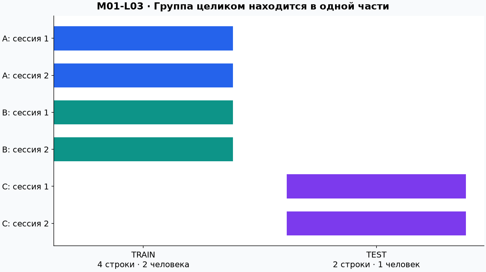

# M01-L03. Разделение данных

**Результат:** Разделить данные под будущий сценарий и исключить пересечение связанных объектов.

**Перед началом:** [M00-L03](M00-L03.md)

## Результат и входные знания

Если ответы одного человека попадут одновременно в обучение и проверку, модель может запомнить его стиль и показать слишком оптимистичное качество. Для продукта важно качество на тех людях и условиях, которые действительно появятся после выпуска. Поэтому способ разбиения является частью постановки задачи.

## Проверь себя сначала

**Короткий путь для знакомой темы, 2–5 минут.** Строки по пользователям: U1, U1, U2, U2, U2, U3, U4. Модель будет работать на новых пользователях. Раздели данные на train и test, чтобы в test было около двух строк, и проверь пересечение.

Запиши ответ и объяснение, затем сверь с [ключом M01-L03-D](../../solutions/modules/M01.md#m01-l03-d). Всё верно и объяснение совпадает по смыслу — переходи сразу к самостоятельной задаче этого урока, затем к варианту B/C. Ошибка, сомнение или ответ без объяснения — проходи урок полностью с начала. [Как работает адаптивный маршрут](../self-study.md#адаптивный-маршрут).

## Объяснение

Обучающая часть служит для подбора параметров. Валидационная часть помогает выбрать настройки и способ подготовки признаков. Тестовая часть оценивает уже выбранную процедуру. Если смотреть на тест после каждого изменения и выбирать по нему лучшую версию, он становится валидацией независимо от имени файла.

Случайное разделение строк подходит не всегда. Оно предполагает, что перемешивание достаточно хорошо моделирует будущие наблюдения и не разрывает значимые связи. Сообщения одной сессии, соседние фрагменты документа и повторные записи одного пользователя связаны. Групповое разбиение сохраняет группу целиком в одной части. Тогда проверка по новым пользователям не получает их прежние ответы в обучение.

Временное разбиение использует прошлое для обучения и будущее для проверки. Оно нужно, когда эксплуатация будет происходить именно так и данные меняются со временем. Признак, доступный только после завершения сессии, нельзя использовать для предсказания в её начале. Даже идеально непересекающиеся идентификаторы не спасают от такой утечки будущего.

Стратификация сохраняет примерные доли классов. Она может уменьшить случайный перекос маленькой выборки, но сама по себе не учитывает группы и время. Нельзя одновременно обещать любые пропорции и любые ограничения без проверки, что данные позволяют их удовлетворить. Если редкий класс представлен только одним человеком, честный тест по новым людям может остаться без этого класса.

После разбиения обучаемые операции подготовки — среднее для заполнения, масштаб, словарь категорий — определяются на train. Эти же параметры применяются к validation и test. Иначе будущие объекты косвенно влияют на обучение даже без использования своих меток. Разделение выполняется раньше операций, которые узнают свойства всей выборки.

Сохрани seed, список ключей и правило разбиения. Один seed без исходной версии данных не воспроизводит эксперимент: добавление строки меняет выбор. Для маленькой учебной задачи ручной список групп прозрачен и удобен; для большого набора используй библиотечный splitter и проверь его инварианты.



Граница проходит между людьми, а не между соседними строками. Цвет одной группы не встречается по обе стороны. Такой рисунок помогает заметить утечку ещё до обучения.

## Аналогия: подготовка к собеседованию

Как похоже: train — вопросы, на которых кандидат готовится; validation — пробное собеседование, по которому выбирают стратегию подготовки; test — настоящее собеседование с новыми вопросами. Если узнать вопросы настоящего собеседования заранее, оценка перестаёт что-либо значить.

| В уроке | В аналогии |
| --- | --- |
| Train | Вопросы для подготовки |
| Validation | Пробное собеседование для выбора стратегии |
| Test | Настоящее собеседование с невиданными вопросами |
| Выбор версии по test после каждого изменения | Узнать вопросы настоящего собеседования заранее |
| Групповое разбиение | Задача с подвопросами — целиком в одной части |
| Временное разбиение | Готовиться по прошлым сезонам, проверяться на новом |

**Где аналогия ломается:** кандидат, узнавший вопросы, понимает, что оценка нечестная. Утечка в модели молчит: метрика просто выглядит лучше. К тому же человек обобщает через понимание, а модель — статистически, на распределении похожих данных.

## Разобранный пример

Пусть A имеет две сессии, B — две, C — две. Выделим A и B в обучение, C в тест. Получатся четыре и две строки, пересечение групп пустое. Если выбрать через одну строку, размер частей тоже может выглядеть правдоподобно, но каждый человек окажется по обе стороны.

```python
import pandas as pd
d=pd.DataFrame({"person":["A","A","B","B","C","C"],"score":[1,2,3,4,5,6]})
train=d[d.person.isin(["A","B"])]
test=d[d.person.eq("C")]
overlap=set(train.person)&set(test.person)
print(len(train),len(test),overlap)
assert len(train)==4 and len(test)==2 and not overlap
```

**Ожидаемый результат:** 4 2 set(): четыре обучающих наблюдения, два тестовых, нет общего человека.

## Как проверить рассуждение

Пустое пересечение — необходимая проверка для группового сценария, но не доказательство отсутствия всех утечек. Например, итоговая оценка интервьюера может быть одновременно меткой и частью текстового признака. Просмотри происхождение каждого столбца и момент его доступности. Тест из одного человека слишком мал для устойчивого вывода о рынке; здесь он демонстрирует механику разбиения. Реальная оценка требует существенно большего числа независимых групп.

## Практика с поддержкой

**Предскажи до запуска.** Прежде чем запускать код или пересчитывать пример, запиши ожидаемый вывод: числа, формы массивов, порядок или текст. После запуска сравни с фактическим и объясни каждое расхождение.

Добавь человека D с одной сессией и назначь его в test вместе с C. Проверь число строк и число уникальных групп отдельно. Объясни, почему баланс строк не означает баланс людей.

## Самостоятельная задача A — M01-L03-A01

Есть восемь строк: A, A, A, B, B, C, C, D. Задача — работа на новых людях. Назначь A, B в train, C в validation, D в test. Посчитай размеры и все пересечения групп. Затем объясни, почему случайное распределение строк может быть нечестным и когда вместо такого разбиения понадобится временное.


## Подсказки по очереди

1. Сначала выпиши множество людей каждой части.
2. Посчитай строки по числу повторов.
3. Сценарий будущих сессий уже известных людей отличается от сценария новых людей.

## Критерии и типичные ошибки

Связанные объекты и время соответствуют сценарию проверки. Полный ответ сохранён до открытия ключа. Если потребовался разбор, проверь самостоятельность на варианте B. Все условия обязательны; оформление не компенсирует неверный механизм.

## Новая и отложенная проверка

**Вариант B:** Есть A1,A2,B1,C1. Назначь A,B в train, C в test и проверь группы.

**Вариант C через 3–7 дней:** У A события дней 2 и 9, граница 6. Что нарушит разрезание группы?

[Отдельные ключи B/C](../../solutions/modules/M01.md). Сохрани попытку, ошибку и требуемую помощь в журнале.

## Источники и углубление

[Ключи M01](../../solutions/modules/M01.md) · [Лабораторная модуля](../../labs/M01/README.md) · [Оглавление модуля](../modules/M01.md)

Основной дополнительный источник: [scikit-learn: типичные ошибки и утечка](https://scikit-learn.org/stable/common_pitfalls.html). Собственных объяснений, данных и кода в уроке достаточно для обязательного задания; внешняя ссылка нужна для уточнений и углубления.
