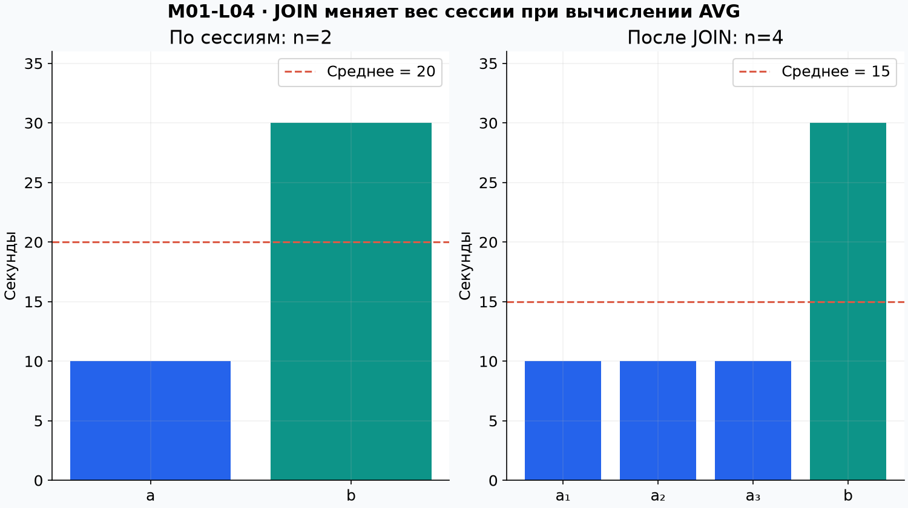

# M01-L04. SQL и происхождение данных

**Результат:** Получить агрегат SQL с правильным числом наблюдений и проверить кратность соединения.

**Перед началом:** [M01-L03](M01-L03.md)

## Результат и входные знания

Большинство инженерных ML-задач начинается с таблиц, а не с нейросети. Соединение с таблицей ответов может размножить строки сессий и незаметно изменить среднюю длительность. Такой результат выглядит численно точным, потому что SQL честно вычисляет именно тот запрос, который был написан.

## Проверь себя сначала

**Короткий путь для знакомой темы, 2–5 минут.** Таблица sessions: s1 длится 10 с, s2 — 30 с. В таблице answers у s1 три ответа, у s2 один. Чему равно AVG(duration) по sessions и после JOIN sessions с answers? Почему результаты разные?

Запиши ответ и объяснение, затем сверь с [ключом M01-L04-D](../../solutions/modules/M01.md#m01-l04-d). Всё верно и объяснение совпадает по смыслу — переходи сразу к самостоятельной задаче этого урока, затем к варианту B/C. Ошибка, сомнение или ответ без объяснения — проходи урок полностью с начала. [Как работает адаптивный маршрут](../self-study.md#адаптивный-маршрут).

## Объяснение

SELECT выбирает выражения, FROM задаёт исходную таблицу, WHERE фильтрует строки, GROUP BY объединяет их по ключам, а агрегаты COUNT и AVG вычисляются для каждой группы. Важно различать число строк COUNT(*) и число известных значений COUNT(column): второй вариант не учитывает NULL. Среднее AVG также пропускает NULL, поэтому вместе со средним полезно показывать количество наблюдаемых значений.

JOIN соединяет строки по условию. При связи один-к-одному число строк обычно сохраняется. При связи один-ко-многим каждая родительская строка повторяется по числу совпавших дочерних. Если у одной сессии три ответа, а у другой один, после соединения первая сессия будет иметь втрое больший вес при усреднении своего поля duration.

LEFT JOIN сохраняет строки слева даже без совпадения справа; поля правой стороны будут NULL. Но фильтр WHERE по правому полю может затем удалить эти строки и фактически уничтожить нужное свойство. Условия выбора дочерних записей иногда следует помещать в ON или предварительную подтаблицу. Правильное место зависит от смысла запроса.

Надёжный способ получить признаки уровня сессии — сначала агрегировать ответы до одной строки на session_id, затем соединить агрегат с таблицей сессий. После соединения проверь уникальность session_id и ожидаемое число сессий. Если таблица справа должна быть справочником, отдельно проверь уникальность её ключа до JOIN.

Происхождение признака включает исходную таблицу, фильтры, время среза и формулу агрегации. Для признака «число предыдущих интервью» слово предыдущих должно быть реализовано условием времени, а не оставаться только в описании. При историческом восстановлении нельзя использовать сегодняшнее состояние справочника без понимания изменений.

Параметризованные запросы отделяют данные от текста SQL. Даже в локальной учебной базе полезно использовать параметры вместо склеивания пользовательской строки. В этой лабораторной SQLite входит в Python, не требует сервера и позволяет полностью воспроизвести таблицы в памяти.



Слева две сессии имеют одинаковый вес. Справа число повторов определяется количеством ответов. Цвет одной сессии повторяется, поэтому наивный AVG измеряет среднее по строкам соединения.

## Аналогия: средний возраст покупателей по строкам чеков

Как похоже: таблица покупателей и таблица позиций чека связаны один-ко-многим. Если соединить их и усреднить возраст по строкам, покупатель, купивший пять товаров, войдёт в среднее пять раз. Чтобы получить средний возраст покупателей, сначала сворачивают позиции до одной строки на покупателя.

| В уроке | В аналогии |
| --- | --- |
| Таблица sessions | Покупатели |
| Таблица answers | Позиции чеков |
| JOIN один-ко-многим | Покупатель повторяется в каждой позиции |
| AVG(duration) после JOIN | Средний возраст по позициям: кто купил больше, весит больше |
| Агрегация до JOIN | Сначала свернуть позиции до одной строки на покупателя |
| Проверка уникальности session_id | В итоговой таблице каждый покупатель один раз |

**Где аналогия ломается:** иногда среднее по позициям — правильный вопрос, например возраст на один проданный товар. Аналогия показывает механизм взвешивания, но какое среднее нужно, решает вопрос задачи. Для NULL и COUNT(column) в чеках прямого аналога нет.

## Разобранный пример

Длительности сессий a=10 и b=30. У a три ответа, у b один. Правильное среднее по сессиям (10+30)/2=20. После соединения список длительностей [10, 10, 10, 30], поэтому наивный AVG равен 15.

```python
import sqlite3
c=sqlite3.connect(":memory:")
c.executescript("CREATE TABLE sessions(id TEXT PRIMARY KEY, seconds REAL); CREATE TABLE answers(sid TEXT);")
c.executemany("INSERT INTO sessions VALUES (?,?)",[("a",10),("b",30)])
c.executemany("INSERT INTO answers VALUES (?)",[("a",),("a",),("a",),("b",)])
correct=c.execute("SELECT AVG(seconds) FROM sessions").fetchone()[0]
wrong=c.execute("SELECT AVG(seconds) FROM sessions s JOIN answers a ON s.id=a.sid").fetchone()[0]
print(correct,wrong)
assert (correct,wrong)==(20.0,15.0)
c.close()
```

**Ожидаемый результат:** 20.0 15.0. Второе число вычислено корректно для другого уровня наблюдения, поэтому неверно отвечает на вопрос о среднем по сессиям.

## Как проверить рассуждение

Проверка запроса должна включать не только ожидаемое число, но и число строк до и после JOIN. DISTINCT seconds не является исправлением: две разные сессии могут иметь одинаковую длительность и ошибочно схлопнуться. DISTINCT по полному ключу может восстановить сущности, но проще и яснее агрегировать на нужном уровне. Для признаков количества ответов правильно считать дочерний ключ, потому что COUNT(*) после LEFT JOIN даст единицу даже сессии без ответов.

## Практика с поддержкой

**Предскажи до запуска.** Прежде чем запускать код или пересчитывать пример, запиши ожидаемый вывод: числа, формы массивов, порядок или текст. После запуска сравни с фактическим и объясни каждое расхождение.

Добавь сессию c=20 без ответов. Сравни INNER JOIN и LEFT JOIN по сохранённым сессиям. Затем сгруппируй ответы по sid до соединения и замени отсутствующее количество на ноль через COALESCE.

## Самостоятельная задача A — M01-L04-A01

Есть сессии a=5, b=15, c=40 секунд. Количество ответов соответственно 2, 1, 1. Вычисли среднее по сессиям и среднее после JOIN. Напиши запрос, который возвращает по одной строке на сессию с количеством ответов, и проверку уникальности ключа результата.


## Подсказки по очереди

1. Правильный знаменатель — три сессии.
2. После JOIN список [5, 5, 15, 40].
3. Сначала SELECT sid, COUNT(*) n FROM answers GROUP BY sid, затем LEFT JOIN.

## Критерии и типичные ошибки

Проверены ключ и кратность JOIN; агрегат имеет правильную единицу. Полный ответ сохранён до открытия ключа. Если потребовался разбор, проверь самостоятельность на варианте B. Все условия обязательны; оформление не компенсирует неверный механизм.

## Новая и отложенная проверка

**Вариант B:** После JOIN значение A=10 повторилось 3 раза, B=30 — один раз. Сравни среднее до/после.

**Вариант C через 3–7 дней:** Как сохранить среднее по сессиям при JOIN один-ко-многим?

[Отдельные ключи B/C](../../solutions/modules/M01.md). Сохрани попытку, ошибку и требуемую помощь в журнале.

## Источники и углубление

[Ключи M01](../../solutions/modules/M01.md) · [Лабораторная модуля](../../labs/M01/README.md) · [Оглавление модуля](../modules/M01.md)

Основной дополнительный источник: [SQLite: SELECT и JOIN](https://www.sqlite.org/lang_select.html). Собственных объяснений, данных и кода в уроке достаточно для обязательного задания; внешняя ссылка нужна для уточнений и углубления.
