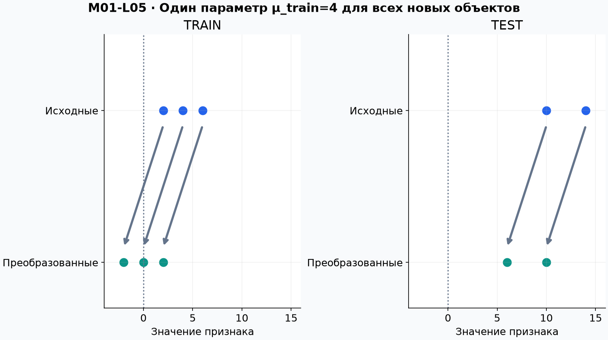

# M01-L05. Воспроизводимый конвейер

**Результат:** Разделить fit и transform и воспроизвести подготовку новых объектов сохранёнными параметрами.

**Перед началом:** [M01-L02](M01-L02.md), [M01-L03](M01-L03.md)

## Зачем это инженеру

Одинаковый код может давать разные признаки, если каждый раз пересчитывать среднее на новой партии запросов. Для эксплуатации нужно сохранить не только веса модели, но и всю обученную подготовку. Иначе ответ начнёт зависеть от того, какие чужие запросы попали в соседний пакет.

## Объяснение

Конвейер — упорядоченная последовательность преобразований от исходной записи до предсказания. Часть операций не обучается: проверка схемы или перевод миллисекунд в секунды по известному коэффициенту. Другая часть узнаёт параметры из данных: заполнение медианой, нормализация, кодирование категорий. Этим операциям нужны разные режимы fit и transform.

Fit вычисляет и сохраняет параметры на обучающей части. Transform применяет сохранённые параметры к любому допустимому входу. Fit_transform объединяет оба шага и поэтому предназначен для обучения. Если вызвать его на test, подготовка начнёт использовать свойства тестовых объектов. Даже без прямого доступа к меткам это нарушит заявленный независимый эксперимент.

Для центрирования параметром является среднее обучающих значений μ. Преобразование z=x−μ. У тестовой части среднее z не обязано быть нулевым. Это полезный сигнал отличия распределений, а не автоматическая ошибка. Принудительное отдельное центрирование test скрывает разницу и создаёт другое пространство признаков.

Воспроизводимость требует исходных данных, их версии, правил разбиения, кода, зависимостей и источников случайности. Seed управляет конкретным генератором случайных чисел, но не исправляет изменённый файл или другой порядок столбцов. Хеш файла помогает заметить изменение байтов, однако одинаковый смысл может иметь разные байтовые представления. Поэтому вместе с хешем нужен понятный контракт.

Артефакт конвейера сохраняет названия признаков, порядок, обученные статистики и версию. Если на обучении порядок [duration, questions], а в сервисе [questions, duration], вычисления могут пройти без ошибки формы и выдать бессмысленное число. Проверяй не только размер, но и имена.

Учебный минимальный артефакт удобно хранить в JSON: он читаем и достаточен для нескольких чисел. Сложные библиотечные объекты требуют другого формата и совместимости версий. Загружать непроверенный pickle как обычные данные нельзя: формат может выполнять код. Пока ограничимся собственным JSON и явной функцией применения.



Тестовые значения остаются далеко от нуля. Это ожидаемо: преобразование не подгоняется заново под тест. Пунктир показывает общий сохранённый параметр.

## Разобранный пример

Train=[2, 4, 6], test=[10, 14]. Среднее train=4. После transform получаем train=[−2, 0, 2], test=[6, 10]. Если отдельно обучить центрирование на test, получится [−2, 2], то есть другая операция со средним 12.

```python
import json
import numpy as np
train=np.array([2.,4.,6.]); test=np.array([10.,14.])
artifact={"version":"center-v1","feature":"seconds","mean":float(train.mean())}
loaded=json.loads(json.dumps(artifact))
transformed=test-loaded["mean"]
print(loaded,transformed.tolist())
assert np.allclose(transformed,[6,10])
assert loaded["mean"]==4
```

**Ожидаемый результат:** JSON со средним 4.0 и test после преобразования [6.0, 10.0].

## Как проверить рассуждение

Проверь предсказуемость одного объекта: преобразование x=10 отдельно и внутри партии [10, 14] должно дать 6. Если результат зависит от партии из-за пересчёта среднего, сервис нарушает контракт. Такая проверка полезнее простого сравнения сериализованного файла с самим собой. Также проверь пустой train, неизвестное имя признака и нечисловой вход: эти случаи должны иметь явное поведение, а не незаметно создавать NaN.

## Практика с поддержкой

Сохрани артефакт в строку JSON и прочитай заново. Измени состав test, добавив 100. Убедись, что результат для 10 не изменился. Затем намеренно пересчитай среднее на test и объясни появившуюся зависимость.

## Самостоятельная задача M01-L05-A01

Train=[1, 3, 5, 7], test=[9, 13]. Создай артефакт центрирования, покажи оба преобразованных массива и результат нового одиночного x=11. Укажи, какие метаданные нужны для воспроизведения. Добавь проверку, что test не меняет сохранённое среднее.


## Подсказки

1. Среднее train равно четырём.
2. Одиночный запрос использует тот же параметр.
3. Сравни артефакт до transform и после, а не только среднее преобразованной партии.

## Критерии самостоятельной проверки

fit не использует test; параметры подготовки сохраняются. Полный ответ сохранён до открытия ключа. Если потребовался разбор, проверь самостоятельность на варианте B. Все условия обязательны; оформление не компенсирует неверный механизм.

## Повторная и отложенная проверка

**Вариант B:** Train=[1,3], test=[100]. Центрируй test по train.

**Вариант C через 3–7 дней:** Добавь test=−100: должна ли поменяться сохранённая средняя?

[Отдельные ключи B/C](../../solutions/modules/M01.md). Сохрани попытку, ошибку и требуемую помощь в журнале.

## Решение и дополнительные материалы

[Ключи M01](../../solutions/modules/M01.md) · [Лабораторная модуля](../../labs/M01/README.md) · [Оглавление модуля](../modules/M01.md)

Основной дополнительный источник: [scikit-learn: согласованная подготовка и Pipeline](https://scikit-learn.org/stable/common_pitfalls.html). Собственных объяснений, данных и кода в уроке достаточно для обязательного задания; внешняя ссылка нужна для уточнений и углубления.
