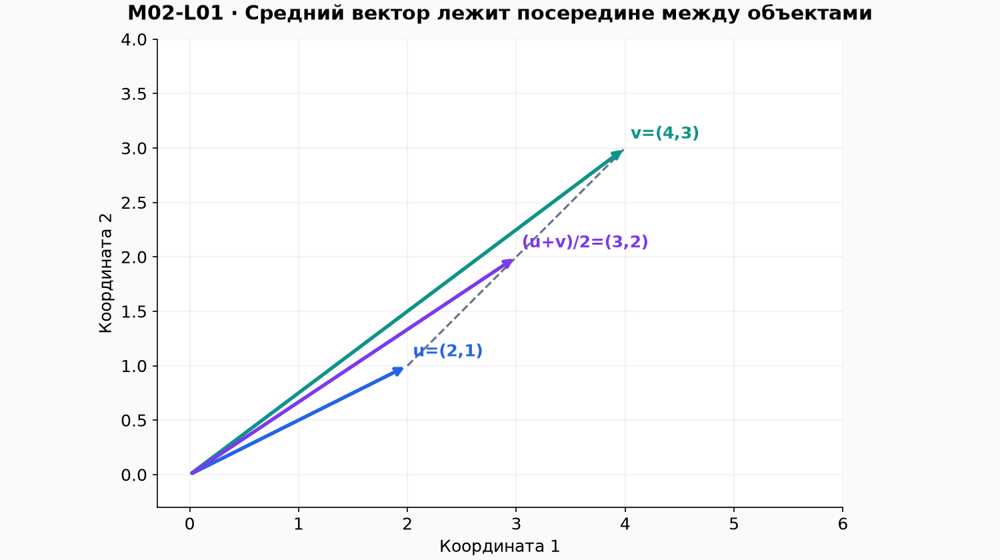

# M02-L01. Векторы как признаки

**Результат:** Представить объект вектором признаков и объяснить смысл координат и линейной комбинации.

**Перед началом:** [M01-L01](M01-L01.md)

## Зачем это инженеру

Embedding документа, строка таблицы и параметры линейной модели — разные сущности, которые удобно представлять векторами. Чтобы понимать поиск и обучение, нужно сначала отделить геометрические операции от смысла конкретных координат. Короткая программа с неверным порядком признаков может давать правильные размерности и неправильный ответ.

## Объяснение

Вектор в этом курсе — упорядоченный набор чисел фиксированной длины. Если объект описан длительностью ответа и числом примеров, вектор x=(40, 2) содержит две координаты. Перестановка координат меняет представление: (2, 40) уже не описывает тот же объект в прежнем договорённом порядке. Вместе с числами храни схему признаков и единицы.

На плоскости вектор можно нарисовать стрелкой от начала координат к точке. Такая картинка помогает понять сложение, но не означает, что любые признаки имеют физическую геометрию. Ось в секундах и ось в штуках нельзя непосредственно считать одинаковыми единицами расстояния. Геометрический результат зависит от выбора масштаба.

Сложение выполняется покоординатно: (a, b)+(c, d)=(a+c, b+d). Умножение на число α изменяет каждую координату: α(a, b)=(αa, αb). Линейная комбинация αu+βv объединяет эти операции. Например, средний вектор двух наблюдений равен 0.5u+0.5v. Слово линейная здесь означает форму операции, а не обещание, что она описывает все реальные зависимости.

Разность v−u показывает изменение по каждой координате. Если u=(20, 1), v=(30, 3), разность (10, 2) означает ещё десять секунд и два примера. Положительное направление зависит от смысла признака: рост ошибки плох, рост числа корректных аргументов может быть полезен. Сам знак не является оценкой качества.

Базисные векторы e₁=(1, 0) и e₂=(0, 1) позволяют записать x=x₁e₁+x₂e₂. Они задают координатные направления. В высоких размерностях рисунок уже не помещается на листе, но операции остаются теми же. Вектор длины 384 не требует 384 новых правил сложения.

Не все числовые поля подходят для такой арифметики. Среднее между идентификаторами пользователей не обозначает среднего пользователя. Категория языка, закодированная числами 1, 2, 3, не автоматически получает осмысленные расстояния. Представление должно следовать задаче, а не удобству хранения.



Точка среднего находится посередине отрезка между концами стрелок. Это геометрическое свойство выбранных координат; оно не подтверждает, что среднее имеет смысл для любого набора полей.

## Разобранный пример

Пусть u=(2, 1), v=(4, 3). Их сумма (6, 4), разность v−u=(2, 2), среднее (3, 2). Если первая координата — минуты, а вторая — число примеров, среднее описывает агрегированный профиль, но не обязательно реально существовавшую сессию.

```python
import numpy as np
u=np.array([2.,1.]); v=np.array([4.,3.])
mid=(u+v)/2
print((v-u).tolist(),mid.tolist())
assert np.allclose(v-u,[2,2])
assert np.allclose(mid,[3,2])
```

**Ожидаемый результат:** Разность [2.0, 2.0], средний вектор [3.0, 2.0].

## Как проверить рассуждение

Проверь результат через каждую исходную величину: среднее двух минутных значений и среднее двух количеств считаются отдельно. Не складывай разные координаты между собой без объяснения. Умножение на два сохраняет единицы, но может нарушить допустимый диапазон, например для доли от нуля до единицы. Поэтому математическая допустимость вектора шире допустимости объекта предметной области. В отчёте назови и координаты, и ограничения.

## Практика с поддержкой

Нарисуй u, v и v−u на бумаге. Объясни, почему стрелку изменения удобно переносить к концу u. Затем поменяй местами координаты во всех векторах и проверь, что арифметика согласована только при одинаковой перестановке.

## Самостоятельная задача M02-L01-A01

Для u=(1, 4), v=(5, 2) вычисли v−u и 0.25u+0.75v. Представь, что координаты означают число завершённых задач и длительность. Объясни, почему дробная первая координата среднего не обязана соответствовать одной реальной сессии.

Сначала сохрани собственные расчёты и объяснение в submissions. Не открывай ключ до первой попытки. Важно показать промежуточные значения: по ним можно понять, где именно расходятся смысл и реализация. Разрешено пользоваться калькулятором и документацией синтаксиса; полученную содержательную подсказку отметь отдельно. После просмотра готового решения самостоятельность проверяется новым примером, а не повторным переписыванием тех же строк.

## Подсказки

1. Коэффициенты относятся ко всему вектору.
2. Первая координата смеси:0.25·1+0.75·5.
3. Агрегированная характеристика и наблюдавшийся объект — разные понятия.

## Ошибки и критерии самопроверки

Разность (4, −2), смесь (4, 2.5), дано объяснение координат. Критическая ошибка — менять порядок признаков только у одного вектора или приписывать смысл арифметике идентификаторов.

При несовпадении ответа с эталоном сначала классифицируй ошибку: неверно понято условие, перепутаны величины, допущена арифметическая ошибка или нарушено правило эксперимента. Проверка кода не заменяет объяснение. Если вывод сильнее имеющихся данных, перепиши именно вывод, а затем реши, какие дополнительные наблюдения нужны. Хорошее оформление не компенсирует критическую ошибку.

## Повторная и отложенная проверка

Повтори с u=(−1, 2), v=(3, 6) и равными весами. Позже по одной схеме признаков объясни, какие поля можно усреднять и почему.

Через несколько других занятий вернись к этому действию без открытого конспекта. Сохрани новый ответ и сравни способ рассуждения, а не только последнее число. В [журнале](../../progress/progress.md) отделяй самостоятельную попытку, результат с подсказкой и внешнюю проверку, если она действительно была.

## Решение и дополнительные материалы

[Ключи M02](../../solutions/modules/M02.md) · [Лабораторная модуля](../../labs/M02/README.md) · [Оглавление модуля](../modules/M02.md)

Основной дополнительный источник: [NumPy: векторы и операции над массивами](https://numpy.org/doc/stable/user/absolute_beginners.html). Собственных объяснений, данных и кода в уроке достаточно для обязательного задания; внешняя ссылка нужна для уточнений и углубления.
