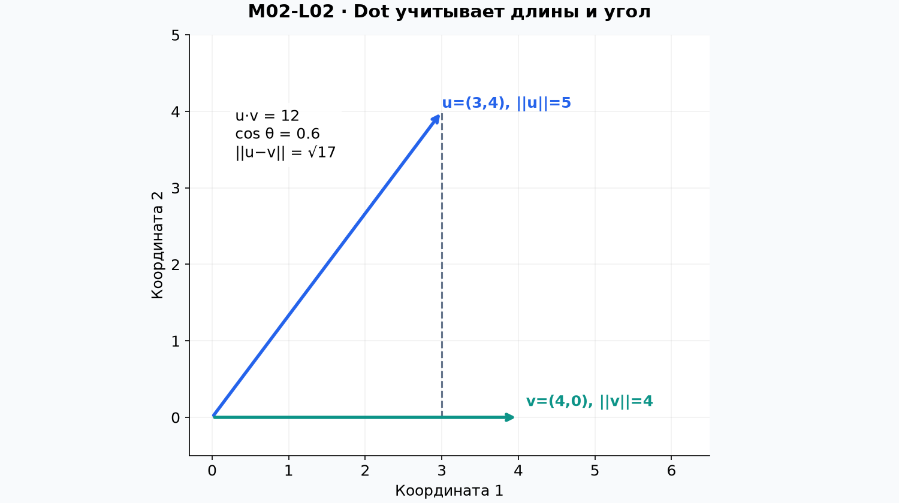

# M02-L02. Скалярное произведение и нормы

**Результат:** Вычислить скалярное произведение, длину и косинусное сходство, обработать нулевой вектор.

**Перед началом:** [M02-L01](M02-L01.md)

## Результат и входные знания

Линейная модель складывает взвешенные признаки, а векторный поиск сравнивает направления представлений. В обоих случаях появляется скалярное произведение. Понимание этой операции позволяет обнаружить, почему большой по длине документ получает высокий dot product, хотя его направление хуже совпадает с запросом.

## Проверь себя сначала

**Короткий путь для знакомой темы, 2–5 минут.** u = (2, 0), v = (1, 1). Найди dot(u, v), ‖u‖, ‖v‖ и косинусное сходство. Что должна делать функция cosine, если v = (0, 0)?

Запиши ответ и объяснение, затем сверь с [ключом M02-L02-D](../../solutions/modules/M02.md#m02-l02-d). Всё верно и объяснение совпадает по смыслу — переходи сразу к самостоятельной задаче этого урока, затем к варианту B/C. Ошибка, сомнение или ответ без объяснения — проходи урок полностью с начала. [Как работает адаптивный маршрут](../self-study.md#адаптивный-маршрут).

## Объяснение

Скалярное произведение u·v равно сумме произведений соответствующих координат: Σuᵢvᵢ. Результат — число, поэтому операция называется скалярной. Для модели ŷ=w·x+b каждое слагаемое wᵢxᵢ показывает вклад признака при выбранных параметрах. Смысл вклада зависит от единиц и подготовки признаков.

Евклидова норма ||u||₂=√Σuᵢ² измеряет длину вектора в выбранной системе координат. Для (3, 4) длина равна пяти. Норма не отрицательна и равна нулю только у нулевого вектора. Расстояние между u и v равно норме их разности ||u−v||₂. Длина одного вектора и расстояние между двумя — связанные, но разные величины.

Геометрическая связь u·v=||u||||v||cosθ показывает, что скалярное произведение зависит одновременно от длин и угла. Если умножить один вектор на положительное число, dot product увеличится, хотя направление не изменится. Для сходства по направлению используют cosine=u·v/(||u||||v||), когда обе длины ненулевые.

Косинус лежит между −1 и 1. Значение 1 означает одинаковое направление, 0 — перпендикулярность в выбранном пространстве, −1 — противоположность. Эти геометрические отношения не универсально равны смысловому совпадению текстов. Такую интерпретацию должно поддерживать обучение представлений и проверка на задаче.

Нулевой вектор не имеет направления. Деление на его норму математически не определено. В инженерном коде нужно явное правило: отклонить пустое представление, вернуть специальный статус или применить заранее определённое соглашение. Добавление epsilon в знаменатель предотвращает деление на ноль, но не создаёт у нулевого вектора смысловое направление.

Плавающая арифметика может дать cosine чуть больше единицы из-за округления. При вычислении угла через arccos допустимо ограничить численный результат диапазоном [−1, 1] после проверки исходных норм. Это численная защита, а не способ скрыть неверный алгоритм.

В линейной модели скалярное произведение может иметь единицы ответа, если веса правильно согласованы с признаками. В геометрическом сходстве обычно работают с безразмерными координатами. Это разные интерпретации одной арифметики. Перед переносом формулы в новую задачу отдельно проверь, что означают множители и допустим ли их общий итог. Правильное число без такого соглашения ещё не является правильным измерением.



Горизонтальная проекция первого вектора равна 3. Dot product с (4, 0) умножает эту проекцию на 4, поэтому результат 12. Нормирование убирает обе длины.

## Разобранный пример

u=(3, 4), v=(4, 0). u·v=12, ||u||=5, ||v||=4, cosine=12/20=0.6. Расстояние √((3−4)²+(4−0)²)=√17≈4.123. Удвоение v даёт dot24, но cosine остаётся 0.6.

```python
import numpy as np
u=np.array([3.,4.]); v=np.array([4.,0.])
def cosine(a,b):
    denominator=np.linalg.norm(a)*np.linalg.norm(b)
    if denominator==0: raise ValueError("zero vector has no direction")
    return float(a@b/denominator)
print(float(u@v),round(cosine(u,v),3),round(np.linalg.norm(u-v),3))
assert np.isclose(cosine(u,v),cosine(u,2*v))
```

**Ожидаемый результат:** 12.0 0.6 4.123.

## Как проверить рассуждение

Проверь крайние случаи: одинаковый ненулевой вектор должен иметь cosine1, противоположный −1, перпендикулярный 0. Эти проверки выявляют перепутанный знаменатель. Расстояние до самого себя равно 0, но dot product с собой равен квадрату нормы, а не всегда единице. Для обученных embeddings прежде всего проверь, какую метрику использует конкретная модель; произвольная замена dot на cosine может изменить ранжирование.

## Практика с поддержкой

Посчитай показатели для (1, 0) и (0, 1), затем для (1, 0) и (2, 0). Сравни, какая информация сохраняется в длине, а какая в направлении. Вызови cosine для нулевого вектора и проверь ожидаемое исключение.

## Самостоятельная задача A — M02-L02-A01

Для u=(1, 2), v=(2, 1) вычисли dot, обе нормы, расстояние и cosine. Затем сравни cosine(u, 3v) и dot(u, 3v). Сформулируй контракт для нулевого вектора.


## Подсказки по очереди

1. Dot равен сумме двух произведений.
2. Обе нормы равны√5.
3. Положительный множитель сокращается в cosine, но не в dot.

## Критерии и типичные ошибки

Знаменатель cosine содержит обе нормы; ноль обработан явно. Полный ответ сохранён до открытия ключа. Если потребовался разбор, проверь самостоятельность на варианте B. Все условия обязательны; оформление не компенсирует неверный механизм.

## Новая и отложенная проверка

**Вариант B:** Найди cosine между [3,4] и [0,5].

**Вариант C через 3–7 дней:** Можно ли назначить нулевому query cosine=0 со всеми документами?

[Отдельные ключи B/C](../../solutions/modules/M02.md). Сохрани попытку, ошибку и требуемую помощь в журнале.

## Источники и углубление

[Ключи M02](../../solutions/modules/M02.md) · [Лабораторная модуля](../../labs/M02/README.md) · [Оглавление модуля](../modules/M02.md)

Основной дополнительный источник: [NumPy: норма вектора](https://numpy.org/doc/stable/reference/generated/numpy.linalg.norm.html). Собственных объяснений, данных и кода в уроке достаточно для обязательного задания; внешняя ссылка нужна для уточнений и углубления.
