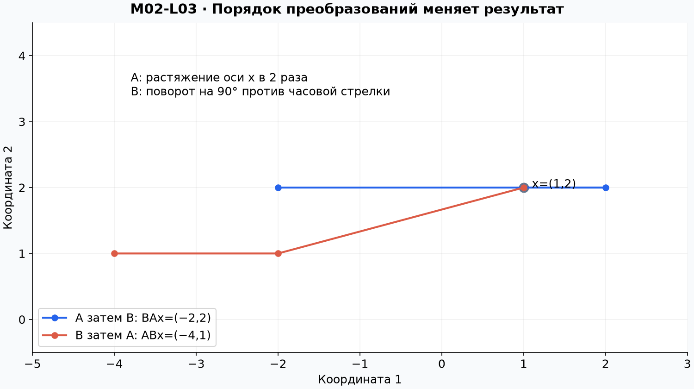

# M02-L03. Матрицы и композиция

**Результат:** Проверить размеры матричного произведения и порядок последовательных преобразований.

**Перед началом:** [M02-L02](M02-L02.md)

## Зачем это инженеру

Один проход слоя нейросети и одновременное предсказание для тысячи объектов — матричные операции. Ошибки размерностей проще обнаружить до запуска: нужно подписать, какая ось означает объекты, признаки и выходы. Матрица также позволяет понять, почему порядок преобразований нельзя менять произвольно.

## Объяснение

Матрица — прямоугольная таблица чисел. В X формы n×d строки обозначают n объектов, столбцы d признаков. Вектор весов w длины d преобразует каждый объект в число: Xw имеет длину n. Каждый выход равен скалярному произведению соответствующей строки X и w.

Если нужно k выходов, веса можно организовать в матрицу W формы d×k. Тогда XW имеет форму n×k. Внутренние размеры d должны совпасть. Элемент результата (i, j) — сумма произведений строки i первой матрицы и столбца j второй. Это не поэлементное умножение: в NumPy оператор @ выполняет матричное произведение, а * — поэлементное с broadcasting.

Транспонирование меняет строки и столбцы местами. У X формы n×d транспонированная X.T имеет форму d×n. Оно может исправить договорённость об ориентации, но не является универсальной реакцией на исключение. Если оси обозначают разные сущности, случайная перестановка может создать вычислимую, но неверную операцию.

Для геометрического преобразования столбца x матрицей A записывают Ax. Если сначала действует A, затем B, полный результат BAx. Правая операция применяется раньше. В общем случае AB не равно BA. Например, растяжение только горизонтальной оси до поворота и после поворота увеличивает разные направления.

Матричное умножение ассоциативно: (BA)x=B(Ax), если размеры согласованы. Благодаря этому можно заранее объединить два линейных преобразования. Но добавление нелинейной функции между ними обычно не позволяет свести всё к одной матрице. Позднее это объяснит, зачем нейросетям активации.

Векторы-строки и векторы-столбцы — два соглашения записи. Для таблиц объектов в курсе используется XW, для отдельных геометрических стрелок Ax. Всегда объявляй соглашение перед формулой, чтобы отсутствие транспонирования не превратилось в скрытую ошибку.

На практике полезно записывать форму рядом с каждой переменной прямо в комментарии к коду. Например, batch_size меняет только ось объектов, а число выходов определяется последней осью матрицы весов. Проверь реализацию на одном объекте и на нескольких одновременно: результаты первого объекта должны совпасть. Такое сравнение обнаруживает случайное суммирование по оси объектов вместо оси признаков.



Две траектории начинаются в одной точке (1, 2). Порядок подписан у стрелок: сначала горизонтальное растяжение, потом поворот, либо наоборот. Конечные точки различны.

## Разобранный пример

X=[[1, 2], [3, 4]], w=[2, −1]. Получаем [0, 2]. Для столбца x=(1, 2) матрица A=diag(2, 1) даёт (2, 2), поворот B=[[0, −1], [1, 0]] затем даёт (−2, 2). Обратный порядок даёт (−4, 1).

```python
import numpy as np
X=np.array([[1.,2.],[3.,4.]])
w=np.array([2.,-1.])
A=np.diag([2.,1.]);B=np.array([[0.,-1.],[1.,0.]])
x=np.array([1.,2.])
print((X@w).tolist(),(B@A@x).tolist(),(A@B@x).tolist())
assert np.allclose(X@w,[0,2])
assert not np.allclose(B@A@x,A@B@x)
```

**Ожидаемый результат:** [0.0, 2.0], [−2.0, 2.0], [−4.0, 1.0].

## Как проверить рассуждение

Проверь одну ячейку произведения вручную. Если форма результата правильная, это ещё не доказывает верность вычисления: квадратные матрицы разрешают много перестановок. Поэтому нужен численный пример, чувствительный к порядку. Единичная матрица для такой проверки плоха, потому что она ничего не меняет. Случай X формы (2, 3), W формы (3, 4) полезнее для проверки осей, чем два квадрата одного размера.

## Практика с поддержкой

Подпиши размеры X=(5, 3), W=(3, 2), результата и смещения b=(2, ). Объясни, почему X@W+b даёт два выхода для каждого из пяти объектов. Сравни с X*W и предскажи, почему операция не соответствует задаче.

## Самостоятельная задача M02-L03-A01

Даны X=[[1, 0, 2], [0, 1, 3]] и W=[[1, 2], [3, 4], [5, 6]]. Найди XW, его форму и первый элемент вручную. Для A=diag(3, 1), B — тот же поворот, x=(1, 1) сравни BAx и ABx.


## Подсказки

1. Каждый выход использует строку X и столбец W.
2. Первый элемент 1·1+0·3+2·5.
3. Для композиции сначала выполни самое правое действие.

## Критерии самостоятельной проверки

Согласованы внутренние размеры и смысл порядка преобразований. Полный ответ сохранён до открытия ключа. Если потребовался разбор, проверь самостоятельность на варианте B. Все условия обязательны; оформление не компенсирует неверный механизм.

## Повторная и отложенная проверка

**Вариант B:** A имеет форму 2×3, B — 3×4. Найди форму AB.

**Вариант C через 3–7 дней:** A имеет форму 3×2, B — 3×1. Почему AB не определено?

[Отдельные ключи B/C](../../solutions/modules/M02.md). Сохрани попытку, ошибку и требуемую помощь в журнале.

## Решение и дополнительные материалы

[Ключи M02](../../solutions/modules/M02.md) · [Лабораторная модуля](../../labs/M02/README.md) · [Оглавление модуля](../modules/M02.md)

Основной дополнительный источник: [NumPy: матричное произведение](https://numpy.org/doc/stable/reference/generated/numpy.matmul.html). Собственных объяснений, данных и кода в уроке достаточно для обязательного задания; внешняя ссылка нужна для уточнений и углубления.
