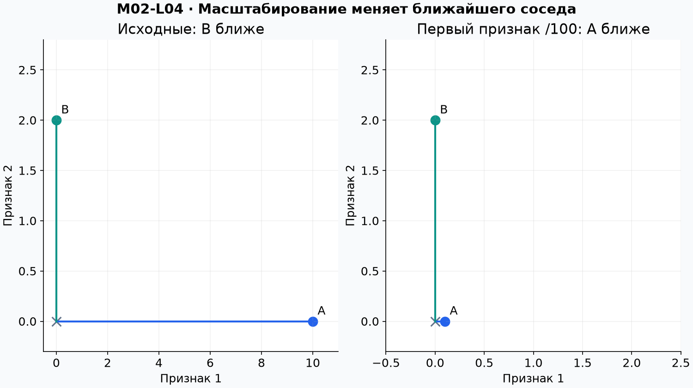

# M02-L04. Сходство и масштаб

**Результат:** Показать изменение ближайшего соседа при смене масштаба и выбрать обоснованное преобразование.

**Перед началом:** [M02-L03](M02-L03.md)

## Зачем это инженеру

В поиске похожих сессий один признак может быть в тысячах символов, другой — в долях. Евклидово расстояние будет преимущественно отражать первый. Нормализация не является косметическим улучшением: она задаёт, какие различия считать важными.

## Объяснение

Расстояние d(x, z)=√Σ(xᵢ−zᵢ)² суммирует квадраты различий координат. Если одну координату измерять в миллисекундах вместо секунд, её вклад увеличится в миллион раз. Физическое событие не изменилось, но численная геометрия стала другой. Поэтому выбор единиц и масштаба относится к определению модели.

Стандартизация часто использует zᵢ=(xᵢ−μᵢ)/sᵢ, где μᵢ и sᵢ вычислены на train. Теперь различие выражено в единицах типичного разброса признака. Это удобно, но не универсально: выбросы могут сильно изменить среднее и стандартное отклонение. Для устойчивого масштаба иногда используют медиану и межквартильный размах.

Нормирование вектора по его собственной длине x/||x|| решает другую задачу. Оно делает длину каждого объекта равной единице и сохраняет направление. Стандартизация работает по столбцам набора, нормирование по строке объекта. Подмена одной операции другой меняет смысл сравнения.

У константного признака стандартное отклонение равно нулю. Делить на него нельзя; можно удалить признак или определить масштаб единицей, явно записав правило. Такой признак не помогает различать обучающие объекты, но новое значение в эксплуатации всё равно может указывать на изменение данных.

Масштаб можно задавать предметно, например десять секунд считать сопоставимыми с одним дополнительным примером. Тогда расстояние отражает явное инженерное решение. Оно должно проверяться на размеченных парах, а не объявляться правильным только потому, что график выглядит симметрично.

Векторный поиск текстов наследует пространство конкретного encoder. Если модель уже обучена с определённым нормированием и метрикой, произвольная стандартизация координат может испортить её геометрию. Для табличных признаков и языковых embeddings нельзя автоматически применять одинаковую подготовку.



На левой панели оси показывают исходные единицы. На правой первая координата разделена на 100. Порядок ближайших соседей меняется, хотя исходные объекты те же.

## Разобранный пример

Запрос q=(0, 0), A=(10, 0), B=(0, 2). Исходные расстояния 10 и 2: ближайший B. После деления первого признака на 100 расстояния 0.1 и 2: ближайший A. Изменение не ошибка арифметики, а следствие нового веса координаты.

```python
import numpy as np
q=np.array([0.,0.]);D=np.array([[10.,0.],[0.,2.]])
raw=np.linalg.norm(D-q,axis=1)
scale=np.array([100.,1.])
scaled=np.linalg.norm((D-q)/scale,axis=1)
print(raw.tolist(),scaled.tolist())
assert raw.argmin()==1 and scaled.argmin()==0
```

**Ожидаемый результат:** [10.0, 2.0] и [0.1, 2.0]; ближайший сосед меняется.

## Как проверить рассуждение

Сначала проверь единицы и возможные диапазоны. Затем сравни несколько разумных масштабов на независимых примерах сходства. Не подбирай масштаб по тестовым ответам и одновременно не называй их независимой проверкой. Если задача требует учитывать абсолютную длину ответа, нормирование каждого объекта может удалить полезный сигнал. Если важна только тематическая направленность, удаление длины иногда оправдано. Решение должно ссылаться на задачу.

## Практика с поддержкой

Измени масштаб первого признака со 100 на 5. Получатся одинаковые расстояния 2. Объясни, почему нужен детерминированный порядок при равенстве и почему такая ничья не даёт основания объявить один объект более похожим.

## Самостоятельная задача M02-L04-A01

Запрос q=(0, 0), A=(30, 1), B=(5, 4). Сравни расстояния до и после деления первого признака на 10. Затем нормируй вектор (3, 4) по длине и объясни, почему эта операция отличается от деления одного столбца на 10.

Сначала сохрани собственные расчёты и объяснение в submissions. Не открывай ключ до первой попытки. Важно показать промежуточные значения: по ним можно понять, где именно расходятся смысл и реализация. Разрешено пользоваться калькулятором и документацией синтаксиса; полученную содержательную подсказку отметь отдельно. После просмотра готового решения самостоятельность проверяется новым примером, а не повторным переписыванием тех же строк.

## Подсказки

1. Исходные квадраты расстояний 901 и 41.
2. После масштаба квадраты 10 и 16.25.
3. Норма(3, 4)=5.

## Ошибки и критерии самопроверки

До преобразования ближе B, после ближе A; нормированный вектор(0.6, 0.8). Критическая ошибка — считать стандартизацию и нормирование взаимозаменяемыми либо вычислять обучаемый масштаб по всему набору.

При несовпадении ответа с эталоном сначала классифицируй ошибку: неверно понято условие, перепутаны величины, допущена арифметическая ошибка или нарушено правило эксперимента. Проверка кода не заменяет объяснение. Если вывод сильнее имеющихся данных, перепиши именно вывод, а затем реши, какие дополнительные наблюдения нужны. Хорошее оформление не компенсирует критическую ошибку.

## Повторная и отложенная проверка

Для q=(0, 0), A=(20, 0), B=(0, 1) найди масштаб первой координаты, при котором возникает ничья. Позже обоснуй выбор метрики для числовых признаков интервью.

Через несколько других занятий вернись к этому действию без открытого конспекта. Сохрани новый ответ и сравни способ рассуждения, а не только последнее число. В [журнале](../../progress/progress.md) отделяй самостоятельную попытку, результат с подсказкой и внешнюю проверку, если она действительно была.

## Решение и дополнительные материалы

[Ключи M02](../../solutions/modules/M02.md) · [Лабораторная модуля](../../labs/M02/README.md) · [Оглавление модуля](../modules/M02.md)

Основной дополнительный источник: [scikit-learn: подготовка и масштабирование](https://scikit-learn.org/stable/modules/preprocessing.html). Собственных объяснений, данных и кода в уроке достаточно для обязательного задания; внешняя ссылка нужна для уточнений и углубления.
