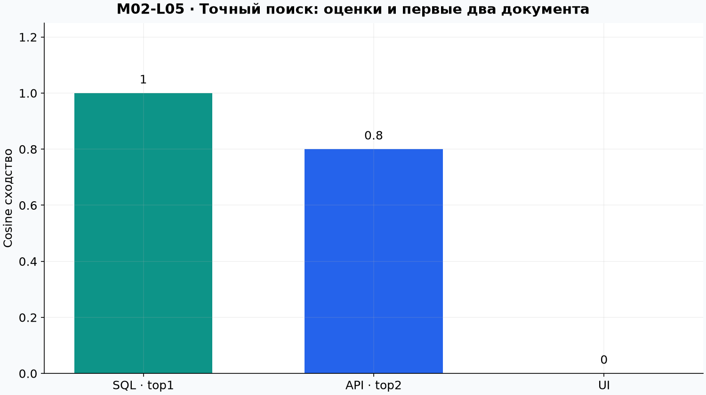

# M02-L05. Маленький векторный поиск

**Результат:** Реализовать точный поиск по cosine, проверить top-k и сформулировать ограничения качества.

**Перед началом:** [M02-L04](M02-L04.md)

## Результат и входные знания

RAG начинается с поиска подходящих материалов. Прежде чем подключать векторную базу, полезно построить прозрачный поиск по нескольким векторам и проверить каждое число. Это отделит ошибку индекса от плохого представления текста или неверной оценки релевантности.

## Проверь себя сначала

**Короткий путь для знакомой темы, 2–5 минут.** Документы A = (1, 0), B = (1, 1), C = (0, 1), запрос q = (1, 0.2). Найди косинусное сходство с каждым документом, top-2 и recall@2, если релевантны B и C.

Запиши ответ и объяснение, затем сверь с [ключом M02-L05-D](../../solutions/modules/M02.md#m02-l05-d). Всё верно и объяснение совпадает по смыслу — переходи сразу к самостоятельной задаче этого урока, затем к варианту B/C. Ошибка, сомнение или ответ без объяснения — проходи урок полностью с начала. [Как работает адаптивный маршрут](../self-study.md#адаптивный-маршрут).

## Объяснение

Векторный поиск сопоставляет запросу q представление и вычисляет близость к векторам документов d₁…dₙ. При cosine сначала можно нормировать все ненулевые векторы до длины 1. Тогда q̂·d̂ равно cosine, и один матричный вызов D̂q̂ вычисляет сходство со всеми документами.

Top-k означает выбор k элементов с наибольшими оценками. Оценка сходства не является вероятностью истинности документа и не гарантирует, что найденный текст отвечает на вопрос. Даже лучший из плохих кандидатов остаётся плохим. Поэтому система должна уметь сообщать об отсутствии достаточного контекста, а порог нужно калибровать на примерах.

Точный поиск перебирает все векторы. Его стоимость растёт примерно с количеством документов и размерностью. Для небольшого учебного корпуса это хороший эталон: результат легко проверить. При большом корпусе используют приближённые индексы, которые ускоряют поиск ценой возможного пропуска ближайших соседей. Качество приближения надо сравнивать с точным эталоном.

Равные оценки требуют определённого порядка, например по стабильному идентификатору. Иначе одни и те же данные могут возвращать разные top-k после перестановки строк. Для учебного примера заранее зададим порядок идентификаторов и стабильную сортировку. Проверяй также границы k: оно должно быть положительным и не превышать размер доступного корпуса либо явно обрезаться по контракту.

Encoder запроса и документов должен быть совместим. Смена модели требует пересчитать документы, а часто и настройки поиска. Число координат одинаковой длины не гарантирует общего пространства: два разных encoder могут выдавать векторы 384 совершенно разного смысла.

Метрика качества поиска сравнивает найденные документы с разметкой релевантности. Recall@k — доля всех релевантных документов, попавших в первые k. Если релевантен один документ, recall принимает 0 или 1 для отдельного запроса. При отсутствии размеченных релевантных документов знаменатель нулевой; такие запросы нужно обрабатывать по отдельному правилу, а не молча считать успехом.



Высота столбца показывает геометрическую оценку. Подпись релевантности задаётся человеком отдельно; её нельзя получить просто переименованием cosine в вероятность.

## Аналогия: поисковый движок

Как похоже: векторный поиск устроен как поиск в движке вроде Elasticsearch. Запрос и документы обрабатываются одним анализатором, каждому документу ставится оценка, а выдача — первая страница результатов, отсортированная с правилом равенства.

| В уроке | В аналогии |
| --- | --- |
| Векторы запроса и документов | Запрос и документы, обработанные одним анализатором |
| Точный перебор всех векторов | Full scan: проверка каждой строки |
| Приближённый индекс | Индекс, который быстрее, но может пропустить подходящий результат |
| Top-k с правилом равенства | `ORDER BY score DESC, id LIMIT k` |
| Смена encoder | Смена анализатора: индекс нужно перестроить |
| Recall@k | Доля нужных документов на первой странице выдачи |

**Где аналогия ломается:** текстовый движок совпадает по явным словам и может объяснить, почему документ найден. Векторное сходство — выученная геометрия без читаемой причины, и высокая оценка ещё не значит, что документ отвечает на вопрос: лучший из плохих кандидатов остаётся плохим.

## Разобранный пример

q=(1, 0); документы SQL=(1, 0), API=(0.8, 0.6), UI=(0, 1) уже единичные. Оценки[1, 0.8, 0]. Top2=[SQL, API]. Если размечен только SQL, recall@1=1. Если релевантны SQL и API, recall@1=0.5, recall@2=1.

```python
import numpy as np
ids=np.array(["SQL","API","UI"])
D=np.array([[1.,0.],[.8,.6],[0.,1.]])
q=np.array([1.,0.])
norms=np.linalg.norm(D,axis=1)
assert np.all(norms>0) and np.linalg.norm(q)>0
scores=(D/norms[:,None])@(q/np.linalg.norm(q))
order=np.argsort(-scores,kind="stable")
top=ids[order[:2]].tolist()
print(scores.tolist(),top)
assert top==["SQL","API"]
```

**Ожидаемый результат:** Оценки [1.0, 0.8, 0.0], порядок SQL, API.

## Как проверить рассуждение

Проверь три разных уровня: арифметику cosine, алгоритм сортировки и смысловую разметку. Правильный top-k по заданным векторам ещё не означает хороший поиск по реальным текстам. В этом уроке векторы назначены вручную, поэтому это учебная геометрия, а не обученная семантическая модель. Позднее заменим ручные координаты настоящими embeddings и сохраним точный поиск как проверяемую базовую реализацию.

## Практика с поддержкой

**Предскажи до запуска.** Прежде чем запускать код или пересчитывать пример, запиши ожидаемый вывод: числа, формы массивов, порядок или текст. После запуска сравни с фактическим и объясни каждое расхождение.

Измени запрос на(0, 1), предскажи порядок до запуска. Затем добавь копию API с другим id и введи правило равенства оценок. Запиши, как изменение k влияет на полноту и количество лишних документов.

## Самостоятельная задача A — M02-L05-A01

Используй документы A=(1, 0), B=(0.6, 0.8), C=(0, 1) и запрос q=(0, 1). Найди top2 и recall@1, recall@2, если релевантны B и C. Опиши поведение для q=(0, 0) и несовместимой размерности.


## Подсказки по очереди

1. Cosine с(0, 1) для единичного вектора равен второй координате.
2. В знаменателе recall два релевантных документа.
3. Ошибочный вход нужно обнаружить до сортировки.

## Критерии и типичные ошибки

Есть устойчивое правило ничьих, контракты и правильный знаменатель recall. Полный ответ сохранён до открытия ключа. Если потребовался разбор, проверь самостоятельность на варианте B. Все условия обязательны; оформление не компенсирует неверный механизм.

## Новая и отложенная проверка

**Вариант B:** Документы Z и A имеют одинаковые векторы. Какой первый при правиле ID по возрастанию?

**Вариант C через 3–7 дней:** Релевантны A,B,C; найдено A,A,D. Чему равен recall?

[Отдельные ключи B/C](../../solutions/modules/M02.md). Сохрани попытку, ошибку и требуемую помощь в журнале.

## Источники и углубление

[Ключи M02](../../solutions/modules/M02.md) · [Лабораторная модуля](../../labs/M02/README.md) · [Оглавление модуля](../modules/M02.md)

Основной дополнительный источник: [scikit-learn: cosine similarity](https://scikit-learn.org/stable/modules/generated/sklearn.metrics.pairwise.cosine_similarity.html). Собственных объяснений, данных и кода в уроке достаточно для обязательного задания; внешняя ссылка нужна для уточнений и углубления.
