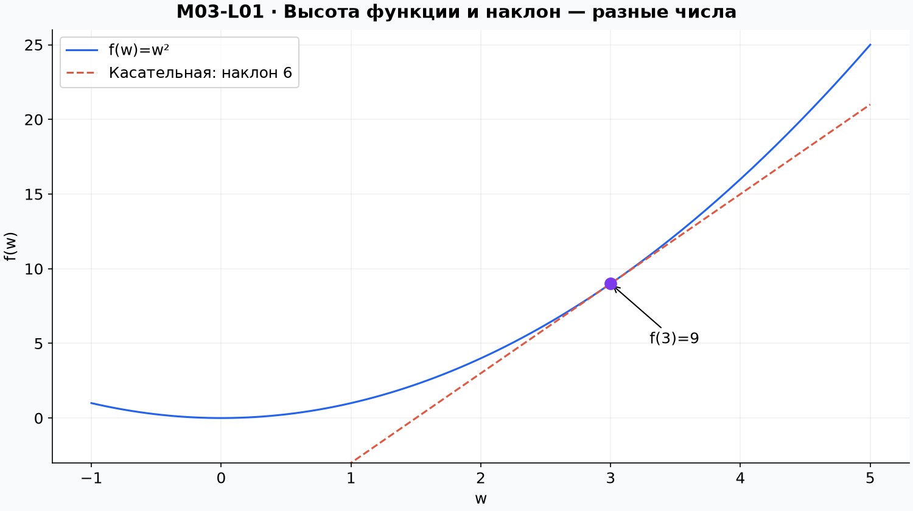

# M03-L01. Изменение функции

**Результат:** Оценить скорость изменения функции конечной разностью и отличить её от значения функции.

**Перед началом:** [M00-L03](M00-L03.md)

## Результат и входные знания

Обучение модели требует понимать, как небольшое изменение параметра влияет на ошибку. Само значение ошибки не говорит, в какую сторону двигаться. Производная даёт локальную информацию об изменении, а конечные разности позволяют проверить её вычисление простыми подстановками.

## Проверь себя сначала

**Короткий путь для знакомой темы, 2–5 минут.** f(w) = (w − 3)². Найди f(4), точную производную при w = 4 и прямую разность с h = 0.1. В какую сторону сдвинуть w, чтобы f уменьшилась?

Запиши ответ и объяснение, затем сверь с [ключом M03-L01-D](../../solutions/modules/M03.md#m03-l01-d). Всё верно и объяснение совпадает по смыслу — переходи сразу к самостоятельной задаче этого урока, затем к варианту B/C. Ошибка, сомнение или ответ без объяснения — проходи урок полностью с начала. [Как работает адаптивный маршрут](../self-study.md#адаптивный-маршрут).

## Объяснение

Функция сопоставляет входу значение. Для f(w)=w² входом является число w, выходом его квадрат. В задаче обучения w может быть параметром, а f — ошибкой. Значение f(3)=9 описывает высоту графика, но не наклон. У функции f(w)=w²+100 в той же точке высота 109, хотя локальный наклон такой же.

Средняя скорость изменения на отрезке равна [f(w+h)−f(w)]/h при h≠0. Это наклон прямой через две точки графика. Если уменьшать шаг h, отношение при достаточно гладкой функции приближается к производной в точке. Производная f′(w) — предел этого отношения, когда h стремится к нулю, если предел существует.

Для квадрата f(w+h)=(w+h)²=w²+2wh+h². После вычитания w² и деления на h остаётся 2w+h. При уменьшении h дополнительное слагаемое исчезает, поэтому f′(w)=2w. В точке 3 наклон 6. Положительный наклон означает, что небольшое увеличение w увеличивает f; уменьшение w локально уменьшает f.

Центральная разность [f(w+h)−f(w−h)]/(2h) использует точки по обе стороны. Для квадрата она точно даёт 2w в идеальной арифметике. Для других гладких функций обычно имеет меньшую ошибку приближения при сопоставимом шаге, но вычисляет функцию дважды. Конечная разность полезна для проверки градиентов, хотя для миллионов параметров слишком дорогая как основной способ обучения.

Слишком маленький h не всегда лучше на компьютере. Почти равные числа вычитаются с потерей значащих разрядов, а число может вообще не измениться при прибавлении шага. Это ограничение плавающей арифметики. Поэтому проверяют несколько разумных шагов, например 10⁻², 10⁻⁴, 10⁻⁶, и смотрят на устойчивость.

Производная описывает локальную окрестность. Нулевой наклон не гарантирует минимум: у f(w)=w³ в нуле он равен 0, но функция продолжает расти по обе стороны. Для негладких функций, например |w| в нуле, обычная двухсторонняя производная не существует. Эти ограничения пригодятся при изучении активаций.



Касательная наклонена сильнее, чем прямая около нуля. Подписи отделяют координату точки от изменения функции на единицу параметра.

## Разобранный пример

Для f(w)=w² при w=3 прямое приближение с h=0.1 равно(9.61−9)/0.1=6.1. При h=0.01 получаем 6.01. Центральная разность при 0.1: (9.61−8.41)/0.2=6.

```python
def f(w): return w*w
w=3.0
for h in [0.1,0.01,0.001]:
    forward=(f(w+h)-f(w))/h
    central=(f(w+h)-f(w-h))/(2*h)
    print(h,round(forward,6),round(central,6))
assert abs((f(3.01)-f(2.99))/.02-6)<1e-10
```

**Ожидаемый результат:** Строки 0.1 6.1 6.0;0.01 6.01 6.0;0.001 6.001 6.0.

## Как проверить рассуждение

Сначала проверь знак: при положительном w квадрат растёт вправо. Затем сравни размер изменения f с приближением f′(w)·h. Для h=0.1 прогноз изменения 0.6, фактическое 0.61; расхождение объясняется кривизной, а не ошибкой производной. Чем дальше шаг, тем слабее локальное приближение. Поэтому нельзя переносить наклон в одной точке на весь график без проверки.

## Практика с поддержкой

**Предскажи до запуска.** Прежде чем запускать код или пересчитывать пример, запиши ожидаемый вывод: числа, формы массивов, порядок или текст. После запуска сравни с фактическим и объясни каждое расхождение.

Повтори расчёт при w=−2. Предскажи знак производной и объясни, почему движение вправо уменьшает квадрат. Затем добавь к функции 100 и убедись, что разности и производная не меняются.

## Самостоятельная задача A — M03-L01-A01

Для f(w)=(w−2)² вычисли f(5), точную производную при 5 и прямую разность с h=0.1. Укажи направление небольшого изменения, уменьшающего функцию. Сравни с точкой w=1.


## Подсказки по очереди

1. Обозначь u=w−2.
2. Производная квадрата относительно w равна 2(w−2).
3. В точке 1 знак отрицательный, поэтому для уменьшения функции нужно увеличивать w.

## Критерии и типичные ошибки

Разделены изменение функции и величина самой функции. Полный ответ сохранён до открытия ключа. Если потребовался разбор, проверь самостоятельность на варианте B. Все условия обязательны; оформление не компенсирует неверный механизм.

## Новая и отложенная проверка

**Вариант B:** Для f(x)=x²,x=3,h=0.1 вычисли прямую разность.

**Вариант C через 3–7 дней:** В той же точке вычисли центральную разность h=0.1.

[Отдельные ключи B/C](../../solutions/modules/M03.md). Сохрани попытку, ошибку и требуемую помощь в журнале.

## Источники и углубление

[Ключи M03](../../solutions/modules/M03.md) · [Лабораторная модуля](../../labs/M03/README.md) · [Оглавление модуля](../modules/M03.md)

Основной дополнительный источник: [Google ML Crash Course: градиентный спуск](https://developers.google.com/machine-learning/crash-course/linear-regression/gradient-descent). Собственных объяснений, данных и кода в уроке достаточно для обязательного задания; внешняя ссылка нужна для уточнений и углубления.
