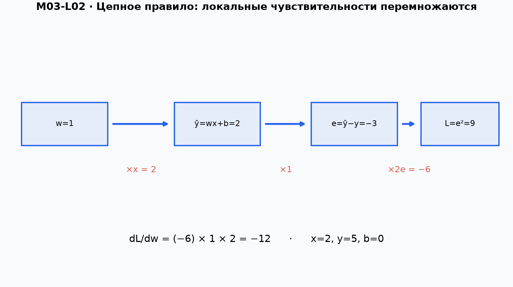

# M03-L02. Производная и цепное правило

**Результат:** Применить цепное правило к квадрату ошибки линейной модели и проверить производные численно.

**Перед началом:** [M03-L01](M03-L01.md)

## Зачем это инженеру

Параметр обычно влияет на ошибку через несколько промежуточных вычислений. Сначала модель делает предсказание, затем вычисляется остаток, затем функция потерь. Цепное правило связывает изменения этих этапов и является основой обратного распространения в нейросетях.

## Объяснение

Если z=g(w), а L=f(z), то производная L по w равна произведению f′(z)g′(w). Смысл простой: маленькое изменение w меняет z, а изменение z меняет L. Скорости этих двух изменений перемножаются. Правило применимо там, где нужные функции дифференцируемы.

Для одного примера линейная модель даёт ŷ=wx+b. Ошибка e=ŷ−y, потеря L=e². При вычислении производной по w вход x, истинная метка y и смещение b считаются фиксированными. Производная квадрата по e равна 2e; производная e по ŷ равна 1; производная ŷ по w равна x. Поэтому ∂L/∂w=2ex.

По смещению получаем ∂L/∂b=2e, потому что производная wx+b по b равна 1. Символ частной производной ∂ напоминает, что функция зависит от нескольких параметров, но в конкретном вычислении меняется один. Собранные вместе частные производные образуют градиент.

Знак производной зависит не только от ошибки, но и от входа. При отрицательном x увеличение w уменьшает предсказание. Поэтому правило «предсказание слишком мало — всегда увеличивай вес» неверно. Производная 2ex учитывает направление влияния признака. Для b направление проще, потому что прибавление b всегда одинаково сдвигает ответ.

Вычислительный граф показывает зависимости: w и x входят в умножение, к результату добавляется b, затем вычитается y и берётся квадрат. Можно сначала вычислить промежуточные значения вперёд, а затем распространить чувствительности назад. Именно это делает автоматическое дифференцирование на гораздо более крупных графах.

Градиент нельзя проверять сравнением с собственной переписанной формулой: одинаковая ошибка может попасть в обе реализации. Центральные конечные разности используют только вычисление исходной функции и дают независимый численный ориентир. Проверяй несколько ненулевых входов и ошибок, чтобы нулевые множители не скрыли дефект.

Цепное правило также объясняет отсутствие влияния параметра: если хотя бы одна локальная производная на единственном пути равна нулю, произведение чувствительностей обнуляется. В более сложном графе у параметра может быть несколько путей к результату, и их вклады складываются. Поэтому нельзя просто перемножить все числа графа; нужно проследить конкретные зависимости. В нашем примере путь к каждому параметру один.



Синие стрелки показывают прямое вычисление. Для производной читай локальные множители под ними справа налево: от потери к параметру. Значения вдоль цепочки перемножаются, а независимые пути в большем графе будут складываться.

## Разобранный пример

x=2, y=5, w=1, b=0: ŷ=2, e=−3, L=9. Производные dL/dw=2·(−3)·2=−12 и dL/db=−6. Маленькое увеличение w или b уменьшит потерю. При x=−2 знак производной по w может измениться.

```python
def loss(w,b,x=2.,y=5.): return (w*x+b-y)**2
w,b=1.,0.;x,y=2.,5.
e=w*x+b-y
dw,db=2*e*x,2*e
h=1e-5
numeric=(loss(w+h,b)-loss(w-h,b))/(2*h)
print(dw,db,round(numeric,6))
assert abs(dw-numeric)<1e-7
```

**Ожидаемый результат:** −12.0 −6.0 −12.0.

## Как проверить рассуждение

Сопоставь единицы: если w выражен в единицах ответа на единицу входа, производная по w показывает изменение квадратной потери на единицу такого параметра. Не смешивай градиент с самой потерей: потеря не отрицательна, производная может быть отрицательной. Также не обновляй параметр в середине проверки и затем не сравнивай производную, вычисленную уже в другой точке.

## Практика с поддержкой

Повтори цепочку для x=−2, y=5, w=1, b=0. Получи e=−7, dw=28, db=−14. Объясни, почему уменьшение w и увеличение b оба повышают слишком низкое предсказание.

## Самостоятельная задача M03-L02-A01

Для x=3, y=7, w=1, b=1 найди предсказание, остаток, потерю и обе производные. Проверь dw центральной разностью. Затем объясни, что происходит с dw при x=0 и может ли при этом обучаться b.


## Подсказки

1. Сначала ŷ=4 и e=−3.
2. Производная по w включает множитель 3.
3. При нулевом x предсказание не зависит от w.

## Критерии самостоятельной проверки

Цепочка включает влияние входа на параметр; знаки проверены. Полный ответ сохранён до открытия ключа. Если потребовался разбор, проверь самостоятельность на варианте B. Все условия обязательны; оформление не компенсирует неверный механизм.

## Повторная и отложенная проверка

**Вариант B:** x=−1,y=2,w=2,b=1. Найди ŷ,e,L,dw,db.

**Вариант C через 3–7 дней:** x=0,y=4,b=1. Может ли меняться b при нулевом dw?

[Отдельные ключи B/C](../../solutions/modules/M03.md). Сохрани попытку, ошибку и требуемую помощь в журнале.

## Решение и дополнительные материалы

[Ключи M03](../../solutions/modules/M03.md) · [Лабораторная модуля](../../labs/M03/README.md) · [Оглавление модуля](../modules/M03.md)

Основной дополнительный источник: [Google ML Crash Course: градиентный спуск](https://developers.google.com/machine-learning/crash-course/linear-regression/gradient-descent). Собственных объяснений, данных и кода в уроке достаточно для обязательного задания; внешняя ссылка нужна для уточнений и углубления.
