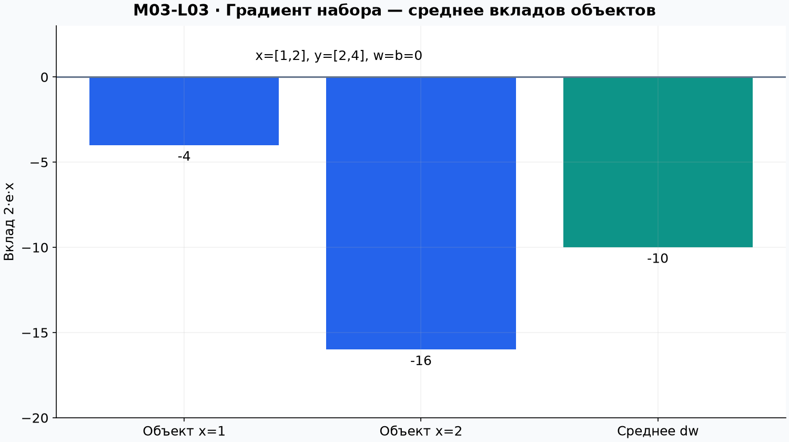

# M03-L03. Градиент на наборе

**Результат:** Вычислить градиент MSE по набору и выполнить согласованный шаг всех параметров.

**Перед началом:** [M03-L02](M03-L02.md), [M02-L01](M02-L01.md)

## Результат и входные знания

Модель обучается на наборе, в котором отдельные примеры могут требовать противоположных изменений. Градиент среднего объединяет их требования. Реализация должна правильно усреднять, сохранять формы и обновлять параметры из одной и той же исходной точки.

## Проверь себя сначала

**Короткий путь для знакомой темы, 2–5 минут.** x = [1, 2], y = [2, 2], w = 0, b = 0, потеря MSE, шаг η = 0.1. Найди dw, db и параметры после одного шага.

Запиши ответ и объяснение, затем сверь с [ключом M03-L03-D](../../solutions/modules/M03.md#m03-l03-d). Всё верно и объяснение совпадает по смыслу — переходи сразу к самостоятельной задаче этого урока, затем к варианту B/C. Ошибка, сомнение или ответ без объяснения — проходи урок полностью с начала. [Как работает адаптивный маршрут](../self-study.md#адаптивный-маршрут).

## Объяснение

Для n примеров MSE равна L=(1/n)Σ(wxᵢ+b−yᵢ)². Производная суммы равна сумме производных, постоянный множитель 1/n сохраняется. Поэтому ∂L/∂w=(2/n)Σeᵢxᵢ, а ∂L/∂b=(2/n)Σeᵢ. Здесь eᵢ — остаток на i-м объекте.

Градиент показывает направление наибольшего локального роста функции при обычной евклидовой геометрии параметров. Для уменьшения ошибки делается шаг в противоположную сторону: w_new=w−ηdw, b_new=b−ηdb. Положительное число η называется шагом обучения. В этом уроке задаём его вручную и проверяем фактическое изменение потери.

Оба компонента градиента должны быть вычислены при старых w и b. Если сначала обновить w, затем пересчитать остатки для db, получится другая процедура. Она не обязательно бессмысленна, но это уже не один обычный шаг по градиенту в исходной точке. Сохраняй dw и db до обновления.

Векторная запись для многих признаков: ŷ=Xw+b, e=ŷ−y, dw=(2/n)Xᵀe, db=2mean(e). X имеет форму n×d, Xᵀe — вектор длины d. Подписи форм помогают найти неверное транспонирование и broadcasting. Для одного признака формулы сводятся к предыдущим суммам.

Полный градиент использует все обучающие примеры на каждом шаге. Мини-пакетный использует часть и даёт шумную оценку. Одна эпоха означает проход по обучающему набору, а не обязательно один шаг: при нескольких пакетах за эпоху будет несколько обновлений. Пока полный набор мал и позволяет проверить каждое слагаемое.

Усреднение делает масштаб функции менее зависимым от количества примеров. Если вместо среднего случайно взять сумму, при удвоении идентичного набора градиент удвоится и прежний шаг обучения изменит поведение. Это удобный тест правильности реализации среднего.

Запиши в журнале, какую именно функцию минимизирует код: среднюю или сумму, со штрафом или без него. Константный множитель не меняет положение минимума простой задачи, но меняет величину градиента и устойчивый шаг. Поэтому две реализации могут иметь одинаковую формулу оптимального решения и разные кривые обучения. Для сравнения нужны не только итоговые параметры, но и одинаковые определения цели и шага.



Каждый столбец — вклад одного объекта до усреднения. Общий градиент не обязан совпадать с градиентом любого отдельного примера.

## Разобранный пример

x=[1, 2], y=[2, 4], w=b=0. Остатки[−2, −4], MSE=(4+16)/2=10. dw=(−4−16)/2=−10, db=(−4−8)/2=−6. При η=0.1 получаем w=1, b=0.6; новые ответы[1.6, 2.6], MSE=1.06.

```python
import numpy as np
x=np.array([1.,2.]);y=np.array([2.,4.]);w=b=0.
e=w*x+b-y
dw=2*np.mean(e*x); db=2*np.mean(e)
w,b=w-.1*dw,b-.1*db
new_loss=np.mean((w*x+b-y)**2)
print(w,b,round(float(new_loss),6))
assert np.allclose([w,b,new_loss],[1,.6,1.06])
```

**Ожидаемый результат:** 1.0 0.6 1.06; потеря уменьшилась с 10 до 1.06.

## Как проверить рассуждение

Снижение после одного шага подтверждает только этот шаг на этих данных. Оно не доказывает сходимость при любом η и не измеряет качество на новых объектах. Проверь градиент конечными разностями всей средней потери, затем удвой набор и убедись в неизменности градиента. Если проверять только снижение, некоторые неверные градиенты случайно тоже уменьшат ошибку.

## Практика с поддержкой

Выполни второй шаг из полученных w, b, предварительно записав новые остатки. Затем удвой исходные x, y через concatenate и сравни первый градиент. Объясни, почему средняя потеря не меняется.

## Самостоятельная задача A — M03-L03-A01

Для x=[1, 3], y=[3, 7], w=1, b=0 найди исходную MSE, dw, db и новые параметры при η=0.05. Вычисли новую MSE. Покажи, что все производные использовали старые параметры.


## Подсказки по очереди

1. Исходные ответы[1, 3], остатки[−2, −4].
2. dw=2·mean([−2, −12]).
3. После обновления отдельно пересчитай предсказания.

## Критерии и типичные ошибки

Градиент усреднён; параметры обновляются из одной исходной точки. Полный ответ сохранён до открытия ключа. Если потребовался разбор, проверь самостоятельность на варианте B. Все условия обязательны; оформление не компенсирует неверный механизм.

## Новая и отложенная проверка

**Вариант B:** xs=[−1,1],ys=[−2,2],w=b=0. Найди градиент и шаг η=0.1.

**Вариант C через 3–7 дней:** Удвой набор копированием обеих строк. Удвоится ли градиент MSE?

[Отдельные ключи B/C](../../solutions/modules/M03.md). Сохрани попытку, ошибку и требуемую помощь в журнале.

## Источники и углубление

[Ключи M03](../../solutions/modules/M03.md) · [Лабораторная модуля](../../labs/M03/README.md) · [Оглавление модуля](../modules/M03.md)

Основной дополнительный источник: [Google ML Crash Course: обучение линейной модели](https://developers.google.com/machine-learning/crash-course/linear-regression/gradient-descent). Собственных объяснений, данных и кода в уроке достаточно для обязательного задания; внешняя ссылка нужна для уточнений и углубления.
