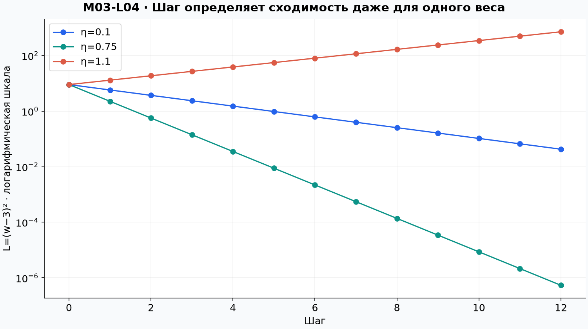

# M03-L04. Шаг обучения

**Результат:** Объяснить медленное обучение, колебания и расходимость через размер шага.

**Перед началом:** [M03-L03](M03-L03.md)

## Результат и входные знания

Если потеря растёт, необязательно виновата архитектура. Слишком большой шаг может разрушить даже обучение одной переменной. Прозрачная квадратичная задача позволяет увидеть это без скрытых деталей библиотеки и научиться читать кривую обучения.

## Проверь себя сначала

**Короткий путь для знакомой темы, 2–5 минут.** L(w) = w², w₀ = 1, обновление w ← w − η·2w. Сделай два шага при η = 0.25 и при η = 1.25. Что происходит в каждом случае?

Запиши ответ и объяснение, затем сверь с [ключом M03-L04-D](../../solutions/modules/M03.md#m03-l04-d). Всё верно и объяснение совпадает по смыслу — переходи сразу к самостоятельной задаче этого урока, затем к варианту B/C. Ошибка, сомнение или ответ без объяснения — проходи урок полностью с начала. [Как работает адаптивный маршрут](../self-study.md#адаптивный-маршрут).

## Объяснение

Рассмотрим L(w)=(w−3)². Градиент 2(w−3), обновление w_new=w−2η(w−3). Если обозначить ошибку параметра δ=w−3, то δ_new=(1−2η)δ. Таким образом, поведение полностью определяется множителем 1−2η.

При 0<η<0.5 множитель положителен и меньше единицы: параметр приближается к минимуму с одной стороны. При η=0.5 множитель ноль, и эта конкретная квадратичная задача достигает минимума за шаг. При 0.5<η<1 знак меняется, но модуль уменьшается: параметр колеблется вокруг минимума со всё меньшей амплитудой.

При η=1 множитель−1: расстояние сохраняется, возникают постоянные колебания. При η>1 модуль больше единицы, поэтому расстояние и потеря растут. Эти границы относятся именно к квадрату с коэффициентом 1. Для L=a(w−3)² устойчивый диапазон меняется на 0<η<1/a. Универсального хорошего шага без учёта функции нет.

Маленький шаг может давать устойчивое, но очень медленное движение. Большое число эпох не исправляет расходящийся шаг. Для сложной модели отслеживают кривую потери, величину градиента, конечность чисел и качество на validation. Появление NaN обычно требует остановки и диагностики, а не продолжения обучения.

Критерий остановки может учитывать малое изменение потери, малый градиент или ограничение числа шагов. Малое изменение не всегда означает хороший минимум: шаг мог быть слишком мал, а данные иметь плохой масштаб. Поэтому сохраняй несколько сигналов, а не одну булеву переменную done.

В реальной задаче validation может начать ухудшаться, пока train продолжает улучшаться. Это другой эффект — переобучение, а не численная расходимость по train. Ранняя остановка выбирает момент по validation; тест при этом остаётся для окончательной проверки. Не смешивай диагностические причины только потому, что все они выглядят как «обучение не получилось».

Практическая диагностика начинается с короткого запуска и нескольких сохранённых значений, а не с многочасового ожидания. Если первый шаг увеличил простую выпуклую потерю, уменьшай шаг и проверь градиент независимым способом. Если значения конечны и медленно убывают, посмотри масштаб признаков. Записывай каждое изменение настройки отдельно, чтобы не потерять причинную связь между изменением и наблюдаемой кривой.



На графике каждая кривая стартует из одной точки. Различается только η. Логарифмическая вертикальная шкала показывает, что расходящийся запуск увеличивает ошибку на порядки.

## Аналогия: автоскейлер с пропорциональной поправкой

Как похоже: автоскейлер меняет число реплик на величину, пропорциональную отклонению от цели, с коэффициентом усиления. Малое усиление подтягивает медленно, среднее — с перерегулированием, которое затухает, слишком большое раскачивает систему. Шаг обучения ведёт себя так же.

| В уроке | В аналогии |
| --- | --- |
| Ошибка параметра δ = w − 3 | Отклонение числа реплик от нужного |
| Шаг обучения η | Коэффициент усиления автоскейлера |
| 0 < η < 0.5 | Плавное приближение с одной стороны, медленное при малом усилении |
| 0.5 < η < 1 | Перерегулирование: колебания вокруг цели затухают |
| η = 1 | Незатухающие колебания |
| η > 1 | Раскачка: каждая поправка больше предыдущей |

**Где аналогия ломается:** автоскейлер работает с шумной системой и задержкой реакции. Здесь потеря — известная квадратичная функция, поэтому граница устойчивости точная. У настоящих моделей кривизна разная по направлениям и меняется во время обучения, единой точной границы шага нет.

## Разобранный пример

Начнём с w=0. При η=0.1 первый шаг w=0.6, потеря 5.76. При η=0.5 получаем w=3 и нулевую потерю. При η=1.1 получаем w=6.6, потеря 12.96, затем w−1.32, потеря 18.6624.

```python
def run(eta,steps=3):
    w=0.; losses=[(w-3)**2]
    for _ in range(steps):
        w-=eta*2*(w-3)
        losses.append((w-3)**2)
    return w,losses
for eta in [.1,.5,1.1]:
    w,losses=run(eta)
    print(eta,[round(v,4) for v in losses])
assert run(.1)[1][-1]<9 and run(1.1)[1][-1]>9
```

**Ожидаемый результат:** η=0.1: [9, 5.76, 3.6864, 2.3593];η=0.5: [9, 0, 0, 0];η=1.1: [9, 12.96, 18.6624, 26.8739].

## Как проверить рассуждение

Сравни отношение соседних потерь: оно равно(1−2η)² для этой задачи. Это более сильная проверка, чем просто убывание. Если программа показывает другое отношение, проверь формулу и место обновления. Не переносись сразу к адаптивному оптимизатору: сначала исключи ошибку градиента и масштаба. В отчёте сохраняй полный ряд хотя бы первых шагов и условия запуска.

## Практика с поддержкой

**Предскажи до запуска.** Прежде чем запускать код или пересчитывать пример, запиши ожидаемый вывод: числа, формы массивов, порядок или текст. После запуска сравни с фактическим и объясни каждое расхождение.

Возьми η=0.75 и запиши три значения параметра. Они должны перескакивать через 3, приближаясь к нему. Объясни, почему колебание параметра здесь совместимо с монотонным уменьшением потери.

## Самостоятельная задача A — M03-L04-A01

Для L(w)=2(w−1)², w₀=0 выведи формулу обновления ошибки δ=w−1. Найди условие сходимости по η. Выполни два шага при η=0.2 и при η=0.6 и сравни потери.


## Подсказки по очереди

1. Производная 4(w−1).
2. Требуется|1−4η|<1.
3. При η=0.2 множитель 0.2, при η=0.6 он−1.4.

## Критерии и типичные ошибки

Показаны минимум два шага и объяснена устойчивость. Полный ответ сохранён до открытия ключа. Если потребовался разбор, проверь самостоятельность на варианте B. Все условия обязательны; оформление не компенсирует неверный механизм.

## Новая и отложенная проверка

**Вариант B:** L=(w−2)²,w₀=0,η=0.25. Выполни два шага.

**Вариант C через 3–7 дней:** Та же цель, η=1.1. Выполни два шага и оцени устойчивость.

[Отдельные ключи B/C](../../solutions/modules/M03.md). Сохрани попытку, ошибку и требуемую помощь в журнале.

## Источники и углубление

[Ключи M03](../../solutions/modules/M03.md) · [Лабораторная модуля](../../labs/M03/README.md) · [Оглавление модуля](../modules/M03.md)

Основной дополнительный источник: [Google ML Crash Course: шаг обучения](https://developers.google.com/machine-learning/crash-course/linear-regression/hyperparameters). Собственных объяснений, данных и кода в уроке достаточно для обязательного задания; внешняя ссылка нужна для уточнений и углубления.
