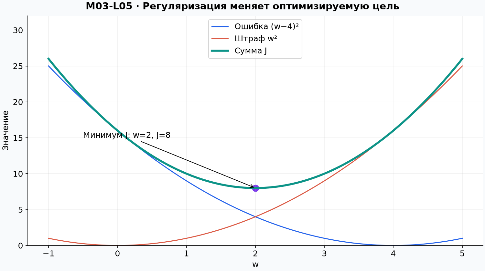

# M03-L05. Регуляризация и масштаб

**Результат:** Добавить L2-регуляризацию, вывести её градиент и объяснить связь с масштабом признаков.

**Перед началом:** [M03-L04](M03-L04.md)

## Зачем это инженеру

Минимальная ошибка на train не всегда означает полезную модель. Регуляризация ограничивает предпочтительные параметры и может снизить чувствительность к шуму. При этом она меняет целевую функцию: сравнивать её значение с обычной MSE без оговорки нельзя.

## Объяснение

L2-регуляризация добавляет к ошибке штраф за квадрат весов. Для одного веса J(w, b)=MSE(w, b)+λw², где λ≥0 задаёт силу штрафа. В этом уроке смещение b не штрафуется. Это явное соглашение: в других реализациях коэффициенты и выбор штрафуемых параметров могут отличаться.

Производная штрафа по w равна 2λw. Общий градиент dJ/dw=dMSE/dw+2λw, а производная по b остаётся прежней. Штраф тянет положительный вес вниз, отрицательный вверх, то есть к нулю. Однако итоговый вес зависит от компромисса с ошибкой по данным и не обязательно становится нулём.

Рассмотрим простую функцию J=(w−4)²+λw². Приравнивая производную 2(w−4)+2λw к нулю, получаем w*=4/(1+λ). При λ=0 оптимум 4, при λ=1 оптимум 2. Ошибка первого слагаемого увеличивается, но полная целевая функция минимальна с учётом штрафа. Это не противоречие, а изменение цели.

Регуляризация является предположением о предпочтительной модели. Она не исправляет утечку, неверные метки или неудачное разбиение. Коэффициент λ выбирают на validation; тест не должен многократно участвовать в выборе. Полезность оценивают по качеству на новых данных, а не только по уменьшению длины весов.

Масштаб признаков меняет смысл штрафа. Если x заменить на 10x, для того же предсказания вес нужно разделить на 10. Его квадрат уменьшится в 100 раз. Поэтому одинаковый λ будет по-разному ограничивать эквивалентные по предсказаниям модели. Стандартизация признаков часто делает сравнение весов более осмысленным, но должна обучаться только на train.

L2 не гарантирует разреженность: многие веса становятся небольшими, но не точно нулевыми. L1 использует сумму модулей и имеет другую геометрию и поведение около нуля. В обязательной задаче достаточно понимать L2 и не переносить её свойства на любой вид регуляризации.



Отдельные кривые показывают два конкурирующих требования. Минимум суммы не совпадает с минимумом ошибки по данным. Подписи помогают не спутать train-MSE с полной целью.

## Разобранный пример

При λ=1 J=(w−4)²+w². Для w=4: MSE=0, штраф 16, J16. Для w=2: MSE=4, штраф 4, J8. Для w=0: MSE=16, штраф 0, J16. Минимум w=2 подтверждается нулевой производной 4w−8.

```python
def objective(w,lam): return (w-4)**2+lam*w*w
lam=1.;w=0.
for _ in range(100):
    gradient=2*(w-4)+2*lam*w
    w-=.1*gradient
print(round(w,6),round(objective(w,lam),6))
assert abs(w-2)<1e-8
assert objective(w,lam)<objective(4,lam)
```

**Ожидаемый результат:** 2.0 8.0 после сходимости.

## Как проверить рассуждение

Отдельно сохраняй ошибку по данным, штраф и сумму. Если показывать только сумму, непонятно, улучшается ли прогноз или уменьшается штраф за счёт ухудшения прогноза. Проверь градиент полной функции конечной разностью. Сравнивание двух λ по их разным значениям J не является корректным выбором лучшей модели: сами цели имеют разный штраф. Выбор делается по общей целевой метрике на validation.

## Практика с поддержкой

Вычисли аналитический оптимум при λ=3 и проверь численно с достаточно небольшим шагом. Затем замени единицы входа в линейной модели и пересчитай эквивалентный вес. Объясни изменение штрафа.

## Самостоятельная задача M03-L05-A01

Для J(w)=(w−6)²+2w² найди оптимум, значение ошибки, штрафа и полной цели. Выведи градиент. Если исходный признак умножили на 10, во сколько раз изменится штраф при сохранении прежних предсказаний и λ?

Сначала сохрани собственные расчёты и объяснение в submissions. Не открывай ключ до первой попытки. Важно показать промежуточные значения: по ним можно понять, где именно расходятся смысл и реализация. Разрешено пользоваться калькулятором и документацией синтаксиса; полученную содержательную подсказку отметь отдельно. После просмотра готового решения самостоятельность проверяется новым примером, а не повторным переписыванием тех же строк.

## Подсказки

1. Производная 2(w−6)+4w.
2. Реши 6w−12=0.
3. Эквивалентный вес станет в 10 раз меньше, его квадрат в 100 раз меньше.

## Ошибки и критерии самопроверки

Оптимум 2, ошибка 16, штраф 8, цель 24, градиент 6w−12. Критическая ошибка — объявить рост train-MSE доказательством бесполезности регуляризации без независимой оценки или сравнивать разные J как одну метрику.

При несовпадении ответа с эталоном сначала классифицируй ошибку: неверно понято условие, перепутаны величины, допущена арифметическая ошибка или нарушено правило эксперимента. Проверка кода не заменяет объяснение. Если вывод сильнее имеющихся данных, перепиши именно вывод, а затем реши, какие дополнительные наблюдения нужны. Хорошее оформление не компенсирует критическую ошибку.

## Повторная и отложенная проверка

Для(w−3)²+0.5w² найди оптимум и компоненты. Через несколько занятий объясни, почему масштабирование и регуляризация должны проектироваться вместе.

Через несколько других занятий вернись к этому действию без открытого конспекта. Сохрани новый ответ и сравни способ рассуждения, а не только последнее число. В [журнале](../../progress/progress.md) отделяй самостоятельную попытку, результат с подсказкой и внешнюю проверку, если она действительно была.

## Решение и дополнительные материалы

[Ключи M03](../../solutions/modules/M03.md) · [Лабораторная модуля](../../labs/M03/README.md) · [Оглавление модуля](../modules/M03.md)

Основной дополнительный источник: [scikit-learn: Ridge и регуляризация](https://scikit-learn.org/stable/modules/linear_model.html#ridge-regression-and-classification). Собственных объяснений, данных и кода в уроке достаточно для обязательного задания; внешняя ссылка нужна для уточнений и углубления.
