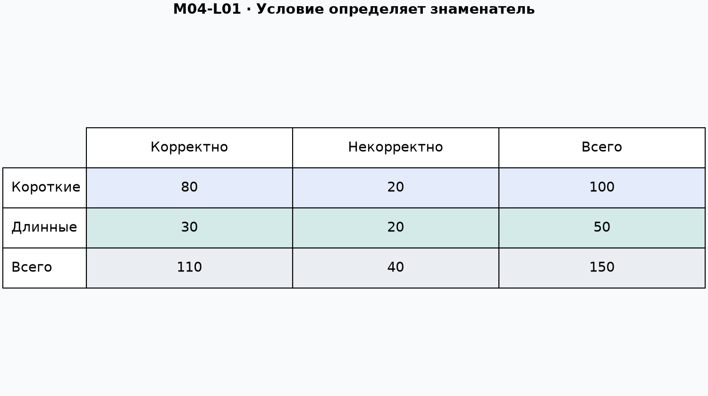

# M04-L01. Случайность и условие

**Результат:** Вычислить условную вероятность по таблице и явно назвать знаменатель.

**Перед началом:** [M01-L02](M01-L02.md)

## Зачем это инженеру

Фраза «модель верно оценивает 90% ответов» скрывает знаменатель. Возможно, речь только о коротких ответах или случаях, где модель уже уверена. Для проверки качества нужно назвать событие, условие и совокупность, к которой относится число. Это позволит сравнивать системы, даже когда состав пользователей меняется.

## Объяснение

Вероятность описывает неопределённость события в заданной модели наблюдений. Для конечного набора равновероятных исходов её можно вычислить как долю подходящих исходов. В данных наблюдаемая доля является оценкой вероятности: она зависит от выборки и не обязана совпадать с будущей частотой. Сначала определяют, что считается отдельным наблюдением и успехом.

Событие A может означать «обратная связь признана корректной», событие B — «ответ длинный». Условная вероятность P(A|B) равна P(A∩B)/P(B), если P(B)>0. В таблице это число корректных длинных ответов, делённое на число всех длинных ответов. Условие B определяет новый знаменатель и сужает рассматриваемую совокупность.

P(A|B) и P(B|A) обычно различаются. Первое спрашивает, насколько хорошо модель работает среди длинных ответов. Второе — какая доля длинных среди всех корректно оценённых. Они могут иметь одинаковый числитель, но разные знаменатели. Такая перестановка особенно опасна при интерпретации детектора ошибок: качество на ошибках и доля настоящих ошибок среди срабатываний различны.

Если B и его дополнение разбивают набор, общая вероятность вычисляется по формуле P(A)=P(A|B)P(B)+P(A|не B)P(не B). Поэтому агрегированное качество зависит и от качества внутри групп, и от доли групп. Изменение состава пользователей может изменить общую метрику даже без изменения модели. Среднее двух групповых процентов без учёта размеров групп обычно неверно.

Независимость означает P(A∩B)=P(A)P(B), или при ненулевом P(B) равенство P(A|B)=P(A). Она не следует из того, что события имеют разные названия. Длина ответа, тема и опыт пользователя часто связаны. В маленьком наборе наблюдаемое отличие также может быть случайным; само сравнение долей ещё не доказывает причинную зависимость.

Формула Байеса переставляет условие с учётом базовой частоты: P(B|A)=P(A|B)P(B)/P(A). Если событие редко, даже неплохой детектор может выдавать много ложных сигналов среди всех срабатываний. Поэтому вместе с качеством на положительных случаях нужно учитывать распространённость события. Формула не создаёт новых данных, а согласует разные способы подсчёта одних наблюдений.



Условие выбирает строку таблицы, затем доля считается внутри неё. Если условие поменять на корректность, придётся выбирать столбец, и знаменатель станет другим.

## Разобранный пример

Из 100 коротких ответов корректно оценены 80, из 50 длинных — 30. P(correct|long)=30/50=0.6. P(long|correct)=30/110≈0.2727. Общая доля 110/150≈0.7333, также 0.8·(100/150)+0.6·(50/150).

```python
short_ok,short_total=80,100
long_ok,long_total=30,50
p_correct_long=long_ok/long_total
p_long_correct=long_ok/(short_ok+long_ok)
overall=(short_ok+long_ok)/(short_total+long_total)
print(round(p_correct_long,4),round(p_long_correct,4),round(overall,4))
assert abs(overall-(.8*2/3+.6/3))<1e-12
```

**Ожидаемый результат:** 0.6 0.2727 0.7333.

## Как проверить рассуждение

Каждую дробь сначала произнеси словами: «число чего среди кого». Это помогает обнаружить перепутанное условие. Для пустой группы вероятность по наблюдениям не определена: нельзя возвращать ноль без отдельного статуса. Ноль означает, что группа наблюдалась и успехов не было; отсутствие данных означает другое. Сохраняй числитель и знаменатель рядом с долей. При переносе в продукт проверь, одинаково ли размечена корректность в обеих группах.

## Практика с поддержкой

Представь, что доля длинных ответов выросла до 80%, а условные качества 0.8 и 0.6 остались прежними. Вычисли новую общую долю 0.64. Объясни, почему снижение не доказывает ухудшение алгоритма внутри групп.

## Самостоятельная задача M04-L01-A01

В тесте 40 HR-ответов, из них 32 оценены корректно, и 60 технических, из них 42 корректны. Найди P(correct|technical), P(technical|correct), общую долю и ожидаемую общую долю при будущем составе 20% HR и 80% technical, если условные качества сохранятся.

Сначала сохрани собственные расчёты и объяснение в submissions. Не открывай ключ до первой попытки. Важно показать промежуточные значения: по ним можно понять, где именно расходятся смысл и реализация. Разрешено пользоваться калькулятором и документацией синтаксиса; полученную содержательную подсказку отметь отдельно. После просмотра готового решения самостоятельность проверяется новым примером, а не повторным переписыванием тех же строк.

## Подсказки

1. Для первого вопроса знаменатель 60.
2. Для второго знаменатель 32+42.
3. Будущий состав задаёт веса 0.2 и 0.8, а не прежние 0.4 и 0.6.

## Ошибки и критерии самопроверки

Ответы 0.7, 42/74≈0.5676, 0.74 и 0.72. Критическая ошибка — поменять условие местами или считать будущие частоты гарантированными. Условие сохранения качества названо явно.

При несовпадении ответа с эталоном сначала классифицируй ошибку: неверно понято условие, перепутаны величины, допущена арифметическая ошибка или нарушено правило эксперимента. Проверка кода не заменяет объяснение. Если вывод сильнее имеющихся данных, перепиши именно вывод, а затем реши, какие дополнительные наблюдения нужны. Хорошее оформление не компенсирует критическую ошибку.

## Повторная и отложенная проверка

Поменяй состав на 50% каждого типа и пересчитай долю. Через несколько занятий объясни формулу Байеса на таблице с целыми числами.

Через несколько других занятий вернись к этому действию без открытого конспекта. Сохрани новый ответ и сравни способ рассуждения, а не только последнее число. В [журнале](../../progress/progress.md) отделяй самостоятельную попытку, результат с подсказкой и внешнюю проверку, если она действительно была.

## Решение и дополнительные материалы

[Ключи M04](../../solutions/modules/M04.md) · [Лабораторная модуля](../../labs/M04/README.md) · [Оглавление модуля](../modules/M04.md)

Основной дополнительный источник: [SciPy: дискретные вероятностные распределения](https://docs.scipy.org/doc/scipy/tutorial/stats/discrete.html). Собственных объяснений, данных и кода в уроке достаточно для обязательного задания; внешняя ссылка нужна для уточнений и углубления.
