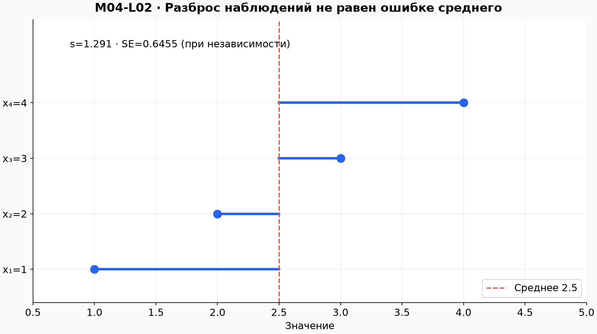

# M04-L02. Среднее, дисперсия и выборка

**Результат:** Различить разброс наблюдений и неопределённость среднего, вычислить обе величины.

**Перед началом:** [M04-L01](M04-L01.md)

## Зачем это инженеру

Средняя задержка не описывает весь опыт пользователя. Две системы могут иметь одинаковое среднее и разные редкие паузы. Одновременно среднее по пяти измерениям менее устойчиво, чем по пяти тысячам независимых измерений. Это два разных вида разброса, и для инженерного решения важно сообщать оба.

## Проверь себя сначала

**Короткий путь для знакомой темы, 2–5 минут.** Для выборки [4, 5, 9] найди среднее, s² (с n − 1), s и стандартную ошибку среднего. Что из этого описывает разброс наблюдений, а что — неопределённость среднего?

Запиши ответ и объяснение, затем сверь с [ключом M04-L02-D](../../solutions/modules/M04.md#m04-l02-d). Всё верно и объяснение совпадает по смыслу — переходи сразу к самостоятельной задаче этого урока, затем к варианту B/C. Ошибка, сомнение или ответ без объяснения — проходи урок полностью с начала. [Как работает адаптивный маршрут](../self-study.md#адаптивный-маршрут).

## Объяснение

Среднее выборки x̄=(1/n)Σxᵢ описывает центр данных. Оно чувствительно к большим значениям: одна долгая задержка может заметно поднять среднее. Медиана — центральное значение упорядоченного набора — устойчивее к отдельным крайностям, но отвечает на другой вопрос. Ни одна из них не заменяет просмотр распределения. У набора с несколькими группами среднее может находиться там, где почти нет наблюдений.

Дисперсия с делением на n описывает средний квадрат отклонений имеющегося конечного набора. Когда по случайной независимой выборке оценивают дисперсию совокупности, часто используют s²=Σ(xᵢ−x̄)²/(n−1). Делитель n−1 учитывает, что среднее уже оценено по тем же данным. В NumPy выбор задаётся ddof: 0 для деления на n, 1 для n−1.

Стандартное отклонение s=√s² возвращает исходные единицы. Если задержка измеряется в секундах, дисперсия имеет единицы секунд в квадрате, стандартное отклонение — секунды. Оно характеризует разброс наблюдений, а не точность среднего. Отрицательная дисперсия невозможна в точной арифметике, потому что складываются квадраты.

Стандартная ошибка среднего при независимых одинаково распределённых наблюдениях оценивается как s/√n. При увеличении n среднее становится устойчивее, хотя разброс отдельных задержек может остаться тем же. Уменьшение стандартной ошибки вдвое обычно требует примерно вчетверо больше независимых наблюдений, если разброс неизменен. Это полезно для оценки объёма будущего измерения.

Независимость нельзя получить увеличением числа строк. Сто ответов одного человека или сто измерений в одном перегруженном процессе могут быть связаны. Если считать их независимыми, стандартная ошибка получится слишком маленькой. Уровень анализа должен соответствовать единице независимого изменения: человеку, сессии, устройству или запуску. Повторные копии строки не добавляют сведений.

Для производительности дополнительно показывают квантили: медиану, p90, p95 и число измерений. На маленьком наборе высокий квантиль нестабилен и зависит от способа интерполяции. Не выдавай p99 по десяти запросам за надёжную характеристику эксплуатации. Храни также условия нагрузки: последовательный и параллельный запуск могут давать разные распределения.



Вертикальная линия обозначает среднее, отрезки — отклонения отдельных точек. Их квадраты входят в дисперсию. Стандартная ошибка среднего меньше стандартного отклонения наблюдений.

## Разобранный пример

Для [1, 2, 3, 4] среднее 2.5, сумма квадратов отклонений 5. Дисперсия с делением на n равна 1.25; оценка с n−1 равна 5/3≈1.6667. s≈1.2910, стандартная ошибка s/2≈0.6455.

```python
import numpy as np
x=np.array([1.,2.,3.,4.])
mean=x.mean();variance=x.var(ddof=1);std=x.std(ddof=1)
se=std/np.sqrt(len(x))
print(round(mean,4),round(variance,4),round(std,4),round(se,4))
assert np.isclose(variance,5/3)
assert np.isclose(se,np.sqrt(5/3)/2)
```

**Ожидаемый результат:** 2.5 1.6667 1.2910 0.6455.

## Как проверить рассуждение

Запиши, что оцениваешь: разброс текущего набора или параметр будущей совокупности. Выбор ddof не должен зависеть от того, какое число приятнее. Для n=1 оценка с n−1 не определена. Если добавить копии измерений, формула может уменьшить стандартную ошибку, но новые независимые сведения не появятся. Поэтому проверка происхождения важнее механического размера массива. Сравни также среднее и медиану, чтобы не скрыть асимметрию.

## Практика с поддержкой

Добавь значение 20. Сравни среднее и медиану до и после. Объясни, почему долгое ожидание нельзя автоматически удалить как выброс: оно может быть реальным важным случаем.

## Самостоятельная задача M04-L02-A01

Для [2, 4, 6, 8] найди среднее, сумму квадратов отклонений, s² с n−1, s и стандартную ошибку. Объясни, почему копирование каждой строки десять раз не является честным способом повысить точность оценки.


## Подсказки

1. Среднее 5.
2. Отклонения −3, −1, 1, 3.
3. Четыре независимых измерения остаются четырьмя источниками информации после копирования.

## Критерии самостоятельной проверки

Разделены SD и SE; независимость не выводится из числа строк. Полный ответ сохранён до открытия ключа. Если потребовался разбор, проверь самостоятельность на варианте B. Все условия обязательны; оформление не компенсирует неверный механизм.

## Повторная и отложенная проверка

**Вариант B:** Для [1,3,5] вычисли среднее, выборочную дисперсию, SD и SE.

**Вариант C через 3–7 дней:** Продублируй каждую строку. Можно ли считать шесть независимых наблюдений?

[Отдельные ключи B/C](../../solutions/modules/M04.md). Сохрани попытку, ошибку и требуемую помощь в журнале.

## Решение и дополнительные материалы

[Ключи M04](../../solutions/modules/M04.md) · [Лабораторная модуля](../../labs/M04/README.md) · [Оглавление модуля](../modules/M04.md)

Основной дополнительный источник: [NumPy: дисперсия и ddof](https://numpy.org/doc/stable/reference/generated/numpy.var.html). Собственных объяснений, данных и кода в уроке достаточно для обязательного задания; внешняя ссылка нужна для уточнений и углубления.
