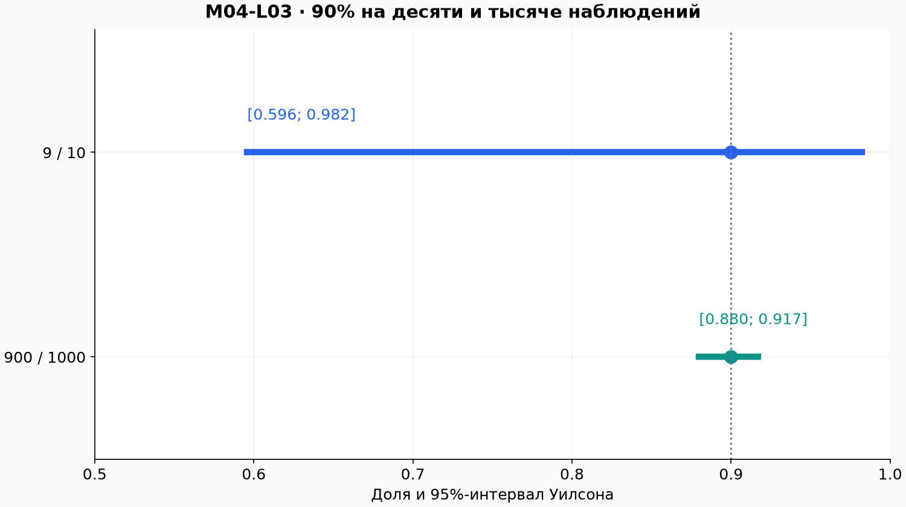

# M04-L03. Неопределённость метрики

**Результат:** Оценить неопределённость доли успехов и корректно интерпретировать интервал.

**Перед началом:** [M04-L02](M04-L02.md)


Перед этим уроком пройди [исходы и биномиальное распределение](M04-L07.md): формула интервала использует модель независимых испытаний.

## Результат и входные знания

Результаты 9 из 10 и 900 из 1000 оба дают 90%, но поддерживают разные уровни уверенности в будущем качестве. Для AI-интервьюера удачная демонстрация не равна проверенному продукту. Метрика должна сопровождаться числом независимых примеров, составом набора и описанием неопределённости.

## Проверь себя сначала

**Короткий путь для знакомой темы, 2–5 минут.** Модель прошла 8 из 10 проверок. Найди долю и её стандартную ошибку √(p(1 − p)/n). Как изменится стандартная ошибка при 80 из 100 и чего интервал не обещает?

Запиши ответ и объяснение, затем сверь с [ключом M04-L03-D](../../solutions/modules/M04.md#m04-l03-d). Всё верно и объяснение совпадает по смыслу — переходи сразу к самостоятельной задаче этого урока, затем к варианту B/C. Ошибка, сомнение или ответ без объяснения — проходи урок полностью с начала. [Как работает адаптивный маршрут](../self-study.md#адаптивный-маршрут).

## Объяснение

Для бинарного результата успех кодируется 1, неуспех 0. Доля p̂=k/n равна среднему этих чисел. При независимых одинаково распределённых попытках число успехов имеет биномиальную модель с неизвестной вероятностью p. Это модель наблюдений, а не универсальное описание любых пользовательских данных. Повторные ответы одного человека могут нарушать независимость.

Приближённая стандартная ошибка доли равна √[p̂(1−p̂)/n]. Она показывает характерный разброс оценки при повторении эксперимента. Для небольших n и долей около 0 или 1 формула может вводить в заблуждение: при всех успехах она даёт ноль, хотя истинная вероятность вовсе не известна точно. Отсутствие ошибки в десяти попытках не доказывает невозможность ошибки.

Доверительный интервал строится процедурой, которая при многократном повторении эксперимента покрывает фиксированный неизвестный параметр с заданной частотой, например 95%. После получения данных частотный интервал не означает «вероятность параметра внутри именно этих границ 95%» без дополнительной вероятностной модели параметра. Случайна процедура получения границ, а параметр в этой интерпретации фиксирован.

Для доли можно использовать интервал Уилсона, который лучше ведёт себя у границ, чем простое p̂±1.96SE. При z≈1.96 центр равен [p̂+z²/(2n)]/[1+z²/n], полуширина z√[p̂(1−p̂)/n+z²/(4n²)]/[1+z²/n]. Формула длинная, поэтому код проверяем на крайних случаях и сравниваем с библиотечной реализацией.

Интервал учитывает случайность выборки в рамках предположений, но не исправляет смещённый сбор данных. Если проверяли только знакомых разработчиков с хорошим микрофоном, узкий интервал не распространяет результат на всех пользователей. Ошибки разметки и зависимость ответов требуют отдельного анализа. Чем больше данных одного узкого типа, тем точнее можно оценить именно этот тип, а не весь рынок.

Сравнение двух систем лучше делать на одинаковых примерах и анализировать разности. Два отдельных интервала сами по себе не дают полноценного теста различия, особенно если оценки связаны. В следующем уроке используем парный bootstrap, сохраняя соответствие объектов. Размер эффекта и неопределённость должны оставаться отдельными величинами.



Точки находятся на уровне 0.9. Длинный интервал малого набора показывает неопределённость, которую одна цифра 90% скрывает. Интервалы относятся к параметру при объявленных предположениях.

## Аналогия: доля успешных запросов у нового сервиса

Как похоже: новый сервис ответил успешно на 18 запросов из 20, старый — на 180 из 200. Доля одна и та же, а уверенность разная. Интервал Уилсона особенно полезен у границ: 10 успехов из 10 ещё не означают 100% надёжности.

| В уроке | В аналогии |
| --- | --- |
| Доля p̂ = k/n | Доля успешных запросов за период |
| SE доли | Насколько эта доля может меняться от периода к периоду |
| 18/20 против 180/200 | Новый и старый сервис: доля одна, уверенность разная |
| Интервал Уилсона у границы | 10 из 10 успешных — ещё не 100% надёжности |
| Смещённый сбор данных | Мерили только в тихие часы: интервал узкий, но о пике ничего не говорит |
| Сравнение на одних примерах | A/B на одном и том же трафике, а не в разные дни |

**Где аналогия ломается:** запросы редко бывают независимыми одинаковыми попытками — есть повторы и всплески нагрузки, а интервал Уилсона опирается на независимость. В эксплуатации надёжность обычно ведут через окна и бюджет ошибок, а не через доверительные интервалы.

## Разобранный пример

Для 9/10 интервал Уилсона 95% примерно [0.596, 0.982]. Для 900/1000 примерно [0.880, 0.917]. Большой набор даёт более точную оценку, но не исправляет систематически неверную разметку.

```python
from math import sqrt
def wilson(k,n,z=1.959963984540054):
    if n<=0 or not 0<=k<=n: raise ValueError("invalid counts")
    p=k/n; den=1+z*z/n
    center=(p+z*z/(2*n))/den
    half=z*sqrt(p*(1-p)/n+z*z/(4*n*n))/den
    return center-half,center+half
small=wilson(9,10);large=wilson(900,1000)
print(tuple(round(x,3) for x in small),tuple(round(x,3) for x in large))
assert large[1]-large[0]<small[1]-small[0]
assert wilson(10,10)[0]<1
```

**Ожидаемый результат:** (0.596, 0.982) и (0.880, 0.917).

## Как проверить рассуждение

Проверь, что границы лежат в диапазоне вероятностей и ширина ненулевая при десяти успехах из десяти. Затем спроси, что считается независимой попыткой. Если десять ответов принадлежат одному человеку, интервал по ответам может быть слишком узким для вывода о новых людях. Для групповых данных следует пересэмплировать группы или использовать соответствующую модель зависимости. Показатель 100% полезно всегда сопровождать знаменателем.

## Практика с поддержкой

**Предскажи до запуска.** Прежде чем запускать код или пересчитывать пример, запиши ожидаемый вывод: числа, формы массивов, порядок или текст. После запуска сравни с фактическим и объясни каждое расхождение.

Вычисли Уилсона для 0/10 и 10/10. Сравни с наивной формулой p̂±1.96SE. Объясни разницу поведения у границ.

## Самостоятельная задача A — M04-L03-A01

Сравни 18/20 и 180/200. Вычисли доли, стандартные ошибки и интервалы Уилсона. Напиши корректный вывод, не обещающий, что следующая партия обязательно попадёт в найденный диапазон долей.


## Подсказки по очереди

1. Обе доли 0.9.
2. SE=√(0.09/n).
3. Будущая наблюдаемая доля имеет дополнительную случайность относительно неизвестной вероятности.

## Критерии и типичные ошибки

Интервал не назван гарантией будущей наблюдаемой доли. Полный ответ сохранён до открытия ключа. Если потребовался разбор, проверь самостоятельность на варианте B. Все условия обязательны; оформление не компенсирует неверный механизм.

## Новая и отложенная проверка

**Вариант B:** Для 20/20 найди нижнюю границу Wilson при z=1.96.

**Вариант C через 3–7 дней:** Для 0/20 найди верхнюю границу.

[Отдельные ключи B/C](../../solutions/modules/M04.md). Сохрани попытку, ошибку и требуемую помощь в журнале.

## Карточка урока

| Поле | Содержание |
| --- | --- |
| Правило | p̂ = k/n; SE ≈ √[p̂(1 − p̂)/n]; интервал Уилсона лучше ведёт себя у 0 и 1, чем p̂ ± 1.96·SE |
| Смысл величин | k — успехи, n — независимые попытки; интервал описывает неопределённость доли при принятых предположениях, а не диапазон следующей партии |
| Когда применять | Чтобы доложить долю успехов с честной неопределённостью. Пример: 45/50 и 450/500 дают одну долю 0.9, но SE ≈ 0.042 и ≈ 0.013 |
| Главная ошибка | Доложить долю без n или считать, что интервал гарантирует результат следующей партии |

## Источники и углубление

[Ключи M04](../../solutions/modules/M04.md) · [Лабораторная модуля](../../labs/M04/README.md) · [Оглавление модуля](../modules/M04.md)

Основной дополнительный источник: [SciPy: интервал биномиальной доли](https://docs.scipy.org/doc/scipy/reference/generated/scipy.stats._result_classes.BinomTestResult.proportion_ci.html). Собственных объяснений, данных и кода в уроке достаточно для обязательного задания; внешняя ссылка нужна для уточнений и углубления.

Второй источник: [Wikipedia: Binomial proportion confidence interval](https://en.wikipedia.org/wiki/Binomial_proportion_confidence_interval) — интервалы Вальда и Уилсона и их поведение у 0 и 1 (на английском).
