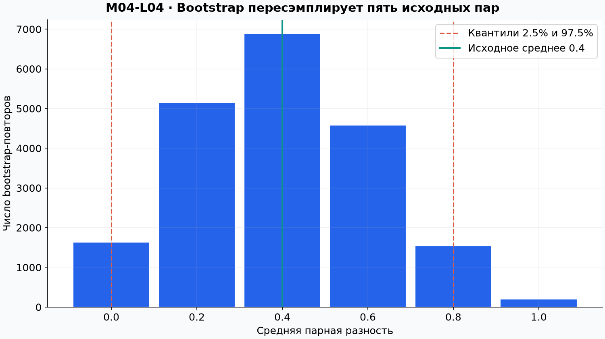

# M04-L04. Bootstrap и интервалы

**Результат:** Построить парный bootstrap и сохранить правильную единицу пересэмплирования.

**Перед началом:** [M04-L03](M04-L03.md), [M01-L03](M01-L03.md)

## Результат и входные знания

Для сложной метрики формулу неопределённости не всегда удобно вывести. Bootstrap приближает повторение выборки пересэмплированием имеющихся объектов. Для сравнения двух моделей важно сохранять, что обе отвечали на одни и те же вопросы, иначе теряется полезная информация о парности результатов.

## Проверь себя сначала

**Короткий путь для знакомой темы, 2–5 минут.** Пары оценок A = [1, 2, 4] и B = [2, 2, 5] на одних и тех же трёх вопросах. Найди разности B − A и их среднее. Посчитай один парный повтор bootstrap для индексов [2, 2, 0]. Почему нельзя пересэмплировать A и B независимо?

Запиши ответ и объяснение, затем сверь с [ключом M04-L04-D](../../solutions/modules/M04.md#m04-l04-d). Всё верно и объяснение совпадает по смыслу — переходи сразу к самостоятельной задаче этого урока, затем к варианту B/C. Ошибка, сомнение или ответ без объяснения — проходи урок полностью с начала. [Как работает адаптивный маршрут](../self-study.md#адаптивный-маршрут).

## Объяснение

Непараметрический bootstrap создаёт новые наборы того же размера, выбирая исходные наблюдения с возвращением. Одна строка может попасть несколько раз, другая не попасть вовсе. Для каждого набора пересчитывается статистика, например среднее или разность средних. Исходные данные здесь играют роль приближённого распределения, из которого можно повторно выбирать наблюдения.

Распределение полученных статистик приближает выборочную неопределённость при предположениях о репрезентативности и независимости единиц. Процентильный интервал берёт квантили 2.5% и 97.5% bootstrap-распределения. Это один метод, а не универсально лучший интервал: для маленьких, смещённых или дискретных выборок покрытие может быть плохим. Нужно понимать границы приближения.

Если модели A и B проверены на одинаковых объектах, для каждого объекта есть пара (aᵢ, bᵢ). Нужно выбирать индексы пар и сохранять стороны вместе. Эквивалентно можно сначала вычислить разности dᵢ=bᵢ−aᵢ и пересэмплировать их. Независимое пересэмплирование A и B разрушает связь между сложностью объекта и обеими оценками.

В интервью несколько ответов одного человека могут быть зависимы. Тогда независимой единицей является человек: выбираются идентификаторы людей с возвращением, а все их ответы переносятся вместе. Размеры групп могут различаться; заранее определи, метрика усредняется по людям или по ответам. Эти цели дают разные веса активным пользователям.

Количество повторов влияет на численную стабильность квантилей, но не создаёт новых реальных данных. Миллион повторов по пяти людям остаётся анализом пяти людей. Seed делает конкретный результат воспроизводимым, а другой seed показывает чувствительность к числу повторов. Если границы заметно меняются, нужно увеличить вычислительное число повторов, но это не заменяет расширение исходного набора.

Bootstrap не устраняет выбор модели по тесту. Если из ста вариантов выбрали лучший на тех же данных и построили интервал как для заранее выбранного варианта, неопределённость выбора не учтена. Сохраняй независимую финальную проверку и честно называй исследовательский характер промежуточных сравнений. Полезно заранее записать статистику, направление разницы и единицу пересэмплирования.



Столбцы агрегируют пересэмплирования пяти пар. Это распределение оценок среднего, а не распределение отдельных пользовательских результатов. Вертикальные границы обозначают выбранные квантили.

## Разобранный пример

A=[0, 1, 0, 1, 0], B=[1, 1, 0, 1, 1], разности [1, 0, 0, 0, 1], средняя 0.4. Индексы [0, 0, 2, 3, 4] дают [1, 1, 0, 0, 1] и среднюю 0.6.

```python
import numpy as np
d=np.array([1.,0.,0.,0.,1.])
rng=np.random.default_rng(42)
indices=rng.integers(0,len(d),size=(20000,len(d)))
means=d[indices].mean(axis=1)
interval=np.quantile(means,[.025,.975])
print(float(d.mean()),interval.tolist())
assert np.allclose(interval,[0,0.8])
assert abs(means.mean()-.4)<.01
```

**Ожидаемый результат:** Средняя 0.4, процентильный интервал [0.0, 0.8] при seed42 и 20000 повторах.

## Как проверить рассуждение

Наличие нуля в интервале показывает, что маленький набор допускает отсутствие улучшения в рамках процедуры. Это не доказывает равенство моделей. Все наблюдаемые разности неотрицательны, поэтому bootstrap не породит отрицательные разности: таково ограничение информации исходного набора. Сопоставляй вывод с размером выборки и разнообразием примеров. Для решения о выпуске потребуется независимая проверка и анализ содержательных ошибок.

## Практика с поддержкой

**Предскажи до запуска.** Прежде чем запускать код или пересчитывать пример, запиши ожидаемый вывод: числа, формы массивов, порядок или текст. После запуска сравни с фактическим и объясни каждое расхождение.

Повтори с 1000 и 50000 повторов и двумя seed. Сравни границы. Затем намеренно пересэмплируй A и B отдельно и объясни, почему это соответствует другому эксперименту.

## Самостоятельная задача A — M04-L04-A01

Даны A=[2, 3, 1, 4], B=[3, 3, 2, 4]. Найди разности и среднее. Выполни 20000 парных повторов с seed42, вычисли 95%-процентильный интервал. Для индексов [0, 0, 2, 3] посчитай один повтор вручную. Объясни ограничение четырёх объектов.


## Подсказки по очереди

1. Разности [1, 0, 1, 0].
2. Ручной повтор [1, 1, 1, 0].
3. Повторы не увеличивают число независимых исходных объектов.

## Критерии и типичные ошибки

Сохраняется парность/группы при пересэмплировании. Полный ответ сохранён до открытия ключа. Если потребовался разбор, проверь самостоятельность на варианте B. Все условия обязательны; оформление не компенсирует неверный механизм.

## Новая и отложенная проверка

**Вариант B:** A=[0,1,0,1],B=[1,1,1,0]. Найди парные разности и средний эффект.

**Вариант C через 3–7 дней:** Пересэмплируй пары индексами [0,0,3,3]. Чему равен эффект?

[Отдельные ключи B/C](../../solutions/modules/M04.md). Сохрани попытку, ошибку и требуемую помощь в журнале.

## Источники и углубление

[Ключи M04](../../solutions/modules/M04.md) · [Лабораторная модуля](../../labs/M04/README.md) · [Оглавление модуля](../modules/M04.md)

Основной дополнительный источник: [SciPy: bootstrap и парные данные](https://docs.scipy.org/doc/scipy/reference/generated/scipy.stats.bootstrap.html). Собственных объяснений, данных и кода в уроке достаточно для обязательного задания; внешняя ссылка нужна для уточнений и углубления.
