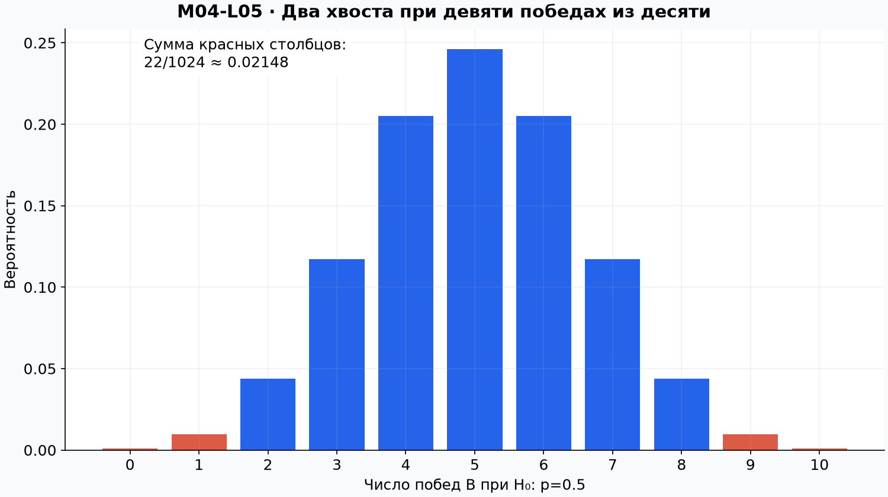

# M04-L05. Гипотезы и эксперимент

**Результат:** Различить размер эффекта, статистическую проверку и решение о полезности изменения.

**Перед началом:** [M04-L04](M04-L04.md)

## Зачем это инженеру

Небольшое улучшение может быть случайностью, а статистически заметное изменение — слишком маленьким для продукта. Инженер заранее определяет, какое улучшение имеет смысл, как измеряется и какие ограничения не позволяют сделать сильный вывод. Это защищает от выбора красивого результата после множества попыток.

## Объяснение

Нулевая гипотеза H₀ задаёт модель отсутствия определённого эффекта, например равной вероятности победы A и B на сопоставимых примерах. Альтернативная гипотеза описывает рассматриваемое отклонение. Формулировка выбирается до просмотра результата; менять одностороннюю проверку после наблюдения знака эффекта нельзя без учёта этого выбора.

P-value — вероятность при H₀ получить статистику не менее экстремальную, чем наблюдаемая, по правилу выбранного теста. Это не вероятность истинности H₀ и не вероятность того, что результат «случаен». Малое p-value говорит о несогласии данных с конкретной нулевой моделью, если её предположения и процедура соблюдены. Оно зависит от размера выборки и выбранной статистики.

Ошибка первого рода — отклонить H₀, когда она верна. Уровень значимости α ограничивает частоту такой ошибки для заранее выбранной процедуры. Ошибка второго рода — не обнаружить рассматриваемый эффект. Мощность 1−β зависит от величины эффекта, шума, размера выборки и теста. Неотклонение H₀ не доказывает равенство систем: данных могло быть слишком мало.

При множестве проверок возрастает шанс случайной находки. Если независимо провести двадцать тестов с α=0.05 при истинных нулевых гипотезах, вероятность хотя бы одного ложного отклонения равна 1−0.95²⁰≈0.642. Поэтому выбирают основную метрику, корректируют множественные сравнения или разделяют поиск гипотез и подтверждение. Зависимость тестов меняет точное число, но не устраняет проблему выбора.

Практическая значимость задаётся величиной улучшения и его ценой. Дополнительный процент корректных ответов может не оправдать десятикратную задержку. В протоколе фиксируют основную метрику, минимально полезный эффект, ограничения задержки и ошибок, размер или правило остановки. Постоянное подглядывание с остановкой при первом p<0.05 меняет свойства обычного теста.

Для парного сравнения можно считать победы среди нетождественных результатов. В простом знаковом тесте при H₀ каждая сторона выигрывает с вероятностью 0.5. Он учитывает направление разницы, но теряет её величину. Поэтому рядом показывай исходные значения, эффект и интервал. Ничьи исключаются по заранее объявленному правилу, а число оставшихся пар обязательно сообщается.



Двусторонняя проверка для девяти побед учитывает столь же редкий противоположный результат. Сумма выделенных вероятностей равна примерно 0.02148.

## Разобранный пример

Из десяти нетождественных независимых пар B лучше в девяти. При H₀ с p=0.5 двусторонняя вероятность 2·[C(10, 9)+C(10, 10)]/2¹⁰=22/1024≈0.02148. Для восьми побед получается 112/1024≈0.10938.

```python
from math import comb
def symmetric_binomial_p(k,n):
    tail=sum(comb(n,j) for j in range(0,min(k,n-k)+1))/2**n
    return min(1.,2*tail)
print(round(symmetric_binomial_p(9,10),6),round(symmetric_binomial_p(8,10),6))
assert symmetric_binomial_p(9,10)==22/1024
assert symmetric_binomial_p(8,10)==112/1024
```

**Ожидаемый результат:** 0.021484 и 0.109375. Функция реализует симметричный двусторонний биномиальный случай p=0.5, а не произвольный тест.

## Как проверить рассуждение

Проверь независимость пар и обработку ничьих. Десять вопросов одного человека не обязательно дают десять независимых сравнений. Знаковый тест не сообщает, велико ли улучшение: победа на 0.001 и на 10 учитывается одинаково. Вывод отдельно описывает размер эффекта, ограничения данных и продуктовые последствия. Если изменение проверяли после десятков попыток, нужна новая подтверждающая выборка.

## Практика с поддержкой

Вычисли вероятность хотя бы одного ложного срабатывания для одного, пяти и двадцати независимых тестов с α=0.05. Объясни необходимость новой проверки после выбора лучшего из двадцати prompt.

## Самостоятельная задача M04-L05-A01

B выиграла семь из восьми нетождественных независимых сравнений. Вычисли двустороннее p при H₀ с p=0.5. Можно ли отклонить H₀ на уровне 0.05? Доказывает ли это равенство? Составь протокол следующего сравнения с основной метрикой, минимально полезным эффектом и правилом остановки.

Сначала сохрани собственные расчёты и объяснение в submissions. Не открывай ключ до первой попытки. Важно показать промежуточные значения: по ним можно понять, где именно расходятся смысл и реализация. Разрешено пользоваться калькулятором и документацией синтаксиса; полученную содержательную подсказку отметь отдельно. После просмотра готового решения самостоятельность проверяется новым примером, а не повторным переписыванием тех же строк.

## Подсказки

1. Учитываются хвосты 0, 1, 7, 8.
2. 2·(1+8)/256.
3. Различай отсутствие свидетельства и доказательство отсутствия эффекта.

## Ошибки и критерии самопроверки

p=18/256=0.0703125; оснований для отклонения на α=0.05 нет, равенство не доказано. Протокол фиксируется заранее. Критическая ошибка — назвать p вероятностью H₀.

При несовпадении ответа с эталоном сначала классифицируй ошибку: неверно понято условие, перепутаны величины, допущена арифметическая ошибка или нарушено правило эксперимента. Проверка кода не заменяет объяснение. Если вывод сильнее имеющихся данных, перепиши именно вывод, а затем реши, какие дополнительные наблюдения нужны. Хорошее оформление не компенсирует критическую ошибку.

## Повторная и отложенная проверка

Повтори для восьми побед из восьми. Позже объясни, почему значимость не заменяет оценку задержки, цены и содержательных ошибок.

Через несколько других занятий вернись к этому действию без открытого конспекта. Сохрани новый ответ и сравни способ рассуждения, а не только последнее число. В [журнале](../../progress/progress.md) отделяй самостоятельную попытку, результат с подсказкой и внешнюю проверку, если она действительно была.

## Решение и дополнительные материалы

[Ключи M04](../../solutions/modules/M04.md) · [Лабораторная модуля](../../labs/M04/README.md) · [Оглавление модуля](../modules/M04.md)

Основной дополнительный источник: [SciPy: точный биномиальный тест](https://docs.scipy.org/doc/scipy/reference/generated/scipy.stats.binomtest.html). Собственных объяснений, данных и кода в уроке достаточно для обязательного задания; внешняя ссылка нужна для уточнений и углубления.
