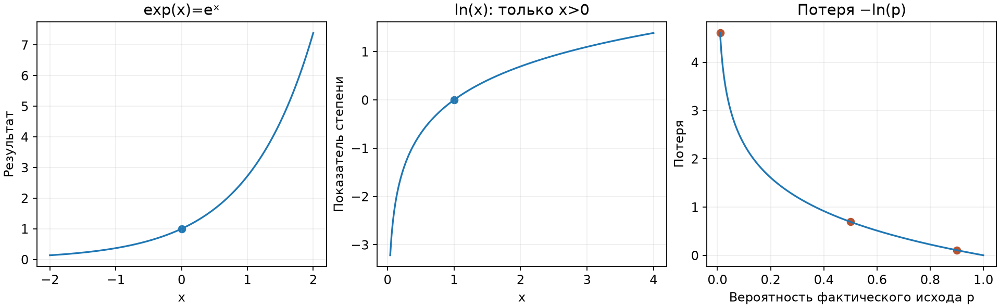

# M04-L06. Экспонента, логарифм и потеря вероятностного ответа

**Результат:** объяснить область определения ln, вычислить потерю вероятностного ответа и предсказать её изменение. **До урока:** M00-L03, школьные степени и функции. Это восстановительный мостик: пройди его перед M04 и M05-L02. Ориентир — 90 минут, включая ручной расчёт и самостоятельную задачу.

## Проверь себя сначала

**Короткий путь для знакомой темы, 2–5 минут.** Пример 1: y = 1, p = 0.5. Пример 2: y = 0, p = 0.2 (p — вероятность класса 1). Найди потерю −ln(вероятность правильного исхода) для каждого примера и среднюю. Что будет при p = 0 для y = 1?

Запиши ответ и объяснение, затем сверь с [ключом M04-L06-D](../../solutions/modules/M04.md#m04-l06-d). Всё верно и объяснение совпадает по смыслу — переходи сразу к самостоятельной задаче этого урока, затем к варианту B/C. Ошибка, сомнение или ответ без объяснения — проходи урок полностью с начала. [Как работает адаптивный маршрут](../self-study.md#адаптивный-маршрут).

## Объяснение

### Зачем нужен логарифм

Классификатор сообщает вероятность события: например, 0.8 для правильного ответа на вопрос. Число 0.8 не означает, что событие «на 80% произошло»: в наблюдении оно либо произошло, либо нет. Чтобы обучать модель, нужно превратить вероятность, назначенную действительно случившемуся событию, в потерю. Чем она меньше, тем сильнее ошибка уверенности модели.

Начнём с обратимых действий. В записи 2³=8 основание — 2, показатель — 3, результат — 8. Логарифм спрашивает о показателе: log₂(8)=3. Поэтому log₂(1)=0, log₂(0.5)=−1. Отрицательный результат логарифма не означает отрицательный аргумент: 0.5 положительно.

В ML часто используют основание e≈2.71828. Функция exp(x)=eˣ определена при любом вещественном x и всегда положительна. Натуральный логарифм ln(x) — её обратная функция: ln(exp(x))=x; exp(ln(x))=x только при x>0. Например, exp(0)=1 и ln(1)=0. Для вещественной задачи ln(−1) не определён; при приближении x к нулю справа ln(x) уходит к минус бесконечности. Сам ноль в область определения не входит.

Логарифм превращает произведение положительных чисел в сумму: ln(ab)=ln(a)+ln(b). Если модель назначила независимым наблюдениям вероятности 0.8 и 0.5, вероятность их совместного появления по этому предположению равна 0.4. Логарифм произведения можно вычислить как сумму логарифмов. Это одна из причин, почему удобно суммировать потери по примерам. Предположение независимости не следует из самой формулы: связанные ответы одного человека требуют отдельного учёта в оценивании.



На первых двух графиках меняются роли входа и выхода: точке (0,1) у exp соответствует (1,0) у ln. На третьем по горизонтали вероятность **случившегося события**, по вертикали потеря. Объясни, почему правый край подходит к нулю, а левый резко растёт.

### От вероятности к функции потерь

Для одного правильного исхода с вероятностью p используем L=−ln(p). При p=1 потеря нулевая. При p=0.9 она примерно 0.105; при p=0.5 — 0.693; при p=0.01 — 4.605. Функция штрафует именно низкую вероятность факта, который оказался верным. Это не то же самое, что пороговая ошибка «угадал/не угадал»: два правильно классифицированных ответа с p=0.51 и p=0.99 имеют разные потери.

В бинарной классификации p обычно обозначает вероятность класса 1. Если истинная метка y=0, вероятность случившегося исхода равна 1−p. Две ветки можно записать одной формулой: BCE(y,p)=−[y ln(p)+(1−y)ln(1−p)]. При y=1 остаётся −ln(p); при y=0 — −ln(1−p). Средняя потеря — сумма таких величин, делённая на число примеров.

## Аналогия: доступность цепочки сервисов

Как похоже: доступность цепочки сервисов — произведение доступностей компонентов, как вероятность нескольких независимых исходов. Логарифм превращает произведение в сумму, и вклады компонентов можно складывать. Штраф −ln p похож на неустойку за уверенный неверный прогноз: чем меньше вероятность случившегося, тем он больше.

| В уроке | В аналогии |
| --- | --- |
| Произведение вероятностей | Доступность цепочки = произведение доступностей компонентов |
| ln(ab) = ln a + ln b | Сложить логарифмы доступностей вместо перемножения |
| −ln(p) | Штраф прогнозу, который дал случившемуся событию вероятность p |
| p → 0 для случившегося события | Уверенный неверный прогноз: штраф растёт без предела |
| y = 0, вероятность 1 − p | Для «не случилось» берётся вероятность отсутствия события |
| ln(0) не определён | Нельзя «считать нулём»: нужна проверка входа |

**Где аналогия ломается:** произведение доступностей верно только для независимых отказов, а на практике отказы связаны. Log loss — правило оценки вероятностных прогнозов: низкая средняя потеря ещё не значит, что модель полезна или хорошо откалибрована в каждой группе.

## Разобранный пример

Для y=[1,0], p=[0.8,0.3] первый вклад равен −ln(0.8)≈0.223144, второй −ln(0.7)≈0.356675. Среднее≈0.289909. Во втором случае нельзя подставлять −ln(0.3): модель правильно отдала большую вероятность классу 0.

```python
import math
y = [1, 0]
p = [0.8, 0.3]
terms = [-math.log(prob if label == 1 else 1-prob)
         for label, prob in zip(y, p)]
print(terms, sum(terms)/len(terms))
assert abs(sum(terms)/len(terms)-0.2899092476) < 1e-9
```

Событию с вероятностью ноль модель приписывает бесконечную потерю, если оно всё же случилось. При конечных вычислениях библиотека может использовать устойчивую формулу непосредственно от logits. Самовольное обрезание вероятностей меняет вычисляемую потерю: если используешь clipping, запиши epsilon и причину. Оно не исправляет качество модели и не превращает невозможный исход в правильный.

## Практика с поддержкой

**Предскажи до запуска.** Прежде чем запускать код или пересчитывать пример, запиши ожидаемый вывод: числа, формы массивов, порядок или текст. После запуска сравни с фактическим и объясни каждое расхождение.

Для y=0 сравни p=0.2 и p=0.8. Сначала переведи их в вероятность фактического класса, затем вычисли логарифм. Измени только второй пример разобранного набора на p=0.9 и объясни рост среднего. На рисунке найди точку, соответствующую каждому вкладу.

## Самостоятельная задача A — M04-L06-A

Для y=[1,0,1], p=[0.75,0.25,0.1] выпиши вероятности правильных исходов, индивидуальные потери и среднее. Расположи вклады от меньшего к большему. Объясни, что произойдёт с третьим вкладом при p→0, и почему ln(0) нельзя просто считать нулём. Затем напиши две проверки области определения для собственной функции потерь.

## Критерии и типичные ошибки

**Критерии до просмотра ответа:** правильная ветка для y=0; знак потери; показаны индивидуальные слагаемые; объяснена граница p=0; код отвергает неверную вероятность. Содержательная подсказка переводит эту попытку в «с поддержкой».

## Подсказки по очереди

1. Вероятность класса 0 равна 1−p.
2. Два первых вклада одинаковы.
3. Положительный логарифм для p<1 — повод проверить знак или аргумент.

## Новая и отложенная проверка

Вариант B: y=[1,0], p=[0.6,0.3]. Через 3–7 дней вариант C: найди две ошибки в утверждении «ln(−0.2) — отрицательная потеря, а при p=0 потеря равна нулю». Затем вычисли потерю для y=0,p=0.95. Числа и объяснения всех вариантов находятся в [ключе M04](../../solutions/modules/M04.md).

## Карточка урока

| Поле | Содержание |
| --- | --- |
| Правило | Потеря примера L = −ln(вероятность случившегося исхода): для y = 1 это −ln p, для y = 0 — −ln(1 − p); средняя BCE усредняет потери по примерам |
| Смысл величин | p — вероятность класса 1; ln — функция, обратная exp, определена только для положительных чисел; ln(ab) = ln a + ln b превращает произведение вероятностей в сумму |
| Когда применять | Чтобы оценить вероятностный классификатор. Пример: y = 1 при p = 0.9 даёт 0.105, а при p = 0.1 — 2.303: уверенная ошибка стоит примерно в 22 раза дороже |
| Главная ошибка | Брать −ln p для y = 0 или «чинить» ln(0) нулём вместо проверки области определения |

## Источники и углубление

Источник для синтаксиса и области определения: [NumPy log](https://numpy.org/doc/stable/reference/generated/numpy.log.html). Объяснение и примеры здесь авторские; внешний источник не требуется для обязательной задачи.

[Интерактивный эксперимент этого урока](../visuals/M04-L06.html): сначала предскажи изменение, затем сравни числа.
