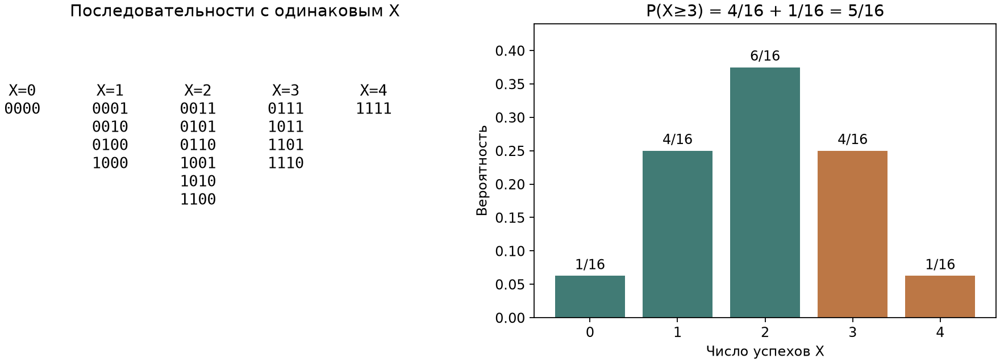

# M04-L07. От исходов к распределению и вероятности хвоста

**Результат:** построить распределение числа успехов из простых исходов и вычислить вероятность события «не менее k». **До урока:** M04-L01, M04-L02. Этот урок идёт до интервалов и проверки гипотез. Ориентир — 90 минут.

## Проверь себя сначала

**Короткий путь для знакомой темы, 2–5 минут.** Четыре независимых броска честной монеты, X — число орлов. Найди P(X ≥ 3). Сколько исходов дают X = 3 и почему?

Запиши ответ и объяснение, затем сверь с [ключом M04-L07-D](../../solutions/modules/M04.md#m04-l07-d). Всё верно и объяснение совпадает по смыслу — переходи сразу к самостоятельной задаче этого урока, затем к варианту B/C. Ошибка, сомнение или ответ без объяснения — проходи урок полностью с начала. [Как работает адаптивный маршрут](../self-study.md#адаптивный-маршрут).

## Объяснение

### Что является случайным

Одно испытание с двумя исходами удобно обозначать 1 и 0. Например, оценщик признал ответ правильным или неправильным. Случайная величина X сопоставляет каждому возможному результату число. Для четырёх испытаний можно определить X как число единиц. Наблюдение 1011 даёт X=3; наблюдение 1101 тоже даёт X=3. Поэтому вероятность значения X складывается из вероятностей нескольких разных последовательностей.

Рассмотрим пока четыре независимых испытания с вероятностью успеха 0.5. Независимость означает, что вероятность конкретной последовательности равна произведению вероятностей её элементов. Каждая из 2⁴=16 последовательностей имеет вероятность 1/16. Распределение X — таблица всех возможных значений X и их вероятностей. Значения X: 0,1,2,3,4. Число соответствующих последовательностей: 1,4,6,4,1. Получаем вероятности [1,4,6,4,1]/16. Сумма должна равняться единице: других значений у X нет.



Каждый столбец — не вероятность одной последовательности, а сумма вероятностей всех последовательностей с этим числом успехов. Выделенные X=3 и X=4 вместе образуют событие «не менее трёх». Сначала посчитай площадь выделенных столбцов как сумму дробей.

### Почему появляются сочетания

Чтобы разместить k успехов среди n позиций, выбираем k позиций из n. Их порядок внутри выбранного набора значения не имеет: набор {1,3} тот же, что {3,1}. Число способов называется сочетанием C(n,k)=n!/[k!(n−k)!]. Факториал n! — произведение целых от 1 до n, причём 0!=1. Для n=4,k=2 получаем 4·3/(2·1)=6. Деление на 2! убирает двойной подсчёт порядка выбранных позиций.

Если вероятность успеха p не равна 0.5, последовательности с разным числом успехов уже не равновероятны. Но все последовательности с ровно k успехами имеют вероятность pᵏ(1−p)ⁿ⁻ᵏ. Поэтому P(X=k)=C(n,k)pᵏ(1−p)ⁿ⁻ᵏ. Это биномиальное распределение при фиксированном n, одинаковом p и независимых испытаниях. Формула не описывает автоматически ситуацию, когда несколько ответов одного человека связаны или условия изменились посреди эксперимента.

Событие «не менее k» включает k,k+1,…,n. Его вероятность — сумма соответствующих столбцов. Знак ≥ включает граничное значение; «больше k» начинает сумму с k+1. Для четырёх честных испытаний P(X≥3)=(4+1)/16=0.3125. Для P(X>3) остаётся только 1/16. Ошибка на единицу в границе меняет смысл проверяемой гипотезы.

## Аналогия: кворум реплик

Как похоже: кластер из n реплик собирает кворум, если ответили не менее k из них. Если реплики отвечают независимо с вероятностью p, вероятность кворума — хвост биномиального распределения.

| В уроке | В аналогии |
| --- | --- |
| Одно испытание 1/0 | Одна реплика ответила или нет |
| X — число успехов | Сколько реплик из n ответили |
| C(n, k) | Сколькими способами можно выбрать ответившие реплики |
| P(X ≥ k) | Вероятность собрать кворум k из n |
| p ≠ 0.5 | У реплик своя надёжность: последовательности не равновероятны |
| ≥ против > | Кворум «не менее k» включает ровно k |

**Где аналогия ломается:** отказы реплик часто связаны — одна стойка, один выпуск, — и независимость нарушается. Биномиальная модель предполагает одинаковую вероятность p для всех испытаний.

## Разобранный пример

```python
from itertools import product
from collections import Counter
from math import comb
counts = Counter(sum(bits) for bits in product([0, 1], repeat=4))
assert [counts[k] for k in range(5)] == [1, 4, 6, 4, 1]
tail = sum(comb(4, k) * .5**k * .5**(4-k) for k in range(3, 5))
print(counts, tail)
assert tail == 5/16
```

В этом коде перечисление исходов и формула сочетаний — два разных пути проверки. Для сотен испытаний перечислять 2ⁿ последовательностей нельзя; библиотека считает вероятность распределения без такого перебора. Небольшой пример помогает понять, что именно она вычисляет.

## Практика с поддержкой

**Предскажи до запуска.** Прежде чем запускать код или пересчитывать пример, запиши ожидаемый вывод: числа, формы массивов, порядок или текст. После запуска сравни с фактическим и объясни каждое расхождение.

Перечисли восемь последовательностей трёх испытаний. Для p=0.6 выпиши вероятность каждой последовательности с двумя успехами. Их три; затем прибавь вероятность трёх успехов. Проверь, что вероятность «не менее двух» не получается простым делением числа подходящих последовательностей на восемь: теперь их вероятности различаются.

## Самостоятельная задача A — M04-L07-A

Для пяти независимых честных испытаний найди P(X≥4), P(X>4) и P(X=0). Объясни каждое число сочетаний. Затем для трёх испытаний с p=0.6 найди P(X≥2). Реализуй `binomial_tail(n, minimum, p)` в [стартовом файле M04](../../exercises/M04/starter.py); сначала проверь руками малые случаи, затем запусти проверку из README задания.

## Критерии и типичные ошибки

**Критерии:** различены последовательность и значение случайной величины; учтена граница события; вероятности суммируются корректно; условия биномиальной модели названы. Верный вызов `comb` без объяснения числителя не закрывает результат урока.

## Подсказки по очереди

1. При n=5 событие X≥4 содержит два значения X.
2. Для p=0.6 два успеха дают множитель 0.6²·0.4.
3. Не забудь, сколько разных последовательностей имеют два успеха.

## Новая и отложенная проверка

Вариант B: n=4,p=0.25, событие X≥1. Реши суммой и через дополнение 1−P(X=0). Вариант C через 3–7 дней: n=0, затем minimum>n. Объясни, почему вероятность X≥0 при нуле испытаний равна единице, а невозможного события — нулю. [Ключ и разбор](../../solutions/modules/M04.md).

## Карточка урока

| Поле | Содержание |
| --- | --- |
| Правило | P(X = k) = C(n, k)·pᵏ(1 − p)ⁿ⁻ᵏ для n независимых испытаний; P(X ≥ k) — сумма таких вероятностей от k до n |
| Смысл величин | X — число успехов; C(n, k) — число последовательностей с k успехами; «не менее k» включает k, «больше k» начинается с k + 1 |
| Когда применять | Чтобы найти вероятность «не менее k успехов». Пример: n = 6, p = 0.5 дают P(X ≥ 5) = (6 + 1)/64 ≈ 0.109 |
| Главная ошибка | Забыть граничное значение в «не менее k» или считать последовательности при p ≠ 0.5 равновероятными |

## Источники и углубление

Дополнительный источник: [SciPy: биномиальная проверка](https://docs.scipy.org/doc/scipy/reference/generated/scipy.stats.binomtest.html). До следующего урока запомни не название теста, а смысл хвоста: какие возможные результаты складываются и при каких предположениях.
