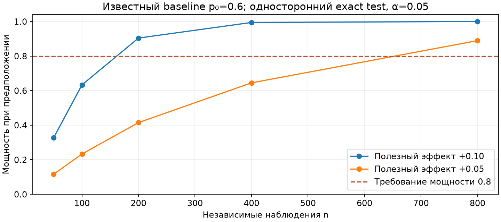

# M04-L08. Сколько наблюдений нужно: планирование симуляцией

**Результат:** выбрать объём из заранее заданных вариантов по мощности при явных предположениях и зафиксировать остановку. **До урока:** M04-L05 и M04-L07. Ориентир — 150 минут. Все эксперименты работают на CPU.

## Вопрос до сбора данных

После изменения интервьюера хочется сравнить качество. Число «100 сессий» само по себе ничего не объясняет. План зависит от минимального полезного эффекта, шума, зависимости наблюдений и способа анализа. Мощность — вероятность отклонить нулевую гипотезу, когда заданная альтернативная модель данных верна. Это характеристика процедуры при предположениях, а не вероятность того, что наше улучшение реально существует.

Сначала разберём более простой сценарий: эталонная вероятность p₀=0.6 считается известной, и мы хотим обнаруживать улучшение до p₁=0.7. Наблюдения независимы, каждый результат равен 0 или 1. До эксперимента выбираем одностороннюю проверку и α=0.05: интересует именно улучшение. Для каждого размера n находим наименьшее число успехов k, при котором P₀(X≥k)≤0.05. Если реально наблюдаем не меньше k успехов, правило отклоняет H₀. Во время сбора правило и объём не меняются.

Для n=100 граница k=69; при p₀=0.6 вероятность такого хвоста около 0.03985. Она не равна ровно 0.05, потому что число успехов целое. При p₁=0.7 вероятность получить не менее 69 успехов около 0.63311. Значит, даже при реальном улучшении на 10 процентных пунктов такой эксперимент часто его не обнаружит.

## Симуляция полного эксперимента

Можно многократно сгенерировать искусственные эксперименты при p₁, применить заранее выбранное правило и посчитать долю отклонений. В каждом повторе генерируются **новые n исходов**, но все повторы остаются компьютерной моделью. Они не превращаются в тысячи наблюдений настоящего продукта. Погрешность самой симуляции приблизительно √[power·(1−power)/R], где R — число симуляций.



Горизонтальная линия 0.8 — выбранное требование к мощности, а не универсальный закон. При эффекте 0.10 первый подходящий объём из [50,100,200,400] — 200; при эффекте 0.05 из [100,200,400,800] — 800. Это выбор **из сетки**, а не доказательство минимального возможного n.

```python
from labs.M04.bridges import plan
rows = plan(p0=.6, p1=.7, sizes=(50, 100, 200, 400), seed=71)
for row in rows:
    print(row['n'], row['reject_at'], round(row['simulated_power'], 3))
chosen = next(row['n'] for row in rows if row['exact_power'] >= .8)
assert chosen == 200
```

Проверенный вывод мощности при seed71: примерно 0.329, 0.636, 0.906, 0.995. Рядом лабораторная считает точную биномиальную вероятность: расхождение объясняется случайностью симуляции. Если изменить seed, не нужно добиваться последней совпадающей цифры. Сверься с разумным допуском и оцени ошибку Монте-Карло.

## Когда baseline тоже измерен

Нельзя автоматически применить предыдущую схему к сравнению двух моделей на данных: p₀ обычно не известно точно. Для интервьюера удобно оценивать версии A/B на **одинаковых новых сессиях**. Каждая пара имеет три состояния: B исправила ошибку A, B испортила правильный ответ A либо результат совпал. Зададим до запуска предположение: вероятности улучшения 0.15, регрессии 0.05, совпадения 0.80. Средний полезный эффект равен 0.10, но информации для знакового теста дают только нетождественные пары.

В каждой симуляции `paired_plan` генерирует количество побед/поражений и применяет заранее выбранный односторонний знаковый тест. При seed73 мощности для n=50,100,200,400 примерно [0.345,0.677,0.933,0.998]. Проверка под H₀, где улучшения и регрессии одинаково вероятны, даёт долю ложных срабатываний ниже 0.05 в этих опытах. Это не переносит автоматически мощность на другие доли совпадений: одинаковый средний эффект может сопровождаться другой дисперсией пар.

```python
from labs.M04.bridges import paired_plan
rows = paired_plan(improve=.15, regress=.05, seed=73)
print([(r['n'], round(r['simulated_power'], 3)) for r in rows])
assert next(r['n'] for r in rows if r['simulated_power'] >= .8) == 200
```

## Практика с поддержкой

Запусти `.\.venv\Scripts\python.exe labs\M04\bridges.py`. Сравни предположение известного baseline и парный вариант. Укажи, какое из них ближе твоему проекту. Для пар сравни improve=0.20/regress=0.10 и 0.15/0.05: средний эффект одинаковый, но число нетождественных пар другое. Объясни, почему одного размера эффекта недостаточно.

## Самостоятельная задача M04-L08-A

Для известного p₀=0.6 и полезного p₁=0.65 выбери первый n из [100,200,400,800], при котором точная мощность не ниже 0.8. Проверь симуляцией с seed72. Напиши протокол из семи пунктов: единица наблюдения, источник случаев, исход/рубрика, полезный эффект, правило проверки, фиксированное n, критические ограничения. Отдельно объясни, почему нельзя честно остановиться на первом удачном p-value.

**Критерии:** предположения заданы до результата; известный baseline не перепутан с оценённым; n означает реальные независимые случаи; выделена погрешность симуляции; нет обещания гарантированно обнаружить эффект. Если n недоступно, правильный вывод — ограниченная точность, а не подмена симуляций реальными людьми.

## Подсказки и новые варианты

1. Сравни мощность с требованием, а не p₁ с 0.8. 2. Выбирай из сетки, не называй результат точным минимальным объёмом. 3. На следующем независимом тесте нельзя выбирать новую основную метрику после просмотра.

Повтор B: парные вероятности improve=0.10, regress=0.05, сетка [100,200,400,800], seed75. Если симулированная мощность оказалась рядом с 0.8, сравни расхождение с Monte Carlo SE и с exact_power лабораторной: она отдельно суммирует все возможные числа нетождественных пар. Не выбирай seed ради попадания выше порога. Через неделю C: сравни протокол фиксированного n=200 с просмотром после каждых десяти наблюдений и остановкой при первом успехе. Предложи корректный вариант без разработки последовательного теста. Численные ответы и эталон протокола — [в решениях M04](../../solutions/modules/M04.md).

Основной источник API: [SciPy binomial test](https://docs.scipy.org/doc/scipy/reference/generated/scipy.stats.binomtest.html). В уроке используются самостоятельно построенные симуляции, а не выводы о реальном качестве тренажёра.
