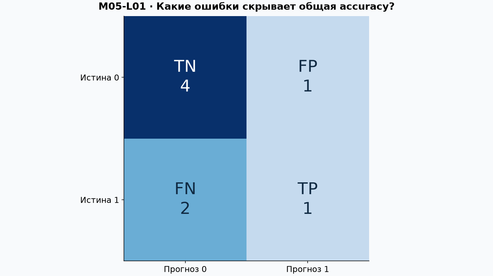

# M05-L01. Задача и исходное решение

**Результат:** Сформулировать задачу классификации, построить baseline и выбрать метрику по ошибкам.

**Перед началом:** [M01-L03](M01-L03.md), [M00-L03](M00-L03.md)

## Результат и входные знания

Сложная модель не нужна, пока не определены объект, целевая переменная и момент применения. Для тренажёра можно предсказывать, требует ли ответ ручной проверки. Но качество такого предсказания нельзя измерять одной accuracy, если проблемные ответы редки и именно их пропуск важен.

## Проверь себя сначала

**Короткий путь для знакомой темы, 2–5 минут.** Истина [1, 0, 0, 1, 0], прогноз [1, 0, 1, 0, 0]. Найди TP, FP, FN, TN, accuracy, precision и recall. Какая accuracy у baseline «всегда 0»?

Запиши ответ и объяснение, затем сверь с [ключом M05-L01-D](../../solutions/modules/M05.md#m05-l01-d). Всё верно и объяснение совпадает по смыслу — переходи сразу к самостоятельной задаче этого урока, затем к варианту B/C. Ошибка, сомнение или ответ без объяснения — проходи урок полностью с начала. [Как работает адаптивный маршрут](../self-study.md#адаптивный-маршрут).

## Объяснение

В обучении с учителем есть признаки X и целевые значения y. Регрессия предсказывает числовую величину, например длительность. Классификация выбирает класс, например «нужна проверка». Числовая запись метки 0 или 1 не делает задачу обычной регрессией: решение и метрика определяются смыслом ошибки.

Постановка включает единицу наблюдения, момент предсказания, доступные признаки, способ получения метки и действие после ответа. Если сервис должен предупреждать до начала интервью, признаки завершённой сессии недоступны. Если метка субъективна, нужна рубрика и проверка согласованности разметчиков. Иначе модель будет оптимизировать непоследовательные оценки.

Baseline — простое исходное решение для сравнения. Это может быть большинство классов, среднее значение или понятное правило. Оно проверяет, даёт ли сложность реальную пользу. На наборе с 95% обычных ответов стратегия «всё нормально» имеет accuracy 95%, но пропускает все проблемные случаи. Высокая цифра не отвечает на нужный продуктовый вопрос.

Для положительного класса «нужна проверка» TP — верно найденная проблема, FN — пропущенная проблема, FP — ложная тревога, TN — верно признанный обычный случай. Precision=TP/(TP+FP) показывает долю настоящих проблем среди тревог. Recall=TP/(TP+FN) показывает долю найденных среди всех проблем. Accuracy=(TP+TN)/n учитывает все правильные ответы.

При нулевом знаменателе метрика математически не определена. Библиотека может вернуть ноль по выбранному соглашению, но в отчёте нужно объяснить отсутствие положительных предсказаний или положительных объектов. F1 — гармоническое среднее precision и recall, однако оно не делает цену двух видов ошибок автоматически одинаковой или обоснованной.

Выбор основной метрики связан с действием. Если ложная тревога вызывает дорогое ручное интервью, важна precision. Если пропуск ведёт к вредному совету, важна полнота при допустимом числе тревог. Практично заранее задать ограничение на один вид ошибки и улучшать другой. Тестовый набор должен отражать заявленный сценарий, а его метки не используются для выбора порога.



Строки — настоящие классы, столбцы — предсказания. Прочитай сначала подписи: перестановка осей меняет интерпретацию FP и FN, хотя числа остаются теми же.

## Разобранный пример

Истина [0, 0, 0, 0, 0, 1, 1, 1], прогноз [0, 0, 0, 0, 1, 0, 0, 1]. TP=1, FP=1, FN=2, TN=4. Accuracy=5/8=0.625, precision=1/2, recall=1/3. Baseline всегда 0 тоже имеет accuracy5/8, но recall=0.

```python
from sklearn.metrics import confusion_matrix,accuracy_score,precision_score,recall_score
y=[0,0,0,0,0,1,1,1];p=[0,0,0,0,1,0,0,1]
matrix=confusion_matrix(y,p,labels=[0,1])
print(matrix.tolist(),accuracy_score(y,p),precision_score(y,p),recall_score(y,p))
assert matrix.tolist()==[[4,1],[2,1]]
assert accuracy_score(y,p)==5/8
```

**Ожидаемый результат:** [[4, 1], [2, 1]], accuracy0.625, precision=0.5, recall≈0.3333.

## Как проверить рассуждение

Сравни модели по одной и той же выборке и с одинаковым определением положительного класса. Accuracy baseline и модели совпадают, но распределение ошибок различается. Нельзя объявить равную полезность без цены ошибок. Также не называй учебную метку объективной профессиональной пригодностью человека: она относится к конкретному ответу и рубрике, а не к личности.

## Практика с поддержкой

**Предскажи до запуска.** Прежде чем запускать код или пересчитывать пример, запиши ожидаемый вывод: числа, формы массивов, порядок или текст. После запуска сравни с фактическим и объясни каждое расхождение.

Измени последний отрицательный прогноз для проблемного случая на 1. Пересчитай метрики вручную и библиотекой. Объясни, почему повышение recall не всегда уменьшает FP.

## Самостоятельная задача A — M05-L01-A01

Истина [0, 0, 0, 0, 1, 1], прогноз [0, 0, 1, 0, 1, 0]. Найди четыре клетки матрицы, accuracy, precision, recall и сравни с baseline всегда 0. Напиши, какие дополнительные сведения нужны для выбора лучшего решения.


## Подсказки по очереди

1. Положительных настоящих объектов два.
2. Тревог тоже две.
3. Цена ложной тревоги и пропуска не следует из accuracy.

## Критерии и типичные ошибки

Метрика соответствует целевой ошибке; baseline имеет смысл. Полный ответ сохранён до открытия ключа. Если потребовался разбор, проверь самостоятельность на варианте B. Все условия обязательны; оформление не компенсирует неверный механизм.

## Новая и отложенная проверка

**Вариант B:** В наборе 10 положительных и 90 отрицательных случаев; baseline всегда отрицателен. Найди accuracy и recall positive.

**Вариант C через 3–7 дней:** Сессии одного человека случайно разошлись между train/test. Какой вывод нельзя делать?

[Отдельные ключи B/C](../../solutions/modules/M05.md). Сохрани попытку, ошибку и требуемую помощь в журнале.

## Источники и углубление

[Ключи M05](../../solutions/modules/M05.md) · [Лабораторная модуля](../../labs/M05/README.md) · [Оглавление модуля](../modules/M05.md)

Основной дополнительный источник: [scikit-learn: оценивание классификации](https://scikit-learn.org/stable/modules/model_evaluation.html#classification-metrics). Собственных объяснений, данных и кода в уроке достаточно для обязательного задания; внешняя ссылка нужна для уточнений и углубления.
