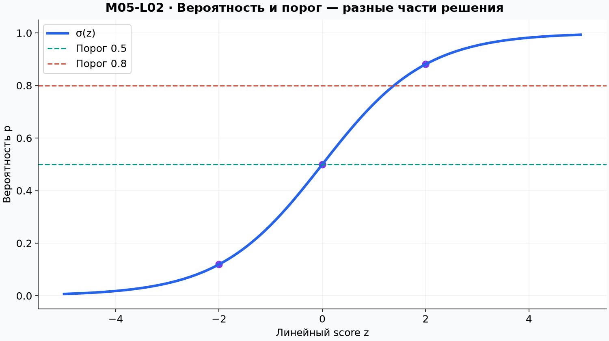

# M05-L02. Линейные модели

**Результат:** Объяснить логистическую модель, вероятность и порог как разные части решения.

**Перед началом:** [M05-L01](M05-L01.md), [M03-L04](M03-L04.md)


Перед этим уроком пройди [экспоненту и логарифм](M04-L06.md). После ручной арифметики обязательная [M05-L06](M05-L06.md) доводит тему до обучения классификатора.

## Результат и входные знания

Линейная модель часто служит сильным и быстрым исходным решением. Для бинарной классификации нужен способ превратить линейный score в число между нулём и единицей. Но даже такое число ещё не является готовым действием: порог и проверка калибровки относятся к отдельным инженерным решениям.

## Проверь себя сначала

**Короткий путь для знакомой темы, 2–5 минут.** Вероятности класса 1: [0.3, 0.55, 0.8], истина [0, 0, 1]. Какие классы предскажет порог 0.5, а какие порог 0.6? Меняются ли веса модели при смене порога? Найди бинарную кросс-энтропию первого примера.

Запиши ответ и объяснение, затем сверь с [ключом M05-L02-D](../../solutions/modules/M05.md#m05-l02-d). Всё верно и объяснение совпадает по смыслу — переходи сразу к самостоятельной задаче этого урока, затем к варианту B/C. Ошибка, сомнение или ответ без объяснения — проходи урок полностью с начала. [Как работает адаптивный маршрут](../self-study.md#адаптивный-маршрут).

## Объяснение

Линейная регрессия предсказывает ŷ=w·x+b и обычно оптимизирует квадрат ошибки. Выход может быть любым вещественным числом. Для бинарной классификации логистическая регрессия вычисляет score z=w·x+b и применяет сигмоиду σ(z)=1/(1+exp(−z)). Результат p лежит между 0 и 1 и интерпретируется моделью как вероятность положительного класса.

Название «регрессия» историческое: при выборе бинарного класса это классификатор. Линейной остаётся зависимость score от признаков, а вероятность меняется нелинейно. В точке z=0 получаем p=0.5, положительные score дают p>0.5, отрицательные p<0.5. Рост модуля z приближает вероятность к границе.

Для обучения используют бинарную кросс-энтропию L=−[y log p+(1−y)log(1−p)]. Если y=1, штраф равен−log p и растёт при уверенно неверном маленьком p. Если y=0, штраф−log(1−p). Это позволяет обучать вероятностный прогноз, не выбирая жёсткий класс на каждом шаге. Численно устойчивые реализации работают со score, чтобы избежать переполнения exp и log0.

Порог t переводит вероятность в действие: predict=1, если p≥t. Изменение порога не обучает веса заново и не меняет сами вероятности. Снижение порога обычно увеличивает число тревог, может поднять recall и уменьшить precision. Конкретные значения зависят от набора. Правило равенства порогу тоже нужно зафиксировать.

Калибровка означает соответствие заявленных вероятностей частотам. Среди многих случаев с прогнозом около 0.8 ожидается примерно 80%положительных, если модель калибрована на этой совокупности. Высокая accuracy или хорошее ранжирование не гарантируют калибровку. Маленький набор не позволяет надёжно оценить её по узким корзинам.

Подготовка признаков и регуляризация влияют на обучение. Масштабирование вычисляется на train, коэффициент штрафа выбирается на validation. У LogisticRegression параметр C задаёт обратную силу регуляризации: больше C обычно означает слабее штраф. Не путай его с λ из математической записи. Проверяй соглашения конкретной библиотеки.

Вероятностный прогноз полезен даже тогда, когда интерфейс показывает только класс. Он позволяет выбирать разные действия: автоматически принять уверенный случай, запросить уточнение в промежуточной зоне и направить сомнительный ответ на ручной разбор. Эти действия требуют собственной оценки ошибок и нагрузки. Нельзя считать численную уверенность модели достаточным основанием для важного решения без проверки её поведения на соответствующих данных.



Горизонтальная линия порога пересекает одну и ту же кривую в разных score. Веса не меняются: меняется правило принятия решения по уже вычисленному числу.

## Аналогия: балл антиспама в почтовом сервере

Как похоже: почтовый фильтр складывает веса сработавших правил — подозрительная тема, ссылка, неизвестный отправитель — и сравнивает сумму с порогом из конфига. Логистическая регрессия так же считает взвешенную сумму признаков, а порог меняется без переобучения, как строка в конфиге без пересборки фильтра.

| В уроке | В аналогии |
| --- | --- |
| Признаки x | Сработавшие правила письма |
| Score z = w·x + b | Сумма весов сработавших правил |
| Сигмоида σ(z) | Перевод балла в вероятность «это спам» |
| Порог t | Порог в конфиге: меняется без пересборки фильтра |
| Три действия по вероятности | Доставить, отправить в «Спам», задержать на карантин |
| Калибровка | Среди писем с отметкой «80%» действительно около 80% спама |

**Где аналогия ломается:** веса классического фильтра часто подобраны вручную, а его балл не вероятность. Логистическая регрессия учит веса по кросс-энтропии на данных, и даже её вероятность нужно проверять на калибровку — она может разойтись с частотами на другой совокупности.

## Разобранный пример

Для score[−2, 0, 2] вероятности примерно[0.1192, 0.5, 0.8808]. При пороге 0.5 и правиле≥ прогнозы[0, 1, 1]. При 0.8 получаем[0, 0, 1]. Для положительной метки и p0.8 потеря−ln0.8≈0.2231, при p0.2≈1.6094.

```python
import numpy as np
from scipy.special import expit
z=np.array([-2.,0.,2.]);p=expit(z)
print(np.round(p,4).tolist(),(p>=.5).astype(int).tolist(),(p>=.8).astype(int).tolist())
assert np.allclose(p,[.119202922,.5,.880797078])
assert -np.log(.8)<-np.log(.2)
```

**Ожидаемый результат:** [0.1192, 0.5, 0.8808], классы[0, 1, 1] и[0, 0, 1].

## Как проверить рассуждение

Проверь монотонность: больший score должен давать большую вероятность. Затем отдельно проверь порог на значении ровно 0.5. Выбор порога по тестовым меткам делает тест частью настройки. Для продукта порог определяется на validation с учётом допустимого числа тревог; финальный test оценивает готовое правило. Не объясняй коэффициент как причинное влияние без отдельного причинного дизайна.

## Практика с поддержкой

**Предскажи до запуска.** Прежде чем запускать код или пересчитывать пример, запиши ожидаемый вывод: числа, формы массивов, порядок или текст. После запуска сравни с фактическим и объясни каждое расхождение.

Возьми score[−1, 1] и сравни пороги 0.5 и 0.9. Посчитай потерю для обеих возможных меток. Объясни, почему уверенная ошибка штрафуется сильнее неуверенной.

## Самостоятельная задача A — M05-L02-A01

Вероятности[0.2, 0.4, 0.6, 0.9], истина[0, 1, 0, 1]. Сравни TP, FP, FN, precision, recall при порогах 0.5 и 0.3. Объясни, изменились ли веса модели. Найди среднюю бинарную кросс-энтропию этих вероятностей.


## Подсказки по очереди

1. При 0.5 положительны третий и четвёртый объекты.
2. При 0.3 добавляется второй.
3. Потери−ln0.8, −ln0.4, −ln0.4, −ln0.9.

## Критерии и типичные ошибки

Различены вероятность, порог, обучение весов и регуляризация. Полный ответ сохранён до открытия ключа. Если потребовался разбор, проверь самостоятельность на варианте B. Все условия обязательны; оформление не компенсирует неверный механизм.

## Новая и отложенная проверка

**Вариант B:** y=[0,1],p=[0.2,0.8]. Найди среднюю BCE.

**Вариант C через 3–7 дней:** Измени порог 0.5 на 0.9 при прежних p. Что изменилось?

[Отдельные ключи B/C](../../solutions/modules/M05.md). Сохрани попытку, ошибку и требуемую помощь в журнале.

## Источники и углубление

[Ключи M05](../../solutions/modules/M05.md) · [Лабораторная модуля](../../labs/M05/README.md) · [Оглавление модуля](../modules/M05.md)

Основной дополнительный источник: [scikit-learn: логистическая регрессия](https://scikit-learn.org/stable/modules/linear_model.html#logistic-regression). Собственных объяснений, данных и кода в уроке достаточно для обязательного задания; внешняя ссылка нужна для уточнений и углубления.
