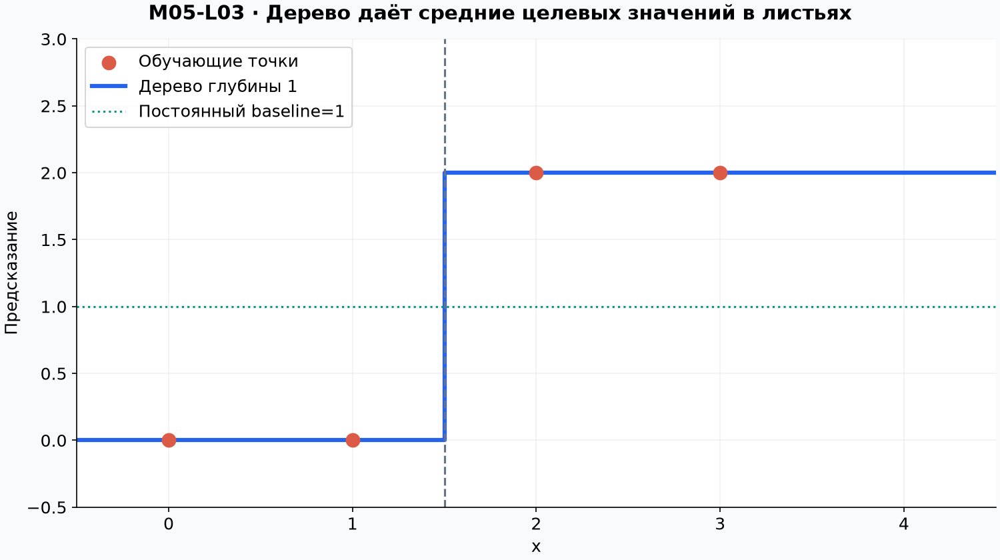

# M05-L03. Деревья и бустинг

**Результат:** Построить простое дерево, объяснить усреднение в листьях и идею бустинга.

**Перед началом:** [M05-L02](M05-L02.md)

## Зачем это инженеру

Табличные признаки часто имеют пороговые и нелинейные зависимости. Дерево разделяет пространство правилами, которые можно проследить. Ансамбли деревьев дают сильные исходные решения, но их качество зависит от глубины, данных и честной проверки, а не от названия алгоритма.

## Объяснение

Дерево решений последовательно задаёт вопросы к признакам, например x≤0.5. Внутренний узел выбирает ветвь, лист выдаёт прогноз. Для регрессии с квадратной ошибкой прогноз листа обычно равен среднему целевых значений обучающих объектов в нём. Для классификации в листе оценивают доли классов или выбирают класс по правилу.

Разбиение выбирается так, чтобы уменьшить неоднородность дочерних узлов относительно родителя. Для регрессии это уменьшение суммы квадратов ошибок. В простом примере можно перебрать пороги вручную. На каждом шаге обычное дерево делает локально лучший выбор; это не гарантирует глобально оптимальное дерево среди всех структур.

Глубокое дерево способно запомнить обучающие данные, включая шум. Ограничения max_depth, min_samples_leaf и pruning уменьшают сложность. Маленький train-error не доказывает хорошее обобщение. Особенно опасны уникальные идентификаторы и признаки будущего: дерево легко использует их, но проблема относится к данным, а не решается одной глубиной.

Случайный лес обучает много деревьев на случайно изменённых поднаборах объектов и признаков, затем усредняет прогнозы. Усреднение снижает чувствительность к отдельным нестабильным деревьям. Деревья в лесу обучаются как множество вариантов, а не каждое для исправления предыдущего. Это отличает лес от бустинга.

Градиентный бустинг строит аддитивную модель: F_new=F_old+ηh. Следующий слабый алгоритм приближает направление улучшения функции потерь. Для квадратичной регрессии это связано с остатками y−F_old. Маленькие деревья последовательно исправляют ещё не объяснённую часть. Число деревьев и learning_rate совместно регулируют сложность.

Деревья обычно не требуют стандартного масштабирования для пороговых разбиений, потому что монотонное преобразование сохраняет порядок значений. Но это не отменяет обработки пропусков, категорий, утечек и контрактов. Разные реализации поддерживают эти случаи по-разному. Обычное дерево регрессии также плохо экстраполирует за пределы обученных диапазонов: оно возвращает значение крайнего листа.



Ступенчатый прогноз отличается от прямой. За пределами крайних наблюдений ступень продолжается: дерево не выводит автоматически закон роста.

## Разобранный пример

x=[0, 1, 2, 3], y=[0, 0, 2, 2]. Постоянный прогноз 1 имеет MSE=1. Порог 1.5 делит набор на два чистых листа со средними 0 и 2, MSE=0. На новом x10 дерево продолжит выдавать 2, хотя истинный будущий закон неизвестен.

```python
import numpy as np
from sklearn.tree import DecisionTreeRegressor
from sklearn.metrics import mean_squared_error
X=np.array([[0.],[1.],[2.],[3.]]);y=np.array([0.,0.,2.,2.])
tree=DecisionTreeRegressor(max_depth=1,random_state=42).fit(X,y)
prediction=tree.predict(X)
print(prediction.tolist(),mean_squared_error(y,prediction),tree.predict([[10.]]).tolist())
assert np.allclose(prediction,y)
assert np.isclose(tree.tree_.threshold[0],1.5)
```

**Ожидаемый результат:** [0, 0, 2, 2], MSE=0, прогноз при 10 равен 2.

## Как проверить рассуждение

Проверь среднее в каждом листе и взвешенную ошибку разбиения. Порог между соседними значениями может иметь разные эквивалентные записи, если новых точек между ними нет; важен контракт на будущие входы. Сравнение дерева с линейной моделью проводится на validation, а не по способности воспроизвести четыре обучающие точки. Для бустинга отслеживай качество по числу итераций, чтобы заметить переобучение.

## Практика с поддержкой

Измени y на[0, 1, 2, 3], сохрани глубину 1. Вычисли ожидаемые средние листьев 0.5 и 2.5 и MSE=0.25. Сравни с прямой y=x, которая точно описывает эти учебные данные.

## Самостоятельная задача M05-L03-A01

Для x=[0, 1, 2, 3], y=[0, 2, 4, 6] рассмотри дерево с фиксированным порогом 1.5. Найди прогнозы листьев и MSE. Затем начни бустинг с постоянного F0=3, возьми дерево этих остатков и learning_rate0.5; вычисли F1 и его MSE.

Сначала сохрани собственные расчёты и объяснение в submissions. Не открывай ключ до первой попытки. Важно показать промежуточные значения: по ним можно понять, где именно расходятся смысл и реализация. Разрешено пользоваться калькулятором и документацией синтаксиса; полученную содержательную подсказку отметь отдельно. После просмотра готового решения самостоятельность проверяется новым примером, а не повторным переписыванием тех же строк.

## Подсказки

1. Средние целевых значений листьев 1 и 5.
2. Остатки относительно 3 равны−3, −1, 1, 3, средние листьев−2 и 2.
3. Новые прогнозы 3+0.5·h.

## Ошибки и критерии самопроверки

Дерево[1, 1, 5, 5], MSE=1;первый шаг бустинга[2, 2, 4, 4], MSE=2. Критическая ошибка — обучить следующее дерево на исходных метках вместо нужных остатков при заявленном алгоритме.

При несовпадении ответа с эталоном сначала классифицируй ошибку: неверно понято условие, перепутаны величины, допущена арифметическая ошибка или нарушено правило эксперимента. Проверка кода не заменяет объяснение. Если вывод сильнее имеющихся данных, перепиши именно вывод, а затем реши, какие дополнительные наблюдения нужны. Хорошее оформление не компенсирует критическую ошибку.

## Повторная и отложенная проверка

Повтори шаг с learning_rate1 и объясни результат. Позже сравни независимое усреднение леса и последовательное исправление бустинга словами и схемой.

Через несколько других занятий вернись к этому действию без открытого конспекта. Сохрани новый ответ и сравни способ рассуждения, а не только последнее число. В [журнале](../../progress/progress.md) отделяй самостоятельную попытку, результат с подсказкой и внешнюю проверку, если она действительно была.

## Решение и дополнительные материалы

[Ключи M05](../../solutions/modules/M05.md) · [Лабораторная модуля](../../labs/M05/README.md) · [Оглавление модуля](../modules/M05.md)

Основной дополнительный источник: [scikit-learn: деревья и ансамбли](https://scikit-learn.org/stable/modules/ensemble.html#gradient-boosting). Собственных объяснений, данных и кода в уроке достаточно для обязательного задания; внешняя ссылка нужна для уточнений и углубления.
