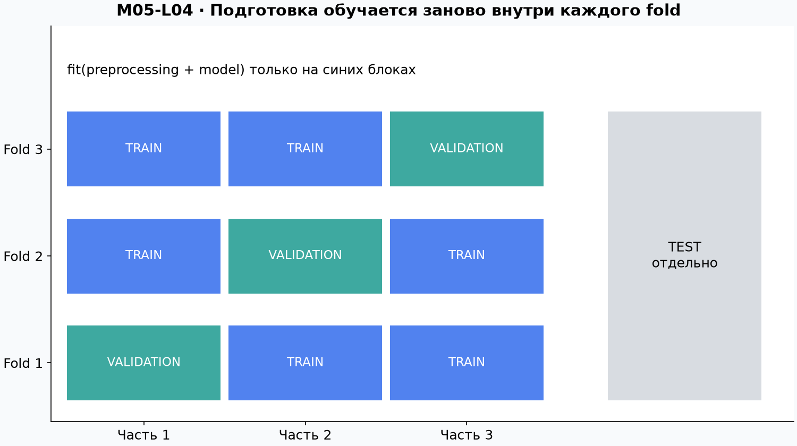

# M05-L04. Валидация и утечки

**Результат:** Организовать cross-validation с подготовкой внутри каждого fold и отдельным финальным test.

**Перед началом:** [M05-L03](M05-L03.md), [M04-L04](M04-L04.md)


После примера проверь процедуру независимо от метрики: [M05-L07](M05-L07.md) и `labs/M05/pipeline.py` записывают реальные fit ID; намеренно глобальный fit отклоняется в каждом fold даже при хорошей метрике.

## Зачем это инженеру

Один удачный split может дать случайно высокую оценку. Cross-validation помогает использовать несколько разделений обучающего набора для выбора процедуры. Но она не защищает от утечек автоматически: если подготовка уже увидела все данные, ошибка повторится во всех folds.

## Проверь себя сначала

**Короткий путь для знакомой темы, 2–5 минут.** В одном fold обучающие значения признака [3, 5, 7, 9], validation — [30]. Какое среднее использовать для центрирования validation и чему равен результат? Где в cross-validation должен вызываться fit у StandardScaler?

Запиши ответ и объяснение, затем сверь с [ключом M05-L04-D](../../solutions/modules/M05.md#m05-l04-d). Всё верно и объяснение совпадает по смыслу — переходи сразу к самостоятельной задаче этого урока, затем к варианту B/C. Ошибка, сомнение или ответ без объяснения — проходи урок полностью с начала. [Как работает адаптивный маршрут](../self-study.md#адаптивный-маршрут).

## Объяснение

В k-fold cross-validation набор делят на k частей. На каждом проходе одна часть служит validation, остальные train. Получают k оценок и агрегируют их. Это способ оценить и выбрать процедуру обучения на доступных данных, а не причина отказаться от независимой финальной проверки после многочисленных решений.

Каждый fold должен заново обучать все операции, зависящие от данных: заполнение, масштабирование, выбор признаков и саму модель. Если сначала выбрать лучшие признаки по всей таблице и затем запустить cross-validation, validation уже повлияла на выбор. Pipeline объединяет шаги так, чтобы fit происходил внутри обучающей части каждого прохода.

Тип splitter следует сценарию. StratifiedKFold поддерживает доли классов, GroupKFold разделяет группы, TimeSeriesSplit уважает порядок времени. Нельзя выбрать обычный shuffled KFold для последовательных сообщений одной сессии и объявить результат качеством на новых людях. Пересечения ключей и доступность признаков проверяются отдельно.

Среднее по folds — оценка процедуры при выбранном разделении. Стандартное отклонение fold-оценок показывает чувствительность к разделению, но не является автоматически стандартной ошибкой независимого среднего: обучающие наборы folds пересекаются. Для сравнения моделей полезны одинаковые splits и парные результаты, чтобы не смешивать модельный эффект с разной сложностью validation.

Утечка может быть прямой: поле reviewer_final_score почти совпадает с целевой меткой и появляется только после решения человека. Может быть косвенной: дубликаты документов по обе стороны, агрегаты с будущими событиями, глобальное заполнение. Слишком хорошая метрика — повод проверить происхождение признаков, а не сразу объявить успех.

После выбора настроек по cross-validation процедуру обычно обучают заново на доступной обучающей части и один раз оценивают на отложенном test. Если после теста понадобилось изменить решение, предыдущий результат сохраняется как наблюдение, а для нового независимого утверждения нужен свежий набор или честное признание повторного использования.



На каждом проходе выделена своя validation-часть. Стрелка fit не должна проходить через неё. Финальный test нарисован отдельно и не участвует в выборе настроек.

## Разобранный пример

Возьмём x=0…8, y=2x+1, три folds. Pipeline содержит StandardScaler и LinearRegression. Идеальная линейная зависимость позволяет получить практически нулевую MSE в каждом fold, если всё вычислено правильно. Это техническая проверка конвейера, а не реалистичная оценка продукта.

```python
import numpy as np
from sklearn.pipeline import make_pipeline
from sklearn.preprocessing import StandardScaler
from sklearn.linear_model import LinearRegression
from sklearn.model_selection import KFold,cross_val_score
X=np.arange(9,dtype=float).reshape(-1,1);y=2*X[:,0]+1
pipe=make_pipeline(StandardScaler(),LinearRegression())
scores=-cross_val_score(pipe,X,y,cv=KFold(3,shuffle=True,random_state=42),scoring="neg_mean_squared_error")
print(np.round(scores,10).tolist())
assert np.max(scores)<1e-20
```

**Ожидаемый результат:** Три MSE, округлённые до нуля; фактические числа могут быть порядка 10⁻²⁹ из-за плавающей арифметики.

## Как проверить рассуждение

В sklearn некоторые функции возвращают отрицательную потерю, чтобы больше всегда означало лучше; поэтому здесь знак меняется обратно. Не сравнивай отрицательную MSE одной модели с положительной другой. Проверь, что каждый объект попадает в validation ровно один раз для данного KFold. Затем отдельно проверь группы: библиотека не знает, что соседние строки принадлежат одному человеку, если ты это не сообщил.

## Практика с поддержкой

Выведи индексы каждого fold и среднее x только на train. Убедись, что обучаемые средние отличаются. Затем добавь group_id и опиши, почему потребуется другой splitter.

## Самостоятельная задача M05-L04-A01

Даны шесть строк с людьми A, A, B, B, C, C. Предложи три folds для оценки на новых людях. Для validation-пользователя C обучающие значения признака[1, 3, 5, 7], validation[100, 102]. Найди правильное среднее для центрирования и ошибочное глобальное. Объясни, где должен находиться StandardScaler.


## Подсказки

1. Каждый fold оставляет одного человека целиком.
2. Среднее train равно 4.
3. Глобальная сумма 218, объектов 6.

## Критерии самостоятельной проверки

Подготовка fit внутри fold; test не участвует в выборе. Полный ответ сохранён до открытия ключа. Если потребовался разбор, проверь самостоятельность на варианте B. Все условия обязательны; оформление не компенсирует неверный механизм.

## Повторная и отложенная проверка

**Вариант B:** Разрешённые fit ID [0,1], validation ID [2,3]; журнал fit содержит [0,1,2,3]. Что должна сделать проверка?

**Вариант C через 3–7 дней:** После просмотра test выбран другой C. Как теперь называется роль этого набора?

[Отдельные ключи B/C](../../solutions/modules/M05.md). Сохрани попытку, ошибку и требуемую помощь в журнале.

## Решение и дополнительные материалы

[Ключи M05](../../solutions/modules/M05.md) · [Лабораторная модуля](../../labs/M05/README.md) · [Оглавление модуля](../modules/M05.md)

Основной дополнительный источник: [scikit-learn: cross-validation](https://scikit-learn.org/stable/modules/cross_validation.html). Собственных объяснений, данных и кода в уроке достаточно для обязательного задания; внешняя ссылка нужна для уточнений и углубления.
