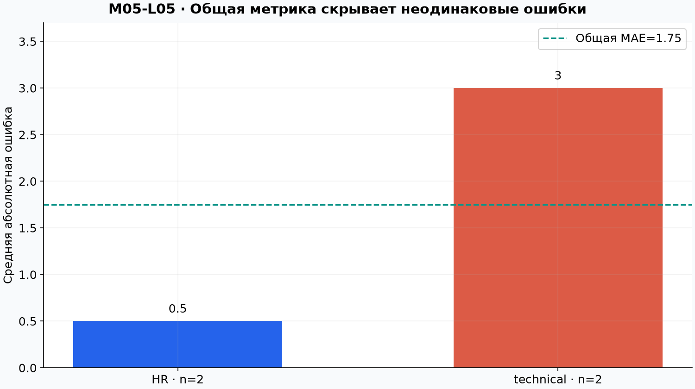

# M05-L05. Анализ ошибок

**Результат:** Разобрать ошибки по содержательным группам и выбрать следующий эксперимент без подгонки теста.

**Перед началом:** [M05-L04](M05-L04.md)

## Зачем это инженеру

Общая метрика сообщает, что система ошибается, но редко объясняет причину. Для тренажёра важны отдельные типы вопросов, длины ответов и технические условия. Анализ ошибок превращает неопределённое «нужно улучшить модель» в проверяемую инженерную гипотезу.

## Проверь себя сначала

**Короткий путь для знакомой темы, 2–5 минут.** Истина [1, 3, 5, 7], прогноз [2, 4, 4, 6], группы [A, A, B, B]. Найди остатки (прогноз − истина), общие MAE и bias, затем MAE и bias по группам. Что скрывает общий bias?

Запиши ответ и объяснение, затем сверь с [ключом M05-L05-D](../../solutions/modules/M05.md#m05-l05-d). Всё верно и объяснение совпадает по смыслу — переходи сразу к самостоятельной задаче этого урока, затем к варианту B/C. Ошибка, сомнение или ответ без объяснения — проходи урок полностью с начала. [Как работает адаптивный маршрут](../self-study.md#адаптивный-маршрут).

## Объяснение

Начни с таблицы уровня наблюдения: идентификатор, истинная метка, прогноз, ошибка и доступные описания случая. Для регрессии сохраняют остаток ŷ−y и абсолютную ошибку. Для классификации — тип TP, FP, FN, TN, вероятность и выбранный порог. Это позволяет отличить слабую модель от ошибки данных или реализации.

Срез — заранее понятная группа, например HR и technical, короткие и длинные ответы, разные устройства. Для каждого среза показывают размер, основную метрику и неопределённость. Одна ошибка из двух и пятьдесят из ста дают одинаковую долю, но разную устойчивость вывода. Не скрывай маленький знаменатель за цветом таблицы.

Систематическое смещение проявляется в знаке остатков: если все длинные ответы недооценены, средний остаток отрицателен. Большая MAE при среднем остатке около нуля означает, что положительные и отрицательные ошибки могут компенсироваться. Поэтому одной средней ошибки недостаточно. Сравнивай минимум MAE и bias, а при необходимости распределение.

Разбор нескольких случаев позволяет сформулировать гипотезы: неверная метка, отсутствующий признак, недостаток похожих примеров, неподходящая модель, сдвиг условий или ошибка подготовки. Каждой гипотезе соответствует отдельная проверка. Например, предположение об ошибках распознавания проверяется сравнением исходного аудио и текста, а не немедленной сменой LLM.

Не исправляй test до достижения красивой метрики. После просмотра ошибок test он уже сообщил информацию о выборе решения. Можно честно использовать его для разработки, но последующая независимая оценка требует нового набора. Сохраняй версию набора и различай исправление объективной ошибки разметки и удаление неудобного примера.

Проверка улучшения должна включать регрессии: новая версия может лучше работать на длинных ответах и хуже на коротких. Сохраняй фиксированный набор критических случаев и общий независимый набор. Узкая регрессия ловит известный дефект, но не заменяет широкую оценку. Любое новое правило должно иметь критерий пользы и возможный побочный эффект.



Столбцы показывают среднюю абсолютную ошибку, подписи — количество объектов. Общая линия скрывает различие между группами. Это учебный набор по два объекта, поэтому вывод о причине пока слабый.

## Разобранный пример

Истина[1, 2, 5, 6], прогноз[1, 3, 2, 3], группы[HR, HR, technical, technical]. Остатки[0, 1, −3, −3], MAE=1.75, bias=−1.25. HR:MAE=0.5, bias=0.5;technical:MAE=3, bias=−3. Технические ответы недооценены в обоих наблюдаемых случаях.

```python
import pandas as pd
d=pd.DataFrame({"group":["HR","HR","technical","technical"],"y":[1,2,5,6],"prediction":[1,3,2,3]})
d["error"]=d.prediction-d.y;d["absolute"]=d.error.abs()
report=d.groupby("group").agg(n=("error","size"),mae=("absolute","mean"),bias=("error","mean"))
print(report.to_string())
assert d.absolute.mean()==1.75
assert report.loc["technical","bias"]==-3
```

**Ожидаемый результат:** HR:n2, MAE=0.5, bias=0.5;technical:n2, MAE=3, bias=−3.

## Как проверить рассуждение

Связь ошибок с группой не объясняет причинность. Возможно, technical содержит более длинные ответы или другой диапазон истинных оценок. Следующая проверка должна сравнить альтернативные объяснения и собрать дополнительные данные. Автоматическое прибавление 3 к техническим прогнозам идеально исправит эти две точки, но его обобщение неизвестно. Это хороший пример подгонки, которую нужно проверить на новых случаях.

## Практика с поддержкой

Прибавь 3 к двум техническим прогнозам и пересчитай метрики. Затем добавь новый technical-объект с y2, прогнозом 2:поправка ухудшит его. Объясни, какие данные нужны для проверки правила.

## Самостоятельная задача M05-L05-A01

Истина[2, 4, 6, 8], прогноз[3, 5, 3, 5], группы[A, A, B, B]. Найди остатки, общие MAE и bias, метрики групп. Сформулируй две разные причины ошибки B, эксперимент для их различения и критерий, по которому улучшение будет принято.


## Подсказки

1. Остатки[1, 1, −3, −3].
2. MAE усредняет модули, bias сохраняет знак.
3. Разные причины могут требовать данных о признаках и отдельной проверки разметки.

## Критерии самостоятельной проверки

Средняя ошибка дополнена срезами и проверяемым планом улучшения. Полный ответ сохранён до открытия ключа. Если потребовался разбор, проверь самостоятельность на варианте B. Все условия обязательны; оформление не компенсирует неверный механизм.

## Повторная и отложенная проверка

**Вариант B:** Остатки [1,−1,4,−4]. Найди bias,MAE,MSE.

**Вариант C через 3–7 дней:** Группа A=[1,−1], B=[4,−4]. Достаточно ли нулевых bias для одинакового качества?

[Отдельные ключи B/C](../../solutions/modules/M05.md). Сохрани попытку, ошибку и требуемую помощь в журнале.

## Решение и дополнительные материалы

[Ключи M05](../../solutions/modules/M05.md) · [Лабораторная модуля](../../labs/M05/README.md) · [Оглавление модуля](../modules/M05.md)

Основной дополнительный источник: [scikit-learn: оценивание и выбор модели](https://scikit-learn.org/stable/modules/model_evaluation.html). Собственных объяснений, данных и кода в уроке достаточно для обязательного задания; внешняя ссылка нужна для уточнений и углубления.
