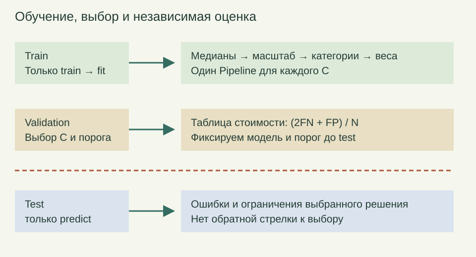
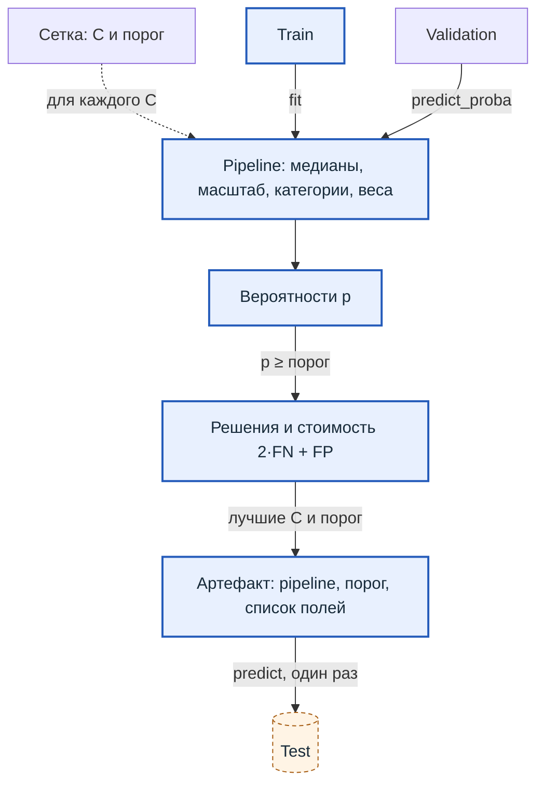

# M05-L06. Обучить классификатор и выбрать правило решения

**Результат:** обучить классификационный pipeline, выбрать регуляризацию и порог на validation и проверить сохранённую модель. **До урока:** M05-L02, M05-L04, M04-L06. Ориентир — 180 минут.

## Проверь себя сначала

**Короткий путь для знакомой темы, 2–5 минут.** Validation: y = [1, 0, 1], p = [0.7, 0.4, 0.3]. Стоимость = 3·FN + FP, правило p ≥ threshold. Сравни пороги 0.25, 0.35 и 0.5 и выбери один. Меняет ли этот выбор модель?

Запиши ответ и объяснение, затем сверь с [ключом M05-L06-D](../../solutions/modules/M05.md#m05-l06-d). Всё верно и объяснение совпадает по смыслу — переходи сразу к самостоятельной задаче этого урока, затем к варианту B/C. Ошибка, сомнение или ответ без объяснения — проходи урок полностью с начала. [Как работает адаптивный маршрут](../self-study.md#адаптивный-маршрут).

## Объяснение

### Из вероятностей к обучаемому эксперименту

В предыдущем уроке вероятности уже были даны. Теперь их должна вычислить модель, обученная на данных. Используем маленькую синтетическую задачу: по опыту разработчика, длине ответа и техническому направлению предсказывается авторская бинарная метка. Она нужна для изучения классификации и **не является пригодностью человека к работе**. Правило генерации известно автору; вывод о настоящих кандидатах по этим данным делать нельзя.

У линейного классификатора score=w·x+b. Сигмоида превращает score в число от 0 до 1. Веса выбирает `fit`: функция потерь по train плюс штраф за величину параметров. В `LogisticRegression` параметр C управляет обратной силой регуляризации: меньше C — сильнее штраф. Это не процент уверенности и не порог решения. Порог применяется позже к уже полученной вероятности; его изменение не переобучает веса.

Числовые признаки могут иметь разные единицы. Опыт от 0 до 8 и длина ответа от 10 до 180 дают разный масштаб коэффициентов. При регуляризации размер коэффициента имеет значение, поэтому смена лет на тысячные доли года может изменить решение без изменения физического смысла данных. `StandardScaler` использует среднее и масштаб **train**. Сначала `SimpleImputer` заменяет пропуски медианами train. Для категорий `OneHotEncoder` создаёт отдельные признаки; неизвестная категория при `handle_unknown='ignore'` не вызывает ошибку, но также не получает автоматически изученный смысл.



Проследи красную границу: сведения из test не должны менять медианы, словарь категорий, веса, C или порог. Если увидел плохой test и изменил модель, этот набор стал частью разработки; для независимого вывода потребуется новый test.

## Аналогия: релизный артефакт сервиса

Как похоже: в продакшен выкатывают не голый бинарник, а образ контейнера — код, зависимости и конфиг вместе. Pipeline — такой же артефакт: медианы, масштаб, словарь категорий, веса и порог сохраняются вместе. Задеплоить одни веса без подготовки — всё равно что выкатить бинарник без конфига: тот же запрос даст другой ответ.

| В уроке | В аналогии |
| --- | --- |
| Pipeline: imputer, scaler, encoder, модель | Образ контейнера: код, зависимости и конфиг |
| Медианы, масштаб, словарь категорий | Значения по умолчанию и справочники, вшитые при сборке |
| Сохранить только веса | Выкатить бинарник без конфига |
| C, выбранный на validation | Параметр сборки, подобранный на staging |
| Порог | Флаг в конфиге: меняет решение без пересборки |
| handle_unknown='ignore' | Неизвестное значение enum не роняет сервис, но и не получает смысла |
| Загрузка и сравнение вероятностей | Smoke-тест образа после выкладки |

**Где аналогия ломается:** образ собирается из кода детерминированно, а параметры pipeline зависят от данных train: другие данные при том же коде дают другой артефакт. И smoke-тест не скажет, как модель поведёт себя при новой доле классов, — это отдельная проверка.

## Разобранный пример

### Один законченный путь

Лабораторная `pipeline.py` создаёт 240 строк, по две на пользователя. В демонстрации первые 72 пользователя входят в train, следующие 24 — в validation, последние 24 — в test. Время также возрастает между частями. `FitAudit` сохраняет фактические ID строк, переданных в fit. Это позволяет проверить процедуру отдельно от метрики: высокая точность не делает смешанные данные допустимыми.

```python
from labs.M05.pipeline import make_data, split_groups, choose_model, check_fit_rows
data = make_data(seed=120)
ids = split_groups(data)
train = data.loc[ids['train']]
validation = data.loc[ids['validation']]
model, threshold, table = choose_model(train, validation)
check_fit_rows(model, train.index)
print(model.named_steps['model'].C, threshold)
assert len(table) == 9
```

В этом окружении выбран C=1, threshold=0.25. Сетка состоит из C=[0.1,1,10] и порогов [0.25,0.5,0.75]. Основная validation-стоимость — (2·FN+FP)/N: пропуск положительного случая условно вдвое дороже ложного положительного. При равенстве стоимости выбираем меньшую log loss, затем меньшие C и порог. Правило разрешения ничьей фиксируется до test.

На демонстрационном test получена матрица [TN,FP,FN,TP]=[1,20,0,27]. Она объясняет компромисс лучше одного числа: выбранный порог почти не допускает FN, но создаёт много FP. Balanced accuracy около 0.524 не отменяет снижения заданной стоимости. Нельзя после этого незаметно заменить основную метрику на более красивую. Сначала проверь, отражает ли стоимость реальный продукт; на новых данных можно запланировать другое правило.

### Масштаб, регуляризация и доля класса

В опыте сравниваются единицы `experience_years` и тот же признак, умноженный на 1000. С scaler при одинаковом C validation log loss совпадает до вычислительного допуска; без scaler меняется. Это показывает роль стандартизации при штрафе, но не доказывает, что scaler всегда улучшает качество. В данном опыте вариант без scaler может получить меньшую потерю — его нужно оценивать по тому же протоколу.

Train содержит около 67.4% положительных случаев, test — 56.25%. Это наблюдаемое изменение состава. Оно не даёт права подбирать новый порог по test. Лабораторная отдельно собирает **из validation** два контролируемых среза: 8 положительных/8 отрицательных и 4/12. Модель и порог заморожены. В `class_composition_experiment` сравни среднюю предсказанную вероятность, фактическую долю класса, стоимость и Brier score — средний квадрат разности вероятности и метки. Совпадение двух средних само по себе ещё не доказывает калибровку во всех диапазонах вероятности. Малые срезы служат демонстрацией сдвига состава, а не точной оценкой нового продукта. При другом распределении калибровка старой модели не гарантирована.

Полный запуск сохраняет pipeline вместе с порогом и списком признаков, загружает обратно и сравнивает вероятности. Сохранить одни веса недостаточно: без медиан, масштаба и словаря категорий тот же пользователь может получить другой score.

## Схема



Обучение классификатора и выбор правила решения. Выделен главный путь: медианы, масштаб, словарь категорий и веса обучаются только на train, вероятности validation переводятся порогом в решения, а стоимость выбирает C и порог из заранее заданной сетки. Смена порога не переобучает веса — меняется только шаг «p ≥ порог». В артефакт сохраняются pipeline, порог и список полей. Test (пунктир) получает только predict — один раз, после выбора.

## Практика с поддержкой

**Предскажи до запуска.** Прежде чем запускать код или пересчитывать пример, запиши ожидаемый вывод: числа, формы массивов, порядок или текст. После запуска сравни с фактическим и объясни каждое расхождение.

Запусти `.\.venv\Scripts\python.exe labs\M05\pipeline.py --variant demo`. Найди таблицу девяти кандидатов в `labs/M05/output/demo/report.json`. Посчитай стоимость двух строк вручную. Затем изучи `scale_experiment` и объясни, какие величины поменялись при смене единиц.

## Самостоятельная задача A — M05-L06-A

Для validation y=[1,0,1,0], p=[0.4,0.3,0.8,0.6] сравни пороги 0.25, 0.5 и 0.75 по стоимости 2FN+FP. Используй правило `p>=threshold`. При равенстве выбери меньший порог. Объясни, изменяет ли этот выбор модель. Затем реализуй `choose_threshold` в [стартере M05](../../exercises/M05/starter.py) и проверь его на новых случаях из checker.

## Критерии и типичные ошибки

**Критерии:** получена полная таблица ошибок; порог выбирается без test; различены C, веса и порог; сохранены preprocessing и порядок полей. Критическая ошибка — включить `review_score_after` в признаки: он появляется после оцениваемого события.

## Подсказки по очереди; новая и отложенная проверка

Сначала выпиши бинарные решения для каждого порога, затем FN и FP; не вычисляй стоимость по вероятностям напрямую. Вариант B: y=[0,1,1,0], p=[0.1,0.45,0.55,0.9], FN стоит 4. Вариант C через неделю: объясни, что требуется переобучить при смене единиц признака и что можно изменить, сохраняя веса. [Ответы и разбор](../../solutions/modules/M05.md).

## Карточка урока

| Поле | Содержание |
| --- | --- |
| Правило | Pipeline: SimpleImputer, StandardScaler и OneHotEncoder, затем LogisticRegression; fit только на train, C и порог — на validation по заранее заданной стоимости; сохраняется pipeline вместе с порогом |
| Смысл величин | C — обратная сила регуляризации: меньше C — сильнее штраф; порог — правило решения; стоимость вида (2·FN + FP)/N задаёт цену ошибок; правило ничьей фиксируют до test |
| Когда применять | Чтобы получить воспроизводимое правило решения. Пример: при стоимости 2·FN + FP порог 0.3 даёт FN = 0, FP = 5, стоимость 5, а порог 0.6 — FN = 1, FP = 2, стоимость 4; выбирается 0.6, веса не меняются |
| Главная ошибка | Сохранить только веса без imputer, scaler, encoder и порога или подбирать порог по test |

## Источники и углубление

Источники: [LogisticRegression](https://scikit-learn.org/stable/modules/generated/sklearn.linear_model.LogisticRegression.html), [защита от утечки и Pipeline](https://scikit-learn.org/stable/common_pitfalls.html). Версия обязательного опыта закреплена окружением курса; выводы выше относятся к локальному прогону.

[Интерактивный эксперимент этого урока](../visuals/M05-L06.html): сначала предскажи изменение, затем сравни числа.

Дополнительно: [scikit-learn: настройка порога решения](https://scikit-learn.org/stable/modules/classification_threshold.html) — выбор порога под заданную метрику с внутренней cross-validation (на английском).
