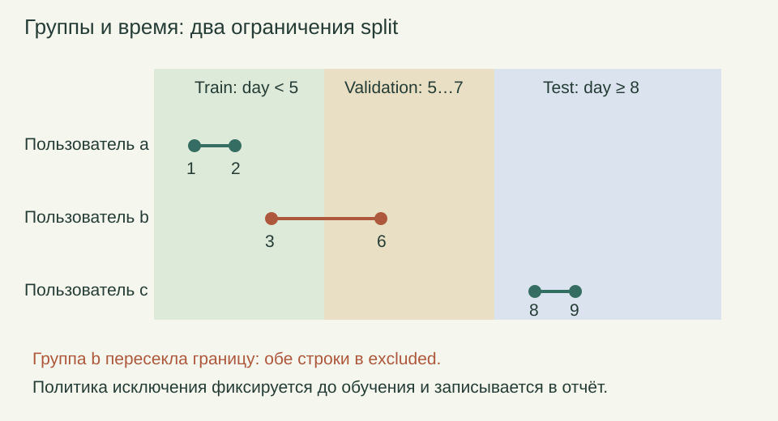

# M05-L07. Самостоятельный эксперимент на неоднородных данных

**Результат:** построить воспроизводимый pipeline на CSV с пропусками, категориями, повторными пользователями, временем и признаком из будущего. **До урока:** M01, M05-L04–L06. Ориентир — 240 минут на первый проход; домашняя работа выполняется отдельно.

## Проверь себя сначала

**Короткий путь для знакомой темы, 2–5 минут.** В CSV есть user_id, created_at, city (категории с пропусками), answer_len, label и resolved_at — время, когда ответ проверили. Модель предсказывает label в момент создания ответа для новых пользователей. Какой признак исключить и почему? Как разделять данные? Где обучать заполнение пропусков и кодирование категорий?

Запиши ответ и объяснение, затем сверь с [ключом M05-L07-D](../../solutions/modules/M05.md#m05-l07-d). Всё верно и объяснение совпадает по смыслу — переходи сразу к самостоятельной задаче этого урока, затем к варианту B/C. Ошибка, сомнение или ответ без объяснения — проходи урок полностью с начала. [Как работает адаптивный маршрут](../self-study.md#адаптивный-маршрут).

## Объяснение

### Сначала контракт, затем модель

Таблица не сообщает сама, какие столбцы разрешено использовать. Для каждого поля нужно понять, когда оно появляется и что означает строка. В нашем наборе строка — одна сессия, `user_id` связывает повторные сессии, `day` описывает момент события. `experience_years`, `answer_words`, `track` доступны при предсказании. Метка `is_ready` назначена позднее. `review_score_after` создан после оценки и почти раскрывает метку; включение его в признаки делает offline-результат привлекательным, но непригодным для заявленного применения.

Это проблема доступности информации, а не плохого названия столбца. Переименование `review_score_after` в `feature_4` не устраняет утечку. Сохранённый контракт перечисляет разрешённые поля, единицы, пропуски и поведение неизвестной категории. Необязательные служебные поля могут присутствовать в запросе, но не должны влиять на предсказание; отсутствие обязательного поля вызывает понятную ошибку.

### Два ограничения разбиения одновременно

Если цель — новые пользователи в будущем, случайный split строк недостаточен. Он может поместить две сессии одного человека в разные части и использовать будущие наблюдения для прошлого. Групповое разбиение исключает пересечение людей, временное — направление из будущего. Оба ограничения нужно проверить явно.

В наборе есть пользователь с событиями по обе стороны границы. Нельзя разрезать его строки и сохранить независимость групп. В данном учебном протоколе такая группа исключается полностью и записывается в `excluded`. Это не единственная допустимая политика. Альтернатива — поменять границу и все последующие оценки; выбор требует объяснить, к какой популяции относится результат. Молчаливое удаление неудобной группы неприемлемо.



На рисунке каждая линия связывает сессии **одного** пользователя. Проверь сначала отсутствие пересечения ID, затем порядок времени. Если выполнено только одно условие, получена другая задача обобщения.

## Разобранный пример

### Короткий пример со сложной группой

```python
import pandas as pd
from labs.M05.pipeline import split_groups
tiny = pd.DataFrame({'user_id':['a','a','b','b','c','c'],
                     'day':[1,2,3,6,8,9]}, index=list('ABCDEF'))
parts = split_groups(tiny, train_before=5, validation_before=8)
assert parts == {'train':['A','B'], 'validation':[],
                 'test':['E','F'], 'excluded':['C','D']}
print(parts)
```

Группа b пересекает первую границу, поэтому обе строки исключены. Пустая validation здесь ожидаема: это пример политики, а не готовый набор для обучения. Основная лабораторная содержит достаточно групп каждого окна; свой конвейер обязан проверить, что после исключения частей осталось достаточно и оба класса доступны для обучения.

### Проверка процедуры независимо от качества

В идеально линейной задаче правильный и протекающий Pipeline могут оба иметь почти нулевую ошибку. Поэтому полезна отдельная проверка того, что именно видел fit. `FitAudit` записывает ID входных строк. `check_fit_rows` сопоставляет их с допустимым train. Если preprocessing или весь pipeline обучен глобально, проверка должна упасть, даже если MSE или accuracy выглядят отлично.

Это средство учебного контроля процесса, не криптографическое доказательство: ученик может переписать журнал. Его смысл — сделать собственную ошибку наблюдаемой. В серьёзной системе дополнительно нужны происхождение данных, код сборки, версии и воспроизводимость. В нашем опыте намеренно неправильный global-fit обнаруживается в каждом из трёх folds.

## Практика с поддержкой

Открой `exercises/M05/data/hw.csv` и словарь полей в README. Посчитай пропуски и число сессий на пользователя. До открытия эталона выпиши предполагаемые разрешённые признаки и правило split. Затем проверь их на маленькой таблице выше. Только после этого напиши обучение. При неизвестной категории проверь наличие конечных вероятностей; не добавляй категорию из test в словарь train вручную.

## Самостоятельная задача A — M05-L07-A

Реализуй `split_records`, `build_pipeline` и `choose_threshold` в [стартере](../../exercises/M05/starter.py). Проверь командой из README, затем проведи M05-HW01 на **hw.csv**, а не на демонстрационных данных. Сохрани выбранные настройки до расчёта test; сохрани pipeline, порог, ID частей, таблицу validation, ошибки test и минимум два среза. Отдельно поменяй значения будущего столбца в копии test: предсказания должны остаться прежними.

## Критерии и типичные ошибки

**Критерии:** группы и время разделены; исключённые строки объяснены; baseline существует; preprocessing fit только на train; неизвестная категория и пропуск обработаны; схема без обязательного поля отклонена; модель после загрузки даёт тот же результат. Критические ошибки не компенсируются высоким качеством или оформлением.

## Подсказки по очереди

1. Составь словарь «поле → доступно в момент запроса?». 2. Группируй до назначения split. 3. Сначала проверь контракт на шести строках, затем обучай модель. 4. При расхождении восстановленного артефакта проверь не только коэффициенты, но и imputer, scaler, encoder, порог.

## Новая и отложенная проверка

Вариант B использует `retry.csv`, FN стоит 4, первая временная граница сдвигается на день 140. Это меняет решение, а не только seed. Через неделю вариант C использует `delayed.csv`: поступает запрос с категорией `rust`, пропущенным опытом и дополнительным будущим столбцом. Объясни, какие изменения требуют новой модели, а какие уже входят в контракт. Для каждой версии есть [отдельный разбор и запускаемый эталон](../../solutions/modules/M05.md).

## Источники и углубление

Источник: [scikit-learn: common pitfalls](https://scikit-learn.org/stable/common_pitfalls.html). Данные созданы для курса, не содержат реальных кандидатов и не обосновывают автоматические кадровые решения.
