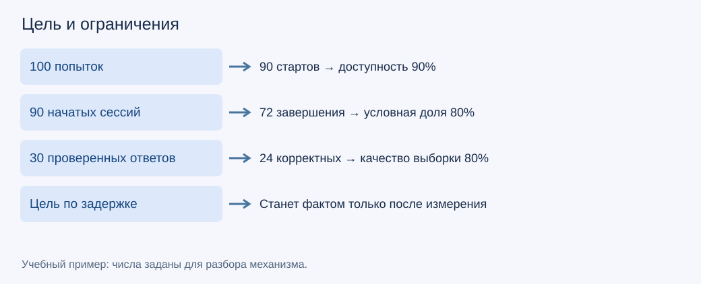

# M06-L01. Цель и ограничения

**Результат:** Отделить измеренное требование от предположения и предложить способ проверки.

**До урока:** M00-L05. Если термины из этих уроков не удаётся объяснить своими словами, вернись к их разобранным примерам. Ориентир времени — 110 минут чтения и практики; это первоначальная оценка, а не ограничение.

## Проверь себя сначала

**Короткий путь для знакомой темы, 2–5 минут.** Из 50 запущенных сессий 40 дошли до конца; из 10 проверенных отзывов 6 оценили вопросы как полезные. Найди обе доли с явными знаменателями. Можно ли утверждать, что «60% пользователей считают вопросы полезными»?

Запиши ответ и объяснение, затем сверь с [ключом M06-L01-D](../../solutions/modules/M06.md#m06-l01-d). Всё верно и объяснение совпадает по смыслу — переходи сразу к самостоятельной задаче этого урока, затем к варианту B/C. Ошибка, сомнение или ответ без объяснения — проходи урок полностью с начала. [Как работает адаптивный маршрут](../self-study.md#адаптивный-маршрут).

## Объяснение

ML-сервис — это программа, в которой часть решения получается из обученных параметров. Пользователь взаимодействует со всей системой: интерфейсом, данными, правилами, моделью и обработкой ошибок. Поэтому точность модели сама по себе ещё не описывает полезность продукта. В интервьюере хороший следующий вопрос бесполезен, если человек уже закончил сессию, а справедливая обратная связь не появится, если потерян исходный ответ. Системный дизайн начинается с наблюдаемого действия пользователя и решения, которое должно стать лучше.

Запишем задачу: после текстового ответа на вопрос о SQL тренажёр возвращает один уточняющий вопрос и краткую обратную связь. Входом являются вопрос, ответ, этап беседы и версия рубрики. Выходом являются текст, признак достаточности данных и ссылки на технические основания. Требование «сделать умного HR» не даёт способа проверки. Требование «на фиксированном наборе из 40 ответов не принимать противоречие о транзакциях за правильный ответ» уже задаёт наблюдаемое поведение. Оно всё ещё не доказывает качество на всех людях: набор может не покрывать реальные ответы.

Различай продуктовую метрику, качество модели и техническую метрику. Доля завершённых добровольных тренировок описывает продукт, доля корректных замечаний — содержание, время ответа и доля ошибок API — работу сервиса. Они связаны, но не заменяют друг друга. Уменьшение задержки может улучшить завершение сессий, однако это гипотеза, которую нужно проверить. Нельзя назвать успешной модель, которая быстро генерирует неверные советы.

Ограничение отличается от пожелания тем, что нарушение делает вариант неприемлемым. В нашем курсе обязательны бесплатный локальный запуск и работа с доступной памятью. Желательная естественность диалога остаётся целью оптимизации. Для начала ограничим число одновременных генераций единицей и длительность текстового ответа. Это осознанный выбор границ первого продукта, а не утверждение о производительности ноутбука. Реальную пропускную способность измерим после запуска модели.

Нефункциональное требование должно иметь единицу, окно измерения и способ расчёта. «Быстро» заменяется на «измеряем p95 полного времени ответа на 100 запросах фиксированной длины после прогрева». p95 — значение, ниже которого находится около 95 процентов наблюдений; способ вычисления квантиля тоже фиксируется. Порог до измерения является целевым, а не достигнутым. Время загрузки весов записывается отдельно, иначе изменение холодного старта замаскирует поведение обычного диалога.

До архитектуры полезно построить простой baseline: фиксированную последовательность вопросов и рубрику, проверяемую человеком. Он показывает, какую ценность добавляет модель и где достаточно обычного кода. Запиши также неприятные исходы: неподтверждённый технический совет, потеря ответа, повтор одного вопроса. Для каждого реши, что система делает: просит уточнение, сообщает ограничение, повторяет операцию или завершает сессию. Такая постановка превращает большой проект в проверяемые инженерные задачи.



## Разобранный пример

Пусть за день поступило 200 запросов, из них 196 получили HTTP 200. Доступность по этим наблюдениям равна 196/200 = 0,98. Из 50 случайно отобранных завершённых ответов 40 соответствуют рубрике: наблюдаемая доля корректных ответов 0,80. Знаменатели разные; перемножение 0,98 и 0,80 допустимо только при дополнительных предположениях о выборке и определении события, которых здесь нет.

```python
successful_http, requests = 196, 200
correct, reviewed = 40, 50
print(round(successful_http / requests, 2))  # 0.98
print(round(correct / reviewed, 2))         # 0.8
```

Техническая исправность не подтверждает качество содержания. В отчёте нужны обе дроби с числителями и знаменателями. Следующее действие: разобрать 10 содержательных ошибок, а не увеличивать таймаут сервера.

## Практика с поддержкой

**Предскажи до запуска.** Прежде чем запускать код или пересчитывать пример, запиши ожидаемый вывод: числа, формы массивов, порядок или текст. После запуска сравни с фактическим и объясни каждое расхождение.

Составь таблицу из четырёх строк: вход, выход, критерий качества, ограничение ресурсов. Для каждой строки добавь пример значения и способ проверки. Затем пометь каждое число как «измерено», «целевое» или «предположение». Используй приведённые 200 запросов только как учебные данные.

## Самостоятельная задача A — M06-L01-A

Для голосового интервьюера наблюдали 100 сессий: 90 запустились, 72 завершились, из 30 проверенных объяснений 24 корректны. Посчитай три доли с явно указанными знаменателями. Предложи по одной метрике продукта, содержания и технического контура. Сформулируй два требования, которые ещё нельзя считать измеренными, и эксперимент для их проверки.

Первая попытка — без готового решения. Сохрани свой код, объяснение и фактический результат в `submissions/M06-L01/`. AI может пояснять термин и помогать найти ошибку; запиши полученную помощь. Прочитанное решение не означает самостоятельно выполненное задание.

## Подсказки по очереди

1. Сначала назови событие: запуск, завершение или корректность.
2. Для завершения допустимы два знаменателя, но они отвечают разным вопросам.
3. Желательная задержка до прогона является целью.

## Критерии и типичные ошибки

Ошибка: назвать 80% «общим качеством продукта». Это только 24/30 рассмотренных объяснений. Ошибка: вывести среднюю задержку из числа завершений. В данных нет времён. Критерий: все дроби подписаны, две гипотезы имеют отдельный план измерения.

Работа готова, когда есть ответ на все условия задачи, вычисление или наблюдение подтверждает вывод, а ты можешь объяснить каждую величину и изменить один параметр без копирования решения. Критическую ошибку сначала исправь и повтори проверку; оформление не компенсирует неверное рассуждение. Сверь свою попытку с [решением M06-L01-A](../../solutions/modules/M06.md).

## Новая и отложенная проверка

**Вариант B после разбора:** 50 попыток, 40 стартов, 30 завершений; из 12 проверенных отзывов 9 корректны. Найди доли с явными знаменателями.

**Вариант C через 7–10 дней:** Проверили только первые 12 успешных ответов. Можно ли переносить 9/12 на все 50 попыток?

Запиши расчёт и объяснение до открытия ключа. [Ответы B/C](../../solutions/modules/M06.md) находятся отдельно. После содержательной помощи самостоятельность проверяется другим вариантом.

## Источники и углубление

- [Stanford CS329S: ML systems](https://stanford-cs329s.github.io/)
- [Google: Rules of ML](https://developers.google.com/machine-learning/guides/rules-of-ml)

Текст, численные примеры, задания и схемы этого урока созданы для данного курса. Источники нужны для проверки терминов и изучения исходного метода; они не заменяют самостоятельную практику.
