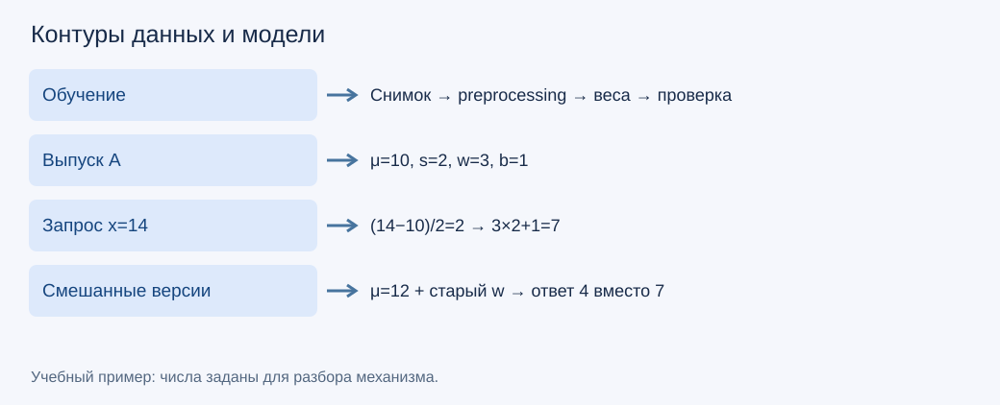

# M06-L02. Контуры данных и модели

**Результат:** Объяснить, как избежать смешивания версий преобразований и модели.

**До урока:** M06-L01. Если термины из этих уроков не удаётся объяснить своими словами, вернись к их разобранным примерам. Ориентир времени — 110 минут чтения и практики; это первоначальная оценка, а не ограничение.

## Проверь себя сначала

**Короткий путь для знакомой темы, 2–5 минут.** Выпуск: mean = 50, scale = 10, weight = 4, bias = 2, ŷ = weight·(x − mean)/scale + bias. Найди ответ для x = 70. Каким он станет, если scale загрузить из другой версии, где scale = 5?

Запиши ответ и объяснение, затем сверь с [ключом M06-L02-D](../../solutions/modules/M06.md#m06-l02-d). Всё верно и объяснение совпадает по смыслу — переходи сразу к самостоятельной задаче этого урока, затем к варианту B/C. Ошибка, сомнение или ответ без объяснения — проходи урок полностью с начала. [Как работает адаптивный маршрут](../self-study.md#адаптивный-маршрут).

## Зачем и как это работает

Обучение и применение модели происходят в разные моменты и решают разные задачи. Контур обучения получает примеры с известными целевыми значениями, подбирает параметры и сохраняет проверенный артефакт. Контур применения получает новый вход и рассчитывает ответ с уже выбранными параметрами. Между ними находится решение о выпуске: наличие файла весов ещё не означает, что его следует использовать в сервисе. Нужны проверка совместимости и сравнение на зафиксированных данных.

Артефакт — воспроизводимый комплект, достаточный для получения предсказания. В него входят веса, конфигурация модели, преобразования признаков, порядок столбцов, словари категорий, версии кода и описание допустимого входа. Для LLM добавятся токенизатор, шаблон диалога и настройки генерации. Сам файл весов не содержит весь смысл системы. Если при обучении первый столбец означал возраст, а в сервисе на его место попала длительность ответа, корректные матричные операции дадут бессмысленное значение.

Рассмотрим стандартизацию: z = (x − μ)/s, где μ и s вычислены на обучающих данных. На инференсе используется именно эта пара, а не среднее текущего запроса. Для одного объекта собственное среднее равно самому x; такое преобразование уничтожит исходную информацию. Ещё опаснее незаметное обновление статистик в сервисе: веса ожидают старую систему координат, но получают новую. Версионирование объединяет модель и preprocessing в один логический выпуск.

Данные тоже имеют историю. Полезно сохранять происхождение, время события и время поступления записи. Ответ пользователя мог появиться вчера, а исправленная разметка — сегодня. Если обучение использует информацию, которая не была доступна в момент реального решения, возникает временная утечка. Снимок данных должен указывать, какие записи и какие версии меток вошли в эксперимент. Хеш файла помогает проверить идентичность байтов, но сам по себе не доказывает корректность сбора или права использования.

В простом локальном проекте не нужен сложный реестр. Достаточно папки выпуска с manifest.json, model.pt, preprocessing.json и report.json, а также маленького указателя current.json на активный выпуск. Сначала создаётся новая папка, затем проверяется контрольный запрос, и только после этого меняется указатель. Недописанный файл не должен стать активной моделью. При дальнейшем масштабировании идея остаётся той же, даже если файлы заменены объектным хранилищем и специализированным реестром.

Журнал запроса связывает входную схему, идентификатор выпуска и результат. Полное хранение личного текста не всегда необходимо: для технической диагностики часто хватает идентификатора сессии, размеров, кодов ошибок и согласованного набора обезличенных примеров. Если требуется воспроизвести конкретное предсказание, заранее определи, какие данные сохраняются и на какой срок. Это инженерное требование к наблюдаемости, а не повод собирать всё без разбора.

Нарисуй два потока: данные → преобразование → обучение → проверка → выпуск; запрос → проверка схемы → преобразование выпуска → модель выпуска → ответ. Соединяет их только проверенный комплект. Обратная связь поступает в новые данные через отдельную проверку, а не автоматически меняет параметры после каждого ответа.



## Разобранный пример

Выпуск A использует μ=10, s=2, w=3 и b=1. Для x=14: z=2, ответ 3·2+1=7. Выпуск B использует μ=12, s=2 и другой обученный вес w=1. Если случайно взять статистики B и вес A, ответ станет 4. Все числа допустимы, исключения нет, но система несовместима.

```python
def predict(x, release):
    z = (x-release['mean']) / release['scale']
    return release['weight'] * z + release['bias']
a = dict(mean=10, scale=2, weight=3, bias=1)
assert predict(14, a) == 7
```

Проверка контрольного входа обнаруживает смешанный выпуск. Для реальной модели используют несколько контрольных объектов, включая границы и категории.

## Практика с поддержкой

Создай JSON выпуска A и функцию, которая принимает только полный объект выпуска. Удали поле scale и убедись, что загрузка завершается понятной ошибкой до обработки запроса. Добавь schema_version и список feature_order.

## Самостоятельная работа M06-L02-A

Выпуск C: mean=20, scale=5, weight=2, bias=−1. Для входов 20 и 30 вычисли ответы. Затем замени только scale на 10 и покажи расхождение. Спроектируй manifest из не менее шести полей и два контрольных запроса, которые обнаружат подмену.

Первая попытка — без готового решения. Сохрани свой код, объяснение и фактический результат в `submissions/M06-L02/`. AI может пояснять термин и помогать найти ошибку; запиши полученную помощь. Прочитанное решение не означает самостоятельно выполненное задание.

## Подсказки по очереди

1. Сначала вычисли нормализованные признаки.
2. Вход ровно в mean не обнаружит неверный scale.
3. Хеш preprocessing и идентификатор модели должны принадлежать одному выпуску.

## Ошибки и самопроверка

Ошибка: проверять только x=mean. Тогда любой ненулевой scale даёт z=0. Ошибка: хранить feature_order только в ноутбуке. Критерий: контрольный набор различает корректный и смешанный комплект, а схема включает версии данных, кода и преобразований.

Работа готова, когда есть ответ на все условия задачи, вычисление или наблюдение подтверждает вывод, а ты можешь объяснить каждую величину и изменить один параметр без копирования решения. Критическую ошибку сначала исправь и повтори проверку; оформление не компенсирует неверное рассуждение. Сверь свою попытку с [решением M06-L02-A](../../solutions/modules/M06.md).

## Повтор и отложенная проверка

**Вариант B после разбора:** Выпуск D: mean=4, scale=2, w=5, b=−1. Вычисли результаты для x=8 и x=4, затем перечисли состав выпуска.

**Вариант C через 7–10 дней:** В D заменили scale на 4. Какой из двух контрольных входов обнаружит изменение?

Запиши расчёт и объяснение до открытия ключа. [Ответы B/C](../../solutions/modules/M06.md) находятся отдельно. После содержательной помощи самостоятельность проверяется другим вариантом.

## Источники и углубление

- [Stanford CS329S: ML systems](https://stanford-cs329s.github.io/)
- [Google: Rules of ML](https://developers.google.com/machine-learning/guides/rules-of-ml)

Текст, численные примеры, задания и схемы этого урока созданы для данного курса. Источники нужны для проверки терминов и изучения исходного метода; они не заменяют самостоятельную практику.
