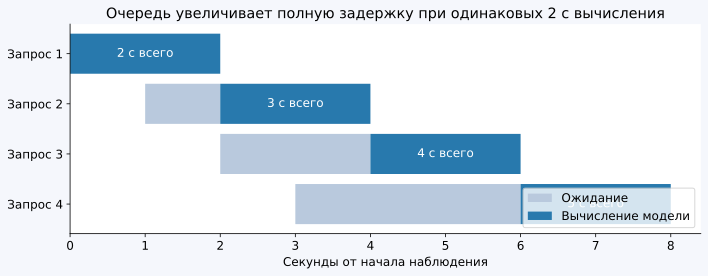

# M06-L03. Batch и online

**Результат:** Защитить выбор через свежесть, задержку, цену вычислений и сложность эксплуатации.

**До урока:** M06-L02, M05-L05. Если термины из этих уроков не удаётся объяснить своими словами, вернись к их разобранным примерам. Ориентир времени — 130 минут чтения и практики; это первоначальная оценка, а не ограничение.

## Проверь себя сначала

**Короткий путь для знакомой темы, 2–5 минут.** Запросы приходят в моменты [0, 0.2, 3] с, обработка одного занимает 1 с, обработчик один. Найди начало, окончание и полную задержку каждого запроса. Какой режим нужен для ежедневного пересчёта эмбеддингов базы — batch или online?

Запиши ответ и объяснение, затем сверь с [ключом M06-L03-D](../../solutions/modules/M06.md#m06-l03-d). Всё верно и объяснение совпадает по смыслу — переходи сразу к самостоятельной задаче этого урока, затем к варианту B/C. Ошибка, сомнение или ответ без объяснения — проходи урок полностью с начала. [Как работает адаптивный маршрут](../self-study.md#адаптивный-маршрут).

## Объяснение

Пакетное применение модели, или batch inference, рассчитывает ответы для набора объектов заранее. Онлайн-применение, или online inference, рассчитывает ответ после прихода конкретного запроса. Это не различие алгоритмов: одни и те же веса могут работать в обоих режимах. Различаются требования к свежести, задержке, доступности и источникам признаков. Ещё один термин, online learning, означает последовательное обновление параметров; он не является синонимом online inference.

Итоговую статистику по вчерашним тренировкам удобно рассчитывать ночью: данные уже накоплены, пользователю не требуется ответ во время разговора. Следующий вопрос интервьюера зависит от только что произнесённой реплики, поэтому его нельзя полностью вычислить заранее. При этом можно заранее подготовить embeddings документов и список базовых вопросов. В одной системе естественно сочетаются пакетная подготовка и онлайн-диалог.

Свежесть показывает, насколько актуальны данные или результат. Если отчёт обновляется каждые шесть часов, его возраст сразу после обновления близок к нулю, а перед следующим — к шести часам плюс время обработки. Средний возраст равен примерно половине интервала только при равномерном времени обращений и пренебрежимо короткой обработке. Пользователи могут приходить сразу после нового события, поэтому среднее без проверки распределения скрывает проблему.

Задержка запроса складывается из ожидания в очереди, получения признаков, вычисления модели и передачи ответа. Когда входящий поток превышает скорость обслуживания, очередь растёт. Пусть одна генерация занимает две секунды, а одновременно выполняется одна. Предельная скорость такого исполнителя около 0,5 запроса в секунду без учёта накладных расходов. Если запросы стабильно приходят со скоростью один в секунду, простой повтор или увеличение таймаута не устранит накопление очереди. Нужно ограничивать приём, увеличивать производительность либо менять требования.

Кэш сохраняет результат для повторного использования, но корректность ключа важнее самого наличия кэша. Для генерации следующий вопрос зависит от версии модели, рубрики, текущего вопроса, ответа и состояния диалога. Ключ только по последней фразе смешает разные сессии. Срок жизни кэша определяет допустимую устарелость. Для персональной обратной связи часто проще сначала отказаться от кэша, чем получить незаметную подмену контекста; для статических embeddings кэш естественен.

Компромисс пакетного режима — меньшая сложность обслуживания запросов ценой устаревания. Компромисс онлайн-режима — актуальность ценой зависимости пользователя от доступности вычислений. Сравнивать нужно полную стоимость: подготовку данных, постоянную память модели, обслуживание пиков, поддержку ошибок. Маленький локальный тренажёр может работать с одним активным пользователем; это допустимая граница версии, если она указана в интерфейсе и измерениях.

Решение документируется через альтернативы. Для каждого сценария укажи, какое событие делает старый ответ неприемлемым, какой срок ожидания допустим и как пользователь узнает о задержке. Тогда выбор «batch или online» перестаёт быть ответом по модному стеку и становится следствием конкретного поведения продукта.



## Аналогия: SSG, ISR и SSR в Next.js

Как похоже: статическую страницу собирают заранее (SSG), ISR пересобирает её раз в revalidate секунд, а SSR рендерит на каждый запрос. Batch inference — это SSG и ISR: ответы готовы заранее и устаревают до следующего пересчёта. Online inference — это SSR: ответ считается после запроса, и пользователь ждёт рендер.

| В уроке | В аналогии |
| --- | --- |
| Batch inference | SSG: страницы собраны заранее при сборке |
| Интервал пересчёта и свежесть | ISR с revalidate: страница устаревает до регенерации |
| Online inference | SSR: рендер на каждый запрос |
| Эмбеддинги заранее, диалог онлайн | Статичная оболочка и динамические данные на одной странице |
| Ключ кэша с версией и состоянием | Ключ кэша без пользователя отдаёт чужую страницу |
| Очередь при нехватке исполнителя | Медленный SSR под пиком: запросы ждут свободный рендер |

**Где аналогия ломается:** SSR-рендер обычно занимает миллисекунды, а генерация LLM на одном исполнителе — секунды, поэтому очередь растёт намного быстрее. Следующий вопрос зависит от состояния диалога, и заранее его не собрать. А online learning — обновление весов — аналога в рендеринге страниц не имеет.

## Разобранный пример

Запросы приходят в моменты [0, 1, 2, 3] секунд. Один исполнитель обслуживает каждый две секунды. Начала обработки: [0, 2, 4, 6], окончания: [2, 4, 6, 8]. Полная задержка равна [2, 3, 4, 5], хотя модель всегда работает ровно две секунды.

```python
finish = 0
latencies = []
for arrived in [0, 1, 2, 3]:
    finish = max(finish, arrived) + 2
    latencies.append(finish-arrived)
assert latencies == [2, 3, 4, 5]
```

Средняя задержка 3,5 секунды. Оптимизация сериализации на 1 миллисекунду не решит дефицит пропускной способности.

## Практика с поддержкой

**Предскажи до запуска.** Прежде чем запускать код или пересчитывать пример, запиши ожидаемый вывод: числа, формы массивов, порядок или текст. После запуска сравни с фактическим и объясни каждое расхождение.

Измени интервал прихода на три секунды и сравни ожидание с исходным примером. Затем объясни, что именно моделируется: один последовательный обработчик без сетевых расходов, а не замер реальной LLM.

## Самостоятельная задача A — M06-L03-A

Для приходов [0, 0.5, 1, 4] и обслуживания по одной секунде вычисли начала, окончания и полные задержки. Выбери режим для трёх функций: embedding базы раз в день, следующий вопрос по ответу пользователя, недельная сводка. Для каждой укажи требование свежести и поведение при просрочке.

Первая попытка — без готового решения. Сохрани свой код, объяснение и фактический результат в `submissions/M06-L03/`. AI может пояснять термин и помогать найти ошибку; запиши полученную помощь. Прочитанное решение не означает самостоятельно выполненное задание.

## Подсказки по очереди

1. Начало = max(предыдущее окончание, приход).
2. Задержка считается от прихода, а не от старта обработки.
3. Отдельный пользовательский запрос не запрещает использовать подготовленные заранее документы.

## Критерии и типичные ошибки

Ошибка: обещать отсутствие очереди по средней скорости за день. Пик может быть значительно выше. Ошибка: называть ежедневное переобучение онлайн-инференсом. Критерий: расчёт очереди верен, у каждого режима есть причина и предел свежести.

Работа готова, когда есть ответ на все условия задачи, вычисление или наблюдение подтверждает вывод, а ты можешь объяснить каждую величину и изменить один параметр без копирования решения. Критическую ошибку сначала исправь и повтори проверку; оформление не компенсирует неверное рассуждение. Сверь свою попытку с [решением M06-L03-A](../../solutions/modules/M06.md).

## Новая и отложенная проверка

**Вариант B после разбора:** Три запроса пришли в моменты [0,0,0]; один worker обрабатывает каждый 2 секунды. Найди ожидание, конец и полную задержку.

**Вариант C через 7–10 дней:** Теперь два worker, те же поступления и время обработки. Не дели все времена механически на два.

Запиши расчёт и объяснение до открытия ключа. [Ответы B/C](../../solutions/modules/M06.md) находятся отдельно. После содержательной помощи самостоятельность проверяется другим вариантом.

## Карточка урока

| Поле | Содержание |
| --- | --- |
| Правило | Начало обработки = max(приход, окончание предыдущего); задержка = окончание − приход; если поток выше скорости обслуживания, очередь растёт |
| Смысл величин | Batch считает ответы заранее для набора, online — после запроса; свежесть — возраст результата; ключ кэша включает версию модели, рубрику и состояние диалога; online learning — не online inference |
| Когда применять | При выборе режима и оценке ожидания. Пример: приходы [0, 1, 1.5] с, обслуживание 1 с, один исполнитель — окончания [1, 2, 3], задержки [1, 1, 1.5] |
| Главная ошибка | Обещать отсутствие очереди по средней скорости за день или кэшировать ответ по ключу из одной последней фразы |

## Источники и углубление

- [Stanford CS329S: ML systems](https://stanford-cs329s.github.io/)
- [Google: Rules of ML](https://developers.google.com/machine-learning/guides/rules-of-ml)
- [Google ML Crash Course: Static versus dynamic inference](https://developers.google.com/machine-learning/crash-course/production-ml-systems/static-vs-dynamic-inference) — пакетное и онлайн-применение модели (на английском)

Текст, численные примеры, задания и схемы этого урока созданы для данного курса. Источники нужны для проверки терминов и изучения исходного метода; они не заменяют самостоятельную практику.
