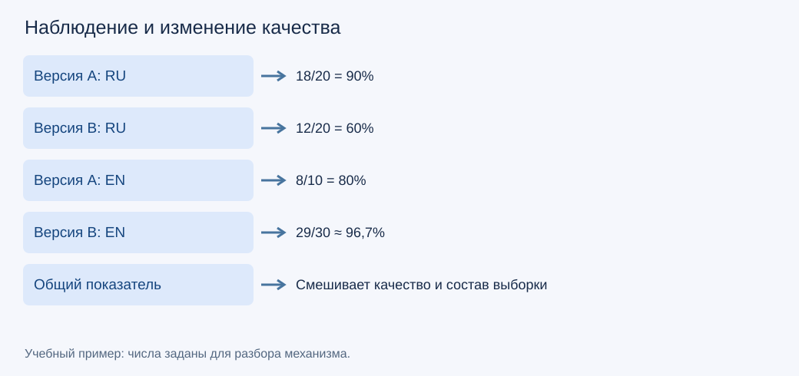

# M06-L04. Наблюдение и изменение качества

**Результат:** Различить техническую доступность и полезность предсказаний.

**До урока:** M06-L03. Если термины из этих уроков не удаётся объяснить своими словами, вернись к их разобранным примерам. Ориентир времени — 110 минут чтения и практики; это первоначальная оценка, а не ограничение.

## Проверь себя сначала

**Короткий путь для знакомой темы, 2–5 минут.** Выпуск A: RU 9/10 правильных, EN 1/10. Выпуск B: RU 5/10, EN 5/10. Найди общую долю правильных у каждого выпуска и доли по языкам. Что скрывает общий показатель?

Запиши ответ и объяснение, затем сверь с [ключом M06-L04-D](../../solutions/modules/M06.md#m06-l04-d). Всё верно и объяснение совпадает по смыслу — переходи сразу к самостоятельной задаче этого урока, затем к варианту B/C. Ошибка, сомнение или ответ без объяснения — проходи урок полностью с начала. [Как работает адаптивный маршрут](../self-study.md#адаптивный-маршрут).

## Объяснение

Наблюдаемость нужна, чтобы по доступным данным восстановить причину неправильного поведения. Лог — запись события, метрика — агрегат по событиям, трассировка — связь шагов одного запроса. Ни одна форма не заменяет остальные. График среднего времени показывает ухудшение, но не объясняет, почему конкретный пользователь ждал; журнал шагов показывает детали, но без агрегатов трудно заметить систематическое изменение.

У ML-системы несколько разных уровней здоровья. Первый — программный: ошибки схемы, таймауты, использование памяти, очередь, задержка. Второй — данные: пропуски, неизвестные категории, длина текста, распределение численных признаков. Третий — выходы: доля отказов, однообразие ответов, количество невалидного JSON. Четвёртый — полезность: корректность технического разбора и выполнение цели пользователя. Успешный HTTP-ответ проверяет лишь часть первого уровня.

Data drift означает изменение распределения входов. Concept drift — изменение связи между входом и целевым результатом. Если в тренажёре стало больше длинных ответов, изменилась длина текста; это ещё не доказывает снижение качества. Если прежний технический совет стал неверным после изменения поведения библиотеки, связь между вопросом и правильной оценкой изменилась даже при прежних словах. Метрика сдвига является сигналом для расследования, а не готовым диагнозом.

Качество часто становится известно с задержкой. В обычном классификаторе метка может появиться через неделю, а в интервьюере требуется ручная проверка. Поэтому есть быстрые прокси: частота пустых ответов, доля ссылок на отсутствующие документы, нарушение схемы. Они полезны для раннего обнаружения, но не доказывают истинность текста. Система способна выдать грамматически правильный JSON с неверной оценкой. Нужно сохранять небольшой согласованный набор для содержательного аудита.

Агрегаты скрывают группы ошибок. Средняя корректность может остаться прежней, пока русские ответы ухудшились, а английские улучшились. Разрезы следует выбирать по смыслу задачи: язык, тема, длина, версия модели, вид интервью. Очень мелкие группы дают шумные оценки; рядом с долей всегда показывай число примеров. Из двух плохих ответов нельзя уверенно вывести качество всех сессий этого типа.

Хороший сигнал мониторинга связан с действием. Если растёт доля невалидного формата, проверить выпуск шаблона и валидатор. Если увеличилась очередь при неизменном времени вычисления, ограничить конкуренцию или пересмотреть нагрузку. Если ухудшилась разметка на SQL, вернуть прошлую версию базы знаний либо уточнить рубрику после анализа. Порог без владельца и действия превращается в уведомление, которое со временем игнорируется.

При локальной разработке достаточно JSONL со строкой на запрос и скрипта сводки. Сохраняй request_id, release_id, этап, длительность, outcome и размеры. Сырые пользовательские ответы не нужны для всех технических графиков. Прежде чем строить сложную панель, проверь, что по одному неудачному запросу можешь восстановить последовательность событий и отличить ошибку данных от ошибки модели.



## Аналогия: дашборд интернет-магазина

Как похоже: health check зелёный и доля 5xx низкая, а заказы не доходят до покупателей — техническая доступность не равна полезности. Больше мобильных клиентов — сдвиг входов, который ещё не означает проблему. Изменилась налоговая ставка — тот же заказ теперь имеет другую правильную сумму, это уже смена связи входа и ответа.

| В уроке | В аналогии |
| --- | --- |
| Доступность против полезности | Health check зелёный, а заказы не доходят до покупателя |
| Data drift | Сменился профиль трафика: больше мобильных клиентов |
| Concept drift | Новая налоговая ставка: тот же заказ, другая правильная сумма |
| Задержанная метка | Возвраты и жалобы приходят через недели |
| Быстрый прокси | Доля отказов платёжного шлюза |
| Срез по языку | Конверсия по регионам: среднее скрывает отстающий регион |
| Порог с владельцем и действием | Алерт с runbook и дежурным |

**Где аналогия ломается:** судьба заказа рано или поздно известна точно. Корректность технического разбора проверяет человек по рубрике и выборочно, а часть меток не придёт никогда. Поэтому нужен отдельный согласованный набор для содержательного аудита.

## Разобранный пример

Вчера средняя длина ответа была 100 символов, сегодня 150. Относительный сдвиг (150−100)/100 = 0,5, то есть 50%. Из этого нельзя вычислить точность модели. На ручной проверке было 18 правильных из 20 вчера и 17 из 20 сегодня. Разница −0,05 заметна численно, но маленькие выборки требуют осторожности.

```python
shift = (150-100)/100
quality_delta = 17/20 - 18/20
print(round(shift, 2), round(quality_delta, 2))  # 0.5 -0.05
```

Практический вывод: посмотреть ошибки длинных ответов и проверить переполнение контекста. Нельзя сразу объявить, что длина вызвала ухудшение.

## Практика с поддержкой

**Предскажи до запуска.** Прежде чем запускать код или пересчитывать пример, запиши ожидаемый вывод: числа, формы массивов, порядок или текст. После запуска сравни с фактическим и объясни каждое расхождение.

Запиши пять событий в JSONL с разными request_id и одним release_id. Для одного запроса добавь ошибку входной схемы, для другого — невалидный ответ модели. Посчитай эти доли раздельно и убедись, что знаменатель соответствует определению.

## Самостоятельная задача A — M06-L04-A

Выпуск A: RU 18/20, EN 8/10. Выпуск B: RU 12/20, EN 29/30. Вычисли общую долю правильных и доли по языку. Объясни, что скрывает сравнение только общего показателя. Предложи событие, две метрики и действие при нарушении технической корректности.

Первая попытка — без готового решения. Сохрани свой код, объяснение и фактический результат в `submissions/M06-L04/`. AI может пояснять термин и помогать найти ошибку; запиши полученную помощь. Прочитанное решение не означает самостоятельно выполненное задание.

## Подсказки по очереди

1. Общая доля — сумма правильных, делённая на сумму проверенных.
2. Состав языковых групп изменился.
3. Для расследования нужен идентификатор версии и точная причина ошибки.

## Критерии и типичные ошибки

Ошибка: усреднить проценты без весов. Ошибка: считать любой drift ухудшением. Критерий: отдельно названы наблюдение, гипотеза причины и проверка гипотезы; группа RU не исчезла за общей долей.

Работа готова, когда есть ответ на все условия задачи, вычисление или наблюдение подтверждает вывод, а ты можешь объяснить каждую величину и изменить один параметр без копирования решения. Критическую ошибку сначала исправь и повтори проверку; оформление не компенсирует неверное рассуждение. Сверь свою попытку с [решением M06-L04-A](../../solutions/modules/M06.md).

## Новая и отложенная проверка

**Вариант B после разбора:** A: RU 18/20, EN 8/10; B: RU 27/30, EN 8/10. Изменились ли доли внутри групп и почему отличается общая?

**Вариант C через 7–10 дней:** API доступен в 99% попыток; содержательно корректны 0 из 5 проверенных отзывов. Что можно заключить?

Запиши расчёт и объяснение до открытия ключа. [Ответы B/C](../../solutions/modules/M06.md) находятся отдельно. После содержательной помощи самостоятельность проверяется другим вариантом.

## Карточка урока

| Поле | Содержание |
| --- | --- |
| Правило | Общая доля = сумма правильных / сумма проверенных; доли показывают по смысловым срезам вместе с числом примеров; data drift — изменение входов, concept drift — изменение связи входа и правильного ответа |
| Смысл величин | Лог — событие, метрика — агрегат, трассировка — шаги одного запроса; быстрые прокси (невалидный JSON, пустые ответы) ловят сбои рано, но не доказывают истинность ответа |
| Когда применять | Для мониторинга выпуска. Пример: X — RU 16/20 и EN 6/10, общая 22/30 ≈ 0.73; Y — RU 8/10 и EN 12/20, общая 20/30 ≈ 0.67: доли внутри языков те же, общая меняется из-за состава |
| Главная ошибка | Усреднять проценты без весов или считать любой drift ухудшением качества |

## Источники и углубление

- [Stanford CS329S: ML systems](https://stanford-cs329s.github.io/)
- [Google: Rules of ML](https://developers.google.com/machine-learning/guides/rules-of-ml)
- [Google ML Crash Course: Monitoring pipelines](https://developers.google.com/machine-learning/crash-course/production-ml-systems/monitoring) — мониторинг данных и модели в ML-конвейере, включая training-serving skew (на английском)
- [Google SRE Book: Monitoring Distributed Systems](https://sre.google/sre-book/monitoring-distributed-systems/) — четыре золотых сигнала и правило, что каждое оповещение должно требовать действия (на английском)

Текст, численные примеры, задания и схемы этого урока созданы для данного курса. Источники нужны для проверки терминов и изучения исходного метода; они не заменяют самостоятельную практику.
