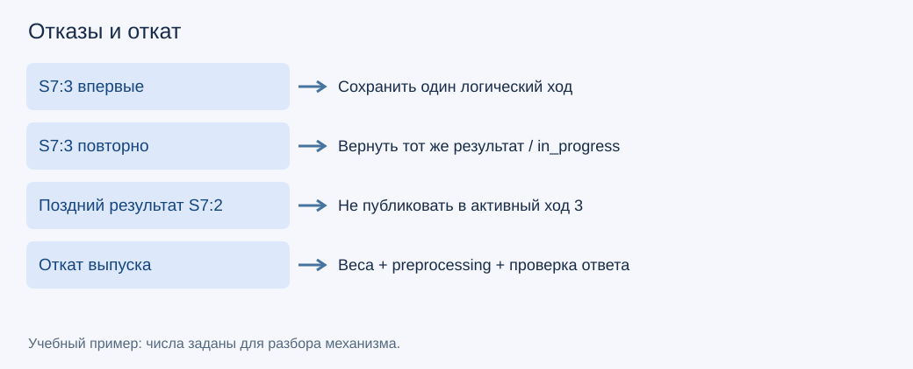

# M06-L05. Отказы и откат

**Результат:** Показать проверяемый план восстановления с известной рабочей версией.

**До урока:** M06-L04. Если термины из этих уроков не удаётся объяснить своими словами, вернись к их разобранным примерам. Ориентир времени — 130 минут чтения и практики; это первоначальная оценка, а не ограничение.

## Проверь себя сначала

**Короткий путь для знакомой темы, 2–5 минут.** Активный ход сессии — 5. Сначала приходит результат хода 4 (пользователь уже перешёл дальше), затем повтор запроса хода 5 с тем же ключом идемпотентности. Что сервис должен сделать в каждом случае?

Запиши ответ и объяснение, затем сверь с [ключом M06-L05-D](../../solutions/modules/M06.md#m06-l05-d). Всё верно и объяснение совпадает по смыслу — переходи сразу к самостоятельной задаче этого урока, затем к варианту B/C. Ошибка, сомнение или ответ без объяснения — проходи урок полностью с начала. [Как работает адаптивный маршрут](../self-study.md#адаптивный-маршрут).

## Объяснение

Отказ — это нарушение обещанного поведения, а не только падение процесса. Сервис может отвечать HTTP200 и использовать неправильную версию рубрики; может возвращать старый результат из кэша; может завершить генерацию, но потерять связь с интерфейсом. Проектирование отказов начинается с того, какую гарантию получает пользователь на каждом этапе. Для тренажёра особенно важно не потерять уже принятый ответ и не продолжить отменённую сессию.

Таймаут ограничивает время ожидания, но не гарантирует остановку работы. Если клиент перестал ждать, вычисление на сервере может продолжаться и занимать ресурсы. Поэтому нужны идентификатор запроса и явная отмена либо проверка актуальности результата перед публикацией. В голосовом диалоге старый ответ после перебивания нельзя озвучивать, даже если он успешно вычислен. Позднее в M15 это станет требованием к состоянию диалога.

Повтор запроса полезен для временного сетевого сбоя, но способен продублировать действие. Идемпотентность означает, что повтор с тем же ключом не создаёт ещё один логический результат. Для «сохранить ответ и перейти к следующему вопросу» повтор должен вернуть прежний результат или состояние обработки, а не добавить второй переход. Ключ привязывается к сессии и номеру хода; содержимое тоже проверяется, иначе один ключ может случайно обозначить разные ответы.

Релиз сначала проверяется вне активного пути. Новый комплект загружается, проходит контрольные запросы и сравнение качества; затем получает ограниченную долю трафика или отдельные тестовые сессии. Shadow-проверка вычисляет кандидат параллельно без показа пользователю. Canary-проверка показывает его небольшой группе. Это способы уменьшить область последствий, но они требуют корректного сравнения и не заменяют тестов. На одном ноутбуке можно начать с ручного переключения на заранее заданных сессиях.

Откат возвращает известный согласованный выпуск: веса, preprocessing, токенизатор, шаблон и необходимые данные. Если новая версия изменила формат состояния сессии, старый код может его не прочитать. Поэтому совместимость хранилища — часть плана. Безопасная миграция сначала добавляет новое поле с сохранением старого, затем обновляет читателей, и лишь после проверки удаляет прежний формат. Для учебного проекта можно хранить версию схемы и явный конвертер.

Fallback — заранее определённый запасной путь. В интервьюере это может быть фиксированный уточняющий вопрос или сообщение о невозможности оценки. Он должен быть обозначен как ограниченный режим. Подставлять случайную оценку ради «успешного ответа» хуже честного отказа. Запасной путь тоже тестируется: он не должен зависеть от той же недоступной модели или бесконечно повторять сбой.

План восстановления становится проверяемым, когда есть три части: как обнаружить проблему, как переключить систему, как убедиться, что она восстановилась. Метрика возвращения процесса недостаточна: нужен контрольный пользовательский сценарий. В лабораторной мы специально активируем несовместимый выпуск, обнаруживаем неправильный ответ и возвращаем согласованный комплект. Это небольшой fault injection — управляемое внесение отказа для проверки защиты.



## Аналогия: курьерская доставка

Как похоже: повторный звонок с тем же номером заказа не создаёт вторую посылку. Если клиент отменил заказ, а курьер всё же приехал, посылку не вручают, а возвращают на склад и отмечают в журнале. Клиент может перестать ждать, но курьер ещё едет — таймаут не останавливает работу. Новую службу доставки сначала пробуют в одном районе.

| В уроке | В аналогии |
| --- | --- |
| Ключ идемпотентности | Номер заказа: повторный звонок не создаёт вторую посылку |
| Устаревший результат хода | Курьер привёз отменённый заказ: не вручать, записать в журнал |
| Таймаут | Клиент перестал ждать, а курьер ещё в пути |
| Canary | Новая служба доставки сначала в одном районе |
| Shadow | Новая служба строит маршруты параллельно, но посылки не возит |
| Fallback | Честно объявленный самовывоз при сбое доставки |
| Откат | Возврат прежней службы вместе с её формами накладных |

**Где аналогия ломается:** посылка физическая, и вторую сложно не заметить. В сервисе дубликат — две одинаковые записи, различимые только по ключу и проверке содержимого. А откат модели требует вернуть согласованный комплект — веса, preprocessing, токенизатор, шаблон; у службы доставки нет аналога статистик, которые тихо меняют ответ.

## Разобранный пример

Есть два выпуска: stable возвращает для контрольного x=14 ответ7, candidate —4. Проверка перед активацией сравнивает результат с эталоном. На реальных моделях допустим численный допуск, например abs(actual−expected)<1e−6, если это согласовано с точностью вычислений.

```python
def release_is_compatible(predict):
    return abs(predict(14)-7) < 1e-6
stable = lambda x: 3*((x-10)/2)+1
candidate = lambda x: 3*((x-12)/2)+1
assert release_is_compatible(stable)
assert not release_is_compatible(candidate)
```

Это проверка совместимости на известном случае, а не полная оценка качества на новых данных. Обе проверки нужны перед выпуском.

## Практика с поддержкой

**Предскажи до запуска.** Прежде чем запускать код или пересчитывать пример, запиши ожидаемый вывод: числа, формы массивов, порядок или текст. После запуска сравни с фактическим и объясни каждое расхождение.

В лабораторной M06 запусти нормальный путь, затем намеренно выбери некорректный preprocessing. Сохрани release_id и фактическое значение до отката и после него. Проверь, что в журнале видна причина возврата.

## Самостоятельная задача A — M06-L05-A

Сессия S7 отправила ход3 дважды с ключом S7:3. Затем пришёл результат хода2, который пользователь уже отменил. Опиши поведение сервиса для каждого события. Напиши функцию accept_result(active_turn, result_turn), а также план отката после несовместимого изменения preprocessing.

Первая попытка — без готового решения. Сохрани свой код, объяснение и фактический результат в `submissions/M06-L05/`. AI может пояснять термин и помогать найти ошибку; запиши полученную помощь. Прочитанное решение не означает самостоятельно выполненное задание.

## Подсказки по очереди

1. Повтор — тот же логический ход, не новый вопрос.
2. Устаревший результат можно сохранить для технического журнала, но нельзя показать как актуальный.
3. Откат проверяется контрольным ответом и согласованностью схемы.

## Критерии и типичные ошибки

Ошибка: бесконечные retries без ограничения. Ошибка: вернуть только веса, сохранив новые статистики. Критерий: дубликат и опоздавший результат имеют разные явно проверенные ветки; после отката есть наблюдаемое подтверждение.

Работа готова, когда есть ответ на все условия задачи, вычисление или наблюдение подтверждает вывод, а ты можешь объяснить каждую величину и изменить один параметр без копирования решения. Критическую ошибку сначала исправь и повтори проверку; оформление не компенсирует неверное рассуждение. Сверь свою попытку с [решением M06-L05-A](../../solutions/modules/M06.md).

## Новая и отложенная проверка

**Вариант B после разбора:** Повтор session=s1, turn=2 пришёл с другим ответом кандидата. Что вернуть и можно ли перезаписать первый результат?

**Вариант C через 7–10 дней:** Два generation_id относятся к одному turn. Первый результат пришёл после нового запуска. Почему одного сравнения turn недостаточно?

Запиши расчёт и объяснение до открытия ключа. [Ответы B/C](../../solutions/modules/M06.md) находятся отдельно. После содержательной помощи самостоятельность проверяется другим вариантом.

## Источники и углубление

- [Stanford CS329S: ML systems](https://stanford-cs329s.github.io/)
- [Google: Rules of ML](https://developers.google.com/machine-learning/guides/rules-of-ml)

Текст, численные примеры, задания и схемы этого урока созданы для данного курса. Источники нужны для проверки терминов и изучения исходного метода; они не заменяют самостоятельную практику.
