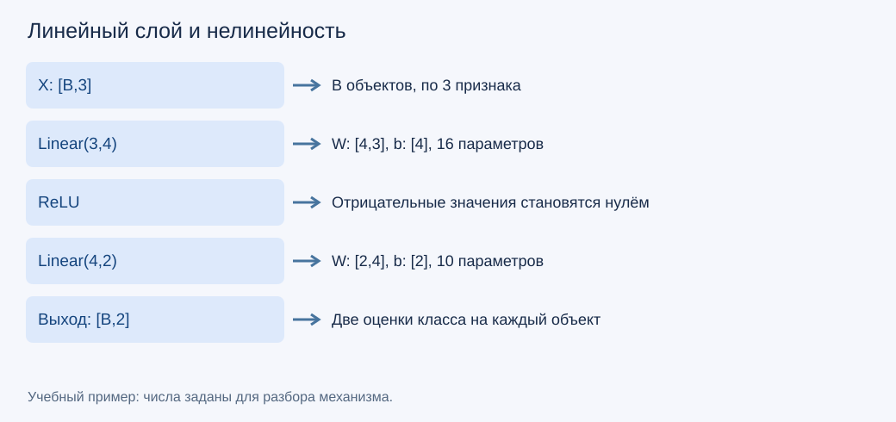

# M07-L01. Линейный слой и нелинейность

**Результат:** Объяснить, что меняется при добавлении нелинейной активации.

**До урока:** M02-L03, M03-L04, M05-L04. Если термины из этих уроков не удаётся объяснить своими словами, вернись к их разобранным примерам. Ориентир времени — 90 минут чтения и практики; это первоначальная оценка, а не ограничение.

## Зачем и как это работает

Нейронная сеть — параметризованная композиция преобразований. «Нейрон» здесь означает вычислительный элемент, а не точную модель клетки мозга. В полносвязном слое каждый выход складывает входные признаки с собственными весами и смещением. Для одного объекта x слой вычисляет z = Wx+b. Если векторы объектов записаны строками матрицы X, удобная запись становится Z = XWᵀ+b. Это та же операция при другом соглашении о расположении векторов.

В PyTorch Linear(in_features,out_features) хранит weight формы [out_features,in_features]. При X формы [batch,in_features] результат имеет форму [batch,out_features]. Bias формы [out_features] добавляется к каждой строке через broadcasting. Сначала подписывай формы и только потом запускай код: многие ошибки не вызывают исключения, потому что библиотека умеет расширять размерности. Неправильно расположенная ось может дать допустимый тензор с неверным смыслом.

Два линейных слоя без нелинейности не создают более выразительный класс функций. Если h=W₁x+b₁, а y=W₂h+b₂, подстановка даёт y=(W₂W₁)x+(W₂b₁+b₂): снова одно линейное преобразование со смещением. Параметров больше, но граница решения остаётся линейной. Нелинейная активация между слоями меняет эту ситуацию. ReLU вычисляет max(0,z) поэлементно: отрицательные промежуточные значения обнуляются, положительные остаются. Сеть получает возможность строить кусочно-линейные зависимости.

Рассмотрим XOR: классы для точек (0,0),(1,1) равны0, а для (0,1),(1,0) равны1. Одна прямая не разделяет эти диагональные группы. Для двоичных входов значение ReLU(x₁+x₂)−2ReLU(x₁+x₂−1) равно нужной метке. Это конкретный пример того, зачем требуется нелинейность. Он не означает, что произвольную задачу достаточно решать двумя скрытыми элементами: мы использовали особую структуру четырёх точек.

Последний слой классификатора часто возвращает logits — ненормированные оценки классов. Это не вероятности: они могут быть отрицательными и не суммируются в единицу. Softmax превращает их в положительные числа с суммой1, но уверенность всё ещё может быть плохо откалибрована. CrossEntropyLoss в PyTorch ожидает logits и целочисленные номера классов; добавление softmax перед этой функцией меняет задачу и ухудшает численную устойчивость. Для предсказанного класса достаточно argmax по последней оси.

Число параметров Linear(a,b) равно ab+b при наличии смещения. Это позволяет оценить размер сети до запуска. Слой2→8 содержит24параметра, слой8→2 содержит18, всего42. Объём весов в float32 равен42×4=168байт; память обучения больше, потому что нужны активации, градиенты и состояние оптимизатора. Большая сеть не гарантирует лучший результат на малых данных: она может запомнить примеры.

В учебной лабораторной мы сравним линейный классификатор и маленькую сеть на синтетических двухмерных данных. Это позволит увидеть форму границы без сложной предметной области. В интервьюере аналогичный принцип применяется к обученным представлениям текста, но двумерная картинка не доказывает качество текстовой оценки. На каждом масштабе остаются отдельные данные, цель и проверка.



## Разобранный пример

Для x=[2,−1], W=[[1,2],[−1,1]], b=[0,1] получаем z=[0,−2], после ReLU h=[0,0].

```python
import torch
x = torch.tensor([[2., -1.]])
w = torch.tensor([[1., 2.], [-1., 1.]])
b = torch.tensor([0., 1.])
z = x @ w.T + b
assert z.tolist() == [[0., -2.]]
assert torch.relu(z).tolist() == [[0., 0.]]
```

Обрати внимание на batch-размерность: даже один объект задан матрицей [1,2]. Нулевая активация в этом примере означает результат конкретного слоя, а не отсутствие информации во всей модели.

## Практика с поддержкой

Измени вход на [1,2], сначала вычисли результат на бумаге, затем проверь Torch. Собери nn.Sequential(Linear(2,8),ReLU(),Linear(8,2)), пропусти батч из трёх строк и проверь форму [3,2]. Посчитай число параметров через sum(p.numel()).

## Самостоятельная работа M07-L01-A

Для входа [−1,3], W=[[2,1],[−1,2]], b=[1,−2] рассчитай z и ReLU(z). Для сети3→4→2 с bias посчитай число параметров. Объясни алгебраически, почему удаление ReLU превращает два слоя в один.

Первая попытка — без готового решения. Сохрани свой код, объяснение и фактический результат в `submissions/M07-L01/`. AI может пояснять термин и помогать найти ошибку; запиши полученную помощь. Прочитанное решение не означает самостоятельно выполненное задание.

## Подсказки по очереди

1. Каждый выход — скалярное произведение одной строки W с x плюс свой bias.
2. Для каждого слоя отдельно считай веса и смещения.
3. Подставь выражение первого слоя во второй.

## Ошибки и самопроверка

Ошибка: считать logits вероятностями. Ошибка: умножать X на W без проверки соглашения. Критерий: верны числа, формы и число параметров; доказательство линейности содержит преобразованные веса и bias.

Работа готова, когда есть ответ на все условия задачи, вычисление или наблюдение подтверждает вывод, а ты можешь объяснить каждую величину и изменить один параметр без копирования решения. Критическую ошибку сначала исправь и повтори проверку; оформление не компенсирует неверное рассуждение. Сверь свою попытку с [решением M07-L01-A](../../solutions/modules/M07.md).

## Повтор и перенос

Повтор: сеть4→5→3 и вход из двух объектов. Через неделю объясни, почему увеличение глубины без активаций не решает XOR, и напиши прямой проход без nn.Sequential.

После проверки сохрани статус «самостоятельно» либо «с поддержкой», конкретную ошибку и дату следующей попытки. Через 7–10 дней повтори изменённый пример без открытого решения; только эта проверка позволяет отметить «подтверждено позже». Если результата пока нет, оставь «не проверено».

## Источники и углубление

- [PyTorch: основы](https://docs.pytorch.org/tutorials/beginner/basics/intro.html)
- [PyTorch: autograd](https://docs.pytorch.org/tutorials/beginner/basics/autogradqs_tutorial.html)

Текст, численные примеры, задания и схемы этого урока созданы для данного курса. Источники нужны для проверки терминов и изучения исходного метода; они не заменяют самостоятельную практику.
