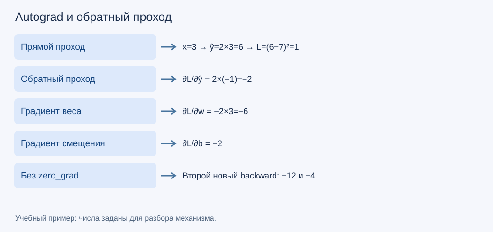

# M07-L02. Autograd и обратный проход

**Результат:** Объяснить накопление градиентов и момент их обнуления.

**До урока:** M07-L01. Если термины из этих уроков не удаётся объяснить своими словами, вернись к их разобранным примерам. Ориентир времени — 110 минут чтения и практики; это первоначальная оценка, а не ограничение.

## Объяснение

Обратное распространение ошибки вычисляет производные функции потерь по параметрам композиции. Autograd автоматизирует применение цепного правила к операциям, выполненным над тензорами. Он не выбирает хорошую цель, не очищает данные и не гарантирует обучение: если программа вычисляет неверный loss, производная будет корректной именно для этого неверного выражения. Поэтому ручной маленький пример полезен даже при работе с библиотекой.

В прямом проходе PyTorch строит вычислительный граф для операций над тензорами с requires_grad=True. Узлы содержат связи, необходимые для обратного прохода. Когда вызывается loss.backward(), библиотека проходит граф от скалярной ошибки к параметрам и добавляет вычисленные производные в поле .grad. Граф строится заново при следующем прямом проходе; обычный тренировочный цикл не должен сохранять все прошлые графы.

Возьмём ŷ=wx+b и L=(ŷ−y)². Обозначим ошибку e=ŷ−y. Тогда ∂L/∂w=2ex, ∂L/∂b=2e. При x=3, y=7, w=2, b=0 предсказание 6, e=−1, производные −6 и −2. Отрицательный градиент по w показывает: небольшое увеличение w уменьшит loss в окрестности текущей точки. Шаг gradient descent w←w−η∂L/∂w при η=0,1 даёт w=2,6. Одновременно b станет 0,2; совместный большой шаг может перескочить минимум, поэтому знак правильный ещё не гарантирует удачный размер шага.

Градиенты накапливаются, поскольку это позволяет суммировать вклад нескольких микро-батчей. Если перед независимым шагом не вызвать optimizer.zero_grad(), старый вклад останется. Для двух одинаковых прямых проходов без изменения параметров градиент удвоится. Иногда такое накопление намеренно, но тогда нормировка loss и момент optimizer.step() должны быть определены. В обычной лабораторной очищаем градиенты перед каждым шагом.

detach() отделяет тензор от графа, а item() извлекает скаляр Python. Они полезны для журналирования, но не должны случайно стоять внутри пути, по которому нужен градиент. Если вычислить pred.detach() перед loss, параметры не получат нужную производную. Для сохранения истории используют loss.item(), а не сам loss: иначе список может удерживать графы и расходовать память. Изменения параметров выполняет optimizer; ручное обновление нужно делать в контексте no_grad.

При оценивании градиенты обычно не нужны. no_grad или inference_mode отключают их отслеживание и уменьшают накладные расходы. Это независимо от model.eval(), который меняет поведение некоторых слоёв. Режим eval не запрещает вычисление градиентов, а no_grad не переводит Dropout в режим оценки. Эти две команды отвечают на разные вопросы.

Проверка конечной разностью помогает убедиться, что производная соответствует функции: [L(w+ε)−L(w−ε)]/(2ε). Для слишком большого ε это грубая аппроксимация, для слишком малого возникают ошибки округления. На маленьком гладком примере float64 и ε около 1e−5 удобны для проверки. В точке излома ReLU классическая производная не определена, поэтому сравнение требует отдельной осторожности.



## Аналогия: распределённая трассировка и счётчики метрик

Как похоже: во время запроса трассировка записывает дерево вызовов, а потом по нему можно пройти от итога к началу и раздать вклад каждому шагу. Прямой проход так же записывает граф операций, а backward() идёт по нему от loss к параметрам. Поле .grad похоже на счётчик метрики: если не сбросить его перед новым окном, к старому значению прибавится новое.

| В уроке | В аналогии |
| --- | --- |
| Граф прямого прохода | Трасса запроса: дерево вызовов, записанное по ходу выполнения |
| backward() | Обход трассы от итога к началу с раздачей вклада каждому вызову |
| Накопление в .grad | Счётчик, который не сбрасывается между окнами |
| zero_grad() | Сброс счётчика перед новым окном |
| detach() | Вызов вне трассы: его вклад никуда не передаётся |
| loss.item() в историю | Записать в лог число, а не хранить ссылку на всю трассу |
| no_grad и eval() | Отключить трассировку и переключить флаг поведения — две разные настройки |

**Где аналогия ломается:** в трассе вклады шагов складываются по времени. Градиент получается по цепному правилу — локальные производные перемножаются, а у результата есть знак, который показывает направление изменения параметра. Похожего направления трасса не даёт.

## Разобранный пример

```python
import torch
w = torch.tensor(2., requires_grad=True)
b = torch.tensor(0., requires_grad=True)
loss = (w*3 + b - 7)**2
loss.backward()
assert loss.item() == 1
assert w.grad.item() == -6
assert b.grad.item() == -2
```

Повторный новый loss.backward() без обнуления даст w.grad=−12. Не повторяй backward на уже освобождённом графе; вычисли новый loss тем же выражением. Так отделяются две разные проблемы: повторное использование графа и накопление градиентов.

## Практика с поддержкой

**Предскажи до запуска.** Прежде чем запускать код или пересчитывать пример, запиши ожидаемый вывод: числа, формы массивов, порядок или текст. После запуска сравни с фактическим и объясни каждое расхождение.

Проверь производную по w конечной разностью, считая b фиксированным. Затем обнули .grad и выполни новый прямой проход. Запиши, чем differs значение функции, её производная и новый параметр после шага.

## Самостоятельная задача A — M07-L02-A

Для x=2, y=5, w=1, b=1 вычисли loss, оба градиента и параметры после одного шага η=0,05. Посчитай новый loss. Покажи, какие градиенты получатся после двух одинаковых backward без обновления и обнуления.

Первая попытка — без готового решения. Сохрани свой код, объяснение и фактический результат в `submissions/M07-L02/`. AI может пояснять термин и помогать найти ошибку; запиши полученную помощь. Прочитанное решение не означает самостоятельно выполненное задание.

## Подсказки по очереди

1. Сначала e=wx+b−y.
2. Обновляй оба параметра из старых градиентов.
3. Накопление удваивает производные, а не исходный loss.

## Критерии и типичные ошибки

Ошибка: обновить w, затем посчитать градиент b уже на новых параметрах. Ошибка: использовать loss.item() для обратного прохода. Критерий: ручные числа совпадают с autograd и объяснён источник накопления.

Работа готова, когда есть ответ на все условия задачи, вычисление или наблюдение подтверждает вывод, а ты можешь объяснить каждую величину и изменить один параметр без копирования решения. Критическую ошибку сначала исправь и повтори проверку; оформление не компенсирует неверное рассуждение. Сверь свою попытку с [решением M07-L02-A](../../solutions/modules/M07.md).

## Новая и отложенная проверка

Вариант **M07-L02-B**. Для w=1, b=0, x=[1,3], y=[2,2] вычисли MSE со средним по двум объектам и градиенты по w и b. Затем замени mean на sum и пересчитай. Объясни, почему при том же learning rate это другой шаг.

Отложенный вариант **M07-L02-C**. В коде w — скаляр 2 с requires_grad=True; z=(3*w).detach().requires_grad_(True); loss=(z−1)**2; loss.backward(). Укажи z.grad и w.grad. Удали ровно разрыв графа и назови новый градиент w. Почему наличие градиента у z ещё не доказывает обучение w?

Сначала сохрани свою попытку и полученную помощь; затем открой [ключи B/C](../../solutions/modules/M07.md). После разбора B выполняй C без открытого решения. Статус «подтверждено позже» относится только к фактически выполненной отложенной проверке; до неё не отмечай освоение заранее.

## Источники и углубление

- [PyTorch: основы](https://docs.pytorch.org/tutorials/beginner/basics/intro.html)
- [PyTorch: autograd](https://docs.pytorch.org/tutorials/beginner/basics/autogradqs_tutorial.html)

Текст, численные примеры, задания и схемы этого урока созданы для данного курса. Источники нужны для проверки терминов и изучения исходного метода; они не заменяют самостоятельную практику.
