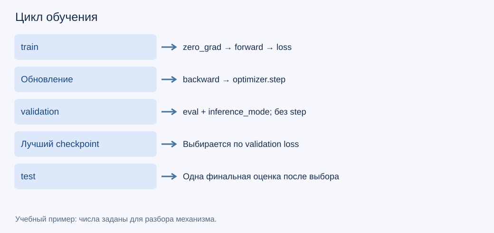

# M07-L03. Цикл обучения

**Результат:** Исправить цикл с пропущенным обнулением или неправильным режимом работы.

**До урока:** M07-L02. Если термины из этих уроков не удаётся объяснить своими словами, вернись к их разобранным примерам. Ориентир времени — 130 минут чтения и практики; это первоначальная оценка, а не ограничение.

## Объяснение

Цикл обучения соединяет данные, модель, функцию потерь и оптимизатор. У каждого компонента своя роль. Модель превращает вход в предсказание; loss измеряет ошибку относительно цели; autograd вычисляет производные; optimizer использует их для изменения параметров. Если разделять эти роли, легче локализовать сбой, чем воспринимать fit как одну магическую операцию.

До обучения данные делятся на train, validation и test согласно будущему сценарию применения. Статистики масштабирования оцениваются только по train. Validation помогает выбрать эпоху и настройки; test используется после фиксации решения. Для синтетической задачи допустим случайный стратифицированный split; для истории интервью с повторными ответами одного человека потребуется разделение по человеку или времени. Случайное перемешивание строк не устраняет зависимость объектов.

Батч — группа примеров, по которой вычисляется один шаг. Эпоха — проход по всему обучающему набору. При размере train640 и batch64 эпоха содержит 10 шагов, если остатка нет. Loss с reduction='mean' усредняет ошибку по объектам батча. Для среднего loss эпохи нужно учитывать размеры батчей: сумма loss_batch·n_batch, делённая на число объектов. Простое среднее средних неправильно, когда последний батч существенно меньше.

Порядок обычного шага: zero_grad, forward, loss, backward, step. Перед обучением вызывается model.train(); перед validation — model.eval(). Dropout во время обучения случайно обнуляет часть активаций, а при оценке отключает это поведение. BatchNorm также по-разному использует статистики. В маленькой сети без этих слоёв train/eval может не менять числа, но правильный цикл должен явно выражать намерение.

Validation выполняется без изменения весов и без накопления градиентов. Иначе оценочный набор начинает влиять на обучение, даже если переменная называется valid_loader. Для CrossEntropyLoss logits имеют форму [B,C], target — [B] целочисленного типа long, значения target находятся от 0 до C−1. Проверка формы до backward ловит ошибки, которые позднее проявились бы странной динамикой.

Воспроизводимость включает seed, разделение данных, версии пакетов и настройки. Одинаковый seed на разных устройствах или версиях библиотек не обещает побитовую идентичность. В CPU-лабораторной фиксируем torch.manual_seed и число потоков, а качество проверяем содержательными границами и сохранёнными контрольными ответами. История нужна для объяснения, а не только для красивого графика: сохраняем train_loss, val_loss и выбранную эпоху.

Остановка выбирается по validation. Снижение train_loss при росте val_loss может означать переобучение. Сохраняется копия state_dict лучшей эпохи; ссылка на текущие тензоры без копирования продолжит меняться вместе с моделью. После выбора лучший комплект оценивается один раз на test. Если посмотреть test после каждой архитектуры и выбрать лучшую, он фактически превращается в validation независимо от имени файла.

Сравнение с линейным baseline отвечает, оправдана ли сложность сети. Оба варианта получают одинаковый split и допустимые признаки. Разница одной метрики на одном seed не доказывает универсальное преимущество нейросетей; нужны анализ ошибок и соответствие цели.



## Разобранный пример

Следующий блок автономен: он создаёт два обучающих объекта, два отдельных контрольных объекта, модель и оптимизатор. Весовые коэффициенты и смещения начинаются с нуля, чтобы один шаг можно было проверить численно. Это опыт над механикой цикла; четыре искусственные точки не являются достаточной оценкой обобщения.

```python
import math
import torch
from torch import nn

torch.set_num_threads(1)
x_train = torch.tensor([[-1.], [1.]])
y_train = torch.tensor([0, 1], dtype=torch.long)
x_val = torch.tensor([[-2.], [2.]])
y_val = torch.tensor([0, 1], dtype=torch.long)
model = nn.Linear(1, 2)
with torch.no_grad():
    model.weight.zero_()
    model.bias.zero_()
criterion = nn.CrossEntropyLoss()
optimizer = torch.optim.SGD(model.parameters(), lr=0.2)

model.train()
optimizer.zero_grad(set_to_none=True)
logits = model(x_train)
assert logits.shape == (2, 2)
loss = criterion(logits, y_train)
loss.backward()
optimizer.step()

before_validation = [p.detach().clone() for p in model.parameters()]
model.eval()
with torch.inference_mode():
    val_loss = criterion(model(x_val), y_val).item()
assert all(torch.equal(old, new) for old, new in
           zip(before_validation, model.parameters()))
assert abs(loss.item() - math.log(2)) < 1e-6
assert torch.allclose(model.weight, torch.tensor([[-0.1], [0.1]]))
assert abs(val_loss - math.log1p(math.exp(-0.4))) < 1e-6
print(f'train_before_step={loss.item():.6f}')
print(f'validation_after_step={val_loss:.6f}')
```

Ожидаемый вывод: `train_before_step=0.693147` и `validation_after_step=0.513015`. До шага оба logit равны нулю, поэтому вероятность каждого класса равна 0,5 и loss = ln(2). Градиенты двух весов равны 0,5 и −0,5; при шаге 0,2 веса становятся −0,1 и 0,1, смещения остаются нулевыми. На контрольном x = −2 logits равны [0,2; −0,2], отсюда loss = ln(1 + exp(−0,4)). Проверка снимка параметров доказывает, что validation их не меняет.

Это один full-batch шаг на двух train-объектах. Если заменить `x_train` набором из 640 объектов, шаг использует все 640. При переходе к DataLoader цикл по батчам добавляется внутри эпохи. Нельзя называть каждый батч новой эпохой. Здесь train loss измерен до обновления, а validation loss после него; их различие не следует трактовать как самостоятельный вывод о переобучении.

## Практика с поддержкой

**Предскажи до запуска.** Прежде чем запускать код или пересчитывать пример, запиши ожидаемый вывод: числа, формы массивов, порядок или текст. После запуска сравни с фактическим и объясни каждое расхождение.

Запусти M07/demo.py, прочитай первые и последние значения истории. Найди место, где копируется лучший state_dict. Временно добавь вывод shapes и dtype перед loss. Удали диагностические печати после проверки.

## Самостоятельная задача A — M07-L03-A

В эпохе три батча размеров 4,4,2, их средние loss равны 0,2;0,4;1,0. Посчитай корректный loss эпохи. В приведённом ниже цикле перечисли две независимые ошибки и исправь: loss.backward(); optimizer.step(); model(x_val).sum().backward(). Объясни, почему оценка test каждую эпоху меняет роль test.

Первая попытка — без готового решения. Сохрани свой код, объяснение и фактический результат в `submissions/M07-L03/`. AI может пояснять термин и помогать найти ошибку; запиши полученную помощь. Прочитанное решение не означает самостоятельно выполненное задание.

## Подсказки по очереди

1. Умножь средний loss каждого батча на число объектов.
2. До нового шага нужно очистить старые градиенты.
3. Validation не должен вызывать backward или step.

## Критерии и типичные ошибки

Ошибка: усреднять батчи одинаковым весом. Ошибка: выбирать лучшую эпоху по test. Критерий: среднее равно взвешенной сумме, исправленный цикл отделяет обновление от оценки.

Работа готова, когда есть ответ на все условия задачи, вычисление или наблюдение подтверждает вывод, а ты можешь объяснить каждую величину и изменить один параметр без копирования решения. Критическую ошибку сначала исправь и повтори проверку; оформление не компенсирует неверное рассуждение. Сверь свою попытку с [решением M07-L03-A](../../solutions/modules/M07.md).

## Новая и отложенная проверка

Вариант **M07-L03-B**. Средние loss четырёх батчей равны [1,1,1,4], размеры [3,3,3,1]. Найди loss по всем объектам и результат ошибочного среднего четырёх средних. Объясни, почему последний батч нельзя наделять весом полного.

Отложенный вариант **M07-L03-C**. У линейной модели w=1 без bias SGD имеет lr=0,1. Первый батч x=1,y=0, второй x=2,y=0; loss=(wx−y)². Выполни два шага с zero_grad перед каждым. Затем повтори, если zero_grad был только перед первым шагом. Запиши w после обоих шагов и источник расхождения.

Сначала сохрани свою попытку и полученную помощь; затем открой [ключи B/C](../../solutions/modules/M07.md). После разбора B выполняй C без открытого решения. Статус «подтверждено позже» относится только к фактически выполненной отложенной проверке; до неё не отмечай освоение заранее.

## Источники и углубление

- [PyTorch: основы](https://docs.pytorch.org/tutorials/beginner/basics/intro.html)
- [PyTorch: autograd](https://docs.pytorch.org/tutorials/beginner/basics/autogradqs_tutorial.html)

Текст, численные примеры, задания и схемы этого урока созданы для данного курса. Источники нужны для проверки терминов и изучения исходного метода; они не заменяют самостоятельную практику.
