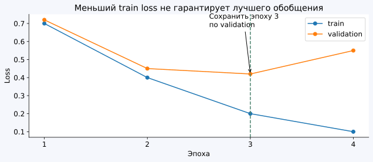

# M07-L04. Проверка и диагностика

**Результат:** Предложить проверку причины сбоя до случайной замены архитектуры.

**До урока:** M07-L03. Если термины из этих уроков не удаётся объяснить своими словами, вернись к их разобранным примерам. Ориентир времени — 110 минут чтения и практики; это первоначальная оценка, а не ограничение.

## Объяснение

Диагностика обучения начинается с наблюдаемого симптома. «Нейросеть не работает» слишком расплывчато: loss не меняется, становится NaN, падает только на train или даёт разные ответы после загрузки — это разные проблемы. Сначала зафиксируй минимальный воспроизводимый пример и ожидаемое свойство. Изменение сразу пяти параметров может случайно помочь, но не объяснит причину.

Проверка возможности запомнить маленький набор — полезный диагностический опыт. Возьми 8–16 обучающих объектов без шумных или противоречивых меток и попробуй добиться очень малого loss. Это не оценка качества: набор намеренно используется для подгонки. Если достаточно выразительная сеть не может решить его, вероятны ошибки формата target, градиентов, масштаба входа или шага. Если может, базовый вычислительный путь работает, и дальнейшие проблемы могут быть связаны с обобщением.

Недообучение проявляется высокой ошибкой и на train, и на validation. Причины включают недостаточную выразительность, слишком короткое обучение, плохие признаки и чрезмерную регуляризацию. Переобучение проявляется разрывом: train становится лучше, а validation ухудшается. Это не диагноз по одному числу: возможно, наборы имеют разные распределения или разметку. Нужно смотреть динамику, размер выборок и конкретные ошибки.

NaN означает недопустимый численный результат. Источником может быть log(0), деление на ноль, переполнение экспоненты или нечисловой вход. Проверяй конечность данных, logits, loss и градиентов по этапам. Самая ранняя точка с нечисловым значением указывает место расследования. Уменьшение learning rate не исправит NaN, уже присутствующий в исходном x. Для классификации используй устойчивую CrossEntropyLoss вместо ручного log(softmax), если нет учебной причины разбирать вычисление.

Масштаб признаков влияет на размер градиента. Если один признак измеряется единицами, другой миллионами, одинаковый шаг по весам может быть неудобен. Стандартизация, обученная только на train, часто делает оптимизацию устойчивее. Gradient clipping ограничивает норму градиента, но это дополнительный механизм, а не универсальное лечение. Сначала проверь, почему градиент вырос и не скрывает ли clipping ошибку данных.

Метрика accuracy не показывает все ошибки. На несбалансированном наборе модель может всегда выбирать большинство. Разбери confusion matrix и примеры по классам. В интервьюере общая «оценка ответа» особенно опасна без явных критериев: нужно различать отсутствие аргумента, фактическую ошибку и краткий, но правильный ответ. Нейросеть не определяет смысл метки; его задают постановка и разметка.

Случайность влияет на небольшой эксперимент. Сравнивая две версии, фиксируй split и настройки, а при необходимости повтори несколько seed. Но не усредняй ошибки разных протоколов: запуск с утечкой не становится корректным от добавления ещё четырёх честных запусков. Содержательный отчёт описывает симптом, гипотезу, изолированную проверку и изменение результата. Такой порядок переносится на большие модели гораздо лучше, чем привычка сразу увеличивать число слоёв.



## Аналогия: отладка инцидента в продакшене

Как похоже: «у меня не работает» не помогает, а минимальный репро бага — помогает. Прежде чем гонять нагрузочный тест, код проверяют юнит-тестом на маленькой фикстуре. Чтобы найти, откуда взялся сбой, git bisect ищет первый плохой коммит — так же ищут первую точку, где появился NaN. Пять фиксов в одном деплое не объяснят, какой из них помог.

| В уроке | В аналогии |
| --- | --- |
| Минимальный воспроизводимый пример | Минимальный репро бага вместо «у меня не работает» |
| Подгонка 8–16 объектов | Юнит-тест на маленькой фикстуре до нагрузочного теста |
| Самая ранняя точка NaN | git bisect: первый коммит, где тест упал |
| Gradient clipping | Rate limiter, который снимает симптом, но не причину |
| Пять изменений сразу | Пять фиксов в одном деплое: непонятно, какой помог |
| Accuracy на несбалансированных данных | Uptime 99%, а критичный эндпоинт всегда падает |

**Где аналогия ломается:** баг в коде обычно детерминирован и воспроизводится одним тестом. В обучении часть эффектов зависит от seed и данных: «починилось на одном запуске» может быть случайностью, поэтому сравнивают при одинаковом протоколе и при необходимости на нескольких seed.

## Разобранный пример

История по эпохам: train=[0,70;0,40;0,20;0,10], validation=[0,72;0,45;0,42;0,55]. Лучшее значение validation на третьей эпохе. Четвёртая улучшает train и ухудшает validation; выбираем сохранённый комплект третьей, а не последней.

```python
import torch
def check_finite(name, value):
    if not torch.isfinite(value).all():
        raise ValueError(f'nonfinite tensor: {name}')
check_finite('input', torch.tensor([1.,2.]))
# check_finite('input', torch.tensor([float('nan')])) -> ValueError
```

Проверка намеренно сообщает имя этапа, иначе сообщение «обучение упало» не помогает локализовать источник.

## Практика с поддержкой

**Предскажи до запуска.** Прежде чем запускать код или пересчитывать пример, запиши ожидаемый вывод: числа, формы массивов, порядок или текст. После запуска сравни с фактическим и объясни каждое расхождение.

Добавь check_finite перед моделью и после loss в копию лабораторной. Внеси NaN в один объект и убедись, что сбой обнаружен до optimizer.step. Затем восстанови данные; не удаляй строку молча без записи причины.

## Самостоятельная задача A — M07-L04-A

Есть train loss=[0,6;0,3;0,1] и val loss=[0,65;0,4;0,7]. Какой checkpoint выбрать и чего эти числа не доказывают? Для отдельного запуска loss=NaN уже на первом шаге предложи последовательность трёх проверок. На 100 объектах класса 0 всего 95; baseline всегда 0. Посчитай accuracy и recall класса 1.

Первая попытка — без готового решения. Сохрани свой код, объяснение и фактический результат в `submissions/M07-L04/`. AI может пояснять термин и помогать найти ошибку; запиши полученную помощь. Прочитанное решение не означает самостоятельно выполненное задание.

## Подсказки по очереди

1. Выбор эпохи опирается на validation.
2. NaN может появиться до обучения.
3. Recall класса 1 — правильно найденные единицы, делённые на все настоящие единицы.

## Критерии и типичные ошибки

Ошибка: заявить причину переобучения только по трём точкам. Ошибка: считать 95% достаточно хорошим без задачи. Критерий: есть выбранная эпоха, ограничение вывода и порядок локализации NaN.

Работа готова, когда есть ответ на все условия задачи, вычисление или наблюдение подтверждает вывод, а ты можешь объяснить каждую величину и изменить один параметр без копирования решения. Критическую ошибку сначала исправь и повтори проверку; оформление не компенсирует неверное рассуждение. Сверь свою попытку с [решением M07-L04-A](../../solutions/modules/M07.md).

## Новая и отложенная проверка

Вариант **M07-L04-B**. Журнал эпох 1…5: train=[0,80;0,60;0,42;0,30;0,23], validation=[0,82;0,62;0,55;0,59;0,67]. Все данные конечны, число объектов неизменно. Выбери checkpoint и объясни наблюдаемую проблему. Test ещё не вычисляли: разрешено ли выбирать эпоху по нему?

Отложенный вариант **M07-L04-C**. В новом запуске train loss=0,41, validation loss=NaN. Проверки дают: параметры конечны; все train-входы конечны; в validation-входе с индексом 17 есть NaN; labels в диапазоне; NaN воспроизводится и в eval, и в train. Назови подтверждённый дефект, две проверки после исправления и предел вывода о причине. Не подменяй эти данные общим советом «уменьши learning rate».

Сначала сохрани свою попытку и полученную помощь; затем открой [ключи B/C](../../solutions/modules/M07.md). После разбора B выполняй C без открытого решения. Статус «подтверждено позже» относится только к фактически выполненной отложенной проверке; до неё не отмечай освоение заранее.

## Источники и углубление

- [PyTorch: основы](https://docs.pytorch.org/tutorials/beginner/basics/intro.html)
- [PyTorch: autograd](https://docs.pytorch.org/tutorials/beginner/basics/autogradqs_tutorial.html)

Текст, численные примеры, задания и схемы этого урока созданы для данного курса. Источники нужны для проверки терминов и изучения исходного метода; они не заменяют самостоятельную практику.
