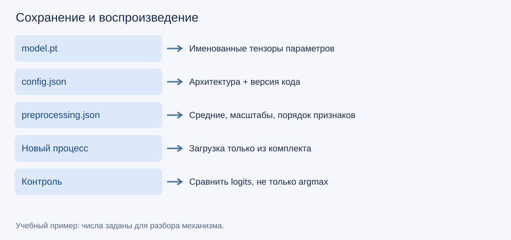

# M07-L05. Сохранение и воспроизведение

**Результат:** Доказать согласованность модели и preprocessing на контрольных входах.

**До урока:** M07-L04. Если термины из этих уроков не удаётся объяснить своими словами, вернись к их разобранным примерам. Ориентир времени — 130 минут чтения и практики; это первоначальная оценка, а не ограничение.

## Объяснение

Обученная сеть существует не только как объект Python в памяти. Чтобы использовать её завтра или в другом процессе, нужно сохранить параметры и условия их интерпретации. В PyTorch state_dict сопоставляет имена параметров и буферов тензорам. Он не хранит автоматически произвольную логику подготовки данных или все решения эксперимента. Архитектуру и preprocessing нужно восстановить согласованно.

Сохранение целого Python-объекта тесно связывает файл со структурой исходного кода и механизмом сериализации. Для курса используем state_dict плюс явную JSON-конфигурацию и читаем веса с weights_only=True. Загружаем только собственные или проверенные артефакты. Это также делает структуру выпуска понятной: можно отдельно посмотреть размеры слоёв, порядок признаков, среднее и масштаб.

Минимальный комплект для нашего MLP содержит model.pt, config.json, preprocessing.json, split.json и report.json. Config описывает input_dim, hidden_dim, output_dim и активацию. Preprocessing содержит mean и scale обучающего набора. Split связывает номера объектов или правило генерации с train/validation/test. Report фиксирует версии пакетов, seed, выбранную эпоху и метрики. Контрольные входы и ожидаемые logits позволяют проверить именно восстановление, не повторяя обучение.

После загрузки вызывается model.eval(), поскольку сериализация весов не заменяет выбор режима исполнения. Устройство задаётся через map_location='cpu' для гарантированного локального варианта. Сначала создаётся архитектура нужной формы, затем load_state_dict проверяет совпадение ключей и размерностей. Параметр strict=False не следует использовать как способ скрыть непонятную несовместимость: пропущенный слой может остаться случайно инициализированным.

Сравнивать лучше исходные численные выходы на нескольких объектах, а не только argmax. Два разных набора logits могут давать тот же класс, поэтому проверка класса не обнаружит некоторые повреждения. Для float32 применяют согласованный absolute/relative tolerance. В одном и том же CPU-окружении маленькая сеть обычно даёт очень близкие результаты, но утверждение о побитовой идентичности требует отдельной проверки. Допуск не должен быть настолько широким, чтобы скрывать изменение модели.

Отдельный процесс важен потому, что ноутбук способен незаметно использовать старые переменные. Если забытый scaler остаётся в памяти, код кажется рабочим, хотя сохранённого комплекта недостаточно. Новый Python-процесс получает только файлы и входной запрос. Успешное восстановление там доказывает более сильное свойство: необходимые данные действительно включены в артефакт. Оно всё ещё не доказывает качество на новых пользователях.

Полное возобновление обучения требует больше состояния, чем инференс: optimizer.state_dict, номер шага, scheduler и состояние генераторов случайных чисел. Например, Adam хранит накопленные моменты градиентов. Загрузка только весов и новый Adam продолжат обучение с иным состоянием. Для этого урока обязательна воспроизводимость предсказания; точное продолжение обучения — дополнительный эксперимент с явно сохранёнными компонентами.

В сквозном проекте эта дисциплина переносится на LLM: версия весов, токенизатор, chat_template и параметры генерации образуют общий комплект. Сохранённая история чата отдельно не гарантирует воспроизведение, если изменились модель или шаблон. Поэтому выпуск получает устойчивый идентификатор, а результаты — ссылку на него.



## Аналогия: бэкап и restore drill базы данных

Как похоже: дамп данных без схемы некуда загрузить — сначала создают таблицы, потом импортируют строки. state_dict — такой же дамп: сначала создают архитектуру, потом load_state_dict сверяет имена и формы. Бэкап проверяют restore drill на чистом сервере с контрольными запросами, а не на рабочем, где всё уже лежит в памяти.

| В уроке | В аналогии |
| --- | --- |
| state_dict | Дамп данных таблиц |
| config.json с архитектурой | DDL схемы: без него дамп некуда загрузить |
| load_state_dict со strict=True | Импорт, который падает при несовпадении колонок |
| strict=False | Импорт с пропуском неизвестных колонок: тихая потеря |
| Проверка в новом процессе | Restore drill на чистом сервере, а не на рабочем |
| Сравнение только argmax | Сверить число строк, а не содержимое |
| Состояние Adam для продолжения обучения | WAL для восстановления на точку во времени, а не только снимок |

**Где аналогия ломается:** дамп базы восстанавливается побайтово, а выходы сети на float сравнивают с допуском. Preprocessing — mean и scale — в дамп таблиц обычно не входит: это ближе к правилам приведения единиц в коде приложения, и их нужно сохранять явно. И совпадение контрольных logits не говорит о качестве на новых данных.

## Разобранный пример

Блок запускается самостоятельно и не требует весов из предыдущих занятий. Зададим маленький линейный слой известными числами, чтобы проверить именно сохранение и восстановление. Временная папка содержит state_dict, конфигурацию и preprocessing, а после проверки автоматически удаляется. Это демонстрация сериализации, а не результат обучения; обучение и восстановление в отдельном процессе выполняет полная лабораторная M07.

```python
import json
from pathlib import Path
from tempfile import TemporaryDirectory
import torch
from torch import nn

model = nn.Linear(2, 2)
with torch.no_grad():
    model.weight.copy_(torch.tensor([[1., 2.], [-1., 1.]]))
    model.bias.copy_(torch.tensor([0.5, -0.5]))
model.eval()
config = {'input_dim': 2, 'output_dim': 2, 'bias': True}
preprocessing = {'mean': [10., 20.], 'scale': [2., 5.]}
raw = torch.tensor([[12., 25.], [8., 20.]])

def transform(values, settings):
    return ((values - torch.tensor(settings['mean']))
            / torch.tensor(settings['scale']))

with torch.inference_mode():
    expected = model(transform(raw, preprocessing))
assert torch.allclose(expected, torch.tensor([[3.5, -0.5], [-0.5, 0.5]]))

with TemporaryDirectory(prefix='ml-course-checkpoint-') as directory:
    folder = Path(directory)
    torch.save(model.state_dict(), folder / 'model.pt')
    (folder / 'config.json').write_text(json.dumps(config), encoding='utf-8')
    (folder / 'preprocessing.json').write_text(
        json.dumps(preprocessing), encoding='utf-8')

    loaded_config = json.loads((folder / 'config.json').read_text(encoding='utf-8'))
    loaded_preprocessing = json.loads(
        (folder / 'preprocessing.json').read_text(encoding='utf-8'))
    restored = nn.Linear(loaded_config['input_dim'], loaded_config['output_dim'],
                         bias=loaded_config['bias'])
    restored.load_state_dict(torch.load(folder / 'model.pt', map_location='cpu',
                                        weights_only=True))
    restored.eval()
    with torch.inference_mode():
        actual = restored(transform(raw, loaded_preprocessing))
    max_abs_error = (actual - expected).abs().max().item()
    assert max_abs_error < 1e-6
    print(actual.tolist())
    print(f'max_abs_error={max_abs_error:.6f}')
```

Ожидается `[[3.5, -0.5], [-0.5, 0.5]]` и `max_abs_error=0.000000`. Первый вход после преобразования равен [1,1], поэтому logits равны [1 + 2 + 0,5; −1 + 1 − 0,5] = [3,5; −0,5]. Второй вход превращается в [−1,0] и даёт [−0,5; 0,5]. Восстановленный слой использует настройки, прочитанные из файлов, и повторяет эти значения.

Архитектура должна совпасть с сохранённой: замена `input_dim` на 3 приведёт к несовместимым размерам весов при загрузке. Это полезная защита, которую не нужно скрывать через `strict=False`. Данный короткий пример проверяет чтение файлов в том же процессе; более сильную проверку отсутствия скрытых переменных выполняет лабораторная, запускающая новый Python-процесс.

## Практика с поддержкой

**Предскажи до запуска.** Прежде чем запускать код или пересчитывать пример, запиши ожидаемый вывод: числа, формы массивов, порядок или текст. После запуска сравни с фактическим и объясни каждое расхождение.

Запусти demo.py и найди сохранённый release в artifacts/M07. Открой JSON-конфигурацию. Запусти режим --verify отдельно. Измени копию scale и убедись, что контрольные logits перестают совпадать; исходный комплект не перезаписывай.

## Самостоятельная задача A — M07-L05-A

Для контрольных logits A=[[1,2],[−1,0]] и B=[[10,20],[−10,0]] сравни классы и сами значения. Объясни, почему совпадения классов недостаточно. Составь два списка файлов: минимальный комплект инференса и дополнение для возобновления обучения с Adam.

Первая попытка — без готового решения. Сохрани свой код, объяснение и фактический результат в `submissions/M07-L05/`. AI может пояснять термин и помогать найти ошибку; запиши полученную помощь. Прочитанное решение не означает самостоятельно выполненное задание.

## Подсказки по очереди

1. Argmax обеих строк в обоих случаях равен 1.
2. Масштаб logits влияет на softmax и confidence.
3. В Adam есть состояние помимо самих параметров модели.

## Критерии и типичные ошибки

Ошибка: считать наличие model.pt полным выпуском. Ошибка: проверять восстановление в том же ноутбуке со старым scaler. Критерий: отдельно проверены logits и preprocessing, новый процесс не зависит от памяти обучения.

Работа готова, когда есть ответ на все условия задачи, вычисление или наблюдение подтверждает вывод, а ты можешь объяснить каждую величину и изменить один параметр без копирования решения. Критическую ошибку сначала исправь и повтори проверку; оформление не компенсирует неверное рассуждение. Сверь свою попытку с [решением M07-L05-A](../../solutions/modules/M07.md).

## Новая и отложенная проверка

Вариант **M07-L05-B**. В сохранённом выпуске W=[[1,2],[−1,1]], bias=[0,5;−0,5], mean=[10,20], scale=[2,5]. Для raw=[14,10] вычисли преобразованный вход и logits. Новый процесс вернул [34,5;−4,5]. Локализуй ошибку и вычисли max_abs_error. Считай допуск 1e−6.

Отложенный вариант **M07-L05-C**. Сравни два комплекта после шага 100 Adam: A содержит веса, архитектуру, scaler и контрольные logits; B дополнительно содержит optimizer.state_dict, scheduler, номер шага, состояния RNG и позицию в порядке данных. При одинаковом окружении предсказания A воспроизводятся, но шаг 101 отличается. Объясни, почему это совместимо, и что проверить до заявления о точном возобновлении из B.

Сначала сохрани свою попытку и полученную помощь; затем открой [ключи B/C](../../solutions/modules/M07.md). После разбора B выполняй C без открытого решения. Статус «подтверждено позже» относится только к фактически выполненной отложенной проверке; до неё не отмечай освоение заранее.

## Источники и углубление

- [PyTorch: основы](https://docs.pytorch.org/tutorials/beginner/basics/intro.html)
- [PyTorch: autograd](https://docs.pytorch.org/tutorials/beginner/basics/autogradqs_tutorial.html)

Текст, численные примеры, задания и схемы этого урока созданы для данного курса. Источники нужны для проверки терминов и изучения исходного метода; они не заменяют самостоятельную практику.
