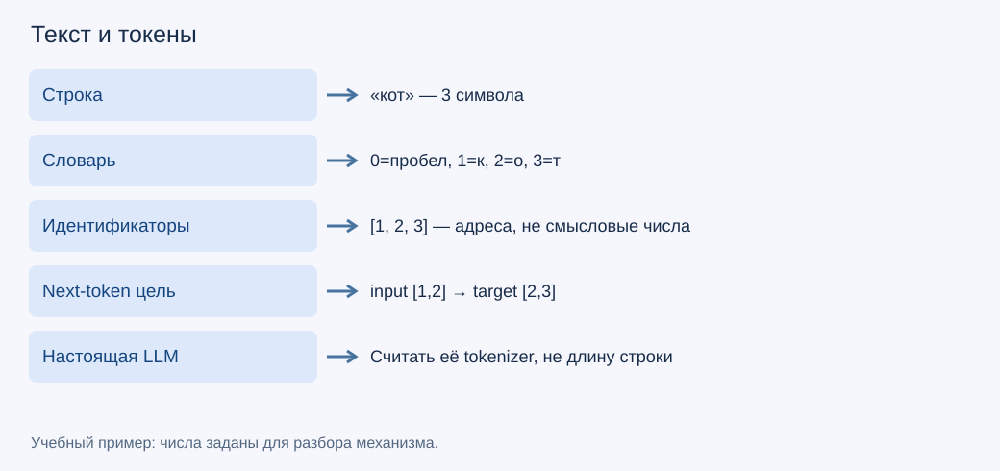

# M08-L01. Текст и токены

**Результат:** Объяснить, почему длина строки в символах не равна числу токенов.

**До урока:** M07-L03. Если термины из этих уроков не удаётся объяснить своими словами, вернись к их разобранным примерам. Ориентир времени — 120 минут чтения и практики; это первоначальная оценка, а не ограничение.

## Зачем и как это работает

Компьютер получает текст как последовательность чисел. Токенизатор задаёт правило преобразования строки в последовательность идентификаторов и обратного декодирования. Токен может соответствовать целому слову, части слова, пробелу, знаку препинания или последовательности байтов. Поэтому число токенов не равно числу слов или символов. Для LLM ограничение контекста и цена вычислений обычно выражаются именно в токенах конкретного токенизатора.

Самый простой учебный вариант — символьный словарь. Собираем уникальные символы обучающего корпуса, сортируем их и назначаем номера. Строка «кот» превращается, например, в [2,4,5]. Номера сами по себе ничего не означают: токен 5 не «больше по смыслу» токена 2. Они служат адресами строк таблицы embeddings. Если переставить словарь, не переставив соответствующие параметры модели, вычисление останется допустимым по формам, но значение текста разрушится.

У символьной токенизации небольшой словарь и длинные последовательности. У токенизации по словам последовательности короче, но огромный словарь и трудности с новыми словами. Subword-подходы ищут компромисс: частые фрагменты получают отдельные элементы, редкие слова разбиваются на несколько частей. В BPE исходные небольшие единицы последовательно объединяются по правилам, выученным на корпусе. Конкретные детали зависят от реализации: важно не переносить правила одного токенизатора на другой.

Русская строка может занимать больше токенов, чем английская фраза с похожим смыслом, если обучающий корпус и словарь модели лучше покрывают английский. Это эмпирический вопрос: посчитай конкретным tokenizer. Нельзя использовать универсальную формулу «один токен равен четырём символам» для строгого бюджета. Эвристика иногда удобна для грубой оценки, но контроль переполнения должен использовать реальные идентификаторы после оформления диалога.

Кроме обычных фрагментов существуют специальные токены: начало/конец последовательности, границы сообщений, padding и неизвестный элемент. EOS показывает возможное завершение; PAD выравнивает длины в батче и обычно исключается из loss или attention соответствующей маской. Если модель учится предсказывать padding как обычный текст, метрика может искусственно улучшиться на коротких примерах с большим количеством пустого заполнения.

Для next-token prediction вход и цель сдвинуты на одну позицию. Последовательность [a,b,c,d] даёт вход[a,b,c] и цель[b,c,d]. В каждой позиции модель предсказывает следующий токен, видя только допустимый префикс. Если в target случайно оставить исходный токен без сдвига, задача станет копированием текущего входа. Очень низкий loss тогда не означает умение продолжать текст.

Разделять корпус нужно до формирования перекрывающихся окон. Если сначала нарезать один документ на окна со сдвигом 1 и случайно поделить окна, train и test будут почти дубликатами. Для учебного корпуса используем разделение по целым строкам или документам и сохраняем их идентификаторы. Словарь символьной модели строим по train; неизвестный символ в validation обрабатываем явным UNK либо заранее определённым байтовым алфавитом.

Токенизация является частью версии модели. Сохраняй tokenizer вместе с весами, не меняй нормализацию текста незаметно и проверяй round-trip на контрольных строках. Обратное декодирование не всегда возвращает побитово исходный текст: некоторые токенизаторы нормализуют пробелы или Unicode. Такое поведение нужно измерить и описать, особенно когда позиции токенов связываются с источниками и выделением ошибок.



## Разобранный пример

Для учебного словаря sorted(set("кот ток")) получаем [пробел,к,о,т]. Строка «кот» кодируется[1,2,3], а «ток» —[3,2,1].

```python
chars = sorted(set('кот ток'))
stoi = {ch:i for i,ch in enumerate(chars)}
ids = [stoi[ch] for ch in 'кот']
assert ids == [1,2,3]
assert ''.join(chars[i] for i in ids) == 'кот'
x, target = ids[:-1], ids[1:]
assert x == [1,2] and target == [2,3]
```

Это настоящий, но примитивный токенизатор. Он не претендует на правила SmolLM; в M09 сравним с реальным subword tokenizer.

## Практика с поддержкой

Добавь строку «кит». Покажи, что символ и отсутствует в старом словаре. Выбери явную политику UNK и проверь, что она не меняет номера уже известных символов. Затем запиши, какую информацию теряет обратное декодирование неизвестного элемента.

## Самостоятельная работа M08-L01-A

Используй заданный словарь [PAD,a,b,c,EOS] с индексами 0…4. Закодируй «abca» с EOS, подготовь input/target для next-token prediction и дополни их до длины 6 с PAD. Укажи, какие позиции цели участвуют в loss. Объясни риск случайного разделения перекрывающихся окон одного документа.

Первая попытка — без готового решения. Сохрани свой код, объяснение и фактический результат в `submissions/M08-L01/`. AI может пояснять термин и помогать найти ошибку; запиши полученную помощь. Прочитанное решение не означает самостоятельно выполненное задание.

## Подсказки по очереди

1. EOS добавляется после последнего символа.
2. Input и target имеют одинаковую длину после сдвига.
3. Позиции padding не должны улучшать метрику за счёт пустоты.

## Ошибки и самопроверка

Ошибка: сравнивать длину в символах с лимитом токенов. Ошибка: менять словарь после обучения без переноса embeddings. Критерий: сдвиг, EOS и маска padding согласованы; разбиение корпуса выполняется до окон.

Работа готова, когда есть ответ на все условия задачи, вычисление или наблюдение подтверждает вывод, а ты можешь объяснить каждую величину и изменить один параметр без копирования решения. Критическую ошибку сначала исправь и повтори проверку; оформление не компенсирует неверное рассуждение. Сверь свою попытку с [решением M08-L01-A](../../solutions/modules/M08.md).

## Повтор и перенос

Вариант **M08-L01-B**. Используй словарь [PAD,a,b,c,EOS] с ID 0…4. Закодируй «cab» с EOS, затем создай сдвинутые input/target и дополни оба до длины 5. Укажи номера позиций target, которые входят в loss; нумерация с нуля.

Отложенный вариант **M08-L01-C**. Старый словарь тот же, новая строка «cad». Нужно сохранить все прежние ID и добавить UNK. Назначь ID нового токена, закодируй строку с EOS и декодируй. Можно ли восстановить именно букву d? Два окна одного исходного документа перекрываются на два токена: в каком порядке выполнять split и создание окон?

Сначала сохрани свою попытку и полученную помощь; затем открой [ключи B/C](../../solutions/modules/M08.md). После разбора B выполняй C без открытого решения. Статус «подтверждено позже» относится только к фактически выполненной отложенной проверке; до неё не отмечай освоение заранее.

## Источники и углубление

- [Attention Is All You Need, исходная статья](https://arxiv.org/abs/1706.03762)
- [Hugging Face: русский курс LLM](https://huggingface.co/learn/llm-course/ru/chapter1/1)

Текст, численные примеры, задания и схемы этого урока созданы для данного курса. Источники нужны для проверки терминов и изучения исходного метода; они не заменяют самостоятельную практику.
