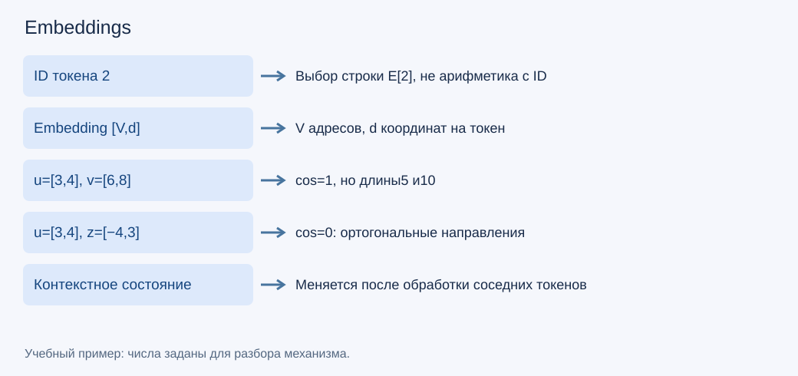

# M08-L02. Embeddings

**Результат:** Различить индекс токена, обучаемое представление и значение сходства.

**До урока:** M08-L01. Если термины из этих уроков не удаётся объяснить своими словами, вернись к их разобранным примерам. Ориентир времени — 120 минут чтения и практики; это первоначальная оценка, а не ограничение.

## Объяснение

Embedding — векторное представление дискретного объекта. Для токенов простейший механизм выглядит как таблица E формы[V,d], где V — размер словаря, d — размерность представления. Идентификатор токена выбирает строку E. Если ids имеет форму[B,T], результат embedding имеет форму[B,T,d]. В этом шаге ещё нет смешивания соседних слов: одинаковый ID выбирает одну и ту же строку независимо от контекста.

Таблица обучаема. В начале значения обычно случайные; в процессе оптимизации градиент меняет строки, которые участвовали в вычислении loss. Нельзя ожидать смысловой близости от случайной таблицы только потому, что она называется embedding. Свойства представления зависят от данных, цели обучения и последующих слоёв. Токеновые embeddings языковой модели обучались для предсказания продолжения, а поисковые sentence embeddings — для другой задачи; взаимозаменяемость не гарантируется.

Выбор строки можно представить умножением one-hot вектора на E. One-hot имеет длину V, одну единицу в позиции токена и нули в остальных. Для V в десятки тысяч явное хранение таких векторов расточительно, поэтому nn.Embedding выполняет индексирование напрямую. Математическое представление полезно для понимания, реализация — для эффективности. Индекс должен быть целочисленным и находиться в диапазоне 0…V−1.

Близость векторов часто измеряют косинусом: cos(u,v)=u·v/(||u||·||v||). Он сравнивает направление и не зависит от положительного масштаба одного вектора. Для нулевого вектора выражение не определено, поэтому нужна явная политика: исключить объект, назначить нулевой score или использовать стабилизатор с пониманием его эффекта. Скалярное произведение без нормировки дополнительно зависит от длин векторов. Выбор метрики должен соответствовать способу обучения представлений.

Статический token embedding отличается от контекстного состояния. В фразах «ключ от двери» и «ключ словаря» начальный токен может иметь одну строку таблицы, но после attention окружение изменит его представление. Контекстный вектор хранит результат вычислений для конкретной позиции. При этом близость таких векторов не является логическим доказательством одинакового значения или истинности утверждения.

Как получить один вектор документа из последовательности? Простой baseline — среднее токеновых векторов с исключением padding. Он теряет порядок и может смешивать важные и неважные слова. Более продвинутые модели специально обучают представления предложений и выбирают способ pooling. Для RAG важно проверять реальное ранжирование запросов, а не только красивую двумерную проекцию. Уменьшение размерности для картинки способно искажать расстояния.

Размер таблицы равен V·d параметров. При V=10000 и d=128 это 1,28 миллиона чисел, около 5,12MB в float32 без учёта градиентов. В больших словарях embedding занимает заметную часть памяти. Иногда выходная матрица языковой модели разделяет веса с входной таблицей, но это архитектурное решение, а не обязательное свойство всех моделей.

Для самостоятельной проверки проследи путь ID→строка→контекст→оценка следующего токена. У каждого шага разные формы и смысл. Такой разбор предотвращает частую путаницу: векторный поиск использует представления для сравнения документов, а обучение LLM изменяет параметры, которые формируют представления и предсказания.



## Разобранный пример

Пусть E=[[1,0],[0,1],[1,1]], ids=[2,0]. Lookup даёт[[1,1],[1,0]]. Косинус первого вектора с[1,0] равен 1/√2≈0,7071.

```python
import torch
e = torch.tensor([[1.,0.],[0.,1.],[1.,1.]])
ids = torch.tensor([2,0])
selected = e[ids]
assert selected.tolist() == [[1.,1.],[1.,0.]]
score = torch.nn.functional.cosine_similarity(e[2:3], e[0:1])
assert abs(score.item()-2**-.5)<1e-6
```

Косинус описывает эти заданные числа. Без обучающей задачи нельзя утверждать, что токен 2 действительно похож по смыслу на токен 0.

## Практика с поддержкой

**Предскажи до запуска.** Прежде чем запускать код или пересчитывать пример, запиши ожидаемый вывод: числа, формы массивов, порядок или текст. После запуска сравни с фактическим и объясни каждое расхождение.

Создай nn.Embedding(5,3), подай ids формы[2,4] и проверь выход[2,4,3]. Посчитай число параметров 15. Затем усредни только реальные позиции, используя маску padding, и сравни с ошибочным средним всех четырёх позиций.

## Самостоятельная задача A — M08-L02-A

Для u=[3,4], v=[6,8], z=[−4,3] посчитай нормы, скалярные произведения u·v, u·z и оба косинуса. Для V=8000,d=64 рассчитай число параметров и объём float32 в десятичных MB. Объясни, почему одинаковый косинус не означает одинаковые векторы.

Первая попытка — без готового решения. Сохрани свой код, объяснение и фактический результат в `submissions/M08-L02/`. AI может пояснять термин и помогать найти ошибку; запиши полученную помощь. Прочитанное решение не означает самостоятельно выполненное задание.

## Подсказки по очереди

1. Норма — квадратный корень суммы квадратов.
2. v=2u, поэтому направления совпадают.
3. MB здесь 1 000 000 байт, а не MiB.

## Критерии и типичные ошибки

Ошибка: трактовать ID как координату смысла. Ошибка: включать PAD в среднее документа. Критерий: все числа верны, значение cosine ограничено геометрией, а память имеет единицы.

Работа готова, когда есть ответ на все условия задачи, вычисление или наблюдение подтверждает вывод, а ты можешь объяснить каждую величину и изменить один параметр без копирования решения. Критическую ошибку сначала исправь и повтори проверку; оформление не компенсирует неверное рассуждение. Сверь свою попытку с [решением M08-L02-A](../../solutions/modules/M08.md).

## Новая и отложенная проверка

Вариант **M08-L02-B**. Даны u=[3,4], v=[−3,−4], z=[0,0]. Вычисли нормы и cosine(u,v). Для cosine(u,z) выбери явную политику и объясни, почему численный ноль не следует молча трактовать как «несвязанность».

Отложенный вариант **M08-L02-C**. Учебные token embeddings: «кошка»=[1,0], «собака»=[0,1], «не»=[0,0]. Sentence embedding — среднее векторов. Найди векторы и cosine для «кошка» и «не кошка». Объясни, почему совпадение направлений не доказывает совпадение смысла и что проверять перед поисковым применением.

Сначала сохрани свою попытку и полученную помощь; затем открой [ключи B/C](../../solutions/modules/M08.md). После разбора B выполняй C без открытого решения. Статус «подтверждено позже» относится только к фактически выполненной отложенной проверке; до неё не отмечай освоение заранее.

## Источники и углубление

- [Attention Is All You Need, исходная статья](https://arxiv.org/abs/1706.03762)
- [Hugging Face: русский курс LLM](https://huggingface.co/learn/llm-course/ru/chapter1/1)

Текст, численные примеры, задания и схемы этого урока созданы для данного курса. Источники нужны для проверки терминов и изучения исходного метода; они не заменяют самостоятельную практику.
