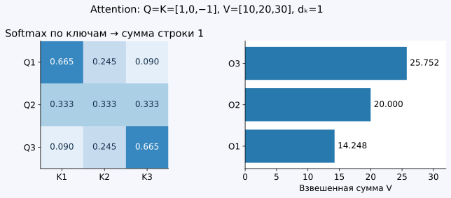
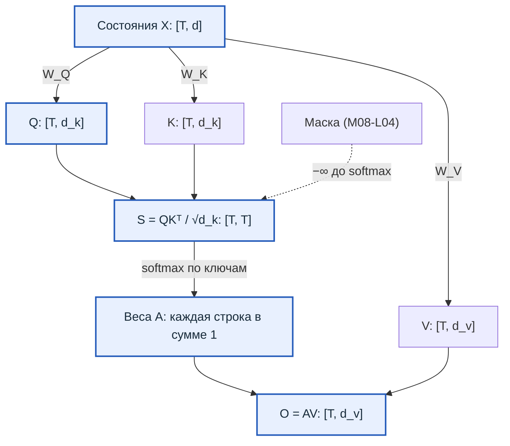

# M08-L03. Attention

**Результат:** Проверить формы Q, K, V и объяснить нормализацию весов.

**До урока:** M08-L02. Если термины из этих уроков не удаётся объяснить своими словами, вернись к их разобранным примерам. Ориентир времени — 140 минут чтения и практики; это первоначальная оценка, а не ограничение.

## Объяснение

Attention вычисляет для каждой позиции взвешенную смесь информации из доступных позиций. Механизм полезен потому, что важность соседей зависит от текущего запроса и контекста. В языке местоимение может обращаться к существительному далеко назад; фиксированного среднего всех слов недостаточно. При этом слово «внимание» — метафора вычислительного механизма, а не доказательство человеческого понимания.

### 1. Создаём запросы, ключи и значения

Из входных состояний X создаются три набора векторов:

`Q = XW_Q;  K = XW_K;  V = XW_V`

Query описывает, какую информацию позиция ищет; key участвует в сравнении; value — то, что будет смешиваться. Это полезная интерпретация, но смысл отдельных координат обычно не задан вручную. Матрицы проекций обучаются вместе с остальной моделью. В self-attention Q,K,V получаются из одной последовательности; в cross-attention источник запросов и источник ключей/значений различаются.

### 2. Сравниваем позиции

Для T позиций и размерности ключа d_k матрицы Q и K имеют форму[T,d_k]. Произведение QKᵀ даёт[T,T]: строка соответствует позиции-запросу, столбец — позиции-источнику. Каждая оценка делится на √d_k. Это уменьшает рост масштаба скалярных произведений при увеличении размерности и помогает избежать слишком насыщенного softmax при типичных предположениях о компонентах. Деление не является гарантией стабильности для любых данных.

`S = QKᵀ / √d_k`

### 3. Превращаем оценки в веса

Softmax применяется внутри каждой строки — по оси ключей:

`a_ij = exp(s_ij) / Σ_j exp(s_ij)`

Получаются неотрицательные веса с суммой 1 по доступным источникам. Для численной устойчивости перед exp вычитают максимум строки: результат не меняется, потому что общий множитель сокращается. Если нормировать не ту ось, библиотека может выдать матрицу нужной формы, но смысл attention будет нарушен.

### 4. Смешиваем значения

Выход O=AV имеет форму[T,d_v]. Каждая строка — взвешенная сумма value-векторов. Q и K определяют веса, V определяет содержимое результата. Даже если самый большой вес приходится на одну позицию, остальные обычно продолжают влиять. Attention не обязан выбирать ровно одно слово и не является таблицей доказательств причинности. Визуализация весов помогает проверить вычисление, но сама по себе не объясняет все причины итогового ответа сети.

`O = AV`

| Величина | Форма без batch | Что означает строка |
| --- | --- | --- |
| Q, K | [T, d_k] | Запрос или ключ одной позиции |
| V | [T, d_v] | Информация одной позиции |
| S, A | [T, T] | Сравнение query со всеми keys / веса смеси |
| O | [T, d_v] | Новое состояние позиции после смешивания |

### От одного attention к сети

Multi-head attention использует несколько таких преобразований, объединяет выходы и применяет выходную проекцию. Разные головы могут научиться разным отношениям, но обещание «одна голова всегда отвечает за грамматику» необоснованно без исследования конкретной модели. Transformer-блок также содержит residual-связи, нормализацию и feed-forward преобразование. Один attention ещё не является полной архитектурой Transformer.

Обычный плотный attention строит T×T оценки, поэтому число пар растёт квадратично с длиной последовательности. При удвоении T число пар увеличивается вчетверо. Оптимизированные реализации меняют память и исполнение, но не превращают эту учебную формулу в линейную. Позже при инференсе увидим KV-cache: он переиспользует прошлые ключи и значения, не отменяя необходимость учитывать доступный контекст.

На маленьких числах можно проверить весь механизм вручную: формы, scale, softmax, суммы строк и выход. Если эти свойства верны, переход к PyTorch становится переводом понятной математики, а не копированием непонятного блока.



## Аналогия: нечёткий поиск в key-value хранилище

Как похоже: KV-хранилище по точному ключу возвращает одну запись. Attention — мягкий поиск: запрос сравнивается со всеми ключами, оценки превращаются в доли, а ответ — смесь содержимого всех записей с этими долями. Это похоже на поисковую выдачу, где результаты не выбирают, а смешивают по релевантности.

| В уроке | В аналогии |
| --- | --- |
| Query | Поисковый запрос позиции |
| Key | Индексируемый ключ записи |
| Value | Содержимое записи |
| QKᵀ | Оценка релевантности запроса каждому ключу |
| Деление на √d_k | Нормировка оценок, чтобы доли не стали слишком острыми |
| Softmax по ключам | Доли одной выдачи: в сумме 1 |
| O = AV | Ответ — смесь содержимого, а не одна запись |

**Где аналогия ломается:** в хранилище ключи и значения — заданные поля, а в attention Q, K и V — обученные проекции одних и тех же состояний. Attention всегда смешивает все доступные значения. И веса не объясняют, почему модель ответила именно так.

## Разобранный пример

Упростим d_k=1, Q=[[1],[0],[−1]], K=[[1],[0],[−1]], V=[[10],[20],[30]]. Для первой строки scores=[1,0,−1], softmax≈[0,6652;0,2447;0,0900]. Выход≈14,2479. Вторая строка имеет равные веса 1/3 и выход 20.

```python
import torch
q = torch.tensor([[1.],[0.],[-1.]])
k = q.clone(); v = torch.tensor([[10.],[20.],[30.]])
a = torch.softmax(q @ k.T, dim=-1)
o = a @ v
assert torch.allclose(a.sum(-1), torch.ones(3))
print(o.flatten().round(decimals=4))  # [14.2479,20.0000,25.7521]
```

Позже causal mask изменит доступные столбцы каждой строки; здесь все позиции видят все источники.

## Схема



Один attention без batch. Выделен главный путь: из состояний получаются запросы, их сравнение с ключами даёт матрицу оценок [T, T], softmax по оси ключей превращает каждую строку в веса с суммой 1, а выход — смесь value-векторов с этими весами. Q и K определяют только веса, содержимое выхода приходит из V. Маска из следующего урока (пунктир) запрещает часть ключей до softmax.

## Практика с поддержкой

**Предскажи до запуска.** Прежде чем запускать код или пересчитывать пример, запиши ожидаемый вывод: числа, формы массивов, порядок или текст. После запуска сравни с фактическим и объясни каждое расхождение.

Измени только V на[[0],[10],[100]], сохрани Q и K. Убедись, что веса attention не изменились, а выход изменился. Затем измени Q и объясни, почему теперь изменились и веса, и выход.

## Самостоятельная задача A — M08-L03-A

Для одной query q=[1,0], ключей k₁=[1,0],k₂=[0,1] и значений v₁=[2,0],v₂=[0,4] вычисли scaled scores, softmax и итоговый вектор. Укажи формы при батче B=2,T=5,d_k=3,d_v=4. Что нарушится при softmax по оси query вместо оси key?

Первая попытка — без готового решения. Сохрани свой код, объяснение и фактический результат в `submissions/M08-L03/`. AI может пояснять термин и помогать найти ошибку; запиши полученную помощь. Прочитанное решение не означает самостоятельно выполненное задание.

## Подсказки по очереди

1. Scores равны[1/√2,0].
2. Вес первого ключа exp(1/√2)/(exp(1/√2)+1).
3. Каждая query должна распределять единичную массу по своим источникам.

## Критерии и типичные ошибки

Ошибка: забыть scale√d_k. Ошибка: считать attention weight объяснением истинности ответа. Критерий: веса суммируются в 1 по key, формы и взвешенная сумма вычислены правильно.

Работа готова, когда есть ответ на все условия задачи, вычисление или наблюдение подтверждает вывод, а ты можешь объяснить каждую величину и изменить один параметр без копирования решения. Критическую ошибку сначала исправь и повтори проверку; оформление не компенсирует неверное рассуждение. Сверь свою попытку с [решением M08-L03-A](../../solutions/modules/M08.md).

## Новая и отложенная проверка

Вариант **M08-L03-B**. Одна query q=[1,0], ключи k₁=[√2·ln(3),0], k₂=[0,0], values v₁=[2,0], v₂=[0,4], d_k=2. Масок и позиций нет. Вычисли scaled scores, веса и выход. Поменяй местами одновременно k₁↔k₂ и v₁↔v₂ и проверь результат.

Отложенный вариант **M08-L03-C**. Матрица уже масштабированных scores двух queries равна [[0,0],[ln(3),0]]. Найди softmax по каждой строке и ошибочный softmax по столбцам. Проверь суммы строк и назови ось, которая должна соответствовать распределению доступных ключей.

Сначала сохрани свою попытку и полученную помощь; затем открой [ключи B/C](../../solutions/modules/M08.md). После разбора B выполняй C без открытого решения. Статус «подтверждено позже» относится только к фактически выполненной отложенной проверке; до неё не отмечай освоение заранее.

## Источники и углубление

- [Attention Is All You Need, исходная статья](https://arxiv.org/abs/1706.03762)
- [Hugging Face: русский курс LLM](https://huggingface.co/learn/llm-course/ru/chapter1/1)

Текст, численные примеры, задания и схемы этого урока созданы для данного курса. Источники нужны для проверки терминов и изучения исходного метода; они не заменяют самостоятельную практику.
