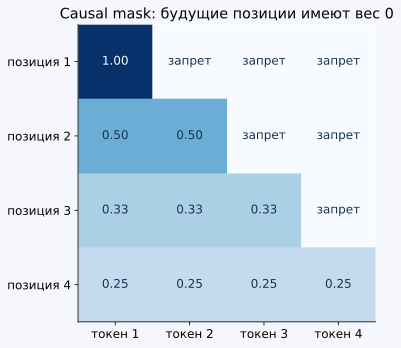

# M08-L04. Позиции и causal mask

**Результат:** На новом примере показать, какую утечку создаёт доступ к будущему токену.

**До урока:** M08-L03. Если термины из этих уроков не удаётся объяснить своими словами, вернись к их разобранным примерам. Ориентир времени — 120 минут чтения и практики; это первоначальная оценка, а не ограничение.

## Объяснение

Self-attention без позиционной информации не знает, какая позиция была первой. Если одинаково переставить входные токены, соответствующие выходы переставятся вместе с ними. Для многих языковых задач порядок важен: «сервер вызвал клиент» и «клиент вызвал сервер» содержат те же слова, но описывают разные отношения. Поэтому модель должна получать информацию о позициях или относительных смещениях.

Простейшее учебное решение — обучаемая таблица P[T_max,d], строка которой добавляется к token embedding: h_t=E[token_t]+P[t]. Теперь одинаковый токен на двух позициях получает разные начальные состояния. Размерность совпадает, поэтому сумма определена. Модель ограничена позициями, для которых таблица существует; использование позиции за T_max требует явного решения, а не молчаливого обрезания. Синусоидальные позиции и rotary-представления устроены иначе, но решают связанную задачу передачи порядка.

Causal mask запрещает позиции смотреть на будущие токены. В матрице scores[T,T] строка i может использовать столбцы j≤i. Элементы j>i заменяются на−∞ до softmax, после чего их веса становятся 0. Диагональ разрешена: текущий входной токен известен, модель предсказывает следующий. Если убрать и диагональ, первая строка окажется полностью замаскирована, что может дать NaN и другую задачу.

Почему маска нужна при обучении, если все токены уже лежат в памяти? Цель в позиции i — следующий токен. Если attention видит позицию i+1, в её входном embedding уже содержится правильный ответ. Модель получает информацию, которой не будет при реальной генерации. Это утечка через архитектуру, а не через разбиение набора. Очень низкий train loss в таком режиме не доказывает способность продолжать текст.

Маска padding решает другую задачу: исключает искусственное заполнение коротких последовательностей в батче. Causal mask кодирует время, padding mask — отсутствие данных. Их можно объединять, но нельзя подменять одну другой. При разной длине объектов следи, чтобы у каждой реально оцениваемой позиции оставался хотя бы один разрешённый источник. Полностью запрещённая строка требует специальной обработки.

Проверка причинности проводится без знания весов. Создай две последовательности с одинаковым префиксом и разным последним токеном. В eval-режиме при выключенном Dropout ранние выходы causal-модели должны совпасть в пределах численного допуска. Последний выход может измениться. Для немаскированного attention ранние позиции обычно изменятся, потому что будущее доступно. Такой тест проверяет смысл поведения, а не наличие строки masked_fill в коде.

На генерации каждый новый токен добавляется к префиксу. Полный пересчёт всех состояний прост, но дорог; KV-cache сохраняет ключи и значения прошлых позиций. Позиционные индексы должны продолжаться, а не начинаться с нуля на каждом новом токене. Иначе кеш и новый запрос описывают разные позиции. В учебной мини-модели пока используем полный пересчёт, чтобы не прятать причинную структуру.

Causal language model и двунаправленная модель решают разные задачи. Для классификации готового текста доступ ко всем словам может быть допустим. Для предсказания следующего слова нужен запрет будущего. Выбор маски определяется информацией, доступной в момент реального применения, а не тем, какой вариант даёт меньше loss на учебном массиве.



## Аналогия: журнал событий и бэктест

Как похоже: без номера события журнал превращается в множество — порядок теряется. Обработчик события с номером i может читать только события до него. Модель, видящая будущий токен, похожа на бэктест торговой стратегии, который подглядывает в завтрашние цены: результат отличный, но в реальной работе таких данных не будет.

| В уроке | В аналогии |
| --- | --- |
| Позиционная информация | Номер события: без него журнал — это множество |
| Causal mask | Обработчик события i видит только события с номером ≤ i |
| −∞ до softmax, а не 0 | Фильтр WHERE seq ≤ i, а не обнуление значения будущей записи |
| Утечка будущего токена | Бэктест, подглядывающий в завтрашние цены |
| Padding mask | Пустые слоты пачки: заполнение, а не события |
| Продолжение позиций при генерации | Offset продолжается, а не начинается с нуля |
| Тест с одинаковым префиксом | Замена будущих событий не меняет ранние результаты |

**Где аналогия ломается:** номер события — точное целое число, а модель получает позицию как обученный вектор или вращение, и таблица позиций ограничена T_max. Обработчик событий — детерминированный код, а attention смешивает разрешённые позиции с обученными весами.

## Разобранный пример

Для T=3 разрешённая матрица имеет строки[1,0,0],[1,1,0],[1,1,1]. Если все разрешённые scores равны 0, веса после softmax будут[1,0,0],[0,5;0,5;0],[1/3;1/3;1/3].

```python
import torch
t = 3
blocked = torch.triu(torch.ones(t,t,dtype=torch.bool), diagonal=1)
scores = torch.zeros(t,t).masked_fill(blocked, float('-inf'))
a = scores.softmax(-1)
assert a[0].tolist() == [1.,0.,0.]
assert a[1].tolist() == [.5,.5,0.]
```

В разных API boolean True может означать «разрешено» или «запрещено». Здесь True явно передаётся masked_fill как запрещённая позиция; не переноси соглашение вслепую.

## Практика с поддержкой

**Предскажи до запуска.** Прежде чем запускать код или пересчитывать пример, запиши ожидаемый вывод: числа, формы массивов, порядок или текст. После запуска сравни с фактическим и объясни каждое расхождение.

На attention из L03 добавь указанную маску. Измени V последней позиции с 30 на 300. Сравни первые два выхода до и после: они должны остаться прежними. Запиши последнее значение отдельно.

## Самостоятельная задача A — M08-L04-A

Для четырёх позиций с нулевыми scores и V=[2,4,8,16] вычисли causal-выходы. Затем замени последнее значение на 160 и объясни, какие выходы изменятся. Напиши assert, обнаруживающий доступ к будущему, и объясни отличие causal mask от padding mask.

Первая попытка — без готового решения. Сохрани свой код, объяснение и фактический результат в `submissions/M08-L04/`. AI может пояснять термин и помогать найти ошибку; запиши полученную помощь. Прочитанное решение не означает самостоятельно выполненное задание.

## Подсказки по очереди

1. При равных scores выход — среднее доступного префикса.
2. Четвёртое значение недоступно строкам 0,1,2.
3. Тест сравнивает выходы на двух входах, а не текст кода.

## Критерии и типичные ошибки

Ошибка: обнулить scores будущего вместо−∞ — exp(0)=1, доступ сохраняется. Ошибка: случайно разрешить верхний треугольник. Критерий: изменение будущего не меняет ранние выходы.

Работа готова, когда есть ответ на все условия задачи, вычисление или наблюдение подтверждает вывод, а ты можешь объяснить каждую величину и изменить один параметр без копирования решения. Критическую ошибку сначала исправь и повтори проверку; оформление не компенсирует неверное рассуждение. Сверь свою попытку с [решением M08-L04-A](../../solutions/modules/M08.md).

## Новая и отложенная проверка

Вариант **M08-L04-B**. Четыре позиции входа [A,B,EOS,PAD], valid_keys=[1,1,1,0]. Для causal attention выпиши 4×4 матрицу допустимых ключей (1 разрешён, 0 запрещён). Цели next-token после сдвига равны [B,EOS,PAD,PAD]: какие позиции участвуют в loss? Почему выход PAD-query можно вычислить, но не оценивать?

Отложенный вариант **M08-L04-C**. Два запуска одного блока с одинаковыми случайными весами и в eval: входы [A,B,C,D] и [A,B,X,Y]. Позиции и маски одинаковы, token-local LayerNorm/MLP, causal attention включён. Какие выходные позиции обязаны совпасть до численного допуска? Что доказывает нарушение и почему проверка должна работать до обучения?

Сначала сохрани свою попытку и полученную помощь; затем открой [ключи B/C](../../solutions/modules/M08.md). После разбора B выполняй C без открытого решения. Статус «подтверждено позже» относится только к фактически выполненной отложенной проверке; до неё не отмечай освоение заранее.

## Карточка урока

| Поле | Содержание |
| --- | --- |
| Правило | h_t = E[token_t] + P[t]; causal mask: позиция i видит ключи j ≤ i; запрещённые scores заменяют на −∞ до softmax |
| Смысл величин | Без позиций перестановка токенов только переставляет выходы; causal mask кодирует время, padding mask — отсутствие данных; диагональ разрешена |
| Когда применять | Для языковой модели, предсказывающей следующий токен. Пример: равные scores и V = [3, 6, 9] дают causal-выходы [3, 4.5, 6]; замена 9 на 90 меняет только третий выход — на 33 |
| Главная ошибка | Обнулять scores будущего вместо −∞ (exp(0) = 1, доступ остаётся) или подменять causal mask маской padding |

## Источники и углубление

- [Attention Is All You Need, исходная статья](https://arxiv.org/abs/1706.03762)
- [Hugging Face: русский курс LLM](https://huggingface.co/learn/llm-course/ru/chapter1/1)
- [PyTorch: scaled_dot_product_attention](https://docs.pytorch.org/docs/2.15/generated/torch.nn.functional.scaled_dot_product_attention.html) — параметры attn_mask и is_causal; здесь True в булевой маске означает «участвует в attention», противоположно masked_fill из урока (на английском)
- [Su et al.: RoFormer](https://arxiv.org/abs/2104.09864) — rotary-позиции: относительное смещение через вращение векторов (на английском)

Текст, численные примеры, задания и схемы этого урока созданы для данного курса. Источники нужны для проверки терминов и изучения исходного метода; они не заменяют самостоятельную практику.
