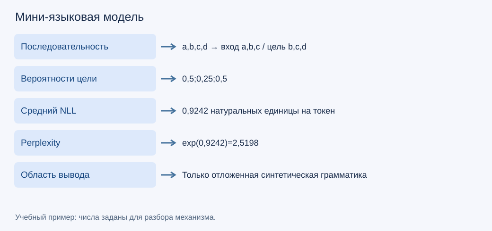

# M08-L05. Мини-языковая модель

**Результат:** Объяснить выбор цели, разделение корпуса и ограничения сгенерированного текста.

**До урока:** M08-L04. Если термины из этих уроков не удаётся объяснить своими словами, вернись к их разобранным примерам. Ориентир времени — 120 минут чтения и практики; это первоначальная оценка, а не ограничение.

## Зачем и как это работает

Языковая модель задаёт распределение вероятностей следующего токена по предыдущим. Вероятность последовательности можно разложить в произведение условных вероятностей: P(x₁…x_T)=Π_t P(x_t|x_<t). На практике минимизируют средний отрицательный логарифм этих вероятностей, чтобы заменить произведение суммой и получить удобную функцию потерь. Это objective обучения, а не непосредственная оценка полезности диалога.

Для каждого положения модель выдаёт V logits. Cross-entropy сравнивает их с одним правильным ID следующего токена. Если модель даёт правильному токену вероятность0,5, вклад в loss равен−ln0,5≈0,693. При вероятности0,1 вклад≈2,303: уверенность в неверных вариантах наказывается сильнее. Средний loss зависит от токенизатора и корпуса; нельзя честно сравнивать два значения на разных способах разбиения текста без уточнения единиц.

Perplexity вычисляется как exp(средний loss), если loss использует натуральный логарифм. Её можно понимать как эффективное число равновероятных вариантов в ограниченной математической аналогии. Для равномерного выбора изV токенов loss=lnV, perplexity=V. Это не число ошибок и не процент корректности. Низкая perplexity на простом повторяющемся корпусе не доказывает способность отвечать на новые технические вопросы.

Наш маленький Transformer использует token embedding, обучаемые позиции, один causal attention-блок, residual-связи, LayerNorm, feed-forward слой и выходную проекцию на словарь. Размерность16 и короткие строки позволяют обучаться на CPU. Архитектура настоящая, но данные синтетические и масштаб очень мал: это учебная языковая модель, а не качественный интервьюер. У неё нет достаточного опыта для общих знаний, русского диалога или надёжного рассуждения.

Корпус строится из коротких предложений с цветом, животным и глаголом. Целые комбинации откладываются до формирования окон. Поэтому проверка измеряет перенос на новые сочетания знакомых элементов внутри искусственной грамматики. Она не измеряет перенос на естественный язык. Такой узкий вывод полезен: мы знаем, какую закономерность модель может выучить и где заканчиваются данные.

Baseline — распределение частот токенов train, не использующее контекст. Оно должно рассчитываться только на обучающей части и сглаживаться для допустимых редких токенов. Если Transformer уменьшает validation loss относительно baseline, это свидетельствует о пользе контекста в данном эксперименте. Нельзя выбрать лучший seed по validation бесконечно и затем назвать тот же набор независимым подтверждением.

Генерация начинается с префикса, получает logits последней позиции, выбирает следующий ID и повторяет процесс. Greedy выбирает максимум; sampling делает случайный выбор по распределению. Даже при хорошем teacher-forced loss свободная генерация может уйти в незнакомую последовательность: теперь вход содержит собственные прошлые ошибки модели. Поэтому в отчёте нужны и численная оценка на фиксированных последовательностях, и примеры свободного продолжения.

Проверки лабораторной отделяют механику от результата: формы совпадают, будущие токены не влияют на прошлые, loss снижается, checkpoint читается. Затем анализируются validation loss и генерации. Все эти уровни нужны вместе. Красивое предложение без корректного split не доказывает обучение, а правильный causal mask сам по себе не гарантирует качественного текста.



## Разобранный пример

Для трёх правильных токенов модель назначила вероятности[0,5;0,25;0,5]. Средний NLL=−(ln0,5+ln0,25+ln0,5)/3≈0,9242. Perplexity≈2,5198.

```python
import math
probabilities = [.5,.25,.5]
nll = -sum(math.log(p) for p in probabilities)/len(probabilities)
assert abs(nll-.9241962407)<1e-9
print(round(math.exp(nll),4))  # 2.5198
```

Средняя вероятность правильного токена0,4167 не равна exp(−NLL)≈0,3969, поскольку усреднение логарифмов соответствует геометрическому среднему.

## Практика с поддержкой

Запусти M08/demo.py. Найди генерацию корпуса, split по строкам, маску и сдвиг targets. Сравни начальный и финальный validation loss с unigram baseline. Прочитай отчёт: вывод должен ограничиваться синтетической грамматикой.

## Самостоятельная работа M08-L05-A

Для правильных вероятностей[0,8;0,2] посчитай NLL и perplexity. Для равномерного словаря из4токенов посчитай baseline. Предложи два теста, отличающие реальное предсказание следующего токена от копирования текущего, и объясни, почему хорошее продолжение одной фразы не заменяет validation.

Первая попытка — без готового решения. Сохрани свой код, объяснение и фактический результат в `submissions/M08-L05/`. AI может пояснять термин и помогать найти ошибку; запиши полученную помощь. Прочитанное решение не означает самостоятельно выполненное задание.

## Подсказки по очереди

1. Используй натуральный логарифм.
2. Perplexity=exp(NLL), а не1−loss.
3. Сдвиг targets и запрет будущего проверяются независимо.

## Ошибки и самопроверка

Ошибка: назвать toy-корпус доказательством готовности LLM для HR. Ошибка: обучать и проверять перекрывающиеся окна одного документа. Критерий: числа верны, scope вывода ограничен корпусом, тесты проверяют информационные ограничения.

Работа готова, когда есть ответ на все условия задачи, вычисление или наблюдение подтверждает вывод, а ты можешь объяснить каждую величину и изменить один параметр без копирования решения. Критическую ошибку сначала исправь и повтори проверку; оформление не компенсирует неверное рассуждение. Сверь свою попытку с [решением M08-L05-A](../../solutions/modules/M08.md).

## Повтор и перенос

Повтор: сравни вероятности[0,9;0,1] с[0,5;0,5] при одинаковом среднем0,5. Через неделю объясни разницу teacher forcing и свободной генерации на примере накопления ошибок.

После проверки сохрани статус «самостоятельно» либо «с поддержкой», конкретную ошибку и дату следующей попытки. Через 7–10 дней повтори изменённый пример без открытого решения; только эта проверка позволяет отметить «подтверждено позже». Если результата пока нет, оставь «не проверено».

## Источники и углубление

- [Attention Is All You Need, исходная статья](https://arxiv.org/abs/1706.03762)
- [Hugging Face: русский курс LLM](https://huggingface.co/learn/llm-course/ru/chapter1/1)

Текст, численные примеры, задания и схемы этого урока созданы для данного курса. Источники нужны для проверки терминов и изучения исходного метода; они не заменяют самостоятельную практику.
